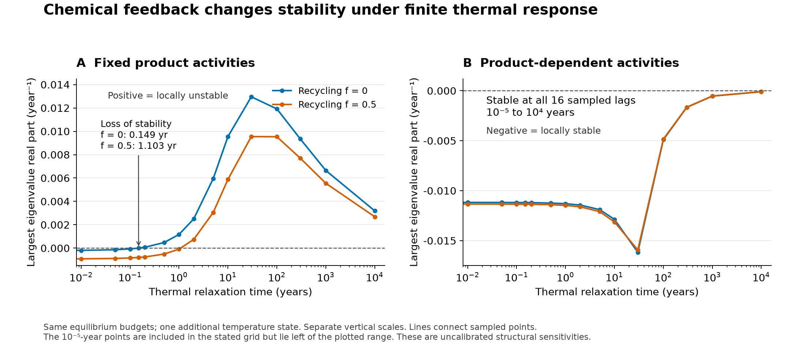

# Independent scientific and numerical review of haze-world

## Review record

- **Reviewer:** GPT-6 Astra Pro, OpenAI. This is the model/version identity supplied by the review environment; a more specific build identifier was not exposed. Three parallel component reviews assisted the lead reviewer, who checked and integrated their findings. These are internal review passes within this review, not the separate cross-developer review mentioned in the brief.
- **Date:** 11 November 2026, Australia/Hobart.
- **Snapshot:** tag `haze-world-review-1`, commit **`729402325eab870e9b829e7db45231d89c83eca5`**, [Terra Prisca snapshot](https://github.com/BWBrook/terra_prisca/tree/729402325eab870e9b829e7db45231d89c83eca5). The annotated tag object resolves to this commit.
- **Time:** Approximately 20 minutes of elapsed wall time, including parallel literature, physiology, evolution and numerical checks. The complete test suite took 329.25 seconds.
- **Independence:** I read the brief, vision, synthesis and model evidence before forming the assessment. I did not read `docs/correspondence/`. Subsequent inspection of the authors’ audit scripts was used to check evidence and reproducibility. No tracked repository files were changed; no issue, comment, PR or push was made.
- **Environments:** the full test suite and numerical-failure qualification used the tagged `uv` environment: Python 3.12.14, NumPy 2.5.4 and SciPy 1.18.1, matching `uv.lock`. Initial physiology and supply diagnostics used the primary runtime with NumPy 2.3.5 / SciPy 1.17.0, then were repeated in the locked environment before packaging. The independent evolution, demographic and log-coordinate thermal checks also used the locked environment; independence refers to equations or algorithms, not to a different software stack. The portable scripts can be rerun in the tagged environment. The scientific figure uses Matplotlib.
- **What I ran:** the full `uv run pytest -q` suite; the claims checker; four short synthesis auditors with outputs redirected outside the checkout; a fresh 30-year prefix of C07; independent branching-probability calculations; new physiological and evolutionary counterexamples; six-state thermal-response Jacobians, an independent log-coordinate implementation, and three 1,000-year small-perturbation controls; compact supply-buffering calculations. Scripts, numerical outputs, DOI metadata and logs accompany this report.
- **What I did not reproduce:** the full long-run experiment archive, the missing approximately 2 GB of raw trajectories, the underlying Atmos climate model, or a fresh digitization of every source figure. Some results could be recounted from committed summaries but not independently regenerated from their raw records. This distinction is maintained below.

Repository paths and line numbers refer to this exact snapshot. `checks/`, `logs/` and `literature/` refer to this review package. **Verified** means I executed or independently recomputed the stated check; **reasoned** means an argument from inspected materials; **suspected** means an unresolved possibility. Verification of a numerical counterfactual does not make its parameters an empirical Archean calibration.

## Verdict

**There is a worthwhile theoretical paper here, but I would not yet treat the present synthesis as a settled, publication-ready account of a stable microbial climate thermostat.** Much of the conditional equilibrium, branching and evolutionary mathematics reproduces. The strongest contribution is the separation between a regulating community’s existence and its ability to survive the path toward that state. However, two inexpensive structural changes expose consequential restrictions: finite temperature adjustment destabilizes the weakly damped fixed-product reference, and guild-specific evolutionary constraint strengths can reverse the competitive feedback inside the supported climate range. The existing product-feedback variant supplies a constructive counterexample to the first failure: it remains stable in my lag checks and retains substantial supply buffering, although exact temperature pinning disappears. A small joint robustness programme could therefore strengthen the paper considerably. Before writing the main results, repair the demonstrated domain-exit defect, address the three failing tests, compare explicitly with close resource-competition regulation literature, and distinguish the demonstrated deterministic finite-census refuge recovery from conditional stochastic survival and first-window dormancy estimates. A small coupled demographic experiment could extend that last contribution. These changes are focused; they do not require rebuilding a complete Archean Earth-system model.

## Findings, most consequential first

| ID | Severity | Type | Claims | Finding | Basis | Remedy and approximate cost |
|---|---|---|---|---|---|---|
| **R1** | major | missing analysis | C06, C20, C29, C34; downstream relevance to C09/C17 | Stability of the fixed-product thermostat depends strongly on instantaneous temperature adjustment. The product-feedback variant changes both damping and exact set-point pinning, so chemistry and thermal response need a joint test. | **Verified:** independent six-state Jacobians, three stencil sizes, separate log-coordinate implementation, nonlinear small kicks, and product-feedback controls; §1.1. | Add a finite thermal-response state and a small chemistry × lag comparison, then recompute representative stability and invasion outcomes. Small implementation; days of focused analysis, not a new climate model. |
| **R2** | major | missing analysis | C29–C36, especially C30/C34 | A single common Arrhenius parameter restricts the evolutionary search to the diagonal of a two-guild parameter space. Allowing different values already represented in the study’s grid reverses feedback and yields feasible unstable communities. | **Verified:** independent optimization from the raw uptake table, both interpolations, full stock balances and three-stencil spectra; §1.2. | Add a small `E_A × E_M` map and disclose the shared-parameter restriction. Cheap static calculations; no new long evolutionary trajectories required. |
| **R3** | major | scope or overclaim | C05, C06, C12–C13; interpretation of C29–C37 | The set point is a joint physiological break-even condition. Shared turnover and one transferred physiology do not establish turnover as its uniquely determining biological control. | **Verified:** unequal-loss crossing diagnostics and full equilibrium counterexamples from capacity changes; §1.3. | Carry a compact structural physiology ensemble into the coupled model. Separate guild losses and normalization uncertainty first; hours to days. |
| **R4** | major | correctness | C08 directly; possible effects on later domain/minimum diagnostics | Near-linear dense polynomials can cause false early physiological-domain exits. Two existing tests fail because an invalid polynomial root is accepted. The effect on specific archived runs remains unestablished. | **Verified:** original tests, polynomial residual diagnosis and temporary in-process control; §1.4. | Use interval-scaled, residual-checked roots and boundary backchecks. Requalify affected domain-censored cases and selected minima, rather than rerunning the entire archive blindly. |
| **R5** | major | novelty | general; C05–C06 | Two-species, one-resource competition producing environmental regulation has a particularly close precedent in Seto & Akagi (2007). The paper’s distinctive contribution must be developed beyond the existence of that feedback. | **Reasoned:** inspected primary publisher abstract/introduction and verified registered DOI metadata; §3. | Engage the close precedent and make dynamical realization and demographic accessibility central. Mainly conceptual/editorial work. |
| **R6** | major | reproducibility | C07–C11, C21–C23 and general | A clean clone cannot execute two principal ledger auditors to completion because raw files or receipts are absent. The availability of hashes and compact summaries does not make those complete replays executable. | **Verified:** precursor/core auditors pass; communities/turnover auditors stop at missing inputs; §6. | Publish a versioned archive or a minimal decision-relevant raw subset, and separate compact checks from archive-dependent replays. Small packaging work if the files remain available. |
| **R7** | minor | correctness | general; original single-guild full-ODE diagnostic | The old three-stock integrator can return all NaNs despite a successful solver status. This is confined to the precursor routine; successful controls support the underlying recovery result. | **Verified:** third failing test, accepted-state inspection, bounded-step LSODA and Radau controls; §1.4. | Reject nonfinite outputs and handle unsafe log-coordinate trials. The existing test is sufficient to demonstrate the failure; a small repair and targeted verification should suffice. |
| **R8** | minor | scope or overclaim | C10, C16–C18 | The numerical demographic thresholds depend on the birth–death split as well as net growth and count scale. Balanced extra birth/death doubles the approximately 230-cell threshold without changing the deterministic trajectory. | **Verified:** independent branching solver and same-net-growth sensitivity; §1.5. | Add one compact demographic sensitivity panel; foreground the conditional survival relationship rather than a special cell count or percentage. |
| **R9** | minor | framing | C19, C21–C22, C28 | Harmful dormancy is strongly driven by the chosen entry cue, which can move cells into a state with worse mortality. Comparing cubic and linear ramps tests smoothness, but retains that cue. | **Reasoned** from the switching equations; quantitative brackets independently recounted; §1.6. | Add a biologically motivated alternative cue or treat this as a supplementary mechanism check. Do not make subcell minima the main biological contrast. |
| **R10** | minor | documentation | C02–C03, C08, C29–C37; general | Some entry-point wording is broader or older than the current estimands: the brief overgeneralizes failure under evolution, E11 calls the two-guild evolutionary question untested, and historical specifications can be mistaken for current guidance. | **Reasoned:** direct text comparison; §6. | Correct active summaries, retain prediction history, and mark superseded specifications clearly. Small editorial work. |
| **R11** | suggestion | missing analysis | C07, C09, C17, C24 | C09 already demonstrates joint deterministic finite-census refuge recovery. Joint **stochastic** recovery/persistence remains untested, and the dormancy estimates do not generally establish a common eventual endpoint. Separate conditional first-window probabilities cannot determine the coupled stochastic outcome. | **Reasoned**, supported by independent verification of the conditional branching calculation; §§1.5 and 2. | Retain the existing distinctions, or add a small hybrid stochastic experiment around decisive invasion cases if pursuing the stronger probabilistic claim. Moderate work; a valuable extension after R1/R2, not a prerequisite for the current conditional result. |

## 1. Is the science right?

### 1.1 The most consequential new result: thermal response and chemistry interact

The five-stock reference model uses `T = T_Arney(r)` algebraically. Its documentation acknowledges that there is no heat-capacity state (`models/haze_world/population-coupling.md`, Equations and interpretation; `population_coupling.py:114–165`). The very small damping in C20 makes this omission consequential even when thermal adjustment is much faster than the 10,000-year methane lifetime.

I retained all five stock equations, all physiological parameters, the source climate curve, the donor supply and the methane loss law, and added only

\[
\frac{dT}{dt}=\frac{T_{\mathrm{Arney}}(r)-T}{\tau_T}.
\]

The biological fluxes now use the evolving temperature. Every original equilibrium remains an equilibrium of this six-state model. This is a minimal structural sensitivity, locally interpretable as a one-box thermal relaxation. It is not a calibrated transient model of Archean oceans, haze or atmospheric chemistry.

**The fixed-product reference loses local stability at remarkably short thermal lags.**

| Fixed-product scenario | Equilibrium temperature | Original leading mode, yr⁻¹ | First detected stability crossing in `τ_T` |
|---|---:|---|---:|
| `f = 0` | 281.5348 K | `−0.000206019 ± 0.05254894 i` | **0.149214 years**, approximately 54.5 days |
| `f = 0.5` | 281.5348 K | `−0.000926010 ± 0.04094346 i` | **1.102760 years** |

At `f=0`, `τ_T=1 year`, the leading real part is **+0.00116849 yr⁻¹**. At `f=0.5`, `τ_T=2 years`, it is **+0.000745890 yr⁻¹**. These results are stable across three finite-difference scales. A separately assembled log-coordinate Jacobian reproduces both critical times. Three short nonlinear Radau integrations agree with the corresponding predicted decay/growth rates: approximately `−0.00006795`, `+0.00116849` and `+0.00074589 yr⁻¹`. They are small-perturbation checks, not explorations of eventual nonlinear attractors.

The mechanism is understandable without relying solely on eigenvalue output. A weakly damped feedback mode with period `P` and damping time `t_damp` can lose stability under a lag of order

\[
\tau_{\mathrm{crit}}\approx\frac{P^2}{2\pi^2t_{\mathrm{damp}}}.
\]

In a simple two-pole reduction this follows from the Routh–Hurwitz condition after inserting a first-order lag. C20’s period and damping give approximately **0.14922 years**, close to the full six-state result. This is an explanatory approximation, not a theorem for all variants of haze-world. The relevant comparison is with the oscillatory feedback’s phase and weak damping; comparing thermal adjustment only with the methane residence time is insufficient.

Arney et al. supply converged climate–photochemical states, not a transient thermal response [L01]. Finite thermal reservoirs are standard in energy-balance dynamics [L02]. Modern fitted response times must not be adopted as Archean measurements, but they make a zero-lag assumption something to test rather than accept from the methane lifetime alone.

**The existing product-dependent chemistry variant substantially changes this result.** I repeated the same calculation with `activity_feedback="products"`:

| Product-feedback scenario | Equilibrium temperature | Original dominant eigenvalue | Thermal-lag result |
|---|---:|---:|---|
| `f = 0` | 281.5691 K | `−0.0111718 yr⁻¹`, real | Locally stable at all 16 tested lags from `10⁻⁵` to `10⁴` years |
| `f = 0.5` | 281.2848 K | `−0.0113360 yr⁻¹`, real | Locally stable at all 16 tested lags from `10⁻⁵` to `10⁴` years |

This finite grid is not proof of stability for every intervening lag or every supply/turnover setting. It nevertheless shows that the first counterexample does **not** invalidate every version of the model. It also shows that the weakly damped 120-year oscillator is not a generic property of the chemically extended thermostat.

The chemically extended version retains substantial regulation, although exact pinning is lost. At `f=0.5`, changing donor potential from 0.24 to 0.44 moves the sampled stable mixed temperature from **282.060 to 280.803 K**, a **1.257 K** range. Near potential 0.3, its local temperature response is about **14.16%** of the matched product-feedback methanogen-only response, or approximately **86% attenuation**. The derivative used increments of ±0.0001; a larger step crosses a nearby interpolation corner in the control. This is a local donor-supply response, not a luminosity response.

This comparison may be one of the paper’s most useful results: product chemistry sacrifices exact pinning while preserving strong buffering and adding damping. Establish the interaction before making the oscillator, stable set point or subsequent invasion path a principal general result. Product feedback still holds CO₂ and pH fixed, so it remains a conditional chemical model.



*Figure 1. Reference donor supply and turnover, with two recycling fractions. Positive leading real parts indicate local instability; negative values indicate local stability. The panels use different vertical scales. Connecting lines guide the eye through sampled lags and do not certify all intervening values. Numerical results and plotting code accompany the report.*

**Evidence:** `checks/thermal_relaxation.py`, `thermal_relaxation_results.json`, `thermal_lag_independent.py/.json`, `thermal_kicks.py`, `thermal_kicks_results.json`, and `check_supply_buffering.py` / `supply_buffering.json`.

### 1.2 The evolutionary feedback can reverse when the guilds have different constraint strengths

The competitive-evolution implementation has one scalar `Traits.energy_ev`, applied to both guilds (`evolved_kinetics.py:22–28,74–76`). This is an additional restriction beyond the acknowledged fixed maintenance, yields and thresholds. Six values of a common `E` examine a diagonal through a two-parameter space.

I allowed separate `E_A` and `E_M`, with the same functional law, measured trait interval and reference turnover. The strongest counterexample uses **`E_A=0.65 eV` and `E_M=0.10 eV`**, values already individually present in the authors’ grid.

| Interpolation | Joint best-response crossing | `d(R*_A − R*_M)/dT` | Largest ecological eigenvalue, `f=0` | Largest ecological eigenvalue, `f=0.5` |
|---|---:|---:|---:|---:|
| Linear measured shapes | **284.7153 K** | **−0.58158 Pa/K** | **+0.034225 yr⁻¹** | **+0.025230 yr⁻¹** |
| Smooth log-PCHIP shapes | **285.3875 K** | **−0.50049 Pa/K** | **+0.033050 yr⁻¹** | **+0.024038 yr⁻¹** |

These are positive-stock communities on the **extracted haze-cooling branch**, at the original donor supply. They do not rely on the bridge, plateau, cold continuation or an infeasible crossing. Methanogens are favored on the cold side and acetogens on the warm side; the competitive response therefore reinforces the climate displacement. Full five-stock Jacobians confirm instability.

The confirming calculation read the raw Table 2 uptake arrays, implemented the separate-energy law and interpolations independently, searched 26,001 trait positions per guild, refined the optima continuously, solved resource/methane balances, and used three Jacobian stencil sizes. The equal-`E=0` control reproduces **277.960221 K**, the positive reference slope and stable spectra. A second unequal-energy example also reverses the sign.

C30 remains true **within its searched common-E family**. It should not be replaced by a declaration that the original computation was wrong. The new result establishes that an uncalibrated equality controls the apparent resistance to feedback inversion. The remedy is a small two-axis map and representative full-community checks, followed by a correspondingly precise evolutionary claim.

There is a second biological limitation: varying assay temperature within a strain does not measure a genetic covariance among alternative genotypes. Turning the measured V–K relationship into a heritable one-dimensional family is a constructed hypothesis. E13 already acknowledges much of this; preserve that candor. Minimizing R* correctly identifies an uninvadable endpoint here: at its resident break-even pressure, no other trait has positive growth. The local smooth/node stability treatments are also useful. Neither makes the chosen genetic constraint empirical.

**Evidence:** `checks/verify_unequal_energy.py/.json`; optional exploratory scan `independent_trait_axes.py/.json`. Source definitions: `evolved_kinetics.py`; `competitive_evolution.py:202–208,278–291`.

### 1.3 Physiology, turnover and chemical reference conditions

For the saturating uptake model,

\[
Q_i=m_i+L_i/Y_i,\qquad
R_i^*=p_i^*+\frac{K_iQ_i}{s_i-Q_i}.
\]

Positive coexistence requires equality of the guilds’ break-even resource pressures. Under fixed product activities this equality can select temperature independently of donor supply, while allocation between guilds changes. This is a real mechanism, but the condition contains thresholds, maintenance, yield, affinity, capacity **and guild-specific loss**. A shared-L sweep isolates one direction through that parameter space.

The reference hybrid combines the A. woodii growth scale with other strains’ temperature/uptake shapes and assumed methanogen growth parameters. The source pages disclose this. The problem is that much of the extensive downstream evidence is conditional on that one combination.

Holding acetogen loss at `0.001 h⁻¹`, changing only methanogen loss gives:

| Methanogen loss | Detected R* crossing |
|---:|---:|
| `0.00050 h⁻¹` | None in the searched 273–303.15 K interval |
| `0.00075 h⁻¹` | **278.3746 K** |
| `0.00100 h⁻¹` | **281.5348 K** |
| `0.00125 h⁻¹` | **285.1583 K** |
| `0.00200 h⁻¹` | **294.3144 K** |

These are crossing diagnostics, not new full stability results with unequal losses. In separate **full equilibrium** checks, halving the reference methanogen capacity ratio from 0.74 to 0.37 moves the crossings above the extracted case-B climate maximum and leaves a stable acetogen-only state at **294.4025 K**. Doubling it to 1.48 yields a stable methanogen-only state on the imposed **274.002 K** plateau. The smaller capacity is close to the alternative normalization already discussed upstream in the project. Thus a broader coupled physiology check is a concrete uncertainty test, not an arbitrary demand for endless parameter sweeps.

The phrase “turnover sets the temperature under fixed physiology” is acceptable. The stronger “turnover, not physiology/tolerance, determines the temperature” is not. The synthesis is more careful on this point than the brief.

The below-4°C continuation is particularly important for the methanogen-only control and invasion paths. It is not what directly creates the 281.5 K reference crossing, which lies inside the measured temperature interval. The demonstrated 8.02-to-4.73 K change in the matched control contrast should remain prominent; quoting the larger contrast alone would give a misleading impression of quantitative robustness.

A further named diagnostic aligns assay and climate CO₂. The source assay uses approximately 12 kPa CO₂, whereas case B uses 1.8 kPa. Holding products and pH fixed, the reaction quotients imply threshold multipliers of **2.582** for acetogens and **1.607** for methanogens. Applying these gives a stable mixed state at **279.921 K**, or **279.754 K** with product feedback. This retains a locally stable mixed state. It demonstrates why the chemical reference attached to an assumed cessation threshold must be explicit. Because the baseline thresholds are already assumed rather than fully recovered measurements, this is not a proven transcription or coding error.

**Remedy:** use a structured envelope of plausible model alternatives, without assigning pseudo-probabilities to grid counts. Start with separate losses, the documented capacity normalization, chemical activities and a few yield/maintenance alternatives. Advance only representative cases to expensive transient runs. Matched cold-strain experiments would improve historical applicability, but are not a prerequisite for publishing a clearly theoretical mechanism.

**Evidence:** `checks/check_crossings.py` / `crossings.json`; `check_equilibrium_variants.py` / `counterfactual_equilibria.json`. Source evidence: `models/haze_world/two-guilds.md:66–102,121–149`; `evidence/hydrogen-competition.md`; [L03–L06].

### 1.4 Two established numerical defects

#### False domain exits

The full test run produced **840 passes and 3 failures**. Two failures establish incorrect exit times:

| Existing test module and case | Expected exit | Returned exit |
|---|---:|---:|
| `test_habitat_integration.py`, nonmonotone climate path | **9.639484 yr** | **4.447911 yr** |
| `test_refuge_integration.py`, exit followed by re-entry | **10.394359 yr** | **4.447911 yr** |

The accepted dense methane polynomial contains an approximately `−5.34×10⁻¹⁸` quadratic coefficient beside order-0.1 constant and linear terms. The generic polynomial-root calculation loses the meaningful bounded root and returns a spurious zero. That alleged root has residual about **0.0886**, far from zero. `_real_roots` checks the imaginary part and interval but not the residual; `_exit_time` then returns the beginning of a step whose midpoint is already beyond the true crossing. The returned state remains within the supported physiological interval.

Locations: `habitat_integration.py:226–228,244–257` and `refuge_integration.py:193–195,244–257`. A temporary in-process trim of the negligible leading coefficient makes both original tests pass. That identifies the cause; a production implementation needs interval-aware scaling, residual validation and actual crossing backchecks, not an unconditional coefficient threshold copied from this diagnostic.

The helper is also used by dense-minimum routines and several dormancy integrators. This creates a **risk requiring targeted requalification**. I have not established that any particular archived C08 censoring decision or reported bottleneck minimum is wrong. Preserve that distinction. Prioritize domain-censored records and numerical extrema used in headline probabilities, rather than automatically repeating all long experiments.

#### Successful solver status with nonfinite precursor output

`methane_budget.integrate_full`, lines 190–224, can overflow while exponentiating a log-biomass trial and subsequently return `[NaN, NaN, NaN]` despite `sol.success=True`. It checks status but not finiteness. The existing long-cold-interval recovery test fails for this reason.

Keeping the same equations, LSODA with maximum step 100 years and an independent Radau solve both recover methane ratio **0.1957001713** with positive biomass **1.95156×10⁻⁵**. The defect therefore does not refute recovery. It is confined to the old three-stock routine, whose current call sites are tests and the original reduction diagnostic. Do not infer that the later population, refuge or dormancy integrators share this particular overflow.

**Evidence:** `logs/pytest_full.log`, `logs/pytest_failures_targeted.log`, and `checks/diagnose_domain.py/.json`, `domain_trim_control.py/.json`, `diagnose_precursor.py/.json`. The targeted three-test rerun failed identically in 1.30 seconds. Dependencies match the lock; this is not an unexplained result from arbitrary upgrades.

### 1.5 Finite populations and branching: sound conditional mathematics, incomplete joint inference

The conversion of biomass to global cell counts is explicit, as are deterministic census removals and continuous mean immigration. Those are named model variants, not a simulation of individual cells arriving or dying. The distinction is scientifically necessary and generally respected in the latest synthesis.

I independently solved the backward branching equations for the committed pilot environment using ordinary single-cell survival probabilities and DOP853, rather than the project’s logarithmic LSODA route. Initial log-survival values agreed within **1.72×10⁻⁸**. The pilot survival probability was **0.000264539**, and the corresponding bottleneck count for half survival was **230.4475 cells**. Migration orientation, the branching term and the stated probability interpretation held up in this check.

I also freshly recomputed C07’s first 30 years from the committed initial row. This short check does not require the absent 100,000-year raw archive. It reproduces the methanogen removal at year 20 and the near-unchanged climate. The full endpoint and all other histories were not regenerated.

There is an identifiability issue behind the numerical survival thresholds. Adding the same rate `κ` to births and deaths preserves every deterministic `b−d` and the recorded environmental trajectory, but changes demographic variance and survival:

| Additional balanced birth and death, `κ` | Bottleneck cells for half survival |
|---:|---:|
| `0 yr⁻¹` | **230.45** |
| `0.8766 yr⁻¹` | **253.49** |
| `8.766 yr⁻¹` | **460.89** |
| `87.66 yr⁻¹` | **2534.92** |

These are structural sensitivities, not proposed biological calibrations. They establish that a deterministic growth law does not uniquely identify a cell-count threshold. The numerical value “230” should be a worked example of an integrated demographic hazard, not a general biological constant.

For the probabilistic interpretation, the larger remaining issue is environmental conditioning. C09 already demonstrates joint recovery in its 12 key deterministic finite-census refuge runs; that result should be credited separately. In a stochastic calculation, if one guild disappears, the trajectory generating the other guild’s future rates can change. Two marginal first-window probabilities therefore cannot be multiplied into a joint recovery probability. E4, E9 and E12 already state this accurately. My recommendation is to make a small **coupled** stochastic calculation the next extension if the intended contribution includes probabilities of actual regulator recovery. A hybrid approach can retain deterministic large populations and simulate rare populations while feeding their disappearance and regrowth back into chemistry and temperature. It need not simulate every individual in a planetary population.

Select a few decisive cases around the conditional threshold, both invasion directions, and one well-protected control. Report probabilities of each absorbing outcome or mixed recovery over a declared horizon, with Monte Carlo uncertainty and a numerical threshold check. This would turn the most interesting part of the paper from a qualified possibility into stronger evidence.

**Evidence:** `checks/demographic_sensitivity.py/.json`, `c07_prefix.py/.json`; repository `branching.py`, `bottleneck-test.md` and E4/E9/E12. The pilot calculation checks a recorded environment; it is not a coupled stochastic validation.

### 1.6 Dormancy, refuges and the meaning of memory

The half-life arithmetic and compact evidence selection reproduce. For the fast-switching, no-refuge reference, the committed first-window brackets are:

| Displaced guild | `f=0` | `f=0.5` |
|---|---:|---:|
| Methanogens | **11.30–13.18 yr** | **31.64–32.27 yr** |
| Acetogens | **158.14–171.90 yr** | **87.86–96.43 yr** |

All eight selected compact rows record closed rare windows without another-guild loss flag and with temperatures in the extracted Arney domain during the scored window. This is verification of selection and arithmetic, not reconstruction of the missing original flows.

The isolated-bank approximation is more informative than its particular percentage. From `N_end=N_0 exp(−ε L τ)` and a target `N_50`,

\[
\frac{t_{1/2}}{\tau}=\frac{\ln 2}{\ln(N_0/N_{50})}.
\]

The reported **1.275%** corresponds to an assumed population ratio about **4.0×10²³**. Ratios of `10⁶` and `10⁸` give about **5.02%** and **3.76%** under the same approximation. E5 already disclaims universality; retain that qualification and plot the dimensionless relationship instead of promoting “one per cent” as the discovery. Entry timing, waking and the changing environment remain part of the full problem.

The harmful-dormancy result follows a particularly restrictive cue. Entry is triggered by negative active net growth, even where the dormant death rate exceeds the active net decline. The model can consequently move cells into a less favorable state. This is mathematically coherent, but without an independently motivated cue it is not a surprising empirical result about dormancy. A comparison of linear and cubic ramps retains the same decision boundary. A mortality-aware or energy-state cue would address the biological assumption more directly, while itself remaining an explicitly named hypothesis.

The contrast between expected minima of `10⁻⁵⁹·⁵` and `10⁻¹⁴·²⁵` cells is useful for diagnosing the equations but weak as a biological headline: both already imply negligible survival under the stated count interpretation. The synthesis acknowledges this. Keep the unresolved recurrent paths and switching-law diagnostics in the supplement unless their eventual fate changes a main result.

Buffered refuges demonstrate a mechanism under imposed heat baths. They do not establish plausible Archean areas, heat budgets or migration pathways. Likewise, an established mixed equilibrium can persist without extra memory. The strongest claim concerns stores that bridge an unfavorable **displacement interval**, not a universal need for memory or geological proof that such refuges operated. Seed-bank preservation itself is established prior knowledge [L15–L17].

### 1.7 Units, budgets and climate boundaries

I found no established unit or redox-accounting error in the inspected five-stock core. Hours-to-years conversion, Henry storage, the four-H₂ product factor, local-volume-to-column conversion, biomass export and acetate export are explicitly represented. The conservation checks and reference equilibria are consistent with an **open** resource/redox model. That is useful verification, but does not make the model a closed global carbon cycle or validate its external sinks.

The interpretation should foreground four boundaries already documented in the repository:

1. **Methane routing.** The competitive climate contrast needs different net methane delivery from the two routes. Acetate recovery is supplied by an external downstream process even when the modeled hydrogenotrophic methanogen is absent. `1−f` is an external sink/export fraction, not a measured Archean burial efficiency. Retain a near-complete-recovery control to show when the mechanism weakens.
2. **Surface ratio versus column inventory.** Arney’s response is indexed by a surface CH₄/CO₂ ratio, while methane is not vertically uniform in that source [L01]. The present inventory mapping is an approximation. A matched source–abundance/column relation would improve physical interpretation more than adding another decimal to a plotted temperature.
3. **Low and high methane closures.** The 283 K methane-free bridge does not directly manufacture the reference cooling-branch equilibrium, but it can determine an invasion’s path, suppression duration and memory demand. The flat high-methane continuation directly determines several 274.002 K pure endpoints. The source also considers ice feedback separately; a fixed-albedo trajectory near freezing is not a snowball calculation.
4. **Loss and derivatives.** A 10,000-year linear methane lifetime is a scenario closure. The source extraction does not deliver the matched net-loss derivative at the operating ratio. The project correctly separates its lower-ratio shallow-loss evidence from a matched hazy calibration. Any new stability/robustness analysis should retain that distinction [L01, L19–L20].

A calibrated Archean claim would require considerably more evidence. A strong theoretical paper can instead identify which sign, gain, time-scale and persistence conditions matter, with these assumptions shown explicitly.

## 2. Do the claims follow from the evidence?

**Most final ledger rows are defensible at their carefully narrowed model scope.** The claims checker reports 37 claims, 32 supported, four refuted and one superseded, with zero errors and zero warnings. That is evidence of consistent bookkeeping, not proof of scientific robustness.

The most informative checks were these:

| Claim group | Review outcome |
|---|---|
| C01–C04, single-guild precursor | The precursor synthesis auditor passes. The unconstrained fixed-peak evolutionary result follows correctly from the optimum tracking temperature; constrained exceptions remain essential. The separate old full-ODE recovery implementation has the numerical failure described in R7. |
| C05–C06, reference switch and mixed equilibrium | The reference equilibrium and stability reproduce under the stated fixed-product, quasi-static formulation. New physiology and finite-thermal-response checks expose its conditional nature. |
| C07, exclusion before climatic recovery | The fresh short prefix reproduces removal at year 20. This supports the focal chronology; it does not reproduce every endpoint or make the census rule stochastic. |
| C08–C11, refuge outcomes and bottlenecks | Compact summaries remain inspectable; the pilot branching calculation reproduces independently. Domain-exit numerics require repair and selected requalification. Missing raw records block the complete communities auditor. |
| C12–C15, turnover and coexistence | The interpretation as branch-dependent fixed-physiology results is appropriate. Shared loss is not an exhaustive sensitivity analysis, and coexistence, methane forcing and bulk regulation must remain separate. |
| C16–C18, survival and seed-bank relationships | Independent probability integration and half-life arithmetic support the conditional calculations. The percentage depends on the assumed population ratio and recovery threshold. |
| C19–C24, harmful dormancy and recurrent paths | The cautious finite-record language is appropriate. No established limit cycle, repeated-cycle persistence result or general harmful-dormancy conclusion follows. C20’s weak damping is especially vulnerable to the climate/chemistry closure. |
| C29–C37, kinetic evolution | The equal-E control and main mathematical structure reproduce. The newly tested unequal-E case changes the sign and ecological stability, while remaining inside the extracted climate domain. C30 must retain the common-E qualifier. |

The evidence also contains an **underdeveloped positive result**: chemical feedback can stabilize the lagged system while maintaining strong, imperfect buffering. It deserves more attention than several narrow dormancy-control variants. Another useful result is that the same algebraic coexistence temperature can correspond to different dynamic and demographic outcomes. These distinctions have broader explanatory value than a catalogue of parameter-specific endpoints.

## 3. Novelty and significance

The comparative argument should begin with the closest mechanisms, not with an assertion that Gaia, R* competition or seed banks have been overlooked by previous work.

**Seto & Akagi (2007) is a particularly close precedent.** Their two-species model explicitly combines competition for one resource, temperature alteration, coexistence and environmental regulation [L07]. I found no engagement with it in the inspected current scientific framing. Its publisher abstract and introduction are sufficient to establish substantial conceptual overlap; a full equation-level comparison should precede any claim that competition-generated temperature regulation is new.

Classic Daisyworld supplies the broad homeostasis precedent [L08]. Its adaptive variants already debate how unconstrained adaptation can weaken regulation and how constraints or spatial structure can preserve it [L09–L11]. The single-guild precursor is a useful reconstruction of that issue in a different budget, rather than a new general resolution.

Resource-competition theory supplies break-even resource ordering, and temperature-dependent competition has a direct literature of its own [L12–L13]. The equality of R* values does not violate competitive exclusion: temperature is an endogenous environmental variable, so the fixed-environment exclusion argument is being embedded in a larger feedback system.

Sauterey et al. already combine microbial populations, energy acquisition, maintenance/anabolism, metabolic evolution and planetary climate/geochemistry [L14]. The groundwork correctly cites that paper; it should become a central comparator. Its CO-based acetogens differ from the present H₂ competitors, which helps define the distinction. Nicholson et al. show why donor limitation can make methane production relatively insensitive to biomass details [L18]; haze-world needs to explain how **routing between metabolisms** changes that conclusion.

Microbial dormancy and ecological memory are likewise established [L15–L17]. The opportunity is their interaction with a community that changes the environment needed for its own coexistence. Maull et al.’s microbial Daisyworld is also useful context, provided it is correctly described as a theoretical synthetic-consortium proposal, not experimental confirmation [L21].

The defensible contribution is therefore a conditional theory of **when a competition-generated climate regulator can actually be realized**: the feedback needs the right orientation, adequate dynamic stability and retention of its participants through displacement. The methane–haze example gives this theory concrete biogeochemical structure. Its significance would increase with the small structural and demographic checks above; adding more variants without resolving those conditions would not help much.

## 4. The strongest objection, and the most valuable next analysis

A skeptical expert could reasonably say:

> The resource-competition regulation mechanism has close precedents. Why should this particular stable thermostat and its recovery thresholds survive a physically finite climate response, chemical activity feedback and realistic differences between the guilds?

This objection combines novelty with the model’s untested structural restrictions; it cannot be answered by a larger count of passing algebraic tests.

**The single assumption most likely to overturn the claimed stable oscillator is instantaneous temperature adjustment in the fixed-product core.** There is now a direct counterexample preserving the entire equilibrium budget. For historical applicability, the joint transferred physiology is an equally serious limitation, but it is a different question.

**The highest-value immediate analysis is a joint thermal-response × product-chemistry comparison.** The current code already contains most of the needed pieces, and this review provides a minimal implementation. Use a small set of thermal lags, both reference recycling fractions, and a few supply/turnover settings. Report equilibrium existence, leading eigenvalues, supply-response gain and representative post-invasion outcomes separately. The aim is to determine which regulator survives, not to force the original oscillator to survive.

The separate-`E` map is a second inexpensive prerequisite for the evolutionary interpretation. Once the deterministic operating model is selected, a bounded coupled stochastic recovery experiment would strengthen the distinctive memory result. A matched photochemical source–ratio/column curve is the most useful additional physical source, but it should not become an excuse to postpone the cheap falsification tests already within reach.

## 5. The story: one paper, organized by scientific conditions

**I recommend one integrated paper.** The current programme contains many stages, but most are successive qualifications of a common question. Splitting the fixed-physiology thermostat, memory and restricted evolution into separate papers would risk making each contribution less convincing and more incremental.

The central question should be something like: **Under what conditions can competing microbial metabolisms produce climate buffering that a finite community can sustain?** This accommodates both positive and negative results. It also gives a clear role to the new finding that a chemically extended regulator can remain effective while losing exact pinning.

Four distinctions can organize the argument:

| Scientific question | Evidence required |
|---|---|
| Does a mixed state exist? | R* equality plus positive resource/product/biomass balances on a supported climate branch |
| Does it regulate the chosen forcing? | Matched supply-response gain and the sign of environmental feedback |
| Is it dynamically stable? | Full spectra and targeted trajectories with finite response times and chemical feedback |
| Can a finite community reach or recover it? | Invasion trajectories, memory mechanisms and appropriately coupled demographic outcomes |

Evolution then tests whether the relevant physiological conditions persist within a declared trait family. It does not need to be presented as a separate contest between Darwinism and Gaia.

### Main text

I would prioritize five connected figure questions, with final layout left to Barry’s writing process:

1. **Mechanism and prior-art distinction:** the climate branch, competing R* functions and methane-routing difference, with assumptions visibly separated from source anchors.
2. **Robustness of existence and regulation:** a compact physiological/evolutionary map, including unequal losses and unequal constraint strengths, with representative failures as well as successes.
3. **Dynamic realization:** finite thermal response crossed with fixed/product-dependent chemistry; distinguish exact pinning from strong approximate buffering.
4. **Failure during invasion:** one clear trajectory from each direction showing population loss and slow environmental change, with the finite-population convention explicit.
5. **Memory and recovery:** the dimensionless reserve relationship and a small joint-outcome comparison for refuge/dormancy controls, if the proposed coupled demographic check is completed.

The current turnover map can be integrated into the second figure. A standalone seven-part chronicle of the development stages would burden the reader with the construction history.

### Supplement and research record

Place the single-guild precursor, exhaustive grids, calibration/transfer tables, detailed branching derivations, most switching-law comparisons, unresolved recurrence diagnostics, individual audit histories and superseded predictions in the supplement or linked repository. Keep the history intact; it is valuable provenance. Do not require a scientific reader to traverse it to discover which model and claim are current.

The paper should be explicitly **Archean-inspired theoretical ecology/biogeochemistry** unless stronger physical constraints are added. Donor-supply buffering at fixed solar forcing is a legitimate result. It does not establish resilience to solar evolution, the Great Oxidation Event or four billion years of habitability. A luminosity sweep would require matched climate responses and is not an essential extension for this paper’s bounded question.

## 6. Reproducibility and the research record

### What a newcomer can do now

The tagged clone installs with `uv`; the compact evidence is extensive; the central equations and assumptions can be inspected. The claims ledger is useful because it links statements, parameters, evidence and qualifications. Retaining refuted and superseded claims is informative. I would keep it.

However, three levels of reproducibility need distinct commands:

| Level | Review result |
|---|---|
| Check syntax/provenance of the ledger | **Pass:** 37 claims, zero errors/warnings |
| Recompute short algebra and recount committed compact evidence | **Partial:** precursor and core synthesis auditors complete |
| Replay every ledger auditor from the complete raw evidence | **Blocked:** communities and turnover auditors require absent local files/receipts |

The communities audit stops at `local/haze/finite_populations/final_raw/main_0024_t100000-ce9c0899cdf042d0.json.gz`. The turnover audit stops at `local/haze/dormancy_nonspatial_cycle_precision/dormancy0024-bbfe1cad901c9f85.receipt.json`. Those dependencies were disclosed in the brief; this is an availability gap, not an accusation that they were hidden. Nevertheless, the ledger’s reproduce column should tell a newcomer which path is executable from Git alone.

The committed C07 export is useful. It enabled a fresh short-prefix check even though the original long raw file is absent. Apply that principle to a small set of decisive trajectories: preserve event timing, active/dormant stocks, environment and solver status at sufficient resolution for the claims being made. A hash identifies an available object; it cannot replace access to it.

Before submission, provide a versioned archive or a documented minimal raw subset with a stable download location, size and checksum. Expose a quick clean-clone review command that never silently starts long producers, and a separate full-reproduction command with its data and compute requirements. Redirect regenerated outputs to an explicit directory; several auditors currently overwrite their committed JSON when successful.

### Tests and numerical maintenance

The full suite’s result is **840 passed / 3 failed**, not an all-green 843-test validation. The failures are already useful tests; fix the numerical defects rather than relaxing assertions or multiplying near-duplicate tests. Add only the robust polynomial-root checks required to cover the newly identified failure mode, and a finiteness guard exercised by the existing precursor case. Once those pass, targeted requalification should follow the affected dependency paths.

There are numerous successive dormancy integrators and numerical qualification variants. They are understandable as a research trail, but the paper needs one clearly designated production route. Preserve experiments in the record while giving newcomers a short map of the current solver, retired variants and which claims each can reproduce. Shared domain-root logic should have one maintained implementation.

### Documentation corrections

- E11 still says whether selection erases a two-guild set point is “untested”; E13 and C29–C37 now answer a restricted version of that question.
- The brief’s statement that the single-guild thermostat does not survive evolution needs the **unconstrained fixed-peak** qualifier. C03 already provides exceptions.
- The entry README’s broad climate-tracking-refuge limitation should inherit C08’s specified lower-recycling geometry; higher-recycling counterexamples must remain visible.
- Keep the competitive-evolution specification as a historical prediction record, but mark its superseded thermodynamic-anchor interpretation and direct readers to current E13/C36.
- Use sensible physical precision in narrative. Exact decimals belong in evidence files and regression checks; line-extraction precision is not empirical climate precision.

## 7. Literature to engage, with DOI verification

**Every DOI listed below was checked against registered Crossref work metadata during this review.** The saved records include registered titles, authors and dates. This verifies identity, not every scientific claim in the paper. “Primary text” below indicates the consulted article/abstract; source-data discussions also draw on the repository’s explicitly documented extractions. No paper is quoted at length.

| ID | Work and role | DOI | Verification / access scope |
|---|---|---|---|
| L01 | Arney et al. (2016), *The Pale Orange Dot: The Spectrum and Habitability of Hazy Archean Earth*. Climate source; equilibrium versus transient interpretation. | [10.1089/ast.2015.1422](https://doi.org/10.1089/ast.2015.1422) | **Verified**; primary full text inspected, particularly model coupling and atmospheric-profile assumptions. |
| L02 | Geoffroy et al. (2013), *Transient Climate Response in a Two-Layer Energy-Balance Model. Part I: Analytical Solution and Parameter Calibration Using CMIP5 AOGCM Experiments*. Thermal storage and transient response. | [10.1175/JCLI-D-12-00195.1](https://doi.org/10.1175/JCLI-D-12-00195.1) | **Verified**; indexed publisher text/abstract. Modern model calibration, not an Archean timescale estimate. |
| L03 | Kotsyurbenko et al. (2001), *Competition between homoacetogenic bacteria and methanogenic archaea for hydrogen at low temperature*. Central strain/uptake evidence. | [10.1111/j.1574-6941.2001.tb00893.x](https://doi.org/10.1111/j.1574-6941.2001.tb00893.x) | **Verified**; primary source information and the committed extraction/provenance inspected. |
| L04 | Peters, Janssen & Conrad (1998), *Efficiency of hydrogen utilization during unitrophic and mixotrophic growth of Acetobacterium woodii on hydrogen and lactate in the chemostat*. Growth-scale anchor. | [10.1111/j.1574-6941.1998.tb00516.x](https://doi.org/10.1111/j.1574-6941.1998.tb00516.x) | **Verified** on a successful later registry query; numerical use assessed through the project’s benchmark/extraction, not an independent remeasurement. |
| L05 | Tijhuis, van Loosdrecht & Heijnen (1993), *A thermodynamically based correlation for maintenance Gibbs energy requirements in aerobic and anaerobic chemotrophic growth*. Maintenance transfer. | [10.1002/bit.260420415](https://doi.org/10.1002/bit.260420415) | **Verified**; source/provenance review. Pooled maintenance requirements do not calibrate guild-specific demographic losses. |
| L06 | Muñoz & Philips (2023), *No acetogen is equal: Strongly different H₂ thresholds reflect diverse bioenergetics in acetogenic bacteria*. Threshold heterogeneity. | [10.1111/1462-2920.16429](https://doi.org/10.1111/1462-2920.16429) | **Verified**; relevant source comparison; does not calibrate this Archean community. |
| L07 | Seto & Akagi (2007), *Coexistence introducing regulation of environmental conditions*. Closest identified one-resource regulation precedent. | [10.1016/j.jtbi.2007.05.013](https://doi.org/10.1016/j.jtbi.2007.05.013) | **Verified**; primary publisher abstract and introduction. Full equation-level comparison remains recommended. |
| L08 | Watson & Lovelock (1983), *Biological homeostasis of the global environment: the parable of Daisyworld*. Foundational regulation model. | [10.1111/j.1600-0889.1983.tb00031.x](https://doi.org/10.1111/j.1600-0889.1983.tb00031.x) | **Verified**; publisher abstract and project reconstruction context. |
| L09 | Robertson & Robinson (1998), *Darwinian Daisyworld*. Adaptation challenge. | [10.1006/jtbi.1998.0799](https://doi.org/10.1006/jtbi.1998.0799) | **Verified**; publisher/PubMed abstract. |
| L10 | Lenton & Lovelock (2000), *Daisyworld is Darwinian: Constraints on Adaptation are Important for Planetary Self-Regulation*. Constraint-dependent response. | [10.1006/jtbi.2000.2105](https://doi.org/10.1006/jtbi.2000.2105) | **Verified**; publisher abstract. |
| L11 | Sugimoto (2002), *Darwinian Evolution Does Not Rule Out the Gaia Hypothesis*. Spatial/evolutionary qualification. | [10.1006/jtbi.2002.3091](https://doi.org/10.1006/jtbi.2002.3091) | **Verified**; publisher abstract. |
| L12 | Tilman (1977), *Resource Competition between Plankton Algae: An Experimental and Theoretical Approach*. Resource-competition foundation. | [10.2307/1935608](https://doi.org/10.2307/1935608) | **Verified**; publisher abstract. |
| L13 | Tilman, Mattson & Langer (1981), *Competition and nutrient kinetics along a temperature gradient: An experimental test of a mechanistic approach to niche theory*. Temperature-dependent competitive ordering. | [10.4319/lo.1981.26.6.1020](https://doi.org/10.4319/lo.1981.26.6.1020) | **Verified**; primary publisher source. |
| L14 | Sauterey et al. (2020), *Co-evolution of primitive methane-cycling ecosystems and early Earth’s atmosphere and climate*. Principal ecosystem–planet comparison. | [10.1038/s41467-020-16374-7](https://doi.org/10.1038/s41467-020-16374-7) | **Verified**; open primary full text. Already cited in the groundwork; make the comparison substantive. |
| L15 | Lennon & Jones (2011), *Microbial seed banks: the ecological and evolutionary implications of dormancy*. Seed-bank background. | [10.1038/nrmicro2504](https://doi.org/10.1038/nrmicro2504) | **Verified**; primary review/abstract context. |
| L16 | Jones & Lennon (2010), *Dormancy contributes to the maintenance of microbial diversity*. Empirical dormancy context. | [10.1073/pnas.0912765107](https://doi.org/10.1073/pnas.0912765107) | **Verified**; open primary article. |
| L17 | Lennon et al. (2021), *Principles of seed banks and the emergence of complexity from dormancy*. Mathematical and ecological memory framework. | [10.1038/s41467-021-24733-1](https://doi.org/10.1038/s41467-021-24733-1) | **Verified**; open primary synthesis. |
| L18 | Nicholson et al. (2022), *Predicting biosignatures for nutrient-limited biospheres*. Donor budgets versus biomass detail. | [10.1093/mnras/stac2086](https://doi.org/10.1093/mnras/stac2086) | **Verified**; primary article/abstract and model framing. |
| L19 | Akahori, Watanabe & Tajika (2024), *Controls of Atmospheric Methane on Early Earth and Inhabited Earth-like Terrestrial Exoplanets*. Source–abundance nonlinearity. | [10.3847/1538-4357/ad47f3](https://doi.org/10.3847/1538-4357/ad47f3) | **Verified**; source/provenance context. The project’s extracted regime does not supply a matched hazy derivative. |
| L20 | Eager-Nash et al. (2023), *3D Climate Simulations of the Archean Find That Methane has a Strong Cooling Effect at High Concentrations*. Separate physical climate comparison. | [10.1029/2022JD037544](https://doi.org/10.1029/2022JD037544) | **Verified** on a successful later registry query; project checkpoints inspected. It is not a matched replacement for the Arney bridge. |
| L21 | Maull et al. (2024), *A synthetic microbial Daisyworld: planetary regulation in the test tube*. Microbial environmental regulation comparison. | [10.1098/rsif.2023.0585](https://doi.org/10.1098/rsif.2023.0585) | **Verified**; open primary full text. A theoretical proposal, not a reported laboratory realization. |
| L22 | Kharecha, Kasting & Siefert (2005), *A coupled atmosphere–ecosystem model of the early Archean Earth*. Earlier budget-coupling lineage. | [10.1111/j.1472-4669.2005.00049.x](https://doi.org/10.1111/j.1472-4669.2005.00049.x) | **Verified identity**; cited for literature engagement, not used here to claim a newly checked numerical result. |

The metadata package excludes rejected DOI candidates. Some first queries were rate-limited; successful repeated checks are distinguished from those failures. No unverified DOI is needed for the recommendations above.

## 8. What would change my view?

### R1: thermal response and chemical stabilization

I would revise the criticism if the augmented equations or numerical checks were shown to be wrong; if a physically justified transient climate/habitat response retained stability across the relevant lag range; or if the main model were moved to a chemically consistent variant with demonstrated stability and useful buffering across its declared operating range. The product-feedback controls already provide encouraging evidence in that direction. Showing that thermal adjustment is short relative to 10,000 years would not by itself answer the weak-damping issue. Conversely, finding instability would not prove extinction: bounded oscillatory regulation remains a possibility requiring nonlinear and demographic assessment.

### R2: unequal evolutionary constraints

I would revise the finding if the independent separate-E mapping or raw-table optimization were defective, or if biological evidence restricted the relevant pair of trait families to a region with restoring feedback. A different empirically supported covariance among capacity, affinity, maintenance and yield could also change the result. Rechecking only the common-E diagonal would not address it. The numerical counterexample establishes structural sensitivity, not that actual Archean strains possessed those two E values.

### R3: transferred physiological crossing

Matched strain-specific uptake, yield, maintenance, cessation chemistry and turnover evidence could establish that a restoring crossing is robust over credible conditions. A suitably broad coupled structural envelope could also show that the mechanism survives uncertainty even when its temperature changes. Exact agreement with the central 281.535 K calculation would not resolve this issue, because that calculation is not the disputed point.

The numerical defects have a more direct acceptance criterion: corrected original tests, valid boundary residuals and finite recovery output under meaningful solver controls, followed by targeted checks of any archived classifications that depend on the repaired logic.

## 9. Recommended next work, in order

1. **Repair and qualify numerical boundaries.** Fix the dense-polynomial root handling and precursor finiteness failure. Recheck the small affected set of domain/minimum-sensitive outputs.
2. **Choose a defensible dynamic core.** Compare finite thermal response under fixed and product-dependent chemistry, retaining both stability and supply-response gain. Use the stable chemically extended results as evidence to investigate, not as an assumed universal cure.
3. **Remove avoidable symmetry restrictions from robustness checks.** Add separate evolutionary E values and separate guild loss rates, plus the documented uptake normalization alternatives. Keep the main output a readable mechanism map.
4. **Extend the distinctive memory result where useful.** Preserve the established deterministic finite-census refuge recovery and the separate conditional first-window results. A small coupled demographic experiment is needed for the stronger claim of joint stochastic recovery probability.
5. **Reframe and package.** Engage Seto & Akagi and the other close literature; organize one paper around existence, regulation, stability and finite attainability; publish executable compact checks and accessible raw evidence for its decisive examples.

These priorities offer more scientific value than another broad dormancy-variant grid or more decimal agreement among implementations of the same reference assumptions.

## Appendix: using the accompanying checks

The package contains the report, small reviewer scripts and their numerical outputs, execution logs, a visual summary, and registered DOI metadata. It does **not** include the original repository, third-party source PDFs or the authors’ unavailable long-run archive.

Clone and check out the reviewed tag, then run scripts from the repository root using its environment. Set the following variable to the extracted review package location:

```bash
review_dir=/absolute/path/to/haze_world_review
uv run python "$review_dir/checks/thermal_relaxation.py"
uv run python "$review_dir/checks/thermal_kicks.py"
uv run python "$review_dir/checks/thermal_lag_independent.py"
uv run python "$review_dir/checks/verify_unequal_energy.py"
uv run python "$review_dir/checks/check_crossings.py"
uv run python "$review_dir/checks/check_equilibrium_variants.py"
uv run python "$review_dir/checks/check_supply_buffering.py"
uv run python "$review_dir/checks/demographic_sensitivity.py"
uv run python "$review_dir/checks/c07_prefix.py"
```

The scripts write beside themselves, outside the source checkout. The separate-energy verification uses a dense trait grid but does not run long ecological/evolutionary trajectories. `thermal_kicks.py` imports its neighboring `thermal_relaxation.py`.

The diagnostic controls below temporarily replace functions **in process only**. They are counterexample/localization tools, not production patches:

```bash
uv run python "$review_dir/checks/diagnose_domain.py"
uv run python "$review_dir/checks/domain_trim_control.py"
uv run python "$review_dir/checks/diagnose_precursor.py"
```

The author-audit replay redirects successful outputs beside the review script and records missing archive dependencies:

```bash
uv run python "$review_dir/checks/replay_author_audits.py" "$PWD"
python3 tools/claims.py check models/haze_world/synthesis/claims.csv models/haze_world/synthesis/synthesis.md
uv run pytest -q
```

The last command is the full suite and took about 5.5 minutes here. The supplied logs retain the actual outcomes. Exact counterexample values remain in JSON; rounded narrative values are intended to communicate model behavior, not empirical precision.
