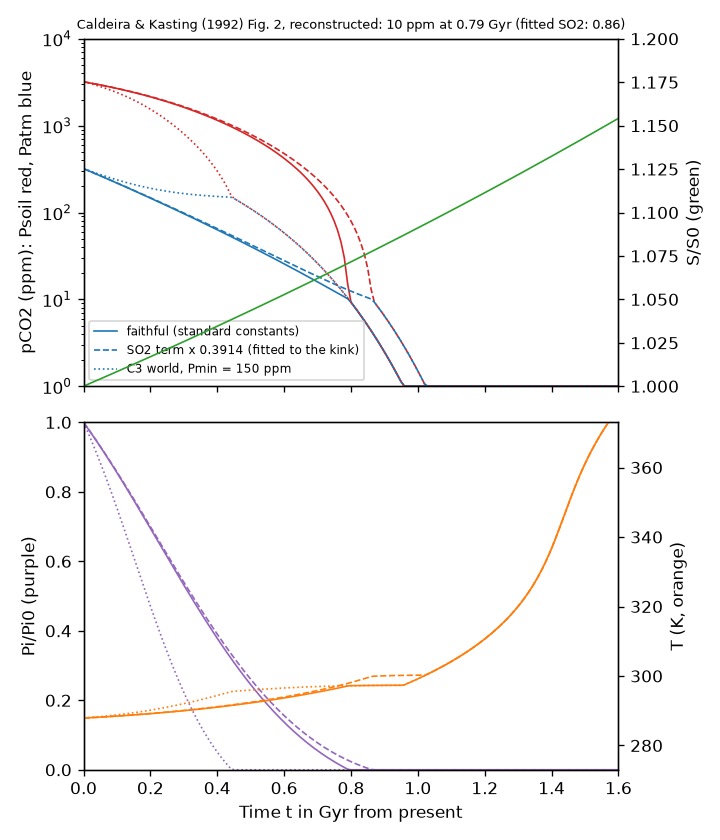

# Life span of the biosphere

Two papers ran the silicate-weathering thermostat of
[Walker, Hays & Kasting (1981)](../walker_hays_kasting/README.md) forward in
time to ask how long the biosphere has left:

- Lovelock & Whitfield (1982), *Nature* 296, 561–563: about 100 Myr.
- Caldeira & Kasting (1992), *Nature* 360, 721–723: about 0.9 Gyr to the C₄
  limit, 0.5 Gyr for a C₃-only world.

This page holds both faithful reconstructions. Once both have passed review,
it will add a separately named analysis that swaps one ingredient at a time
between them, to attribute the gap between their lifespans.

Status: **Lovelock & Whitfield reconstructed and approved by Codex (1d7cd5d);
Caldeira & Kasting reconstructed, in review** (board thread 183).

## Sources

All citations were checked against Crossref on 16 November 2026.

- Lovelock, J. E. & Whitfield, M. (1982). Life span of the biosphere.
  *Nature* 296(5857), 561–563.
  [doi:10.1038/296561a0](https://doi.org/10.1038/296561a0).
  Publisher PDF supplied by Barry: three pages of 220-ppi colour JPEG scans
  with an OCR layer, SHA-256
  `d763245eb2867e041766f6a6ab2d04013b30749eeb938d794b6c8c07477eeab3`.
- Caldeira, K. & Kasting, J. F. (1992). The life span of the biosphere
  revisited. *Nature* 360(6406), 721–723.
  [doi:10.1038/360721a0](https://doi.org/10.1038/360721a0).
  Publisher PDF supplied by Barry: three pages of 650-ppi bilevel scans with
  an OCR layer, SHA-256
  `3fc7926249fdb3faa961e21f3d34029b68e7f7ec1e7549ad6cb34904a250b7b9`.
- Equation and data sources, also in hand:
  - Owen, Cess & Ramanathan (1979), [doi:10.1038/277640a0](https://doi.org/10.1038/277640a0);
  - Gough (1981), [doi:10.1007/BF00151270](https://doi.org/10.1007/BF00151270);
  - Volk (1987), [doi:10.2475/ajs.287.8.763](https://doi.org/10.2475/ajs.287.8.763);
  - Kasting (1988), [doi:10.1016/0019-1035(88)90116-9](https://doi.org/10.1016/0019-1035(88)90116-9);
  - Kasting, Whitmire & Reynolds (1993), [doi:10.1006/icar.1993.1010](https://doi.org/10.1006/icar.1993.1010);
  - Caldeira (1991), [doi:10.1130/0091-7613(1991)019<0204:CPCPAT>2.3.CO;2](https://doi.org/10.1130/0091-7613(1991)019%3C0204:CPCPAT%3E2.3.CO;2).
- Lovelock & Whitfield's luminosity source, Newkirk (1980), *Geochim.
  Cosmochim. Acta Suppl.* 13, 293, is not in hand.
- Caldeira & Kasting's sources for the equilibrium constants are not in hand:
  Stumm & Morgan, *Aquatic Chemistry* (Wiley, 1981), for carbonate, and
  Chameides (1984), *J. Geophys. Res.* 89, 4739–4755,
  [doi:10.1029/JD089iD03p04739](https://doi.org/10.1029/JD089iD03p04739),
  for sulphur. Sander's Henry's-law compilation (henrys-law.org, read
  21 November 2026) lists Chameides' Henry constants: 1.216 M atm⁻¹ for SO₂
  and 0.0314 M atm⁻¹ for CO₂.

All of these are copyrighted and are not redistributed. Place them in
`local/sources/biosphere_lifespan/`; the scan scripts refuse any file with a
different hash. The overlay figures plot values digitised from the scans,
never the scans themselves.

## Code

| File | Contents |
|---|---|
| [`lw1982.py`](../../src/terra_prisca/biosphere_lifespan/lw1982.py) | Lovelock & Whitfield's rule, its readings, a variant and a control |
| [`scan_lw1982.py`](../../src/terra_prisca/biosphere_lifespan/scan_lw1982.py) | Calibration and tracing of their Fig. 2 |
| [`fidelity_lw1982.py`](../../src/terra_prisca/biosphere_lifespan/fidelity_lw1982.py) | Scores, lifespans, band and claims; writes `fidelity/lw1982_*` |
| [`figures_lw1982.py`](../../src/terra_prisca/biosphere_lifespan/figures_lw1982.py) | The reconstructed Fig. 2; writes `figures/lw1982_fig2.*` |
| [`tests/test_lw1982.py`](../../tests/test_lw1982.py) | Anchors, closed forms, the WHK import, controls, and the scan test |
| [`ck1992.py`](../../src/terra_prisca/biosphere_lifespan/ck1992.py) | Caldeira & Kasting's Box 1 model, its readings, the C₃ run and controls |
| [`scan_ck1992.py`](../../src/terra_prisca/biosphere_lifespan/scan_ck1992.py) | Calibration and tracing of their Fig. 2 |
| [`fidelity_ck1992.py`](../../src/terra_prisca/biosphere_lifespan/fidelity_ck1992.py) | Scores, two-way distances, events and claims; writes `fidelity/ck1992_*` |
| [`figures_ck1992.py`](../../src/terra_prisca/biosphere_lifespan/figures_ck1992.py) | The reconstructed Fig. 2; writes `figures/ck1992_fig2.*` |
| [`tests/test_ck1992.py`](../../tests/test_ck1992.py) | Equations, root uniqueness, present-day closure, the WHK import, controls, and the scan test |

```bash
uv run python -m terra_prisca.biosphere_lifespan.figures_lw1982
uv run python -m terra_prisca.biosphere_lifespan.fidelity_lw1982
uv run python -m terra_prisca.biosphere_lifespan.figures_ck1992
uv run python -m terra_prisca.biosphere_lifespan.fidelity_ck1992
uv run pytest tests/test_lw1982.py tests/test_ck1992.py
```

Every committed CSV is regenerated byte for byte by the tests.

## Lovelock & Whitfield (1982)

### The model as published

The paper has no equations. Its arithmetic is stated in the text and drawn in
Fig. 2, as straight lines against time t (Myr from the present):

1. **The Sun.** Luminosity rises along a straight line, after Newkirk (1980),
   from about 0.71 of today's at −4,000 Myr to about 1.15 at +2,000 Myr.
2. **CO₂ at constant temperature.** "A linear relationship between the square
   root of the CO₂ pressure and the solar luminosity for a constant mean
   temperature", anchored at a stated partial pressure 3,500 Myr ago
   (refs 4 and 17: Owen et al. 1979 and Hart 1978) and 320 ppm today.
3. **The limit.** 150 ppm is "the lower limit tolerable for photosynthesis".
   Extrapolating the decline, it "will be reached in about 100 Myr".

Fig. 2 also draws a band of probable past mean temperatures. It is set by
stated assumptions about prokaryote limits and glaciations, not computed.
Fig. 1 is a conceptual diagram of the biological and geological feedback loop
and carries no numbers, so Fig. 2 and the text supply every quantitative
target.

With luminosity linear in time and √C linear in luminosity, √C is linear in
time, and the luminosity slope cancels:

  Δt = 3,500 Myr × (√320 − √150) / (√C_past − √320).

The span to the limit therefore depends on the two dated anchors and the
shape of the rule, not on how fast the Sun brightens. A Sun law of a different
shape does change it (below).

### Interpretive choices

| Choice | Adopted | Reason |
|---|---|---|
| Luminosity law | Straight line, L = 1 + 0.0733 t/Gyr | The paper gives no formula and Newkirk (1980) is not in hand. The printed Sun line is straight to 0.55 px RMS, and its slope is read from the scan. Gough's (1981) curved law and Owen et al.'s linear 75% at 4,500 Myr are scored as nulls |
| CO₂ 3,500 Myr ago | **70,000 ppm** | The text prints 7,000 ppm, citing Owen et al. (1979) and Hart (1978). Owen et al.'s Table 1 gives 0.070 bar at 3.5 Gyr and attributes its CO₂ history to Hart, which is not in hand. The printed line starts at 71,900 ppm, and only 70,000 gives the stated span. 7,000 is kept as a scored, rejected reading |
| "2/3 power relationship" | C^(2/3) linear in L, with the same anchors | The natural reading of "a 2/3 power relationship might be more appropriate" in place of the square root. WHK's published eq. (6) implies a different law (below) |
| Constant temperature | Implicit in the rule | The paper has no climate model. The WHK reading supplies one through the [`whk1981`](../../src/terra_prisca/walker_hays_kasting/whk1981.py) import |
| WHK's P₀ | 320 ppm | WHK leave P₀ as "present"; Lovelock & Whitfield's present is 320 ppm |
| The limit | 150 ppm exactly | As stated |
| Where a rule ends | No value (NaN) | The two-point rules end where C^power would reach zero (the faithful one at +254 Myr). WHK eq. (6) at constant temperature ends where it would need P ≤ 0 (+503 Myr). Every lifespan falls inside its rule's domain; nothing is extrapolated past it |
| Changing the Sun law | Keep the two dated CO₂ anchors and recalibrate the rule on the new luminosities | This keeps the source's own calibration (CO₂ at two dates) fixed while the law changes. Freezing the CO₂–luminosity coefficient instead and swapping only the slope would mix a change of calibration with a change of law; that comparison is not used |

**Readings of the compensation rule** (`READINGS` in `lw1982.py`):

- **faithful**: √C linear in L, through 70,000 ppm at −3,500 Myr and 320 ppm
  today.
- **text_7000**: the same rule through the text's 7,000 ppm.
- **two_thirds**: C^(2/3) linear in L.
- **linear_c**: C linear in L.
- **whk_constant_T**: WHK eq. (6) with ΔT = 0 and ΔT_e = 253(L^¼ − 1) K.
  This is the departure from a two-point rule that the WHK import makes
  explicit: P^0.364 is linear in ΔT_e, which makes the CO₂ needed 3,500 Myr ago
  128,000 ppm rather than 70,000.

**Variants** (`VARIANTS`), kept for the ingredient-swap analysis and not
readings of Lovelock & Whitfield:

- **whk_feedback** lets temperature float, with WHK's full equilibrium at
  V/V₀ = 1. Lovelock & Whitfield assume constant temperature.
- **gough_sun** replaces the straight Sun by Gough's (1981) law, keeping the
  two dated anchors.

**Control**, **no_brightening**: a constant Sun. CO₂ stays at 320 ppm and the
limit is never reached.

### Results


| Rule | CO₂ 3,500 Myr ago (ppm) | Time to 150 ppm (Myr) | Rule ends (Myr) |
|---|---|---|---|
| **Faithful** (√C linear in L, 70,000 ppm) | 70,000 | **80** | 254 |
| Text's 7,000 ppm | 7,000 | 300 | 952 |
| 2/3 power | 70,000 | 39 | 99 |
| C linear in L | 70,000 | 8.5 | 16 |
| WHK eq. (6) at constant temperature | 128,000 | 120 | 503 |
| *Variant:* WHK feedback, temperature free | 25,700 | 461 | — |
| *Variant:* Gough (1981) Sun, same anchors | 70,000 | 61 | 192 |
| *Control:* constant Sun | 320 | never | — |

- **The stated "about 100 Myr" holds.** The faithful rule gives 80 Myr. The
  printed lines meet the printed limit at 106 Myr if the main CO₂ line is
  extended, and at 114 Myr along the stroke drawn beyond the present, which
  continues the same line.
- **How fast the Sun brightens does not matter; the shape of its law does.**
  Any straight Sun gives 80 Myr. Gough's curved law, re-anchored on the same
  two dates, gives 61 Myr: it brightens more slowly in the past and faster
  today, relative to its own 3,500-Myr change.
- **The span depends strongly on the shape of the rule.** With the same two
  anchors, the 2/3 power halves it and a linear rule cuts it tenfold. The
  2/3 power, the alternative the paper names, leaves the span at tens of Myr,
  which bears out the paper's claim that it would not change the qualitative
  conclusion.
- **WHK's own climate makes the window longer.** Holding temperature constant
  under WHK's eq. (6) gives 120 Myr. Letting temperature rise as WHK's
  feedback dictates gives 461 Myr, because warming then speeds weathering
  instead of requiring CO₂ to fall to hold temperature fixed.

### Fidelity against the published paper

**Calibration.** Fig. 2 has three vertical scales sharing one set of ticks on
the middle axis: luminosity 0.7–1.2 and √CO₂ 0–300 (labels on either side),
and time ticks on the bottom frame. The frame lines are exactly vertical and
horizontal, so each scale is a linear map fitted to its own ticks. The largest
tick residuals are 0.79 px (time), 0.47 px (luminosity) and 0.53 px (√CO₂).
The temperature scale (0–100 °C) has labels but no ticks; it is calibrated on
the frame, and each label then sits within 0.8 °C (4 px) of its value.

**Lines.** Each straight line is traced by following ink within a window
about a seeded guess, ±4 px (±2 px for the stroke beyond t = 0 and the limit
line), and refitting. A column is used only when its window holds a single run
of ink at most 4 px tall. Columns where a second stroke enters the window
(crossings, labels) are dropped and counted. Columns 615–625, where the CO₂
stroke and the limit line share ink, are excluded from both. The main Sun and
CO₂ fits change by less than 2×10⁻⁴ px/px between windows of ±2 and ±8 px
(`fidelity/lw1982_lines.csv`).

| Line | Traced span | Straightness (RMS about own fit) | Reading |
|---|---|---|---|
| Sun | −3,975 to +1,987 Myr | 0.49 px | L = 0.9989 + 0.0734 t/Gyr |
| CO₂ | −3,456 to −20 Myr | 0.33 px | √C from 268.1 (71,900 ppm) to 18.8 at t = 0 (354 ppm) |
| CO₂ beyond the present | +14 to +248 Myr (17 columns) | 0.33 px | the same line: slope within 0.8% of the main CO₂ line |
| CO₂ limit | +49 to +1,157 Myr | 0.24 px | √C = 11.2 (124 ppm), 1.0 px below √150 |

**Scores** (`fidelity/lw1982_fidelity.csv`), over every traced column:

| Line | Reading | RMSE | RMSE (px) | Times the faithful |
|---|---|---|---|---|
| Sun | **faithful: straight, 0.0733/Gyr** | 0.0016 | **0.78** | 1 |
| Sun | null: Gough (1981) | 0.022 | 10.6 | 14 |
| Sun | null: Owen et al., linear 0.0556/Gyr | 0.037 | 18.0 | 23 |
| Sun | null: constant Sun | 0.152 | 73.1 | 94 |
| CO₂ | **faithful** | 4.1 √ppm | **4.0** | 1 |
| CO₂ | 2/3 power | 12.5 | 12.0 | 3.0 |
| CO₂ | WHK eq. (6), constant temperature | 32.3 | 31.1 | 7.8 |
| CO₂ | C linear in L | 36.7 | 35.3 | 8.9 |
| CO₂ | text's 7,000 ppm | 107.7 | 103.6 | 26 |
| CO₂ | null: constant 320 ppm | 145.4 | 139.9 | 35 |

**Two-way pixel distances** (`fidelity/lw1982_two_way.csv`), over each traced
line's span. Model to ink is measured at model samples under 0.5 px apart;
samples in dropped columns (710 for the Sun line, 150 for CO₂) are excluded
and counted, and no gap is bridged. Ink to model takes every traced ink pixel
(884 and 544) to the nearest model sample anywhere in the span.

| Line | Reading | Model to ink: median / p95 (px) | Ink to model: median / p95 (px) |
|---|---|---|---|
| Sun | **faithful** | **0.54 / 1.04** | **0.62 / 1.43** |
| Sun | null: Gough (1981) | 4.2 / 21.2 | 4.5 / 20.5 |
| Sun | null: Owen et al. linear | 12.5 / 30.6 | 13.1 / 31.6 |
| CO₂ | **faithful** | **2.6 / 5.0** | **3.0 / 5.5** |
| CO₂ | 2/3 power | 10.0 / 14.4 | 10.5 / 14.9 |
| CO₂ | WHK eq. (6), constant temperature | 6.6 / 61.3 | 7.1 / 47.0 |
| CO₂ | C linear in L | 30.1 / 41.7 | 30.8 / 42.3 |
| CO₂ | text's 7,000 ppm | 76.5 / 145.1 | 88.6 / 167.0 |

The faithful Sun slope is read from this same line, so its 0.78 px measures
how straight the line is, not an independent prediction. What the score tests
is that the printed luminosity is linear and that the two published laws in
hand are not it.

The faithful CO₂ rule lies 3.8 √ppm (3.6 px) below the printed line on
average. The printed line is 2.3% steeper (−0.0721 against −0.0705 √ppm per
Myr) and passes 354 ppm, rather than 320, at t = 0. That is 1 px at the
present and 6–7 px at the line's start.


**The temperature band** (`fidelity/lw1982_band.csv`):

| Feature | Printed | Text |
|---|---|---|
| Archaean upper limit, −3,500 to −2,400 Myr | 39.9 °C | 40 °C |
| Archaean lower limit | 15.0 °C | 15 °C |
| Upper limit after the −2,300 Myr glaciation | 25.0 °C | "20–30 °C" |
| Lower limit after it | 15.0 °C | glacial 5–10 °C, interglacials 5–15 °C higher |
| Six glaciation minima (−2,301, −955, −803, −626, −440, −284 Myr) | 4.0–4.2 °C | glaciations at 5–10 °C |

**Stated numbers** (`fidelity/lw1982_claims.csv`):

| Statement | Stated | Reconstructed |
|---|---|---|
| 150 ppm reached in | about 100 Myr | 80 Myr (rule); 106–114 Myr (printed lines) |
| CO₂ 3,500 Myr ago | 7,000 ppm | 71,900 ppm (printed line, at −3,456 Myr) |
| CO₂ today | 320 ppm | 354 ppm (printed line) |
| CO₂ limit | 150 ppm | 124 ppm (printed line, 1.0 px) |
| Sun's rise since the Earth formed | 30% | 33% of today's at −4,500 Myr on the printed line, or 49% of the young Sun's. The line starts at −4,000 Myr, where it gives 29% |
| Without the CO₂ decline, temperature "might by now have exceeded 50 °C" | 50 °C | 40 °C under WHK eq. (6), with CO₂ held at 70,000 ppm |

## Caldeira & Kasting (1992)

### The model as published

Box 1 of the paper gives every equation. Time t is in Gyr from the present,
pressures in bar and temperatures in K.

1. **The Sun.** S(t) = S₀/(1 − 0.38 t/τ₀), with τ₀ = 4.55 Gyr and
   S₀ = 1,368 W m⁻²: a fit to A. I. Boothroyd's standard solar model.
2. **Energy balance.** (1 − a)S/4 = σT_eff⁴ and T = T_eff + ΔT.
3. **Greenhouse and albedo.** ΔT(T, ψ), with ψ = log₁₀ P_atm, and a(T), are
   least-squares fits to 143 runs of Kasting's radiative–convective model
   over 0–100 °C and 10⁻⁸–10⁻² bar. The stated mean errors are under 0.5 K
   and under 0.01. Clouds are held fixed.
4. **Weathering.** F/F₀ = (a_H/a_H,₀)^0.5 exp((T − T₀)/13.7 K). Here a_H is
   the H⁺ activity of rain water in equilibrium with soil CO₂ and 0.2 ppb of
   atmospheric SO₂. The 13.7 K comes from Walker, Hays & Kasting (1981).
5. **Soil CO₂.** P_soil/P_soil,₀ = (Π/Π₀)(1 − P_atm,₀/P_soil,₀) +
   P_atm/P_soil,₀, from Volk (1987, his eq. 11), with P_soil,₀ = 10 P_atm,₀.
6. **Productivity.** Π/Π_max = (1 − ((T − 25 °C)/25 °C)²) (P_atm − P_min)/
   (P₁/₂ + P_atm − P_min). This is Volk's Michaelis–Menten law (his eq. 12)
   times C&K's temperature factor. Π_max = 2Π₀ and P_min = 10 ppm (C₄
   plants). P₁/₂ is fixed by Π = Π₀ at T₀ = 15 °C and P_atm,₀ = 320 ppm.
7. **Solution.** Weathering is held at today's rate, F = F₀, until P_atm
   falls to 1 ppm; P_atm then stays there.

At each time the model solves F = F₀ for P_atm, with T taken from the
climate fits. CO₂ falls as the Sun brightens. Productivity falls with it, and
so does the soil-CO₂ gradient, so T must rise to keep weathering at the
modern rate. Once P_atm is below P_min, Π = 0 and P_soil = P_atm. Once P_atm
reaches 1 ppm, T depends on eqs (1)–(5) alone.

**Departures from Walker, Hays & Kasting** (imported from
[`whk1981`](../../src/terra_prisca/walker_hays_kasting/whk1981.py)):

- **Weathering.** WHK use (P/P₀)^0.3 on atmospheric CO₂; C&K use
  a_H^0.5 on soil CO₂. Since a_H ∝ P^0.5 when carbonate dominates, WHK's law
  is a_H^0.6: this is the "implied exponent of 0.6" in the text, reproduced
  as 0.3/0.5. Only the 13.7 K e-folding is imported, as `ck1992.EFOLD_K`.
- **Climate.** WHK's linear eqs (3)–(6), with T_e = 253 K and T_s = 285 K,
  are replaced by eqs (2)–(5): Stefan–Boltzmann, a temperature-dependent
  albedo and a radiative–convective greenhouse.
- **Reference temperature.** WHK's T₀ = 285 K becomes 15 °C (288.15 K).
- **Biology.** WHK have none. Soil CO₂ and productivity are new.

### Interpretive choices

| Choice | Adopted | Reason |
|---|---|---|
| Present-day closure | **T₀ = the fits' own present temperature, 287.89 K** | Eqs (1)–(5) put today at 287.89 K, which rounds to the stated 15 °C but is not 288.15 K. With T₀ = 288.15 K, F = F₀ cannot hold at 320 ppm: the model starts at 335 ppm with Π/Π₀ = 1.017. The printed Π/Π₀ starts at 1.002, 15 px from 1.017 on an axis calibrated to 2.4 px. With the SO₂ factor refitted under each reading, T₀ = 288.15 K ties on P_soil and T but misses Π by 6.7 px against 1.6 (`fidelity/ck1992_coupled.csv`). The printed P_atm at t = 0 (324 ppm) is not used: 320 against 335 ppm is 3.3 px, inside the 4.1 px residual of the log axis |
| Equilibrium constants | **Standard values at 25 °C.** Carbonate: pK_H 1.47, pK₁ 6.35, pK₂ 10.33. SO₂: K_H 1.23 M atm⁻¹, K₁ 1.23×10⁻² M, K₂ 6.61×10⁻⁸ M | The paper points to Stumm & Morgan (1981) and Chameides (1984), neither of which is in hand. The SO₂ Henry constant agrees within 1% with Sander's listing of Chameides (1.216 M atm⁻¹). The dissociation constants and the carbonate set are standard values, not checked against the cited sources. They are held at 25 °C, the temperature of the dissolution experiments the text cites. Temperature-dependent constants are scored as a reading |
| Strength of the SO₂ term | **Faithful: ×1 (standard constants). Reading `so2_fitted`: ×0.391** | This choice decides the low-CO₂ phase (below). Only the ratio of sulphur to carbonate acidity enters a_H/a_H,₀, so the fit identifies that ratio, not an SO₂ constant. Sulphur carries 6.0% of today's soil-water acidity with the standard constants, and 2.4% in the fitted reading. The factor puts the model's 10 ppm kink at the printed kink (0.863 Gyr); every other printed feature is then an out-of-sample test. This reading and its target were added after the first scores, not declared in advance (board message 3627) |
| Charge balance | [H⁺] = [HCO₃⁻] + 2[CO₃²⁻] + [HSO₃⁻] + 2[SO₃²⁻] + [OH⁻], with activity taken as concentration | Fresh rain water, as the text describes it. Bar is taken as atm (1.3%, which cancels in a_H/a_H,₀) |
| P₁/₂ | Eq. (8) through Π₀ at (T₀, 320 ppm), temperature factor included: 205.6 ppm | As stated. Volk's eq. (13), (Π_max/Π₀ − 1)(P₀ − P_min) = 310 ppm, omits the temperature factor and is scored as a reading |
| Π outside its range | Zero below P_min and outside 0–50 °C | The temperature factor is negative beyond 50 °C and the CO₂ factor below P_min. A negative productivity has no meaning, and the caption says P_soil = P_atm once P_atm is too low |
| C₃ world | A separate run with P_min = 150 ppm and P₁/₂ recalibrated (112.7 ppm) | The caption calls it "a C₃-only world with P_min = 150 p.p.m." The time at which the C₄ run passes 150 ppm (0.19 Gyr) is reported alongside |
| The 1 ppm floor | P_atm is held at 1 ppm whenever F at 1 ppm already reaches F₀ | As stated. F − F₀ changes sign once in P_atm between 1 ppm and 10⁻² bar at every time tested, so the root is unique. F is not monotonic in P_atm everywhere: late on, high CO₂ warms T towards 50 °C and Π falls, but only where F is 6–9 times F₀ |
| σ | 5.670×10⁻⁸ W m⁻² K⁻⁴ | Not stated |
| Range of the fits | T is reported only up to 373.15 K | The fits cover 0–100 °C, and the figure stops at 373 K |
| ψ | log₁₀ | A natural log puts today at 283 K |

**Readings** (`READINGS` in `ck1992.py`), each scored:

- **faithful**: as above.
- **so2_fitted**: the SO₂ term ×0.391, fitted to the printed kink.
- **t0_printed**: T₀ = 15 °C.
- **chemistry_T**: equilibrium constants follow T.
- **so2_half**, **so2_double**: the SO₂ term ×0.5 and ×2.
- **volk_p_half**: Volk's P₁/₂.

**C₃ world** (`C3`): P_min = 150 ppm, P₁/₂ recalibrated.

**Controls** (`CONTROLS`):

- no SO₂;
- productivity held at Π₀ (Volk's case W3);
- WHK weathering on atmospheric CO₂, with no soil;
- CO₂ held at 320 ppm;
- constant Sun.

**Sensitivity rows** (fidelity only): eq. (4) ±0.5 K and eq. (5) +0.01,
their stated mean errors.

### Results



| Quantity | Stated | Faithful | SO₂ fitted to the kink | Printed (Fig. 2) |
|---|---|---|---|---|
| C₃ world reaches 150 ppm | ~0.5 Gyr | 0.44 | 0.49 | — |
| P_atm reaches 10 ppm (the C₄ limit) | 0.9 Gyr | 0.79 | 0.863 (fitted) | 0.863 |
| P_atm reaches 1 ppm | ~1 Gyr | 0.96 | 1.023 | 1.024 |
| Π/Π₀ falls to 0.05 | — | 0.71 | 0.75 | 0.73 |
| T reaches 300 K | — | 1.02 | 0.88 | 0.87 |
| T at the floor where weathering exceeds supply | "above 300 K" | 297.3 K | 300.3 K | — |
| T reaches 50 °C | ~1.5 Gyr | 1.32 | 1.32 | 1.33 |
| T reaches 80 °C | ~1.5 Gyr | 1.46 | 1.46 | 1.47 |
| T from 50 to 97 °C | < 0.2 Gyr (to 100 °C) | 0.226 | 0.226 | 0.227 |

- **The hot phase is reproduced exactly from eqs (1)–(5).** Once P_atm sits at
  1 ppm, T crosses 50, 80, 90 and 97 °C within 0.007 Gyr of the printed
  curve. This holds under every reading, because none of them changes the
  climate. Near 340–360 K, dT/d ln S reaches about 2,700 K. Shifting eq. (4) by
  its stated mean error (±0.5 K) therefore moves the T curve 24–33 px; the
  printed curve was computed with these fits as published.
- **The low-CO₂ phase depends on how acid rain water is at low soil CO₂.**
  The SO₂ term sets a floor under a_H. A stronger floor stops a_H falling
  with P_soil, so T rises less to keep weathering at the modern rate, and the
  10 ppm limit comes sooner. With the standard constants the model reaches
  10 ppm at 0.79 Gyr and 1 ppm at 0.96 Gyr, and its merged P_soil = P_atm
  curve lies 47 px from the printed one. With the SO₂ term ×0.391, fitted to
  the kink alone, the curve reaches 1 ppm at 1.023 Gyr (printed 1.024) and T
  reaches 300 K at 0.88 Gyr (printed 0.87). The floor threshold becomes
  300.3 K ("above 300 K" in the text), the C₃ world reaches 150 ppm at
  0.49 Gyr ("~0.5"), and every printed curve lies within a median 2.4 px of
  the model.
- **Declining productivity lengthens the span relative to constant
  productivity.** With Π held at Π₀ (Volk's case W3), the 10 ppm limit comes
  at 0.50 Gyr instead of 0.79. As Π falls, so does the soil-CO₂ gradient, and
  T must rise further to keep weathering at the modern rate. WHK's weathering
  law on atmospheric CO₂, with no soil or biology, gives 0.91 Gyr, but its
  P_atm curve lies 34 px from the printed one.
- **The constant-temperature sentence is a figure of speech.** T rises
  9–12 K over the first 0.9 Gyr. Holding T at T₀ literally would need
  10 ppm by 0.49 Gyr and 1 ppm by 0.67 Gyr.

### Fidelity against the published paper

**Calibration** (`fidelity/ck1992_calibration.csv`). Fig. 2 is a 650-ppi
bilevel scan, rotated and sheared by a few pixels across the figure. Each
panel's frame lines are fitted (horizontal slopes 0.0033 and 0.0037, vertical
−0.0050 and −0.0055). Pixels are mapped to u = x − k_v y and v = y − k_h x,
and each scale is a linear map of u or v fitted to its ticks:

- time: the 15 inward ticks on each panel's top frame, 0.1–1.5 Gyr;
- pCO₂: the five decade ticks, 1–10,000 ppm;
- S/S₀: all 21 ticks;
- Π/Π₀ and T: all 11 ticks each.

The largest tick residuals are 2.2–4.1 px. The printed ticks are unevenly
spaced by a few pixels, so this, not the trace, limits the absolute accuracy.

**Traces.** Each curve is traced from knots read off the scan, by refining a
dense polyline along its normals. A sample is kept only when its ±10 px
normal window holds one ink run at most 13 px thick. Samples are dropped and
counted at:

- the crossings (P_soil and P_atm with S/S₀; Π with T);
- the junction of P_soil and P_atm;
- the stretch of P_soil that its label's subscript touches;
- the frames.

Each trace has 109–766 centres and at most five samples dropped for any other
reason.

**Two-way distances** (`fidelity/ck1992_two_way.csv`) run from the model,
drawn on the calibrated axes, to the traced centres and back. Model samples
are 0.25 px apart. Samples inside excluded boxes are dropped and counted, and
no gap is bridged.

| Curve | Reading | Model to trace: median / p95 (px) | Trace to model: median / p95 (px) |
|---|---|---|---|
| P_soil | **faithful** | 10.1 / 61.7 | 8.8 / 44.8 |
| P_soil | **SO₂ fitted** | **2.4 / 4.9** | **2.3 / 5.1** |
| P_soil | T₀ = 15 °C | 6.5 / 54.5 | 5.5 / 39.6 |
| P_soil | Volk's P₁/₂ | 22.5 / 61.3 | 22.4 / 45.7 |
| P_soil | null: Π held at Π₀ | 105 / 241 | 151 / 489 |
| P_atm | **faithful** | 4.6 / 35.4 | 4.6 / 21.0 |
| P_atm | **SO₂ fitted** | **1.2 / 3.4** | **1.1 / 3.5** |
| P_atm | null: WHK weathering | 34.0 / 43.6 | 32.5 / 43.9 |
| P_atm | null: CO₂ fixed | 141 / 275 | 151 / 310 |
| P_soil = P_atm | **faithful** | 47.3 / 48.1 | 47.9 / 76.4 |
| P_soil = P_atm | **SO₂ fitted** | **1.4 / 2.7** | **1.3 / 2.7** |
| P_soil = P_atm | null: no SO₂ | 54.8 / 91.0 | 111 / 191 |
| S/S₀ | **eq. (1)** | **1.6 / 4.3** | **1.6 / 4.7** |
| S/S₀ | null: Gough (1981) | 5.1 / 9.6 | 5.1 / 9.9 |
| S/S₀ | null: Lovelock & Whitfield's straight line | 50.9 / 126 | 60.8 / 138 |
| Π/Π₀ | **faithful** | 2.4 / 11.4 | 2.6 / 13.1 |
| Π/Π₀ | **SO₂ fitted** | **1.6 / 6.3** | **1.6 / 6.2** |
| Π/Π₀ | Volk's P₁/₂ | 37.1 / 52.1 | 40.0 / 70.8 |
| Π/Π₀ | null: Π held at Π₀ | — (on the frame) | 458 / 846 |
| T | **faithful** | 3.3 / 21.8 | 3.4 / 21.7 |
| T | **SO₂ fitted** | **2.2 / 4.7** | **2.1 / 4.9** |
| T | eq. (4) − 0.5 K | 33.0 / 54.2 | 35.4 / 63.1 |
| T | null: CO₂ fixed | 114 / 211 | 122 / 213 |

The column errors in data units are in `fidelity/ck1992_fidelity.csv`. They
cover the stretches flatter than 2 px/px. The SO₂-fitted reading scores 0.009
decades (P_atm), 0.022 (P_soil), 0.0054 (Π/Π₀) and 0.46 K (T).


**Coupled choices** (`fidelity/ck1992_coupled.csv`). Every alternative above
was first scored at the faithful SO₂ factor, where the faithful reading itself
misses the low-CO₂ phase. Here each is rescored with the factor refitted to
the kink under it:

| Base reading | SO₂ factor | Sulphur share today | Π/Π₀ at t = 0 (printed 1.002) | Median px: P_soil / P_atm / Π / T |
|---|---|---|---|---|
| **T₀ = present of the fits, 25 °C constants** | 0.391 | 2.4% | 1.000 | 2.4 / 1.2 / 1.6 / 2.1 |
| T₀ = 288.15 K | 0.429 | 2.7% | 1.017 | 1.9 / 2.2 / 6.7 / 1.9 |
| Constants follow T | 0.548 | 5.2% | 1.000 | 2.3 / 1.2 / 4.0 / 2.1 |
| Volk's P₁/₂ | 0.391 | 2.4% | 0.879 | 14.0 / 8.4 / 32.1 / 1.9 |

T₀ is decided by Π. The two treatments of the constants fit about equally
well. The printed figure cannot separate them, and both put the C₄ limit at
the printed 0.863 Gyr by construction.

**Printed features** (`fidelity/ck1992_events.csv`), read from the traces:

| Feature | Printed | Faithful | SO₂ fitted | T₀ = 15 °C |
|---|---|---|---|---|
| P_atm at t = 0 | 324 ppm | 320 | 320 | 335 |
| P_soil at t = 0 | 3,316 ppm | 3,200 | 3,200 | 3,264 |
| Π/Π₀ at t = 0 | 1.002 | 1 | 1 | 1.017 |
| T at t = 0 | 288.3 K | 287.9 | 287.9 | 288.1 |
| Kink in P_atm | 0.863 Gyr at 9.97 ppm | 0.793 | 0.863 | 0.800 |
| P_atm reaches 1 ppm | 1.024 Gyr | 0.957 | 1.023 | 0.963 |
| T at 0.9 Gyr | 300.2 K | 297.3 | 300.1 | 297.6 |

**Stated numbers** (`fidelity/ck1992_claims.csv`):

| Statement | Stated | Reconstructed |
|---|---|---|
| WHK's implied exponent on a_H | 0.6 | 0.6 (0.3/0.5) |
| S rises at | ~0.12 W m⁻² Myr⁻¹ | 0.114 today; mean 0.124 over 0.9 Gyr |
| C&K's reading of L&W: √P falls to zero at | 1.017 S₀ | 1.0186 S₀ from the faithful L&W rule |
| Trapping by 320 ppm implied by L&W | ~4 W m⁻² | 4.07 with (1 − a₀)(0.017)S₀/4 and a₀ = 0.300 from eq. (5) |
| Trapping by 320 ppm in C&K's model | 20.4 W m⁻² | not reproducible: needs the radiative–convective model |
| With negligible CO₂, T exceeds 50 °C after | ~1.5 Gyr | 1.46 Gyr at 0.01 ppm (the fits' lower bound); 1.32 at the 1 ppm floor |
| Ocean loss at 6×10¹¹ H cm⁻² s⁻¹ | ~1 Gyr | 0.97 Gyr for 1.4×10²¹ kg of water (not stated) |

## What holds

### Lovelock & Whitfield (1982)

- **Fig. 2's CO₂ line is the stated rule:** √CO₂ linear in luminosity, from
  70,000 ppm 3,500 Myr ago to 320 ppm today. It fits to 4.0 px RMS (ink to
  model: median 3.0 px, p95 5.5 px). The four alternative rules and the
  constant-CO₂ null miss by 3 to 35 times as much.
- **The Sun line is straight,** rising 7.3% of today's luminosity per Gyr. The
  two published laws in hand, Gough's (1981) and Owen et al.'s, miss it by 14
  and 23 times as much.
- **"About 100 Myr" holds.** The rule gives 80 Myr and the printed lines meet
  the printed limit at 106–114 Myr.
- **The temperature band is drawn at the stated limits** (40, 15, 25 and
  15 °C, each within 0.1 °C).
- **The 2/3-power alternative leaves the conclusion intact.** It halves the
  span to 39 Myr.

### Caldeira & Kasting (1992)

- **Box 1 reproduces Fig. 2,** once one quantity the paper does not print is
  fixed: the strength of the SO₂ term in rain-water acidity. Fitted to the
  printed kink alone, it brings all five printed curves within a median
  2.4 px and a p95 of 6.3 px. The features it was not fitted to land within
  0.01 Gyr: P_atm reaching 1 ppm, T reaching 300 K, and Π/Π₀ falling to 0.05.
  Holding productivity fixed, using WHK's weathering law, or fixing CO₂ each
  miss the P_atm and T curves by 6 to 80 times as much at the 95th
  percentile.
- **The hot phase follows from eqs (1)–(5) as printed,** to within 0.007 Gyr
  at 50, 80, 90 and 97 °C. The figure is sensitive enough to rule out an
  offset of 0.5 K in eq. (4).
- **The Sun is eq. (1).** The printed S/S₀ lies within a median 1.6 px of it.
  Gough's (1981) law misses by three times as much, and Lovelock & Whitfield's
  straight line by 30.
- **The stated lifespans hold to their rounding.** The C₃ world reaches
  150 ppm at 0.44–0.49 Gyr ("~0.5"). The C₄ limit comes at 0.79–0.86 Gyr
  ("0.9"), and the 1 ppm floor at 0.96–1.02 Gyr ("~1 Gyr"). Each range runs
  from the standard constants to the fitted SO₂ term.
- **C&K's reading of Lovelock & Whitfield checks out against our
  reconstruction.** Their √P ∝ 1.017S₀ − S compares with 1.0186 from the
  faithful L&W rule, and ~4 W m⁻² of trapping comes out at 4.07 W m⁻².
- **Smaller statements check out.** The exponent of 0.6 implied by WHK is
  reproduced, as are 0.114–0.124 W m⁻² Myr⁻¹ for the Sun's rise ("~0.12") and
  0.97 Gyr for ocean loss ("~1 Gyr").

## What the source got wrong or left inconsistent

### Lovelock & Whitfield (1982)

- **The text's 7,000 ppm should read 70,000 ppm.**
  - Owen et al.'s Table 1, one of the two references the text cites for it,
    gives 0.070 bar and attributes the value to Hart (1978), the other.
  - The printed line starts at 71,900 ppm.
  - Taken literally, 7,000 ppm gives 300 Myr, three times the stated span,
    and misses the printed line by 26 times as much as 70,000 does.
- **The glaciations are drawn to 4 °C,** about 5 px below the 5–10 °C the text
  gives for them.

### Caldeira & Kasting (1992)

- **"From 50 °C to 100 °C in <0.2 Gyr."** The paper's own figure takes
  0.227 Gyr to go from 50 to 97 °C, the highest level the trace reaches; the
  reconstruction takes 0.226 Gyr.
- **"Maintain a constant temperature for the next 0.9 Gyr"** describes a rise
  of 12 K in the figure (288.3 to 300.2 K) and 9–12 K in the reconstruction.
- **"The present level of 350 p.p.m."** appears in the text, but the model
  uses 320 ppm.

## What stays open

### Lovelock & Whitfield (1982)

- **The luminosity law.** Newkirk (1980) is not in hand, so the printed line
  is the only record of it. With the two dated anchors, a straight law of any
  slope gives 80 Myr; a curved law does not, and Gough's (1981) gives 61 Myr.
  Whether Newkirk's law is straight, or was straightened for the figure, would
  settle how much of the span rests on that drafting.
- **Hart (1978)** is not in hand. The 0.070 bar anchor is checked through
  Owen et al.'s Table 1, which attributes it to Hart.
- **Why the printed CO₂ line runs 2.3% steeper than the rule** and passes 354
  rather than 320 ppm today. It may be drafting, or a slightly different
  anchor.
- **The source of the "2/3 power".** WHK's published eq. (6) implies that
  P^0.364 is linear in ΔT_e at constant temperature, which is neither a square
  root nor a 2/3 power. The paper cites WHK "in the press", so the remark may
  refer to a different draft.
- **"Might by now have exceeded 50 °C".** The paper gives no climate model.
  WHK eq. (6) gives 40 °C; a more sensitive greenhouse would give more.

### Caldeira & Kasting (1992)

- **The acid chemistry at low soil CO₂.** This is the one ingredient that
  moves the CO₂-limited lifespan:
  - with standard carbonate and SO₂ constants, the C₄ limit comes at
    0.79 Gyr;
  - the printed figure implies an SO₂ term 0.39 times as strong (0.55 with
    temperature-dependent constants), which gives 0.86 Gyr.

  The fit fixes only the share of today's soil-water acidity that sulphur
  carries: 2.4%, against 6.0% with the standard constants. Neither Chameides
  (1984) nor Stumm & Morgan (1981) is in hand. Whether the difference lies in
  the constants,
  in how SO₂ was dissolved, or in the temperature at which the constants were
  evaluated cannot be settled without C&K's own values.
- **The 20.4 W m⁻² of trapping by 320 ppm, and 3.4 W m⁻² for doubled CO₂,**
  come from the radiative–convective model itself, not from the fits in
  Box 1, and are not reproduced here.
- **The 1 Gyr ocean-loss estimate** uses an ocean mass that the paper does not
  state; 1.4×10²¹ kg gives 0.97 Gyr.
- **How today was closed.** The fits put today at 287.89 K, which rounds to
  the stated 15 °C. The printed Π/Π₀ starts at 1.002, so the computation
  closed today at the climate's own temperature, or with fits that differ
  from the printed coefficients within their stated errors.
- **"Exceed 50 °C after ~1.5 Gyr"** is stated "with negligible atmospheric
  CO₂", and the fits give 1.46 Gyr at 0.01 ppm, their lower bound. The model as
  run holds 1 ppm and reaches 50 °C at 1.32 Gyr, as Fig. 2 does (1.33). Which
  case the sentence means is open.
