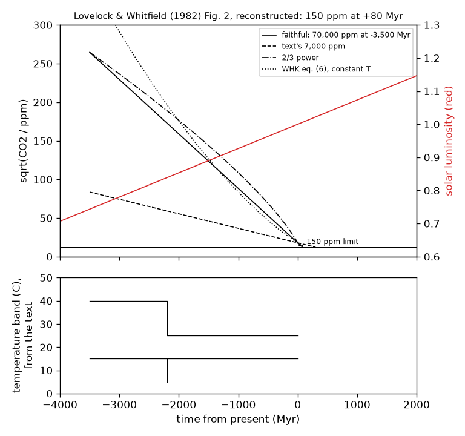

# Life span of the biosphere

Two papers ran the silicate-weathering thermostat of
[Walker, Hays & Kasting (1981)](../walker_hays_kasting/README.md) forward in
time to ask how long the biosphere has left:

- Lovelock & Whitfield (1982), *Nature* 296, 561–563: about 100 Myr.
- Caldeira & Kasting (1992), *Nature* 360, 721–723: in review order, to follow.

This page holds both faithful reconstructions. Once both have passed review,
it will add a separately named analysis that swaps one ingredient at a time
between them, to attribute the gap between their lifespans.

Status: **Lovelock & Whitfield reconstructed; in review** (board thread 183).

## Sources

All citations were checked against Crossref on 16 November 2026.

- Lovelock, J. E. & Whitfield, M. (1982). Life span of the biosphere.
  *Nature* 296(5857), 561–563.
  [doi:10.1038/296561a0](https://doi.org/10.1038/296561a0).
  Publisher PDF supplied by Barry: three pages of 220-ppi colour JPEG scans
  with an OCR layer, SHA-256
  `d763245eb2867e041766f6a6ab2d04013b30749eeb938d794b6c8c07477eeab3`.
- Caldeira, K. & Kasting, J. F. (1992). The life span of the biosphere
  revisited. *Nature* 360(6406), 721–723.
  [doi:10.1038/360721a0](https://doi.org/10.1038/360721a0).
- Equation and data sources, also in hand:
  - Owen, Cess & Ramanathan (1979), [doi:10.1038/277640a0](https://doi.org/10.1038/277640a0);
  - Gough (1981), [doi:10.1007/BF00151270](https://doi.org/10.1007/BF00151270);
  - Volk (1987), [doi:10.2475/ajs.287.8.763](https://doi.org/10.2475/ajs.287.8.763);
  - Kasting (1988), [doi:10.1016/0019-1035(88)90116-9](https://doi.org/10.1016/0019-1035(88)90116-9);
  - Kasting, Whitmire & Reynolds (1993), [doi:10.1006/icar.1993.1010](https://doi.org/10.1006/icar.1993.1010);
  - Caldeira (1991), [doi:10.1130/0091-7613(1991)019<0204:CPCPAT>2.3.CO;2](https://doi.org/10.1130/0091-7613(1991)019%3C0204:CPCPAT%3E2.3.CO;2).
- Lovelock & Whitfield's luminosity source, Newkirk (1980), *Geochim.
  Cosmochim. Acta Suppl.* 13, 293, is not in hand.

All of these are copyrighted and are not redistributed. Place them in
`local/sources/biosphere_lifespan/`; the scan scripts refuse any file with a
different hash. The overlay figures plot values digitised from the scans,
never the scans themselves.

## Code

| File | Contents |
|---|---|
| [`lw1982.py`](../../src/terra_prisca/biosphere_lifespan/lw1982.py) | Lovelock & Whitfield's rule, its readings, a variant and a control |
| [`scan_lw1982.py`](../../src/terra_prisca/biosphere_lifespan/scan_lw1982.py) | Calibration and tracing of their Fig. 2 |
| [`fidelity_lw1982.py`](../../src/terra_prisca/biosphere_lifespan/fidelity_lw1982.py) | Scores, lifespans, band and claims; writes `fidelity/lw1982_*` |
| [`figures_lw1982.py`](../../src/terra_prisca/biosphere_lifespan/figures_lw1982.py) | The reconstructed Fig. 2; writes `figures/lw1982_fig2.*` |
| [`tests/test_lw1982.py`](../../tests/test_lw1982.py) | Anchors, closed forms, the WHK import, controls, and the scan test |

```bash
uv run python -m terra_prisca.biosphere_lifespan.figures_lw1982
uv run python -m terra_prisca.biosphere_lifespan.fidelity_lw1982
uv run pytest tests/test_lw1982.py
```

Every committed CSV is regenerated byte for byte by the tests.

## Lovelock & Whitfield (1982)

### The model as published

The paper has no equations. Its arithmetic is stated in the text and drawn in
Fig. 2, as straight lines against time t (Myr from the present):

1. **The Sun.** Luminosity rises along a straight line, after Newkirk (1980),
   from about 0.71 of today's at −4,000 Myr to about 1.15 at +2,000 Myr.
2. **CO₂ at constant temperature.** "A linear relationship between the square
   root of the CO₂ pressure and the solar luminosity for a constant mean
   temperature", anchored at a stated partial pressure 3,500 Myr ago
   (refs 4 and 17: Owen et al. 1979 and Hart 1978) and 320 ppm today.
3. **The limit.** 150 ppm is "the lower limit tolerable for photosynthesis".
   Extrapolating the decline, it "will be reached in about 100 Myr".

Fig. 2 also draws a band of probable past mean temperatures. It is set by
stated assumptions about prokaryote limits and glaciations, not computed.

With luminosity linear in time and √C linear in luminosity, √C is linear in
time. The time to the limit is then

  Δt = [(√320 − √150) / (√C_past − √320)] × [1 − L(−3,500)] / (dL/dt).

### Interpretive choices

| Choice | Adopted | Reason |
|---|---|---|
| Luminosity law | Straight line, L = 1 + 0.0733 t/Gyr | The paper gives no formula and Newkirk (1980) is not in hand. The printed Sun line is straight to 0.55 px RMS, and its slope is read from the scan. Gough's (1981) curved law and Owen et al.'s linear 75% at 4,500 Myr are scored as nulls |
| CO₂ 3,500 Myr ago | **70,000 ppm** | The text prints 7,000 ppm. Both references it cites give 0.070 bar (Owen et al. 1979, Table 1, from Hart 1978). The printed line starts at 71,900 ppm, and only 70,000 gives the stated span. 7,000 is kept as a scored, rejected reading |
| "2/3 power relationship" | C^(2/3) linear in L, with the same anchors | The natural reading of "a 2/3 power relationship might be more appropriate" in place of the square root. WHK's published eq. (6) implies a different law (below) |
| Constant temperature | Implicit in the rule | The paper has no climate model. The WHK reading supplies one through the [`whk1981`](../../src/terra_prisca/walker_hays_kasting/whk1981.py) import |
| WHK's P₀ | 320 ppm | WHK leave P₀ as "present"; Lovelock & Whitfield's present is 320 ppm |
| The limit | 150 ppm exactly | As stated |

**Readings of the compensation rule** (`READINGS` in `lw1982.py`):

- **faithful**: √C linear in L, through 70,000 ppm at −3,500 Myr and 320 ppm
  today.
- **text_7000**: the same rule through the text's 7,000 ppm.
- **two_thirds**: C^(2/3) linear in L.
- **linear_c**: C linear in L.
- **whk_constant_T**: WHK eq. (6) with ΔT = 0 and ΔT_e = 253(L^¼ − 1) K.
  This is the departure from a two-point rule that the WHK import makes
  explicit: P^0.364 is linear in ΔT_e, which makes the CO₂ needed 3,500 Myr ago
  128,000 ppm rather than 70,000.

**A WHK variant**, **whk_feedback**, lets temperature float, with WHK's full
equilibrium at V/V₀ = 1. It is not a reading of Lovelock & Whitfield, who
assume constant temperature; it is kept for the ingredient-swap analysis.

**Control**, **no_brightening**: a constant Sun. CO₂ stays at 320 ppm and the
limit is never reached.

### Results



| Rule | CO₂ 3,500 Myr ago (ppm) | Time to 150 ppm (Myr) |
|---|---|---|
| **Faithful** (√C linear in L, 70,000 ppm) | 70,000 | **80** |
| Text's 7,000 ppm | 7,000 | 300 |
| 2/3 power | 70,000 | 39 |
| C linear in L | 70,000 | 8.5 |
| WHK eq. (6) at constant temperature | 128,000 | 120 |
| *Variant:* WHK feedback, temperature free | 25,700 | 461 |
| *Control:* constant Sun | 320 | never |

- **The stated "about 100 Myr" holds.** The faithful rule gives 80 Myr. The
  printed lines cross at 105 Myr if the main CO₂ line is extended, and at
  110 Myr along the short stroke drawn beyond the present.
- **The span depends strongly on the shape of the rule.** With the same two
  anchors, the 2/3 power halves it and a linear rule cuts it tenfold. The
  2/3 power, the alternative the paper names, leaves the span at tens of Myr,
  which bears out the paper's claim that it would not change the qualitative
  conclusion.
- **WHK's own climate makes the window longer.** Holding temperature constant
  under WHK's eq. (6) gives 120 Myr. Letting temperature rise as WHK's
  feedback dictates gives 461 Myr, because warming then speeds weathering
  instead of requiring CO₂ to fall to hold temperature fixed.

### Fidelity against the published paper

**Calibration.** Fig. 2 has three vertical scales sharing one set of ticks on
the middle axis: luminosity 0.7–1.2 and √CO₂ 0–300 (labels on either side),
and time ticks on the bottom frame. The frame lines are exactly vertical and
horizontal, so each scale is a linear map fitted to its own ticks. The largest
tick residuals are 0.79 px (time), 0.47 px (luminosity) and 0.53 px (√CO₂).
The temperature scale (0–100 °C) has labels but no ticks; it is calibrated on
the frame, and each label then sits within 0.8 °C (4 px) of its value.

**Lines.** Each straight line is traced by following ink within ±4 px of a
seeded guess and refitting, dropping columns at crossings and labels
(`fidelity/lw1982_lines.csv`).

| Line | Traced span | Straightness (RMS about own fit) | Reading |
|---|---|---|---|
| Sun | −3,984 to +1,996 Myr | 0.55 px | L = 0.9989 + 0.0734 t/Gyr |
| CO₂ | −3,456 to −20 Myr | 0.39 px | √C from 268.1 (71,900 ppm) to 18.8 at t = 0 (354 ppm) |
| CO₂ beyond the present | +14 to +205 Myr | 0.91 px | a shallower stroke to the limit |
| CO₂ limit | +49 to +1,157 Myr | 0.63 px | √C = 11.2 (126 ppm), 1.1 px below √150 |

**Scores** (`fidelity/lw1982_fidelity.csv`), over every traced column:

| Line | Reading | RMSE | RMSE (px) | Times the faithful |
|---|---|---|---|---|
| Sun | **faithful: straight, 0.0733/Gyr** | 0.0017 | **0.80** | 1 |
| Sun | null: Gough (1981) | 0.022 | 10.5 | 13 |
| Sun | null: Owen et al., linear 0.0556/Gyr | 0.037 | 17.9 | 22 |
| Sun | null: constant Sun | 0.151 | 72.5 | 90 |
| CO₂ | **faithful** | 4.1 √ppm | **4.0** | 1 |
| CO₂ | 2/3 power | 12.6 | 12.1 | 3.0 |
| CO₂ | WHK eq. (6), constant temperature | 32.1 | 30.9 | 7.8 |
| CO₂ | C linear in L | 36.8 | 35.4 | 8.9 |
| CO₂ | text's 7,000 ppm | 107.6 | 103.5 | 26 |
| CO₂ | null: constant 320 ppm | 145.2 | 139.7 | 35 |

The faithful Sun slope is read from this same line, so its 0.80 px measures
how straight the line is, not an independent prediction. What the score tests
is that the printed luminosity is linear and that the two published laws in
hand are not it.

The faithful CO₂ rule lies 3.8 √ppm (3.6 px) below the printed line on
average. The printed line is 2.3% steeper (−0.0721 against −0.0705 √ppm per
Myr) and passes 354 ppm, rather than 320, at t = 0. That is 1 px at the
present and 6–7 px at the line's start.


**The temperature band** (`fidelity/lw1982_band.csv`):

| Feature | Printed | Text |
|---|---|---|
| Archaean upper limit, −3,500 to −2,400 Myr | 39.9 °C | 40 °C |
| Archaean lower limit | 15.0 °C | 15 °C |
| Upper limit after the −2,300 Myr glaciation | 25.0 °C | "20–30 °C" |
| Lower limit after it | 15.0 °C | glacial 5–10 °C, interglacials 5–15 °C higher |
| Six glaciation minima (−2,301, −955, −803, −626, −440, −284 Myr) | 4.0–4.2 °C | glaciations at 5–10 °C |

**Stated numbers** (`fidelity/lw1982_claims.csv`):

| Statement | Stated | Reconstructed |
|---|---|---|
| 150 ppm reached in | about 100 Myr | 80 Myr (rule); 105–110 Myr (printed lines) |
| CO₂ 3,500 Myr ago | 7,000 ppm | 71,900 ppm (printed line, at −3,456 Myr) |
| CO₂ today | 320 ppm | 354 ppm (printed line) |
| CO₂ limit | 150 ppm | 126 ppm (printed line, 1.1 px) |
| Sun's rise since the Earth formed | 30% | 33% of today's at −4,500 Myr on the printed line, or 49% of the young Sun's. The line starts at −4,000 Myr, where it gives 29% |
| Without the CO₂ decline, temperature "might by now have exceeded 50 °C" | 50 °C | 40 °C under WHK eq. (6), with CO₂ held at 70,000 ppm |

## What holds

### Lovelock & Whitfield (1982)

- **Fig. 2's CO₂ line is the stated rule:** √CO₂ linear in luminosity, from
  70,000 ppm 3,500 Myr ago to 320 ppm today. It fits to 4.0 px. The four
  alternative rules and the constant-CO₂ null miss by 3 to 35 times as much.
- **The Sun line is straight,** rising 7.3% of today's luminosity per Gyr. The
  two published laws in hand, Gough's (1981) and Owen et al.'s, miss it by 13
  and 22 times as much.
- **"About 100 Myr" holds.** The rule gives 80 Myr and the printed lines cross
  at 105–110 Myr.
- **The temperature band is drawn at the stated limits** (40, 15, 25 and
  15 °C, each within 0.1 °C).
- **The 2/3-power alternative leaves the conclusion intact.** It halves the
  span to 39 Myr.

## What the source got wrong or left inconsistent

### Lovelock & Whitfield (1982)

- **The text's 7,000 ppm should read 70,000 ppm.**
  - Both references the text cites for it give 0.070 bar.
  - The printed line starts at 71,900 ppm.
  - Taken literally, 7,000 ppm gives 300 Myr, three times the stated span,
    and misses the printed line by 26 times as much as 70,000 does.
- **The glaciations are drawn to 4 °C,** about 5 px below the 5–10 °C the text
  gives for them.

## What stays open

### Lovelock & Whitfield (1982)

- **The luminosity law.** Newkirk (1980) is not in hand, so the printed line
  is the only record of it. Near the present the printed line rises 7.3% of
  today's luminosity per Gyr; Gough's (1981) curve rises 8.5%. The span to
  150 ppm scales inversely with that slope, so Gough's law would give 69 Myr
  instead of 80.
- **Why the printed CO₂ line runs 2.3% steeper than the rule** and passes 354
  rather than 320 ppm today. It may be drafting, or a slightly different
  anchor.
- **The source of the "2/3 power".** WHK's published eq. (6) implies that
  P^0.364 is linear in ΔT_e at constant temperature, which is neither a square
  root nor a 2/3 power. The paper cites WHK "in the press", so the remark may
  refer to a different draft.
- **"Might by now have exceeded 50 °C".** The paper gives no climate model.
  WHK eq. (6) gives 40 °C; a more sensitive greenhouse would give more.
