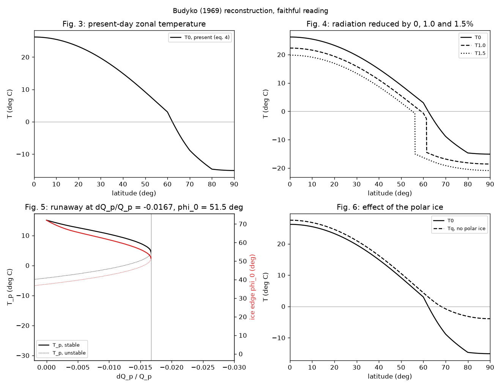
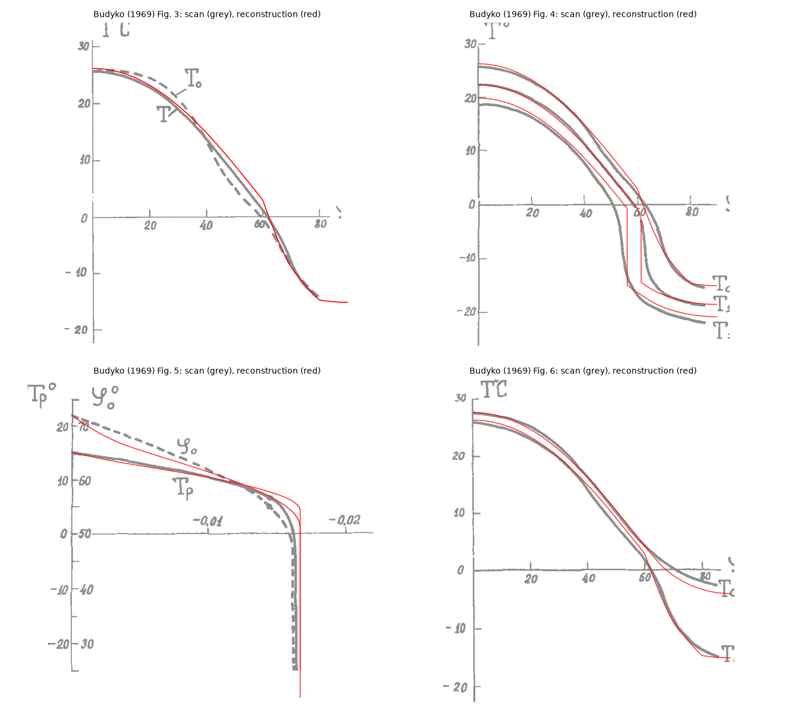

# Budyko–Sellers energy-balance models

Two papers from 1969 found, independently, that the ice-albedo feedback can run
away. They are reconstructed here one at a time. Budyko (1969) is built and
awaiting review. Sellers (1969) is waiting for its source (see
[below](#sellers-1969-waiting-for-the-source)).

## Budyko (1969): faithful reconstruction

**Source.** Budyko, M. I. (1969). The effect of solar radiation variations on
the climate of the Earth. *Tellus* 21(5), 611–619.
[doi:10.3402/tellusa.v21i5.10109](https://doi.org/10.3402/tellusa.v21i5.10109)
(also registered as doi:10.1111/j.2153-3490.1969.tb00466.x; both checked against
Crossref). We worked from the 9-page PDF published by Tellus A, whose page
gives the licence as CC BY 4.0 (SHA-256
`4690e5238be7a2ea00ebd32703bcd3e25822f90e5647df58dd3829300706b120`). Place it at
`local/sources/budyko_sellers/budyko1969.pdf` to rerun the fidelity check. The
overlay figure below reproduces parts of the paper's Figs 3–6 under that
licence.

**Code.** All in [`src/terra_prisca/budyko_sellers/`](../../src/terra_prisca/budyko_sellers/):
- [`budyko1969.py`](../../src/terra_prisca/budyko_sellers/budyko1969.py): the model;
- [`figures_budyko1969.py`](../../src/terra_prisca/budyko_sellers/figures_budyko1969.py): the reconstructed figures and curve tables;
- [`scan_budyko1969.py`](../../src/terra_prisca/budyko_sellers/scan_budyko1969.py): calibrates the printed figures and traces their curves;
- [`fidelity_budyko1969.py`](../../src/terra_prisca/budyko_sellers/fidelity_budyko1969.py): the scores;
- [`digitise.py`](../../src/terra_prisca/budyko_sellers/digitise.py): shared tracing tools.

Tests are in [`tests/test_budyko1969.py`](../../tests/test_budyko1969.py).

```bash
uv run python -m terra_prisca.budyko_sellers.figures_budyko1969
uv run python -m terra_prisca.budyko_sellers.fidelity_budyko1969 local/sources/budyko_sellers/budyko1969.pdf
uv run pytest tests/test_budyko1969.py
```

### The model as published

Budyko's model is a set of algebraic balances, solved for one hemisphere at a
time. The paper assumes both hemispheres change alike. Radiation is in
kcal cm⁻² month⁻¹, temperature in °C, and Q is the radiation at the top of the
atmosphere at latitude φ.

| Eq. | Content |
|---|---|
| (1) | Outgoing long-wave I = a + BT − (a₁ + B₁T)n, an empirical fit to 260 stations |
| (2) | Q(1 − α) − I = A, where A is the gain or loss by atmospheric and oceanic transport |
| (3) | A = β(T − T_p), fitted in Fig. 2 |
| (4) | T = [Q(1 − α) − a + a₁n + βT_p] / (β + B − B₁n) |
| (5) | T_p = [Q_p(1 − α_p) − a + a₁n] / (B − B₁n) |
| (6) | ΔT_p = Q_p/(B − B₁n) · [(ΔQ_p/Q_p)(1 − α_p − 0.30S) − 0.30S] |
| (7) | Eq. (4) with Q scaled by (1 + ΔQ_p/Q_p) and T_p replaced by T_p′ + ΔT_p |

Parameters:
- a = 14.0, B = 0.14, a₁ = 3.0, B₁ = 0.10;
- cloud cover n = 0.50;
- β = 0.235;
- solar constant 1.92 cal cm⁻² min⁻¹.

Albedo is 0.32 at 0–60°, 0.50 at 70° and 0.62 at 80°. The ice edge is now at
72°N. Ice spreads to wherever T falls to the present temperature of the 72°
boundary. Its albedo is 0.62, and 0.50 at the boundary itself. In eq. (6),
S = lq, where:
- l is the fraction of the area that changes from ice-free to ice;
- q is the mean radiation in that band relative to the planetary mean.

Fig. 6 sets the albedo to 0.32 everywhere, to show a planet without polar ice.

**The equilibrium curve is solved exactly.** Eq. (7) is linear in ΔQ_p/Q_p for
a given ice edge φ₀. The radiation change that holds the edge at each latitude
is therefore exact, and no iteration is needed. The poleward branch is stable
and ends at a minimum of ΔQ_p/Q_p. There the ice runs to the equator, which is
the vertical drop in Fig. 5.

### Interpretive choices

The paper leaves these open. Each is our choice, with the reason. Four of them
were decided by the printed figures. The rejected alternatives are scored as
controls below.

| Choice | What we did | Why |
|---|---|---|
| Insolation by latitude, Q(φ) | Annual mean at the top of the atmosphere on a circular orbit, obliquity 23.45° | The paper gives no Q(φ) table. The critical point is sensitive to this: obliquities of 22° and 24.5° give runaway at −2.2% and −1.3% |
| Month length | 365.25/12 days, so Q_p = S₀/4 = 21.04 | The units of eq. (1). A 30-day month would make T_p 12.9 °C, against the printed 14.9 °C. The critical point does not depend on this choice |
| Present albedo by latitude | The stated values at 60°, 70° and 80°, interpolated linearly; 0.62 beyond 80° | As stated for Fig. 3. A step from 0.32 to 0.62 at 72° fits every T₀ curve worse (RMSE 1.6–1.7 °C against 0.65–0.75 °C) |
| Planetary albedo α_p in eqs (5)–(6) | The area mean of the zonal albedos, 0.341 | It gives T_p = 15.1 °C, against 14.9 °C printed in Fig. 5. The insolation-weighted mean (0.332) gives 17.3 °C and fits all curves worse |
| Present T_p′ in eqs (4) and (7) | From eq. (5) | The paper computes it so; it then agrees with Fig. 5 |
| Albedo when ice spreads | 0.62 poleward of the new edge, 0.50 for the edge temperature, present values equatorward | "The albedo on the ice-covered area is equal to 0.62 and at the southern boundary … 0.50". Shifting the present albedo profile with the edge instead triggers runaway at −0.7% |
| Area basis of S | One hemisphere, standing for both | The paper assumes the hemispheres change alike. Counting the area over the whole globe halves the feedback and moves runaway to −5.1% |
| Planetary temperature after the ice moves | Eq. (6) as printed, with 0.30S over the band between 72° and the new edge | Eq. (6) is the paper's method. Our local albedo also raises 72–80° to 0.62, which eq. (6) does not count (at most 0.1 in albedo over 3.4% of the hemisphere) |
| Fig. 6, ice-free planet | Albedo 0.32 everywhere; T_p from eq. (6) for the removal of ice poleward of 72° | "the albedo at high latitudes is accepted to be equal to the albedo of ice-free areas and the coefficient β … equal to its value accepted above" |
| Latitude | Continuous, on an equal-area grid of 9000 bands | The paper's zone spacing is not stated. Its curves are drawn smooth |

### Results



- **Present climate.** T₀ runs from 26.2 °C at the equator to −15 °C at the
  pole, and T_p = 15.1 °C.
- **Ice-edge response.** Cutting radiation by 1% moves the ice edge from 72° to
  61.5° and cools the planet by 4.6 °C. A 1.5% cut moves it to 56.2° and cools
  the planet by 7.7 °C.
- **Runaway.** The stable branch ends at ΔQ_p/Q_p = −1.67%, with the edge at
  51.5°. Past that point, no partly glaciated equilibrium exists.
- **The unstable branch.** It returns to the present radiation at 37.5°.
  Equatorward of that latitude, ice spreads to the equator even under today's
  Sun, as the paper says.

Curve tables: [`figures/budyko1969_curves.csv`](figures/budyko1969_curves.csv)
(the zonal profiles) and [`figures/budyko1969_branch.csv`](figures/budyko1969_branch.csv)
(the ice-edge branch, stable and unstable).

### Fidelity against the published figures

**Method.** Each figure was calibrated from its own tick marks. The largest
tick residual is 1.7 px, about 0.16 °C. Every printed curve was traced
separately from the scan, as follows:
- **Solid curves:** the connected strokes containing hand-placed seed pixels.
- **Dashed curves:** the dashes inside a box.
- **Lettering:** removed by box.

Seeds and boxes were read from the scan, never from the model. Two scores
follow:
- **Column error.** Where the printed curve is single-valued, its value in each
  pixel column against the model at the same abscissa. Units are °C, or
  degrees of latitude for the ice edge.
- **Two-way pixel distance.** From the model to the ink, and from the ink to
  the model. It is reported in the full table only. Printed strokes are about
  5 px wide, so its 3-px fraction understates agreement.

Full tables:
- [`fidelity/budyko1969_fidelity.csv`](fidelity/budyko1969_fidelity.csv): scores per curve;
- [`fidelity/budyko1969_numbers.csv`](fidelity/budyko1969_numbers.csv): key numbers;
- [`fidelity/budyko1969_printed_curves.csv`](fidelity/budyko1969_printed_curves.csv): the digitised curves.



*Scan: Budyko (1969), Tellus 21, Figs 3–6, CC BY 4.0. Red: this reconstruction.*

| Printed curve | Columns | RMSE | Median abs. | Max abs. |
|---|---|---|---|---|
| Fig. 4, T₀ (present) | 367 | 0.65 °C | 0.40 | 1.51 |
| Fig. 4, T₁.₀ (−1.0%) | 413 | 0.34 °C | 0.18 | 1.59 |
| Fig. 4, T₁.₅ (−1.5%) | 381 | 0.91 °C | 0.86 | 3.06 |
| Fig. 5, T_p | 404 | 0.66 °C | 0.35 | 5.27 |
| Fig. 5, ice edge φ₀ | 218 | 1.53° | 1.41 | 3.65 |
| Fig. 6, T₀ | 419 | 0.75 °C | 0.49 | 1.46 |
| Fig. 6, T_q (no polar ice) | 453 | 0.64 °C | 0.35 | 1.46 |
| Fig. 3, T₀ (dashed, labelled computed) | 155 | **2.46 °C** | 1.41 | 4.22 |
| Fig. 3, T (solid, labelled observed) | 299 | 0.96 °C | 0.49 | 1.79 |

**Controls.** Each control is scored on the curves it changes. The score
separates the reconstruction from all of them.

| Control | T₁.₀ | T₁.₅ | T_p | φ₀ | T_q |
|---|---|---|---|---|---|
| Faithful reading | 0.34 | 0.91 | 0.66 | 1.53 | 0.64 |
| Null: no ice-albedo feedback (edge held at 72°) | 2.98 | 7.28 | 3.27 | 9.08 | 4.69 |
| Null: no change from the present | 4.33 | 9.28 | 4.61 | 9.08 | 4.69 |
| Insolation-weighted planetary albedo | 1.41 | 2.36 | 2.21 | 1.51 | 1.36 |
| Stepped present-day albedo | 0.97 | 1.93 | 1.63 | 1.51 | 0.95 |
| Albedo profile translated with the edge (runaway at −0.7%) | 60.1 | 55.6 | 2.80 | 5.70 | 0.58 |
| S counted over the whole globe (runaway at −5.1%) | 1.48 | 5.30 | 2.53 | 3.90 | 1.14 |

RMSE is in °C (degrees of latitude for φ₀). The ice-edge curve hardly
distinguishes the two albedo-weighting readings: the branch's shape is set by
the feedback, and those readings shift only temperatures.

**Key numbers**, as stated in the text, as printed in the figures, and as
reconstructed:

| Quantity | Text | Printed | Reconstruction |
|---|---|---|---|
| β refitted to the Fig. 2 points | 0.235 | 0.231 | 0.235 (input) |
| Cooling per 1% less radiation, fixed albedo 0.33 | 1.5 °C | — | 1.57 °C |
| Present T_p | — | 14.9 °C | 15.1 °C |
| ΔT_p at −1.0% | −5 °C | −4.3 °C | −4.6 °C |
| ΔT_p at −1.5% | −9 °C | −9.0 °C | −7.7 °C |
| Ice edge at −1.0% / −1.5% | shifted 10–18° from 72° | 61.9° / 53.7° | 61.5° / 56.2° |
| ΔQ_p/Q_p holding the edge at 65° / 60° / 55° | — | −0.71 / −1.15 / −1.45% | −0.56 / −1.17 / −1.57% |
| Runaway threshold | −1.6% | −1.63% | −1.67% |
| Ice edge at runaway | about 50° | about 51° | 51.5° |
| Ice-free polar temperature | "several degrees below zero" | −2.1 °C (80–85°) | −3.7 °C (80–90°) |

**The reconstruction agrees with Figs 4, 5 and 6 and with the stated numbers.**
- Every perturbed and ice-free profile is within an RMSE of 1 °C.
- The runaway threshold is within 0.04% of radiation of the printed value.
- The largest local errors sit at the ice edge, where the printed curves are
  drawn smooth and the model has a jump.
- The printed ice-edge branch is straighter than ours: Budyko needs 0.15% more
  radiation loss to reach 65° and 0.12% less to reach 55°. At −1.5% this puts
  his edge 2.6° further south and his planet 1.3 °C colder. That is within the
  sensitivity to Q(φ) noted above, which we do not have from the paper. We have
  not tuned it.

**The paper's own T₀ curves disagree.** Fig. 3 labels the dashed curve as
computed (T₀) and the solid one as observed (T). The T₀ drawn in Figs 4 and 6
matches Fig. 3's observed curve (RMSE 0.49 °C) and not its computed one
(1.95 °C). The two Fig. 3 curves differ by 1.7 °C. Our computed T₀ follows the
Figs 4 and 6 version and Fig. 3's solid curve (0.65–0.96 °C), and departs from
Fig. 3's dashed curve by 2.5 °C. Two explanations fit equally well:
- Fig. 3's labels are swapped;
- Figs 4 and 6 draw the observed profile as their baseline.

The paper does not settle which. It does not change any perturbed result,
because eq. (7) is computed from the model's own T_p′ and boundary temperature.

### Open threads

- Budyko's Q(φ) table, probably from the *Atlas of the Heat Balance of the
  Earth* (1963). It would test whether the straighter printed branch in Fig. 5
  comes from the insolation profile.
- Which Fig. 3 curve is the computed T₀.
- An as-drawn variant, computed at 10° nodes and smoothed as the figures are,
  is worth building only if the node spacing can be established.

## Sellers (1969): waiting for the source

Sellers, W. D. (1969). A global climatic model based on the energy balance of
the Earth-atmosphere system. *J. Appl. Meteorol.* 8(3), 392–400.
[doi:10.1175/1520-0450(1969)008<0392:AGCMBO>2.0.CO;2](https://doi.org/10.1175/1520-0450(1969)008<0392:AGCMBO>2.0.CO;2)
(checked against Crossref). The publisher's site refuses automated download,
and no open copy is indexed. The fidelity targets will be set from the paper
itself once it is in `local/sources/budyko_sellers/sellers1969.pdf`, not from
memory.

## Variants

None yet. A coupling to Daisyworld ("Snowball Daisyworld" in
[`docs/vision.md`](../../docs/vision.md)) is later work. So is any coupling to
the haze-world.
