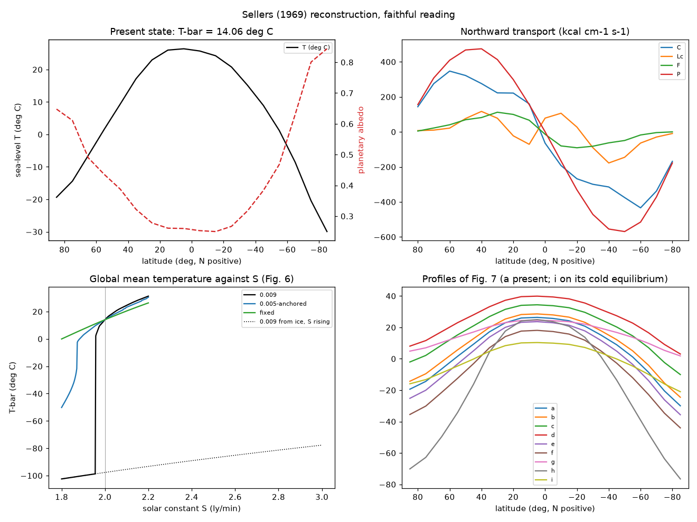
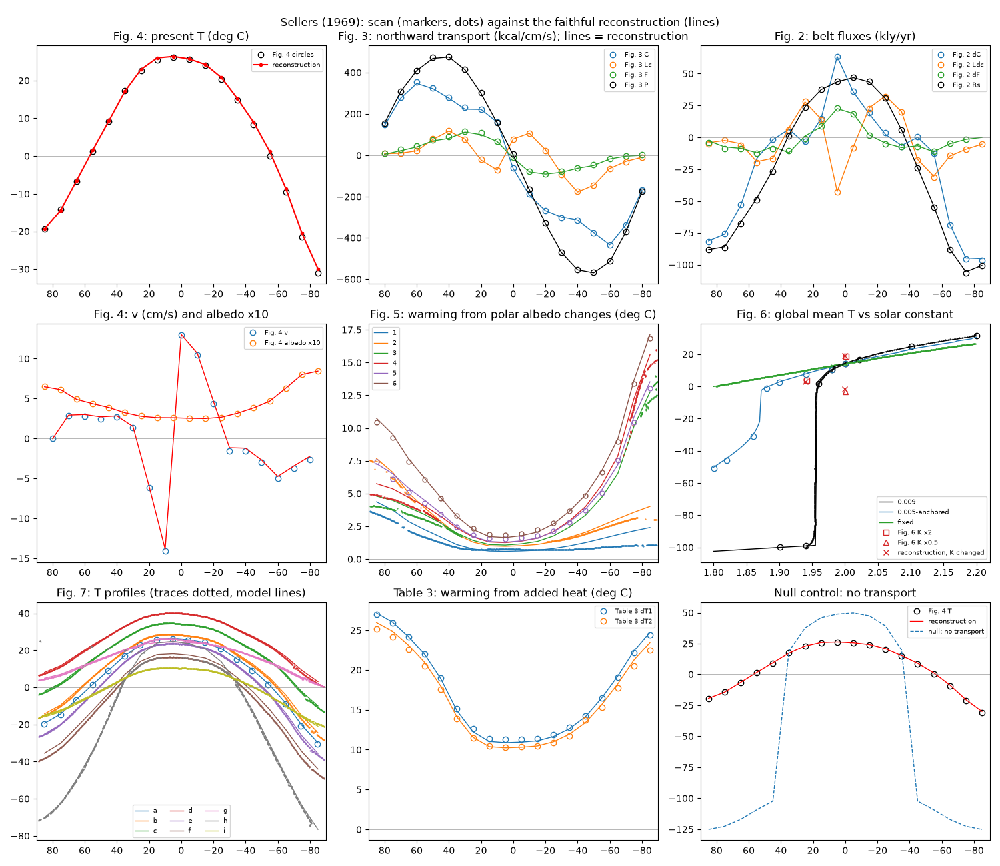

# Budyko–Sellers energy-balance models

Two papers from 1969 found, independently, that the ice-albedo feedback can run
away. They are reconstructed here one at a time. Budyko (1969) and
[Sellers (1969)](#sellers-1969-faithful-reconstruction) are both built and
awaiting review.

## Budyko (1969): faithful reconstruction

**Source.** Budyko, M. I. (1969). The effect of solar radiation variations on
the climate of the Earth. *Tellus* 21(5), 611–619.
[doi:10.3402/tellusa.v21i5.10109](https://doi.org/10.3402/tellusa.v21i5.10109)
(also registered as doi:10.1111/j.2153-3490.1969.tb00466.x; both checked against
Crossref). We worked from the 9-page PDF published by Tellus A, whose page
gives the licence as CC BY 4.0 (SHA-256
`4690e5238be7a2ea00ebd32703bcd3e25822f90e5647df58dd3829300706b120`). Place it at
`local/sources/budyko_sellers/budyko1969.pdf` to rerun the fidelity check. The
overlay figure below reproduces parts of the paper's Figs 3–6 under that
licence.

**Code.** All in [`src/terra_prisca/budyko_sellers/`](../../src/terra_prisca/budyko_sellers/):
- [`budyko1969.py`](../../src/terra_prisca/budyko_sellers/budyko1969.py): the model;
- [`figures_budyko1969.py`](../../src/terra_prisca/budyko_sellers/figures_budyko1969.py): the reconstructed figures and curve tables;
- [`scan_budyko1969.py`](../../src/terra_prisca/budyko_sellers/scan_budyko1969.py): calibrates the printed figures and traces their curves;
- [`fidelity_budyko1969.py`](../../src/terra_prisca/budyko_sellers/fidelity_budyko1969.py): the scores;
- [`digitise.py`](../../src/terra_prisca/budyko_sellers/digitise.py): shared tracing tools.

Tests are in [`tests/test_budyko1969.py`](../../tests/test_budyko1969.py).

```bash
uv run python -m terra_prisca.budyko_sellers.figures_budyko1969
uv run python -m terra_prisca.budyko_sellers.fidelity_budyko1969 local/sources/budyko_sellers/budyko1969.pdf
uv run pytest tests/test_budyko1969.py
```

### The model as published

Budyko's model is a set of algebraic balances, solved for one hemisphere at a
time. The paper assumes both hemispheres change alike. Radiation is in
kcal cm⁻² month⁻¹, temperature in °C, and Q is the radiation at the top of the
atmosphere at latitude φ.

| Eq. | Content |
|---|---|
| (1) | Outgoing long-wave I = a + BT − (a₁ + B₁T)n, an empirical fit to 260 stations |
| (2) | Q(1 − α) − I = A, where A is the gain or loss by atmospheric and oceanic transport |
| (3) | A = β(T − T_p), fitted in Fig. 2 |
| (4) | T = [Q(1 − α) − a + a₁n + βT_p] / (β + B − B₁n) |
| (5) | T_p = [Q_p(1 − α_p) − a + a₁n] / (B − B₁n) |
| (6) | ΔT_p = Q_p/(B − B₁n) · [(ΔQ_p/Q_p)(1 − α_p − 0.30S) − 0.30S] |
| (7) | Eq. (4) with Q scaled by (1 + ΔQ_p/Q_p) and T_p replaced by T_p′ + ΔT_p |

Parameters:
- a = 14.0, B = 0.14, a₁ = 3.0, B₁ = 0.10;
- cloud cover n = 0.50;
- β = 0.235;
- solar constant 1.92 cal cm⁻² min⁻¹.

Albedo is 0.32 at 0–60°, 0.50 at 70° and 0.62 at 80°. The ice edge is now at
72°N. Ice spreads to wherever T falls to the present temperature of the 72°
boundary. Its albedo is 0.62, and 0.50 at the boundary itself. In eq. (6),
S = lq, where:
- l is the fraction of the area that changes from ice-free to ice;
- q is the mean radiation in that band relative to the planetary mean.

Fig. 6 sets the albedo to 0.32 everywhere, to show a planet without polar ice.

**The equilibrium curve is solved exactly.** Eq. (7) is linear in ΔQ_p/Q_p for
a given ice edge φ₀. The radiation change that holds the edge at each latitude
is therefore exact, and no iteration is needed. The poleward branch is stable
and ends at a minimum of ΔQ_p/Q_p. There the ice runs to the equator, which is
the vertical drop in Fig. 5.

### Interpretive choices

The paper leaves these open. Each is our choice, with the reason. Four of them
were decided by the printed figures. The rejected alternatives are scored as
controls below.

| Choice | What we did | Why |
|---|---|---|
| Insolation by latitude, Q(φ) | Annual mean at the top of the atmosphere on a circular orbit, obliquity 23.45° | The paper gives no Q(φ) table. The critical point is sensitive to this: obliquities of 22° and 24.5° give runaway at −2.2% and −1.3% |
| Month length | 365.25/12 days, so Q_p = S₀/4 = 21.04 | The units of eq. (1). A 30-day month would make T_p 12.9 °C, against the printed 14.9 °C. The critical point does not depend on this choice |
| Present albedo by latitude | The stated values at 60°, 70° and 80°, interpolated linearly; 0.62 beyond 80° | As stated for Fig. 3. A step from 0.32 to 0.62 at 72° fits every T₀ curve worse (RMSE 1.6–1.7 °C against 0.65–0.75 °C) |
| Planetary albedo α_p in eqs (5)–(6) | The area mean of the zonal albedos, 0.341 | It gives T_p = 15.1 °C, against 14.9 °C printed in Fig. 5. The insolation-weighted mean (0.332) gives 17.3 °C and fits all curves worse |
| Present T_p′ in eqs (4) and (7) | From eq. (5) | The paper computes it so; it then agrees with Fig. 5 |
| Albedo when ice spreads | 0.62 poleward of the new edge, 0.50 for the edge temperature, present values equatorward | "The albedo on the ice-covered area is equal to 0.62 and at the southern boundary … 0.50". Shifting the present albedo profile with the edge instead triggers runaway at −0.7% |
| Area basis of S | One hemisphere, standing for both | The paper assumes the hemispheres change alike. Counting the area over the whole globe halves the feedback and moves runaway to −5.1% |
| Planetary temperature after the ice moves | Eq. (6) as printed, with 0.30S over the band between 72° and the new edge | Eq. (6) is the paper's method. Our local albedo also raises 72–80° to 0.62, which eq. (6) does not count (at most 0.1 in albedo over 3.4% of the hemisphere) |
| Fig. 6, ice-free planet | Albedo 0.32 everywhere; T_p from eq. (6) for the removal of ice poleward of 72° | "the albedo at high latitudes is accepted to be equal to the albedo of ice-free areas and the coefficient β … equal to its value accepted above" |
| Latitude | Continuous, on an equal-area grid of 9000 bands | The paper's zone spacing is not stated. Its curves are drawn smooth |

### Results


- **Present climate.** T₀ runs from 26.2 °C at the equator to −15 °C at the
  pole, and T_p = 15.1 °C.
- **Ice-edge response.** Cutting radiation by 1% moves the ice edge from 72° to
  61.5° and cools the planet by 4.6 °C. A 1.5% cut moves it to 56.2° and cools
  the planet by 7.7 °C.
- **Runaway.** The stable branch ends at ΔQ_p/Q_p = −1.67%, with the edge at
  51.5°. Past that point, no partly glaciated equilibrium exists.
- **The unstable branch.** It returns to the present radiation at 37.5°.
  Equatorward of that latitude, ice spreads to the equator even under today's
  Sun, as the paper says.

Curve tables: [`figures/budyko1969_curves.csv`](figures/budyko1969_curves.csv)
(the zonal profiles) and [`figures/budyko1969_branch.csv`](figures/budyko1969_branch.csv)
(the ice-edge branch, stable and unstable).

### Fidelity against the published figures

**Method.** Each figure was calibrated from its own tick marks. The largest
tick residual is 1.7 px, about 0.16 °C. Every printed curve was traced
separately from the scan, as follows:
- **Solid curves:** the connected strokes containing hand-placed seed pixels.
- **Dashed curves:** the dashes inside a box.
- **Lettering:** removed by box.

Seeds and boxes were read from the scan, never from the model. Two scores
follow:
- **Column error.** Where the printed curve is single-valued, its value in each
  pixel column against the model at the same abscissa. Units are °C, or
  degrees of latitude for the ice edge.
- **Two-way pixel distance.** From the model to the ink, and from the ink to
  the model. It is reported in the full table only. Printed strokes are about
  5 px wide, so its 3-px fraction understates agreement.

Full tables:
- [`fidelity/budyko1969_fidelity.csv`](fidelity/budyko1969_fidelity.csv): scores per curve;
- [`fidelity/budyko1969_numbers.csv`](fidelity/budyko1969_numbers.csv): key numbers;
- [`fidelity/budyko1969_printed_curves.csv`](fidelity/budyko1969_printed_curves.csv): the digitised curves.


*Scan: Budyko (1969), Tellus 21, Figs 3–6, CC BY 4.0. Red: this reconstruction.*

| Printed curve | Columns | RMSE | Median abs. | Max abs. |
|---|---|---|---|---|
| Fig. 4, T₀ (present) | 367 | 0.65 °C | 0.40 | 1.51 |
| Fig. 4, T₁.₀ (−1.0%) | 413 | 0.34 °C | 0.18 | 1.59 |
| Fig. 4, T₁.₅ (−1.5%) | 381 | 0.91 °C | 0.86 | 3.06 |
| Fig. 5, T_p | 404 | 0.66 °C | 0.35 | 5.27 |
| Fig. 5, ice edge φ₀ | 218 | 1.53° | 1.41 | 3.65 |
| Fig. 6, T₀ | 419 | 0.75 °C | 0.49 | 1.46 |
| Fig. 6, T_q (no polar ice) | 453 | 0.64 °C | 0.35 | 1.46 |
| Fig. 3, T₀ (dashed, labelled computed) | 155 | **2.46 °C** | 1.41 | 4.22 |
| Fig. 3, T (solid, labelled observed) | 299 | 0.96 °C | 0.49 | 1.79 |

**Controls.** Each control is scored on the curves it changes. The score
separates the reconstruction from all of them.

| Control | T₁.₀ | T₁.₅ | T_p | φ₀ | T_q |
|---|---|---|---|---|---|
| Faithful reading | 0.34 | 0.91 | 0.66 | 1.53 | 0.64 |
| Null: no ice-albedo feedback (edge held at 72°) | 2.98 | 7.28 | 3.27 | 9.08 | 4.69 |
| Null: no change from the present | 4.33 | 9.28 | 4.61 | 9.08 | 4.69 |
| Insolation-weighted planetary albedo | 1.41 | 2.36 | 2.21 | 1.51 | 1.36 |
| Stepped present-day albedo | 0.97 | 1.93 | 1.63 | 1.51 | 0.95 |
| Albedo profile translated with the edge (runaway at −0.7%) | 60.1 | 55.6 | 2.80 | 5.70 | 0.58 |
| S counted over the whole globe (runaway at −5.1%) | 1.48 | 5.30 | 2.53 | 3.90 | 1.14 |

RMSE is in °C (degrees of latitude for φ₀). The ice-edge curve hardly
distinguishes the two albedo-weighting readings: the branch's shape is set by
the feedback, and those readings shift only temperatures.

**Key numbers**, as stated in the text, as printed in the figures, and as
reconstructed:

| Quantity | Text | Printed | Reconstruction |
|---|---|---|---|
| β refitted to the Fig. 2 points | 0.235 | 0.231 | 0.235 (input) |
| Cooling per 1% less radiation, fixed albedo 0.33 | 1.5 °C | — | 1.57 °C |
| Present T_p | — | 14.9 °C | 15.1 °C |
| ΔT_p at −1.0% | −5 °C | −4.3 °C | −4.6 °C |
| ΔT_p at −1.5% | −9 °C | −9.0 °C | −7.7 °C |
| Ice edge at −1.0% / −1.5% | shifted 10–18° from 72° | 61.9° / 53.7° | 61.5° / 56.2° |
| ΔQ_p/Q_p holding the edge at 65° / 60° / 55° | — | −0.71 / −1.15 / −1.45% | −0.56 / −1.17 / −1.57% |
| Runaway threshold | −1.6% | −1.63% | −1.67% |
| Ice edge at runaway | about 50° | about 51° | 51.5° |
| Ice-free polar temperature | "several degrees below zero" | −2.1 °C (80–85°) | −3.7 °C (80–90°) |

**The reconstruction agrees with Figs 4, 5 and 6 and with the stated numbers.**
- Every perturbed and ice-free profile is within an RMSE of 1 °C.
- The runaway threshold is within 0.04% of radiation of the printed value.
- The largest local errors sit at the ice edge, where the printed curves are
  drawn smooth and the model has a jump.
- The printed ice-edge branch is straighter than ours: Budyko needs 0.15% more
  radiation loss to reach 65° and 0.12% less to reach 55°. At −1.5% this puts
  his edge 2.6° further south and his planet 1.3 °C colder. That is within the
  sensitivity to Q(φ) noted above, which we do not have from the paper. We have
  not tuned it.

**The paper's own T₀ curves disagree.** Fig. 3 labels the dashed curve as
computed (T₀) and the solid one as observed (T). The T₀ drawn in Figs 4 and 6
matches Fig. 3's observed curve (RMSE 0.49 °C) and not its computed one
(1.95 °C). The two Fig. 3 curves differ by 1.7 °C. Our computed T₀ follows the
Figs 4 and 6 version and Fig. 3's solid curve (0.65–0.96 °C), and departs from
Fig. 3's dashed curve by 2.5 °C. Two explanations fit equally well:
- Fig. 3's labels are swapped;
- Figs 4 and 6 draw the observed profile as their baseline.

The paper does not settle which. It does not change any perturbed result,
because eq. (7) is computed from the model's own T_p′ and boundary temperature.

### Open threads

- Budyko's Q(φ) table, probably from the *Atlas of the Heat Balance of the
  Earth* (1963). It would test whether the straighter printed branch in Fig. 5
  comes from the insolation profile.
- Which Fig. 3 curve is the computed T₀.
- An as-drawn variant, computed at 10° nodes and smoothed as the figures are,
  is worth building only if the node spacing can be established.

## Sellers (1969): faithful reconstruction

**Source.** Sellers, W. D. (1969). A global climatic model based on the energy
balance of the Earth-atmosphere system. *J. Appl. Meteorol.* 8(3), 392–400.
[doi:10.1175/1520-0450(1969)008<0392:AGCMBO>2.0.CO;2](https://doi.org/10.1175/1520-0450(1969)008<0392:AGCMBO>2.0.CO;2)
(checked against Crossref). We worked from the AMS PDF, a 300-ppi scan without
a text layer (SHA-256
`a75e656dc9ee1268c696a610f68d157a2c4c48b525a57b9ecb5c1e5e24beec08`). It is
copyrighted and is not redistributed; place it at
`local/sources/budyko_sellers/sellers1969.pdf` to rerun the fidelity check.
Tables 1–3 and the Fig. 5 inset were transcribed by hand from the scan at
native resolution. The overlay figure plots values digitised from the scan,
never the scan itself.

**Code.** In the same package:
- [`sellers1969.py`](../../src/terra_prisca/budyko_sellers/sellers1969.py): the model, with Tables 1–2 as data;
- [`figures_sellers1969.py`](../../src/terra_prisca/budyko_sellers/figures_sellers1969.py): the reconstruction and its tables;
- [`scan_sellers1969.py`](../../src/terra_prisca/budyko_sellers/scan_sellers1969.py): calibrates Figs 2–7 and reads their points and curves;
- [`fidelity_sellers1969.py`](../../src/terra_prisca/budyko_sellers/fidelity_sellers1969.py): every experiment in the paper, and the scores;
- [`data/ocean_fraction.R`](../../src/terra_prisca/budyko_sellers/data/ocean_fraction.R): ocean fractions of each latitude circle and belt from the R `maps` coastline (both CSVs are committed).

Tests are in [`tests/test_sellers1969.py`](../../tests/test_sellers1969.py).

```bash
uv run python -m terra_prisca.budyko_sellers.figures_sellers1969
uv run python -m terra_prisca.budyko_sellers.fidelity_sellers1969 local/sources/budyko_sellers/sellers1969.pdf
uv run pytest tests/test_sellers1969.py
```

### The model as published

Eighteen 10° belts from pole to pole, with an annual-mean energy balance in
each. Absorbed sunlight minus infrared emission, R_s, is carried away across
the belt's two bounding latitude circles as latent heat Lc, atmospheric
sensible heat C and ocean heat F. The transports per unit length of circle,
P = Lc + C + F, are written in the temperature difference ΔT between
neighbouring belts. Units are cgs and calories, with temperatures in K.

| Eq. | Content |
|---|---|
| (1)–(3) | Belt balance R_s·A₀ = P₀l₀ − P₁l₁ (exports across the northern circle, imports across the southern one); P = 0 at the poles |
| (4) | R_s = Q_s(1 − α_s) − I_s |
| (5a, 5b) | α_s = b − 0.009T_g if T_g < 283.16 K, else α_d = b − 2.548; never above 0.85; T_g = T − 0.0065Z |
| (6) | I_s = σT⁴[1 − m tanh(19T⁶ × 10⁻¹⁶)], with m = 0.5 |
| (7), (9)–(11) | c = (vq − K_w Δq/Δy)Δp/g, where q = εe/p, Δq = ε²LeΔT/(pR_dT₀²) and e = e₀ − 0.5εLe₀ΔT/(R_dT₀²) |
| (8a, 8b) | v = −a(ΔT ± \|ΔT̄\|): plus north of 5N, minus elsewhere; \|ΔT̄\| is the l-weighted mean of \|ΔT\| |
| (12) | C = (vT₀ − K_h ΔT/Δy)c_pΔp/g |
| (13) | F = −K₀Δz(l′/l₁)ΔT/Δy |

The inputs are the belt and circle tables (Q_s, b, Z, α_d, Δp, Δz, K_h, K_w,
K₀ and a), S = 2.00 ly min⁻¹ and the constants listed under the equations.
Substituting (7)–(13) into (2) gives a quadratic in ΔT at each circle. Sellers
fixed T for 80–90N, marched south taking the root that gives realistic
temperatures, and adjusted the starting T until the energy balance at the
south pole closed.

### Interpretive choices

| Choice | Faithful reading | Why |
|---|---|---|
| T in vT₀ (eq. 12) | Kelvin | The near-equatorial K_h (133 and 68 × 10¹⁰ cm² s⁻¹) only balance a large vT term. With °C instead, the Fig. 4 T RMSE rises from 0.58 to 14 °C. |
| \|ΔT̄\| (eq. 8) | l-weighted mean over all 17 circles | "Average absolute value of ΔT (weighted with respect to l₁)". The per-hemisphere alternative doubles the Fig. 4 T RMSE (1.2 °C) and multiplies the Table 3 RMSE by 9 (2.3 °C). |
| T₀ in eqs (10)–(12) | Temperature of the belt north of the circle | Subscript 0 means "north" throughout eq. (2). |
| Root of the quadratic | The root continuous with the linear solution | Sellers: the root giving ΔT < 0 in the north and > 0 in the south. |
| Solver | All 18 belt balances solved together (MINPACK hybr; Levenberg–Marquardt and colder starts as fallbacks), then continuation in S | The equations are Sellers'. `Sellers1969.march` reproduces his north-to-south procedure and agrees to 10⁻⁶ K (tested). |
| Saturation vapour pressure | Clausius–Clapeyron with Sellers' own L, ε and R_d, e = 6.11 mb at 273.16 K | Not stated in the paper. With Tetens' formula, no score changes by more than 0.2. |
| l′/l₁, the ocean fraction of each circle | Fraction of the circle over ocean in the R `maps` world coastline | Not tabulated in the paper. A ±5° band mean is slightly worse on Figs 2 and 3 (ΔC RMSE 1.34 against 0.90 kly yr⁻¹) and ties elsewhere. |
| Land fraction for Table 3 | Area-weighted land fraction of each belt, same coastline | H and ΔQ_s are given "per cm² of land". Near 85S the `maps` polygons are wrong, but H = 0 there. |
| Eq. (5) at the switch | α = max(b − 0.009T_g, α_d) | Table 1 gives b − α_d = 2.548 where 0.009 × 283.16 = 2.54844. The 0.0004 step leaves no equilibrium when a belt sits on the switch (40–50S does near S = 2.005). Taking the maximum moves the switch by 0.05 K. |
| The 0.005 law, "b being adjusted accordingly" | b re-anchored in each belt so that today's albedo is unchanged: α = α_now − 0.005(T_g − T_g,now) below 283.16 K | Fig. 6 draws the 0.005 curve through today's T̄. Keeping α_d at the switch instead makes today 4 °C warmer (18.0 °C). |
| Fixed albedo (Fig. 6) | Today's computed α_s, held in every belt | "Held fixed at its current values (Fig. 4)". |
| Fig. 5 cases | Listed albedos imposed in the treated polar belts; every other belt free under eq. (5) | The inset lists computed values for the untreated poles. The reconstruction reproduces them (key numbers below). |
| K changes (Figs 6, 7) | a, K_h, K_w and K₀ multiplied together | "Exchange coefficients and eddy diffusivities". |
| Curve i (−3%, K×2) | The colder of two equilibria | Both exist (T̄ = 13.0 and 3.1 °C). The paper's text (equator 16 °C colder, NH equator–pole difference 26 °C), its Fig. 6 square (3.8 °C) and its Fig. 7 curve all match the colder one. We reach it from a uniform 250 K start. |
| Year, T̄ | 365.25 days; T̄ is the area-weighted belt mean | The table's Q_s averages to S/4 at 365.25 days. |

### Results

Today's state reproduces the paper's circled values. T̄ is 14.06 °C (Sellers:
"about 14.0C"). Polar albedos are 0.65 and 0.61 in the north and 0.80 and 0.84
in the south. Poleward transport peaks at 475 kcal cm⁻¹ s⁻¹ near 45N and 569
near 50S.

Under the 0.009 law, cutting S by 2.15% (to 1.9573) sends the planet to the
ice-covered state at T̄ ≈ −100 °C. Sellers' Fig. 6 drop is at 1.9544, a cut
of 2.3%. At −2% the T = −10 °C ice edge is at 52.4N (text: 50°).

Once frozen, the planet stays frozen: continuing from the ice-covered state,
T̄ is still −78 °C at S = 3.00, 50% above today. The paper does not compute
this; it is in `figures/sellers1969_solar.csv`.

The 0.005 law falls most steeply at S = 1.87 (−6.5%), as Fig. 6 does (text:
"5–6%"). With albedo fixed, T̄ is close to linear in S: about 1.3 °C per 1% of
S.



### Fidelity against the published figures

**Method.** Each figure is calibrated with an affine map fitted to its ruled
frame and tick marks. This absorbs the 0.1–1° rotation and shear of the
pasted-up original; the largest calibration residual is 1% of an axis range.

- **Figs 2–4.** Sellers marks his computed values with small circles on the
  observed curves. An annulus detector finds them and assigns them to belt or
  circle latitudes. In stacked panels, each latitude's circles are assigned in
  top-to-bottom order. Eight detections (lettering, and one double response)
  were rejected on inspection.
- **Fig. 5.** Curves 5 and 6 carry circles. Curves 1–4 are traced column by
  column from hand-read seed pixels, using only the stretches where they are
  clear of their neighbours.
- **Fig. 6.**
  - Circles are read by eye and refined to the annulus maximum.
  - The square and triangle symbols are refined to their ink centres.
  - The fixed-albedo line is traced.
  - The near-vertical drop is traced row by row.
- **Fig. 7.**
  - Curve a's 18 circles are taken as the strongest detection at each belt.
  - The other eight curves are traced from seeds; h, which is steep, row by
    row.

Model output never enters the reading.

**Faithful reading, RMSE against the printed values.** All values are computed
by the model; the observed curves in Figs 2–4 are not targets.

| Figure | Item | n | RMSE | Unit |
|---|---|---|---|---|
| 4 | T | 18 | 0.58 | °C |
| 4 | v | 17 | 0.26 | cm s⁻¹ |
| 4 | α_s | 18 | 0.002 | |
| 3 | C, Lc, F, P | 17 each | 3.8, 2.2, 4.6, 2.8 | kcal cm⁻¹ s⁻¹ (range ±600) |
| 2 | ΔC, LΔc, ΔF, R_s | 17–18 | 0.90, 0.69, 0.89, 0.75 | kly yr⁻¹ |
| 5 | curves 6, 5 (circles) | 18 each | 0.17, 0.25 | °C |
| 5 | curves 1–4 (traced) | 17–69 | 0.59, 0.29, 0.48, 0.64 (southern limbs of 3 and 4: 0.56, 0.84) | °C |
| 6 | 0.009 law, 0.005 law (circles) | 8 each | 0.75, 0.91 | °C |
| 6 | fixed albedo (traced) | 80 | 0.30 | °C |
| 6 | K×2 squares, K×0.5 triangle | 2, 1 | 0.66, 1.48 | °C |
| 7 | a (circles) | 18 | 0.52 | °C |
| 7 | b, c, d, e, g, i (traced) | 69 each | 0.86, 0.49, 0.65, 0.69, 0.72, 0.61 | °C |
| 7 | f (−2%), h (K×0.5) | 69, 64 | 2.45, 3.85 | °C |
| Table 3 | ΔT₁, ΔT₂ | 18 each | 0.24, 0.45 | °C |

The full table, including maxima, is
[`fidelity/sellers1969_fidelity.csv`](fidelity/sellers1969_fidelity.csv).

**Controls.** Each null fails by one to two orders of magnitude:

| Control | Item | RMSE |
|---|---|---|
| No transport (each belt in radiative balance) | Fig. 4 T | 80.7 °C (faithful 0.58) |
| No change (the perturbation does nothing) | Fig. 5 curves 6, 5 | 7.4, 5.6 °C (faithful 0.17, 0.25) |
| | Fig. 6, 0.009 law | 57 °C (faithful 0.75) |
| | Fig. 7 c, d, h | 12–30 °C |
| | Table 3 ΔT₁ | 18.2 °C (faithful 0.24) |
| Fixed albedo, where the paper let it vary | Fig. 5 curves 6, 5 | 2.6, 2.1 °C |
| | Fig. 6, 0.009 law | 54 °C |

**Rejected and indistinguishable readings.**
- T in °C in eq. (12) fails everywhere: Fig. 4 T 14 °C, Fig. 3 P 35 kcal cm⁻¹ s⁻¹.
- |ΔT̄| per hemisphere is worse throughout: Fig. 4 T 1.2 °C, Table 3 2.3 °C,
  Fig. 5 curves 2–4 1.4–2.6 °C.
- Tetens' vapour-pressure formula ties with the faithful reading: no score
  moves by more than 0.2.
- Ocean band means tie everywhere except Figs 2 and 3, where they are slightly
  worse (ΔC 1.34 against 0.90 kly yr⁻¹).
- No conclusion depends on either choice.

**Key numbers** (from [`fidelity/sellers1969_numbers.csv`](fidelity/sellers1969_numbers.csv)):

| Quantity | Paper | Reconstruction |
|---|---|---|
| Present T̄ | about 14.0 °C | 14.06 °C |
| 0.009 law, S at the jump to ice | 1.9544 (Fig. 6) | 1.9573 |
| Ice-covered T̄ | −100 °C | −102.4 to −98.7 °C (S = 1.80 to 1.955) |
| −2%: ice edge (T = −10 °C) | 50° | 52.4N |
| 0.005 law, steepest fall | 1.87 (Fig. 6); "5–6%" | 1.87 |
| Fixed albedo −10%: cooling at 0–20° and 50–60° / at 80–90° | 14.3 / 13.0 °C | 14.31 / 12.55 °C |
| Fixed albedo +10%: warming | about 12 °C | 12.3 °C |
| K×2: warming | about 5 °C | 5.2 °C |
| K×0.5: polar belts / 40–50° | below −70 / below −10 °C | −70.2 / −13.6 °C |
| −3% and K×2 (cold equilibrium): equator cooling / NH equator–pole difference | about 16 / 26 °C | 16.0 / 26.3 °C |
| Untreated Arctic: case 3 (80–90N, 70–80N); case 4 (70–80N) | 0.61, 0.58; 0.57 | 0.605, 0.571; 0.563 |
| Untreated Antarctic, cases 1 and 2 (70–80S, 80–90S) | 0.79, 0.84; 0.78, 0.82 | 0.781, 0.822; 0.769, 0.808 |
| Case 2: warming poleward of 70N / in the tropics | at most about 7 / about 1 °C | 7.7 / 1.0 °C |
| Case 3: warming at 80–90S / 80–90N | 12–15 / about 4 °C | 12.7 / 4.8 °C |
| Cases 5 and 6: Arctic / Antarctic / tropics | 7–10 / 13–17 / never above 2 °C | 7.3–10.7 / 13.5–17.1 / at most 2.06 °C |
| Table 3 ΔT₁, area mean | about 15 °C (table: 14.8) | 14.7 °C |



### Findings

- **The present state is reproduced from the tables alone.** Every circled
  value in Figs 2–4 is matched to within the width of the printed line, using
  Sellers' Tables 1–2 and nothing fitted. Two inputs had to be supplied: the
  ocean fraction l′ and a vapour-pressure formula. Neither changes any score
  materially.
- **Curve i is on a second equilibrium.** For S − 3% with doubled exchange,
  the model has two steady states: T̄ = 13.0 °C, with ice near today's
  positions, and T̄ = 3.1 °C. Sellers' text and figures describe the colder
  one. His shooting procedure found it; continuation from today finds the
  warmer one. The paper does not mention the multiplicity.
- **Sellers sits slightly further from the edge than we do.** His jump to ice
  comes at S = 1.9544 and ours at 1.9573, 0.15% of S apart. Yet just above the
  jump his planet is colder: at S = 1.96 his Fig. 6 circle reads 1.6 °C against
  our 3.5 °C, and his Fig. 7 curve f (−2%) is about 2.5 °C colder than ours.
  The model's slope is steep there, so a small difference in an unstated input
  (l′, or e_s) moves both numbers. We have not tuned for it.
- **Two numbers in the text disagree with the paper's own figures.**
  - The text puts the NH equator–pole difference at 48 °C today and 28 °C with
    K×2. Sellers' computed Fig. 4 circles give 45.5 °C (85N to 5N); his printed
    Fig. 7 curve g gives 21.8 °C. The reconstruction gives 45.8 and 19.7 °C,
    and matches curve g to 0.7 °C RMSE.
  - The text says case 2 warms the south polar region by 1–3 °C. The traced
    curve 2 reaches 3.1 °C at 75S, against the model's 3.6 °C.

### Open threads

- The ocean fractions Sellers used (probably from Sellers 1965, *Physical
  Climatology*) would remove the last free input. They would also test whether
  the near-threshold offset in Figs 6 and 7 comes from l′.
- A seasonal or monthly extension, which Sellers names as the next step, is a
  variant for later. So is a modern-units variant.

## Variants

None yet. A coupling to Daisyworld ("Snowball Daisyworld" in
[`docs/vision.md`](../../docs/vision.md)) is later work. So is any coupling to
the haze-world.
