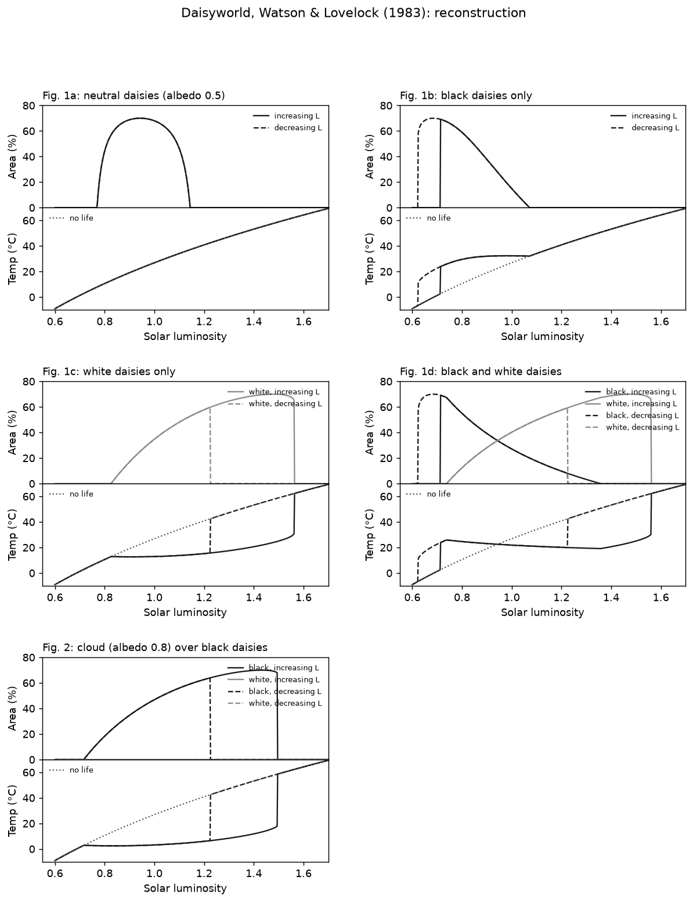

# Daisyworld

## Watson & Lovelock (1983): faithful reconstruction

**Independent review (8 November 2026).** Codex's [review](review/2026-11-08.md)
confirmed the equations, the cloud reading and the Fig. 1a equilibrium
discrepancy. It also found a solver defect and an overstatement in the fidelity
score; both are addressed in the text below. The solver defect lost black
daisies at one down-sweep point (L = 1.224, Fig. 1d) although they could
invade; the fix changed that single row of the sweep table and no published
comparison. The fidelity overstatement came from zero-area curves, which score
perfectly by tracing the axis.

**Source.** Watson, A. J. & Lovelock, J. E. (1983). Biological homeostasis of the
global environment: the parable of Daisyworld. *Tellus B* 35, 284–289.
[doi:10.1111/j.1600-0889.1983.tb00031.x](https://doi.org/10.1111/j.1600-0889.1983.tb00031.x).
We worked from a 6-page scan (SHA-256
`85b32bb0fa9e9314caaea4b4413fb6008c4eb10c7f29c9b1a7dc49333d3fef8f`), which is not
redistributed here; place it at `local/sources/watson_lovelock_1983.pdf` to rerun
the fidelity check.

**Code.** [`src/terra_prisca/daisyworld/wl1983.py`](../../src/terra_prisca/daisyworld/wl1983.py)
(model), [`figures_1983.py`](../../src/terra_prisca/daisyworld/figures_1983.py)
(regenerates the figures and `figures/wl1983_sweeps.csv`), and
[`fidelity_1983.py`](../../src/terra_prisca/daisyworld/fidelity_1983.py) (scores
the reconstruction against the scan). Tests are in
[`tests/test_wl1983.py`](../../tests/test_wl1983.py).

```bash
uv run python -m terra_prisca.daisyworld.figures_1983
uv run python -m terra_prisca.daisyworld.fidelity_1983 local/sources/watson_lovelock_1983.pdf
uv run pytest
```

### The model as published

Two daisy species, white (w) and black (b), cover fractions a_w and a_b of a flat
planet. Temperatures are in °C with the paper's offset of 273.

| Eq. | Content |
|---|---|
| (1) | da_i/dt = a_i (x β_i − γ) |
| (2) | x = P − a_w − a_b (uncolonised fertile ground) |
| (3) | β_i = 1 − 0.003265 (22.5 − T_i)², zero outside 5–40 °C |
| (4) | σ (T_e + 273)⁴ = S L (1 − A) |
| (5) | A = a_g A_g + a_w A_w + a_b A_b, with a_g = 1 − a_w − a_b |
| (7) | T_i = q′ (A − A_i) + T_e (linear form of eq. 6, used for every figure) |

Parameters (Fig. 1 legend): γ = 0.3, P = 1, S = 9.17 × 10⁵ erg cm⁻² s⁻¹
(917 W m⁻²), A_g = 0.5, A_w = 0.75, A_b = 0.25, q′ = 20 K. Fig. 1a uses a single
"neutral" species with albedo 0.5. Fig. 2 adds a cloud of albedo 0.8 over the
black daisies.

Procedure (paper, §3): for each L, start from the previous steady state, reseed
any zero population at 0.01, integrate to steady state, then step L. Fig. 1c
also sweeps L back down.

### Interpretive choices

The paper leaves these open; each is our choice, with the reason.

| Choice | What we did | Why |
|---|---|---|
| Growth outside 5–40 °C | β clipped at 0 | The paper says β "is zero when" T is 5 or 40 °C; a negative growth rate would add mortality the model does not describe |
| Steady state | LSODA (rtol 1e-10) in chunks of 200 time units until the per-capita rate falls below 1e-9 (cap 10⁵ time units; never reached) | Gives the true equilibrium, so that departures in the published curves can be diagnosed rather than copied |
| Extinction | a < 10⁻⁶ at steady state is set to 0, and then reseeded at 0.01 at the next L | The paper's "or 0.01 if these were zero" needs a definition of zero |
| Invasion check | If a species set to 0 could grow in the returned environment (x β − γ > 10⁻⁹), it is reseeded at 0.01 at the same L and integration repeated | A species can dwindle below 10⁻⁶ while the other establishes, leaving a boundary equilibrium that is unstable to invasion (review, 8 Nov 2026) |
| Luminosity grid | 0.6 to 1.7 in steps of 0.002 | Fine enough that transitions are resolved to ±0.002; the paper's step is not stated |
| Fig. 2 clouds | Cloud albedo 0.8 replaces the black daisies' albedo in the planetary albedo (eqs 4–5) only; their local temperature still uses A_b = 0.25 in eq. (7) | The paper retains "the condition that black daisies are warmer than white". The match to Fig. 2 (below) confirms this reading |
| Temperature offset | 273, not 273.15 | As printed |

### Results



Solid lines show increasing luminosity, dashed lines decreasing, and dotted lines
the lifeless planet. The surviving species hold the effective temperature
almost constant over a wide range of L. While both species coexist, T_e falls
as the Sun brightens, the paper's "surprising feature". The analytical
coexistence temperatures of eq. (14), T_b = 27.5 °C and T_w = 17.5 °C, are
reproduced to within 10⁻⁶ °C.

### Fidelity against the published figures

Each published panel was calibrated from its own tick marks: L runs 0.5–1.7,
and tick residuals are below 0.005 in L. We then measured, for every model
curve the paper plots, the distance from points along the curve to the nearest
ink in the scan. One pixel is about 0.0017 in L, 0.36% in area or 0.25 °C.

Any ink counts in that score. A zero-area stretch therefore matches
the printed axis, and an all-zero population scores 100% within 3 px on Figs
1b–d and 2 (the *null* rows in the table). The population curves are therefore
also scored on their **occupied branch** (area > 5%) alone. That is still a
one-way nearest-ink score, not a match to an identified printed curve: it
shows that our branch lies on printed ink, not that every printed curve is
reproduced. Transitions are the luminosities of the vertical jumps in each
area panel. They are transitions under the paper's 0.01 reseeding protocol, not
necessarily bifurcations: black's infinitesimal invasion boundary is
L = 0.716, but a 0.01 seed establishes at 0.714. Full table:
[`fidelity/wl1983_fidelity.csv`](fidelity/wl1983_fidelity.csv).

| Panel | Occupied area branch (median px, % within 3 px) | Temperature, full curve | Transitions, published vs reconstructed (L) |
|---|---|---|---|
| 1a neutral | **26 px, 7%** | 0 px, 99.9% | none (smooth curve) |
| 1b black | 0 px, 98% | 0 px, 97% | establishment 0.714 vs 0.713 |
| 1c white | up 0 px, 100%; down 0 px, 100% | up 0 px, 94%; down 0 px, 88% | collapse 1.570 vs 1.563; down-sweep re-establishment 1.188 vs 1.225 |
| 1d both | white 0 px, 100%; black 0 px, 98% | 1 px, 90% | establishment 0.713 vs 0.713; collapse 1.571 vs 1.561 |
| 2 cloud | 0 px, 99.6% | 0 px, 73% | collapse 1.517 vs 1.495 |

**On the occupied branches of Figs 1b–d and 2, and on their transitions, the
reconstruction agrees with the published figures.** Establishment
transitions agree to 0.001. Each remaining transition sits a little past ours in
the direction of the sweep: collapses come 0.007–0.022 later on the way up, and
white re-establishes 0.037 later on the way down. Those offsets account for
most of the temperature points beyond 3 px. Incomplete settling near the
transitions, where relaxation is slow, would produce offsets of this sign, but
the sign alone does not identify it. The luminosity step, finite reseeding and
scan resolution all limit what can be inferred.

**Fig. 1a does not show the steady state of the stated model.** For neutral
daisies, local temperature equals T_e. Daisies can therefore persist only where
β(T_e) > γ, which gives 0.770 < L < 1.144 with a peak of 70% at L = 0.943. This
follows analytically and is tested. The published hump has the right height
(69%), but it is shifted and skewed. It creeps up from about 0.78 to 0.90,
climbs steeply to its peak near L = 1.0, and decays slowly to zero near 1.23,
where T_e = 42 °C and β = 0. No equilibrium of the stated model can hold daisies
there. The published 1a temperature curve does match our lifeless temperature
to within 2 px, which rules out a calibration error.

We tested two numerical explanations:
- a fixed integration time per luminosity step;
- a loose absolute steady-state criterion.

Neither reproduces 1a while keeping the other panels' fit. A slow continuous
ramp (dL/dt ≈ 0.005 per unit time), fitted to 1a alone, cuts the RMSE from 30
to 8 percentage points. It captures the steep rise but not the long low foot or
the tail.

**The cause is unresolved.** Candidates include:
- incomplete settling in a separate run;
- a model or procedure the paper does not state;
- a coding or plotting error in the original.

None is established by the evidence so far. The reconstruction keeps the
equation-faithful equilibrium and is not tuned to the printed hump. A bounded
literature search (Codex, 8 November 2026, including Wood et al. 2008,
[doi:10.1029/2006RG000217](https://doi.org/10.1029/2006RG000217)) found no earlier
discussion of the discrepancy. That is a negative result from a limited search,
not evidence that nobody has noticed it.

### Open threads

- The cause of the Fig. 1a discrepancy.
- A two-way fidelity score that identifies each printed curve and excludes
  decorative ink, if a stronger claim than branch-on-ink is ever needed.
- An "as-computed-in-1983" variant that emulates the original numerics, worth
  building only if the Fig. 1a question can be pinned down.

## Variants

None yet. See [`docs/vision.md`](../../docs/vision.md) for the planned
re-imaginings. The Archean haze-world is next.
