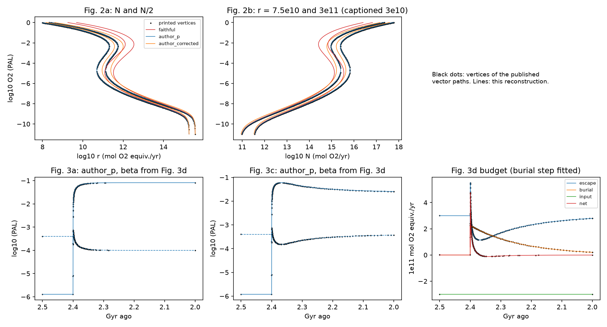

# Bistability of atmospheric oxygen (Goldblatt, Lenton & Watson 2006)

Why did oxygen jump at the Great Oxidation instead of creeping up? Goldblatt,
Lenton & Watson (2006) proposed that the atmosphere had two stable states.
Below about 10⁻⁵ PAL, methane destroys oxygen photochemically as fast as
photosynthesis makes it. Above a few 10⁻³ PAL, an ozone layer shields the
methane–oxygen reaction and oxygen stays high. In between, a modest fall in
the supply of reductants, or a small rise in organic-carbon burial, tips the
system from one state to the other.

This page holds a reconstruction of their three-box model. It is scored
against the vector geometry of the published Figs 2 and 3 and of
Supplementary Figs 2 and 3, and every number the text states is recomputed.

Status: **revised after Codex's review (GLW-R1 to R9); awaiting Codex's check,
then Gemini's review before merge** (board thread 194).

## Sources

The citations were checked against Crossref on 25 November 2026.

- Goldblatt, C., Lenton, T. M. & Watson, A. J. (2006). Bistability of
  atmospheric oxygen and the Great Oxidation. *Nature* 443(7112), 683–686.
  [doi:10.1038/nature05169](https://doi.org/10.1038/nature05169).
  - Publisher PDF supplied by Barry: four pages, SHA-256
    `37a2345b997afe01dad259c4f2525f18edbbdc3703ad545211cd859ebfb58112`.
    Its figures are vector drawings, so every curve's vertices can be read
    exactly.
  - Supplementary Information downloaded by Codex from the publisher: 12 pages
    with the full derivation, SHA-256
    `d2236ec0ec767fbcf61031cc4faf3655f1f8f050633e3d18205c1263109d5046`. Its
    Figs 2 and 3 are also vector drawings.
- Goldblatt's publications page (colingoldblatt.net/publications, "up-to-date
  as of July 2022") attaches a correction to the paper. It gives the
  methane-oxidation polynomial to seven decimals, adding "correct p is
  especially important to reproduce the results". It also states the
  hydrogen-escape coefficient as s = 3.7 × 10⁻⁵ yr⁻¹. Codex found the note;
  Claude checked its wording.
- Catling, D. C., Zahnle, K. J. & McKay, C. P. (2001). Biogenic methane,
  hydrogen escape, and the irreversible oxidation of early Earth. *Science*
  293(5531), 839–843.
  [doi:10.1126/science.1061976](https://doi.org/10.1126/science.1061976).
  Author copy obtained by Codex: 5 pages, SHA-256
  `7f8943005d1bc5a8901e7e8a7693f8ac4c5f97a57cc2d9317897de54f6862cad`. Used for
  its eq. (1), the diffusion-limited hydrogen escape rate.
- Kasting, J. F., Pavlov, A. A. & Siefert, J. L. (2001). A coupled
  ecosystem–climate model for predicting the methane concentration in the
  Archean atmosphere. *Origins of Life and Evolution of the Biosphere* 31,
  271–285. [doi:10.1023/a:1010600401718](https://doi.org/10.1023/a:1010600401718).
  Publisher PDF obtained by Codex: 15 pages, SHA-256
  `bf8537d9c3d2e24e71b8ed8b1c27fbd225663667617dc34718dae878ec3bb8d8`. Used for
  its eq. (1) and Table I, the surface-temperature fit the GLW SI cites for its
  cooling estimate.

All four PDFs are copyrighted and stay in `local/sources/goldblatt_lenton_watson/`
(gitignored). The repository holds only the vertex coordinates read from the
figures, never the drawings.

## Code

| File | Role |
|---|---|
| `src/terra_prisca/goldblatt_lenton_watson/glw2006.py` | The model: equations, readings, steady states, stability, transients, redox budget |
| `src/terra_prisca/goldblatt_lenton_watson/vectors.py` | Reads and calibrates the paths of Figs 2 and 3 and Supplementary Figs 2 and 3 |
| `src/terra_prisca/goldblatt_lenton_watson/fidelity_glw2006.py` | Scores the readings against the figures and recomputes the stated numbers |
| `tests/test_glw2006.py` | Equations, the solver near folds, budget closure, the scorer, and the figure verdicts |

Regenerate the figure vertices and frame calibrations, which needs both GLW
PDFs and PyMuPDF:

```bash
uv run --with pymupdf python -m terra_prisca.goldblatt_lenton_watson.vectors
```

Regenerate every score, table and the overlay from the committed vertices
(about 35 s):

```bash
uv run python -m terra_prisca.goldblatt_lenton_watson.fidelity_glw2006
```

## The model as published

Three reservoirs: methane M and oxygen O in the atmosphere and ocean mixed
layer, and organic carbon C in the crust, all in moles (SI eqs 1–3):

    dM/dt = ½ Ω (N + r) − s M − ½ Ψ M^0.7 − ½ Ω (β (N + r) − w C)
    dO/dt = Ω N − (1 − Ω) r − s M − Ψ M^0.7 + (1 − Ω)(β (N + r) − w C)
    dC/dt = β (N + r) − w C

- N is oxygenic net primary productivity and r the net input of reductant
  (ferrous iron), both in mol O₂ equiv. yr⁻¹.
- Ω = (1 − γ)(1 − δ) is the fraction of decomposed organic matter that reaches
  the atmosphere as methane and oxygen.
  - Aerobic respiration takes γ = O/(d_γ + O), with d_γ = 1.36 × 10¹⁹ mol.
  - Methanotrophy takes δ = O/(d_δ + O), with d_δ = 2.73 × 10¹⁷ mol.
- Photochemical oxidation removes ½ Ψ M^0.7 of methane and Ψ M^0.7 of oxygen,
  with Ψ = 10^(a₁ψ⁴ + a₂ψ³ + a₃ψ² + a₄ψ + a₅) and ψ = log₁₀ O. The fit is
  stated valid for 10⁸ < O < 10²⁰ mol.
- Hydrogen escape removes s M of both methane and oxygen.
- A fraction β of organic production is buried, and buried carbon weathers at
  rate w = 6 × 10⁻⁹ yr⁻¹.

In steady state M = r/s and C = β(N + r)/w, and O solves

    Ω N + (Ω − 2) r − Ψ (r/s)^0.7 = 0          (SI eq. 12)

This does not depend on β. Up to three roots exist; where there are three, the
middle one is unstable.

## Readings

The first three readings are fixed sets of values taken from a source, none
tuned to a figure, and were declared on board thread 194 before any was
scored. The fourth is read from a figure of the source.

| Reading | Polynomial a₁…a₅ | s (yr⁻¹) | Source |
|---|---|---|---|
| `faithful` | 0.0030, −0.1655, 3.2305, −25.8343, 71.5398 | 2.03 × 10⁻⁵ | Article Methods and SI, as printed |
| `author_p` | 0.0030084, −0.1655405, 3.2305351, −25.8343054, 71.5397861 | 2.03 × 10⁻⁵ | Goldblatt's full-precision coefficients |
| `author_corrected` | as `author_p` | 3.7 × 10⁻⁵ | Both of Goldblatt's corrections |
| `si_fig_s3` | 0.0030125, −0.1657711, 3.235288, −25.87687, 71.67882 | 2.03 × 10⁻⁵ | A quartic fitted to the line of Supplementary Fig. 3, scaled as below |

`si_fig_s3` came out of Codex's review (GLW-R4). It asks how much of the
result the 2006 publication alone fixes, without Goldblatt's later note. It is
reported separately from the three predeclared readings. Supplementary Fig. 3
plots methane oxidation over M^0.7. The SI's own equations remove ½ Ψ M^0.7 of
methane, so Ψ is twice the plotted value, and the fit adds log₁₀ 2 to the
line. The article's Fig. 2 settles the factor independently: read as Ψ itself,
the line gives a bistable range of 3.59 × 10¹¹–1.48 × 10¹² and misses the
Fig. 2a curve by 4.1 pt, against 0.025 pt with the factor of two.

The transients also need β, which the source never prints. Two values are run:

- **SI β = 2.667 × 10⁻³**, from the SI's statement that
  β(N + r) = 10¹³ mol yr⁻¹ today, with modern N and r = 7.5 × 10¹⁰;
- **Fig. 3d β = 2.00 × 10⁻³**, read off the published Fig. 3d. At the step,
  burial minus weathering jumps by β ΔN, and the printed jump is
  2.25 × 10¹¹ mol yr⁻¹. Scores of that one trace under this β are flagged as
  fitted.

Some choices came after figure data had been seen, and are labelled as such:

- r = 3 × 10¹¹ for the Fig. 2b dashed curve, after the captioned value missed;
- the Fig. 3d β, read from one step height;
- the Fig. 3 zoom time window, from the zoom ticks;
- the right-hand ordinate of Figs 3a and 3c, calibrated from its own ticks
  after Codex pointed out that they are offset from the left-hand ones;
- the common-support rule in the scorer (log O for Fig. 2, time for Fig. 3);
- the factor of two in `si_fig_s3`, taken from the SI's equations after the
  line was seen to sit 0.301 decades below Ψ;
- the transition-time clocks (six are reported) and the three methane moments
  (the 10⁻⁵ PAL crossing, the first trough and the run minimum).

## Interpretive choices

- **PAL = 0.2095 μ = 3.714 × 10¹⁹ mol.** The source gives μ, the moles in the
  present atmosphere, but never states PAL in moles. The figure confirms the
  choice: the vertical offset that best aligns `author_p` with all four Fig. 2
  curves is −0.001 decades.
- **The Fig. 2b dashed curve is drawn at r = 3 × 10¹¹, against the captioned
  3 × 10¹⁰.** Both values are scored.
- **The Fig. 3 transients start from the lowest stable steady state** of the
  pre-step parameters, with C in balance. This is the low-oxygen state the
  caption describes.
- **Fig. 3 methane is scored on both ordinates.** On the left, M is expressed
  in PAL-of-O₂ units. On the right, pCH₄ = M/μ atm is placed through that
  panel's own right-hand tick calibration.
- **Transition time.** The source does not define it. Six clocks are reported,
  all measured over the first 1 Myr after the step (the span of the zoom
  panels): O crossing 10⁻⁵ PAL and the upper fold (5 × 10⁻³ PAL); 25%, 50%,
  75% and 90% of the logarithmic rise; and the 25–75% duration.
- **Methane decline and cooling.** The text places the rapid methane decline
  "while oxygen rises to the 10⁻⁵ PAL threshold", and the SI allows its
  fixed-CO₂ temperature estimate only for changes faster than the
  carbonate–silicate cycle. The methane ratio is therefore taken at the
  10⁻⁵ PAL crossing. The cooling is Kasting et al.'s eq. (1) at fixed CO₂,
  evaluated across that fit's whole CO₂ range, 10⁻⁵ to 10⁻² atm. The first
  trough and the run minimum are reported separately.
- **Escape coefficient from Catling et al.** Their eq. (1) gives
  2.5 × 10¹³ f_total H₂ molecules cm⁻² s⁻¹. Methane carries two H₂
  equivalents, and each O₂ equivalent removes two, so the O₂-equivalent flux
  is 2.5 × 10¹³ f(CH₄). Converting with an Earth radius of 6,371 km and
  μ = 1.773 × 10²⁰ mol gives s.
- **The reverse switch's forcing is not stated.** The return from high to low
  oxygen is timed for r stepped from 7.5 × 10¹⁰ up to 5.6 × 10¹¹, 6 × 10¹¹,
  7.5 × 10¹¹ (the top of the BIF band), 10¹² and 3 × 10¹².
- **The oxidation polynomial's stated domain, 10⁸ to 10²⁰ mol, bounds the
  solver.** Steady-state searches and branch curves stay inside it unless
  extrapolation is requested explicitly. Fig. 2 spans 10⁻¹¹ to 1 PAL,
  3.7 × 10⁸ to 3.7 × 10¹⁹ mol, inside the domain. The one claim that needs
  lower oxygen, the prebiotic rise at 10⁻¹² PAL, is labelled as an
  extrapolation and computed two ways: with the quartic extended, and with
  log Ψ rising at slope 1 below 10⁸ mol, the straight-line limit the SI
  describes for low oxygen.
- **Roots near folds.** The steady-state solver brackets the residual between
  its own turning points, refined by bounded minimisation. Pairs of roots
  closer than the search grid, as next to a fold, are therefore found.
  Stability comes from the eigenvalues of the full three-box Jacobian; it
  agrees with the sign of the residual's slope at every root tested.
- **Stiffness.** The transients are integrated in log M and log O with Radau
  (rtol 10⁻¹⁰). Oxygen's turnover on the low branch is about 0.01 yr, while
  1/w is 170 Myr.

## Fidelity against the published paper

### Reading the figures

Each curve is a stroked polyline in the PDF.

- Paths drawn twice at identical coordinates, in either direction, are counted
  once. Fig. 2 then has 12 distinct paths: in each panel, a solid and a dashed
  curve, each with two stable branches and a dotted unstable connector.
- Each axis is calibrated from its major ticks
  ([`glw2006_frames.csv`](fidelity/glw2006_frames.csv),
  [`glw2006_calibration.csv`](fidelity/glw2006_calibration.csv)):
  - Fig. 2 ticks fit to 0.0026 decades. The grey reference lines fall at
    log₁₀ r = 10.8753 and log₁₀ N = 15.5742, against 10.8751 and 15.5740 for
    the captioned 7.5 × 10¹⁰ and 3.75 × 10¹⁵.
  - Fig. 3 ticks fit to 0.004 decades, 0.008 × 10¹¹ mol yr⁻¹ and 0.0001 Gyr.
    The zoom panels' time axes run from 2.4001 to 2.399 Gyr ago.
  - The right-hand ordinates of Figs 3a and 3c, in atm, carry their own decade
    ticks, drawn about 2 pt below the left-hand ones. Six right and seven left
    major ticks are fitted in each of the four panels, to 0.003 decades.
    Read against the left-hand axis, 1 PAL sits at 0.196, 0.195, 0.191 and
    0.201 atm on the right in 3a, 3a zoom, 3c and 3c zoom, close to the O₂
    fraction of 0.2095.
  - Supplementary Fig. 2 contributes its 19 marker centres, grouped by the
    caption's three oxygen levels. Supplementary Fig. 3 contributes its
    120-segment fitted line. Their ticks fit to 0.003 decades.
- Scores are distances on the printed page, in points (1 pt = 1/72 inch).
  Every curve, printed or modelled, is a set of separate polylines: each
  printed branch is its own path, and the model curve is clipped at the frame
  segment by segment into visible runs. Each run is densified to 0.01 pt on
  its own, and distances go to the nearest segment exactly.
- Both directions are reported as RMS over arc length: printed to model, and
  model to printed. Each is taken on the common support, the span of log O
  (Fig. 2) or time (Fig. 3) covered by both curves. The length of each curve
  outside that span, and of the model outside the frame, is recorded
  alongside.

### Fig. 2: steady states

Printed-to-model / model-to-printed RMS distance
([`glw2006_fig2.csv`](fidelity/glw2006_fig2.csv)):

| Curve | `faithful` | `author_p` | `author_corrected` | Null: shifted one decade | Null: flat |
|---|---|---|---|---|---|
| 2a, N = 3.75 × 10¹⁵ | 10.9 / 7.5 pt | **0.026 / 0.023 pt** | 2.4 / 2.6 pt | 11.4 / 11.3 pt | 33.0 / 25.8 pt |
| 2a, N/2 | 9.9 / 7.6 pt | **0.025 / 0.022 pt** | 2.3 / 2.6 pt | 11.3 / 11.0 pt | 33.0 / 25.4 pt |
| 2b, r = 7.5 × 10¹⁰ | 6.4 / 5.6 pt | **0.030 / 0.029 pt** | 2.2 / 2.2 pt | 13.8 / 13.4 pt | 31.5 / 22.5 pt |
| 2b dashed, r = 3 × 10¹⁰ (captioned) | 16.7 / 16.2 pt | 9.2 / 10.2 pt | 11.9 / 12.5 pt | 14.0 / 13.5 pt | 31.1 / 22.5 pt |
| 2b dashed, r = 3 × 10¹¹ | 6.4 / 5.7 pt | **0.023 / 0.022 pt** | 2.2 / 2.2 pt | 14.0 / 13.5 pt | 31.1 / 22.5 pt |

- `author_p` puts every curve within three hundredths of a printed point, in
  both directions. Stable and unstable sections agree for 99.7% of vertices;
  the rest lie at the folds.
- The printed 2a N/2 curve stops at 10⁻¹⁰·⁵⁵ PAL. The model's 3.7 pt beyond
  that, down to the frame, is reported as model length outside the common
  support.
- With the printed four-decimal coefficients, `faithful` misses by about as
  much as shifting the printed curve by a full decade.
- The fold positions under `author_p` match the printed connector ends to
  0.008 decades in r or N
  ([`glw2006_folds.csv`](fidelity/glw2006_folds.csv)). At modern N the
  bistable range is r = 1.337–5.519 × 10¹¹; the printed connector ends give
  1.35–5.48 × 10¹¹. Under `faithful` the range is 3.30 × 10¹¹–3.43 × 10¹².

### Supplementary Figs 2 and 3: the photochemical fits

From [`glw2006_si.csv`](fidelity/glw2006_si.csv):

- **Supplementary Fig. 2.** The log–log slopes of the three marker sets are
  0.584, 0.749 and 0.698 at 1, 0.1 and 0.01 PAL. The SI states 0.58, 0.75 and
  0.70.
- **Supplementary Fig. 3.** The drawn line lies 0.3006 decades below
  log₁₀ Ψ from the full-precision coefficients, with a scatter of
  0.002 decades about that offset. The offset is log₁₀ 2 = 0.3010: the figure
  plots methane oxidised, half the oxygen consumed. Against the printed
  four-decimal coefficients the scatter is 0.43 decades.
- **`si_fig_s3`.** A quartic fitted to that line gives a bistable range at
  modern N of 1.335–5.511 × 10¹¹, against `author_p`'s 1.337–5.519 × 10¹¹.
  Codex's independent digitisation gives 1.327–5.490 × 10¹¹. Shifting the line
  by ±0.003 decades, the size of the tick-fit residuals, moves the folds by
  up to 1%, so the SI fixes the range to about 1%. At r = 3 × 10¹¹ the stable
  states are 1.28 × 10⁻⁶ and 0.0230 PAL. The Fig. 2 fold positions match the
  printed connector ends to 0.009 decades, and the Fig. 2a curve scores
  0.025 pt.

### Fig. 3: the two triggers

The model starts from the low state and steps at 2.4 Gyr ago, exactly as the
caption states: (a) r falls from 3 × 10¹¹ to 7.5 × 10¹⁰; (c) N rises from
3.6375 × 10¹⁵ to 3.75 × 10¹⁵ at r = 3 × 10¹¹. Scores are the larger of the two
directions, from [`glw2006_fig3.csv`](fidelity/glw2006_fig3.csv). Fig. 3d β
unless stated.

| Trace | `author_p` | `author_p`, SI β | `author_corrected` | `faithful` | Null: no switch |
|---|---|---|---|---|---|
| 3a O₂ | **0.011 pt** | 0.011 pt | 1.9 pt | 17.6 pt | 27.7 pt |
| 3a CH₄, left axis (PAL units) | **0.011 pt** | 0.011 pt | 1.7 pt | 0.48 pt | 3.6 pt |
| 3a CH₄, right axis as ticked (atm) | 0.20 pt | – | 1.5 pt | – | – |
| 3a zoom O₂, CH₄ (left axis) | **0.013–0.019 pt** | 0.012–0.015 pt | 1.2–3.6 pt | 1.5–20 pt | 1.4–20 pt |
| 3b escape, net | **0.010–0.018 pt** | 0.010–0.018 pt | 0.14–2.2 pt | 0.45–1.7 pt | 0.34–6.5 pt |
| 3b burial, input | **0.008–0.013 pt** | 0.010–0.013 pt | 0.008–0.013 pt | 0.008–0.013 pt | 0–6.6 pt |
| 3c O₂ | **0.016 pt** | 0.52 pt | 2.0 pt | 17.8 pt | 25.9 pt |
| 3c CH₄, left axis (PAL units) | **0.013 pt** | 0.69 pt | 1.7 pt | 0.39 pt | 1.2 pt |
| 3c CH₄, right axis as ticked (atm) | 0.25 pt | – | 1.5 pt | – | – |
| 3c zoom O₂, CH₄ (left axis) | **0.014–0.015 pt** | 0.50–1.4 pt | 1.1–3.6 pt | 1.4–20 pt | 1.4–20 pt |
| 3d escape, net | **0.013–0.017 pt** | 0.24–0.88 pt | 0.13–2.2 pt | 0.39–1.6 pt | 0.29–4.2 pt |
| 3d burial | 0.021 pt (step fitted) | 0.93–0.99 pt | 0.021 pt (step fitted) | 0.021 pt (step fitted) | 2.7–3.2 pt |
| 3d input | 0.003 pt | 0.003 pt | 0.003 pt | 0.003 pt | 0 pt |
| 3b zoom budget | 0.08–1.6 pt | 0.08–1.6 pt | 0.08–6.0 pt | 0.08–7.7 pt | 0–12.6 pt |
| 3d zoom budget | 0.014–0.54 pt | 0.54–2.3 pt | 0.014–7.2 pt | 0.014–6.1 pt | 0–11.2 pt |

- `author_p` with the Fig. 3d β reproduces every main-panel trace, and the
  oxygen and methane traces of both zooms, to 0.003–0.021 pt in both
  directions.
- β comes from the height of a single step in the 3d burial trace. It also
  brings the 3c oxygen and methane traces, which played no part in choosing
  it, from 0.52–0.69 pt down to 0.013–0.016 pt. The 3d burial trace then
  decays over the following 400 Myr exactly as w = 6 × 10⁻⁹ yr⁻¹ predicts,
  which independently checks w.
- Methane lies on both ordinates: 0.011–0.014 pt on the left in PAL units, and
  0.11–0.25 pt on the right-hand atm axis as its ticks are drawn. The
  0.2 pt difference is the gap between the drawn 0.191–0.201 atm per PAL and
  the O₂ fraction of 0.2095. Under `author_corrected` methane misses on both
  ordinates by 1.5–1.7 pt, so the figure was drawn with s = 2.03 × 10⁻⁵.
- The zoom budget panels draw the pre-step fluxes at different levels from the
  main panels. Escape and input are 3.37 and −3.33 × 10¹¹ in the 3b zoom,
  against 3.01 and −2.99 in the main panel. In the 3d zoom they are 3.11 and
  −2.84, against 3.00 and −3.00. These offsets set the zoom budget scores.



### Stated numbers, recomputed

From [`glw2006_claims.csv`](fidelity/glw2006_claims.csv), under `author_p` with
the Fig. 3d β unless stated:

| Claim | Stated | Reconstruction |
|---|---|---|
| Steady states at modern N, r = 3 × 10¹¹ | low branch, ~10⁻⁶ PAL | 1.28 × 10⁻⁶ (stable), 4.95 × 10⁻⁴ (unstable), 0.0231 (stable) PAL |
| Steady states at modern N, r = 7.5 × 10¹⁰ | high branch only, ~0.1 PAL | 0.0816 PAL, the only state |
| Edges of the two branches | low < 10⁻⁵, high > 5 × 10⁻³ PAL | low up to 1.99 × 10⁻⁵, high down to 4.47 × 10⁻³ PAL |
| Low state against the SI's sulphur bound | below 10⁻⁵ PAL | below it for r from 1.403 × 10¹¹ to the upper fold at 5.519 × 10¹¹; above it for r between the lower fold at 1.337 × 10¹¹ and 1.403 × 10¹¹ |
| Prebiotic rise to the low state (extrapolated below 10⁸ mol) | when N exceeds r | at r = 7.5 × 10¹⁰, O reaches 10⁻¹² PAL at N = 8.7 × 10¹⁰ (quartic extended) or 7.95 × 10¹⁰ (slope 1 below 10⁸ mol) |
| Escape coefficient from Catling et al. eq. (1) | 3.7 × 10⁻⁵ yr⁻¹ (Goldblatt's note) | 3.77 × 10⁻⁵ yr⁻¹ |
| Total oxidation, case a | 3 × 10¹⁸ mol | 3.05 × 10¹⁸ mol |
| Total oxidation, case c | 9 × 10¹⁷ mol | 9.4 × 10¹⁷ (Fig. 3d β); 9.7 × 10¹⁷ (SI β) mol |
| Transition time, case a | 150 kyr | 146 kyr to half the log rise; 126 kyr to 10⁻⁵ PAL; 25–75% duration 61 kyr. The printed zoom gives 146 and 61 kyr |
| Transition time, case c | 50 kyr | 146 kyr to half the log rise; 25–75% duration 61 kyr (Fig. 3d β). With SI β: 86 and 52 kyr. The printed zoom gives 145 and 62 kyr |
| Oxygen after the switch, case a | rises to the high state | 0.0052 PAL at 0.5 Myr, 0.011 at 1 Myr, 0.075 at 47.5 Myr, then 0.0816 |
| Oxygen after the switch, case c | rises to the high state | 0.0052 PAL at 0.5 Myr, peak 0.0598 at 32 Myr (printed: 0.0597), 0.025 at 400 Myr, settling to 0.0231 |
| Methane fall while O rises to 10⁻⁵ PAL | factor 2–6 | 2.14 in both cases, at 126 kyr (83.4 → 39.0 ppm). Printed zooms: 2.14 (a), 2.17 (c) |
| Later methane minima | – | first trough 2.24 at 143 kyr; run minimum 4.0 (a, the new steady state) and 2.6 (c, at 32 Myr) |
| Cooling with that methane fall, fixed CO₂ | 4–9 °C | 2.5–3.5 K across 10⁻⁵ to 10⁻² atm CO₂ |
| Methane re-adjustment, case a | about 50 Myr | 54 Myr for escape to come within 10% of r |
| Organic carbon, case c | +3% over ~500 Myr | +2.8% after 400 Myr, heading to 3% |
| Reverse switch | 3–7 Myr | 6.6 Myr (r → 7.5 × 10¹¹); 4.1 Myr (r → 10¹²); 1.1 Myr (r → 3 × 10¹²); 12.3 Myr (r → 6 × 10¹¹); 25.3 Myr (r → 5.6 × 10¹¹) |
| Respiration and methanotrophy thresholds | 0.01 and 2 × 10⁻⁴ PAL | half-saturation at 0.366 and 0.00735 PAL; each pathway is 2.7% saturated at the stated level |
| δ¹³C of carbonate | f = 0.206, +0.23‰ | f = 0.2060, +0.227‰ |
| Simplified eq. (6) equivalent to the full eq. (12) | "when oxygen exceeds 1 × 10⁹ PAL" | above 1.9 × 10⁻⁸ PAL to 1% in r; above 4.3 × 10⁻⁹ PAL to 10% |

## What holds

- **The model reproduces both figures once the polynomial has its full
  precision.** Every Fig. 2 curve lies within 0.030 pt of the printed one, in
  both directions. Every main-panel trace of Fig. 3, and the oxygen and
  methane of both zooms, lies within 0.021 pt. The only number read from a
  figure is β, and the same β also fits traces it was not taken from.
- **The 2006 publication fixes the bistability quantitatively on its own.**
  Supplementary Fig. 3 draws the oxidation fit at full precision: a quartic
  fitted to the drawn line puts the bistable range within 1% of the range
  from Goldblatt's later coefficients, and reproduces Fig. 2. Supplementary
  Fig. 2 recovers the three stated methane exponents to the two decimals
  given.
- **The bistability is real in the model as specified.** At modern
  productivity, reductant inputs between 1.337 × 10¹¹ and
  5.519 × 10¹¹ mol yr⁻¹ have two stable states. The high one sits above
  4.5 × 10⁻³ PAL. The low one sits below the SI's 10⁻⁵ PAL sulphur-isotope
  bound for r from 1.403 × 10¹¹ upwards, which covers 97% of the bistable
  range in log r. The BIF-era input band of 1.25–7.5 × 10¹¹ overlaps this
  range, and today's 7.5 × 10¹⁰ lies on the high branch alone.
- **Both triggers switch the system.** In each case oxygen crosses 10⁻⁵ PAL
  126 kyr after the step and reaches 0.01 PAL within 1 Myr. Case a then rises
  over tens of millions of years to 0.08 PAL. Case c peaks at 0.06 PAL after
  32 Myr, matching the printed peak to 0.2%, and relaxes towards the high
  state at r = 3 × 10¹¹, 0.023 PAL. Total oxidation matches the stated
  3 × 10¹⁸ and 9 × 10¹⁷ mol.
- **Methane falls twofold while oxygen rises to 10⁻⁵ PAL**, the low end of the
  stated factor of 2–6, in the model and in both printed zooms. At fixed CO₂,
  Kasting et al.'s fit turns that fall into 2.5–3.5 K of cooling, nearly
  independent of the CO₂ level, as the SI says. Methane takes about 50 Myr to
  re-adjust in case a.
- **The hysteresis spans millions of years.** Stepping r from today's value to
  the top of the BIF band or to 10¹² mol yr⁻¹ takes oxygen back below
  10⁻⁵ PAL in 6.6 and 4.1 Myr, the stated 3–7 Myr.
- **Catling et al.'s escape law gives s = 3.77 × 10⁻⁵ yr⁻¹**, within 2% of
  Goldblatt's later value of 3.7 × 10⁻⁵.
- **Fig. 3's right-hand axis gives pO₂ and pCH₄ in atm to within the drawing
  precision.** Its ticks put 1 PAL at 0.191–0.201 atm, close to 0.2095, and
  the methane trace lies within 0.25 pt of the partial pressure the model
  gives.
- **The steady states follow in closed form.** M = r/s and C = β(N + r)/w, and
  oxygen is a one-dimensional root that does not depend on β. The redox budget
  of the surface system closes exactly as escape plus net burial minus
  reductant input.
- **The carbon-isotope arithmetic is right:** f = 0.206 gives +0.227‰.

## What the source got wrong or left inconsistent

- **The printed polynomial coefficients do not reproduce the paper's
  results.** At four decimals the rounding errors are multiplied by powers of
  ψ up to ψ⁴ ≈ 8 × 10⁴ near O ~ 10¹⁷ mol, and together they move Ψ by
  0.43 decades RMS against the drawn Supplementary Fig. 3. The bistable range
  at modern N then moves to 3.30 × 10¹¹–3.43 × 10¹². Bistability itself
  survives (at r = 5 × 10¹¹ the printed coefficients give stable states at
  1.7 × 10⁻⁶ and 0.12 PAL), but the captioned Fig. 3 forcing, r = 3 × 10¹¹,
  then has only the high state, so neither Fig. 3 trigger can be rerun from
  the printed numbers. The full precision is in Supplementary Fig. 3 and in
  Goldblatt's later note.
- **The escape coefficient is about half the value its cited source gives.**
  The SI scales s = 2.03 × 10⁻⁵ yr⁻¹ from Catling et al. (2001), and the
  figures were drawn with it: under 3.7 × 10⁻⁵, all four Fig. 2 curves miss by
  2.2–2.6 pt and the Fig. 3 traces by up to 3.6 pt. Catling et al.'s eq. (1)
  gives 3.77 × 10⁻⁵ yr⁻¹, and Goldblatt's later note states 3.7 × 10⁻⁵. The
  published figures therefore carry escape at 54% of the cited
  diffusion-limited rate.
- **Supplementary Fig. 3 labels as Ψ a quantity half as large.** Its axis
  reads "Oxidation parameter, Ψ" and its caption "Ψ = oxidation/M^0.7", but
  the line sits log₁₀ 2 below the Ψ of the SI's equations: it plots methane
  oxidised, while Ψ is the oxygen consumed.
- **The Fig. 2b caption misstates the dashed curve's reductant input.** The
  curve drawn is r = 3 × 10¹¹ (0.023 pt); the captioned 3 × 10¹⁰ misses by
  9–10 pt.
- **"Equivalent when oxygen exceeds 1 × 10⁹ PAL"** (Fig. 2 caption, SI p. 10)
  cannot be right as printed. The simplified and full equations agree above
  about 10⁻⁸ PAL, so 10⁻⁹ was probably meant.
- **The stated transition times, 150 kyr for case a and 50 kyr for case c,
  differ threefold, while the published zooms show the two cases switching
  together.** On every clock tried, the printed Fig. 3a and 3c zooms give
  matching times: 146 and 145 kyr to half the logarithmic rise, 61 and 62 kyr
  for the 25–75% duration. The model reproduces both. No single clock gives
  the 150/50 pair.
- **The Fig. 3 zoom budget panels are not exact enlargements of the main
  panels.** Their pre-step escape and input sit 4–12% away from the same
  fluxes in the main panels, stretched in the 3b zoom and offset in the 3d
  zoom.

## What stays open

- **Why β = 0.0020.** The figure's β does not follow from the SI's statement
  that β(N + r) = 10¹³ mol yr⁻¹ today, which gives 0.0027. With w = 6 × 10⁻⁹,
  β = 0.0020 implies modern burial of 7.5 × 10¹² mol yr⁻¹ and
  C = 1.25 × 10²¹ mol, so the figure may have used burial or reservoir
  numbers other than those the SI quotes. Steady states and case a are
  insensitive to β; case c's path is not.
- **The 4–9 °C cooling.** The events the paper depicts give a 2.14-fold
  methane fall and 2.5–3.5 K of cooling at fixed CO₂. On the same fit, a
  sixfold fall from the same starting methane gives 4.1–7.3 K, and no fall in
  the stated range reaches 9 K. The paper does not say which runs, methane
  levels or CO₂ values produced its range. Kasting et al. quote their fit to
  about 1 K and compute it for 0.8 of present solar luminosity, the Sun at
  2.8 Gyr ago.
- **What "transition time" meant.** Half the logarithmic rise reproduces
  150 kyr for case a. With the SI β the model's case c has a 25–75% duration
  of 52 kyr, near 50 kyr, but the same clock gives 61 kyr for case a. The
  source does not define its clock.
- **What the biological thresholds mean.** The text places the Pasteur point
  at 0.01 PAL and methanotrophy at 2 × 10⁻⁴ PAL. The constants put
  half-saturation at 0.366 and 0.00735 PAL (d_δ does correspond to the stated
  2 µM), so each pathway is 2.7% saturated at the stated level. The two match
  as half-saturation only if 1 PAL were 1.36 × 10²¹ mol. The text calls the
  levels the points where each pathway is inhibited or becomes effective,
  without an operational definition, so which reading the authors intended
  is not settled.
- **The reverse switch's forcing.** 3–7 Myr follows for r stepped to between
  7.5 × 10¹¹ and 10¹² mol yr⁻¹. Closer to the upper fold the return slows:
  12.3 Myr at 6 × 10¹¹ and 25.3 Myr at 5.6 × 10¹¹. The source never says what
  it ran.
- **The prebiotic rise.** The text's condition, that the low state appears
  when N exceeds r, holds by the structure of eq. 12. A quantitative check at
  10⁻¹² PAL lies below the oxidation fit's 10⁸ mol limit; two extensions give
  N = 8.5–8.7 × 10¹⁰ at r = 7.5 × 10¹⁰.
- **How the two values of s arose.** Catling et al.'s eq. (1) gives
  3.77 × 10⁻⁵ with the constants used here, and the note's 3.7 × 10⁻⁵ agrees
  with it to 2%. Neither the SI's conversion to 2.03 × 10⁻⁵ nor the note's
  own constants and rounding are documented.
