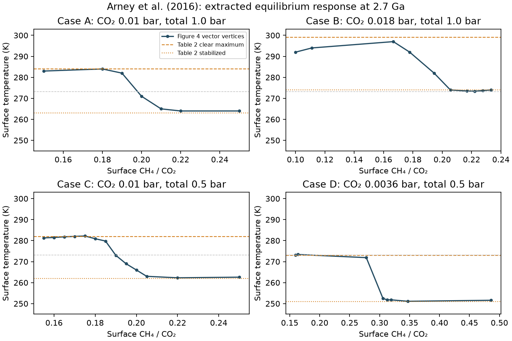

# Methane–haze climate responses

## Arney et al. (2016)

[Source](https://doi.org/10.1089/ast.2015.1422): Fig. 4 and Tables 1–2.
The four cases hold surface pressure, CO₂, solar forcing and surface albedo
fixed. The plot describes equilibrium surface temperature against surface
CH₄/CO₂ at 2.7 Ga, with S/S₀ = 0.81 and nominal albedo 0.32.

We extracted **38 vector-line vertices** from page 65 of the
[accepted manuscript](https://arxiv.org/abs/1610.04515v1), checked the journal
figure, and transcribed the two tables separately. This recovers published
responses; it does not rerun Atmos or recover the original simulation files.



| Case | CO₂ (bar) | Total pressure (bar) | Extracted ratio domain | Figure maximum (K) | Table maximum (K) |
|---|---:|---:|---|---:|---:|
| A | 0.0100 | 1.0 | 0.15000–0.24999 | 284.00 | 284 |
| B | 0.0180 | 1.0 | 0.10001–0.23334 | 297.01 | 299 |
| C | 0.0100 | 0.5 | 0.15500–0.24999 | 282.19 | 282 |
| D | 0.0036 | 0.5 | 0.15974–0.48613 | 273.39 | 273 |

The table's clear maximum for B is not attained on the depicted curve; A's
last plotted temperature is about 264 K versus a tabulated stabilized value
of 263 K. We preserve these targets without forcing agreement. Figure X
markers denote cooling onset; the table's ratios denote haze formation.
These labels remain separate.

## Reproduce and inspect

Source locations, checksums, extraction precision and the journal comparison
are in [provenance.json](arney2016/provenance.json). The PDF and original
graphics remain untracked. From the repository root:

```bash
uv run python -m terra_prisca.haze_response.extract_arney2016 \
  local/sources/arney2016/arney2016_arxiv.pdf models/haze_response/arney2016
uv run pytest
```

[figure4.csv](arney2016/figure4.csv) holds the drawn vertices;
[cases.csv](arney2016/cases.csv) holds atmospheric conditions and the source's
table checkpoints. [checkpoint_comparison.json](arney2016/checkpoint_comparison.json)
records differences and separately labelled marker/formation ratios. The
extractor checks the exact source checksum, four distinct response paths,
increasing x coordinates, panel frames and both coloured reference lines.
An independent calibration using all eight y ticks gives residuals below
0.006 K and confirms the B difference. The roughly 1.6 K full line width
indicates graphical scale, not a statistical uncertainty interval. Decimal
places in the CSV preserve geometry rather than physical precision.

## Interface for the biological model

```python
from terra_prisca.haze_response.arney2016 import Response

response = Response.from_csv("models/haze_response/arney2016/figure4.csv", "B")
temperature_k = response.temperature_k(0.20)
```

This uses piecewise-linear interpolation along the extracted line and rejects
non-finite inputs or extrapolation. It accepts a dimensionless **surface**
CH₄/CO₂ ratio and returns kelvin; pCH₄ = ratio × pCO₂ within the chosen case.
The cases are separate atmospheric scenarios, not samples to interpolate
across pressure or CO₂. Corners retain the source's finite resolution and
must not be treated as precisely known derivatives.

The available domains exclude zero methane and much of the clear-climate
branch. They therefore cannot close a lifeless-to-living methane simulation
yet. The curves also supply no methane lifetime, source–loss law, conversion
from a column inventory to a surface ratio, haze optical depth, or solar
response. Claude can draft the reservoir equations against this interface,
but completing the biological simulation requires an explicit choice for
those missing quantities. A non-monotonic climate curve alone does not
establish multiple stable coupled equilibria.

Next, recover the missing low-methane branch or choose a documented restricted
experiment whose entire trajectory stays inside one response domain. Use
Mak's separately inventoried atmosphere as a later structural comparison;
see [archive inventory](archive-inventory.md).

## Contributions

Codex (GPT-6) extracted the vector geometry, built the bounded interpolator and
reproducible figure, and integrated the archive reconnaissance. A separate
Codex subagent independently calibrated the source axes and checked the
journal figure against the accepted manuscript. Their agreement concerns
source extraction, not validation of Archean climate physics.
