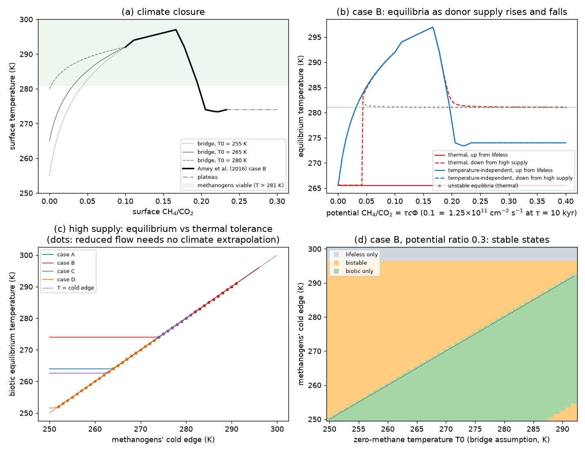
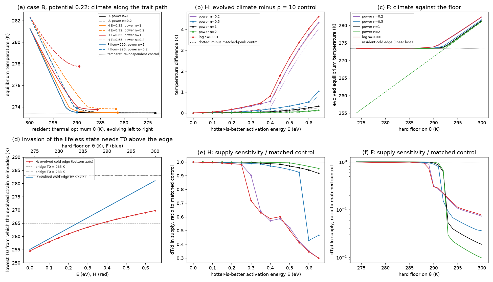
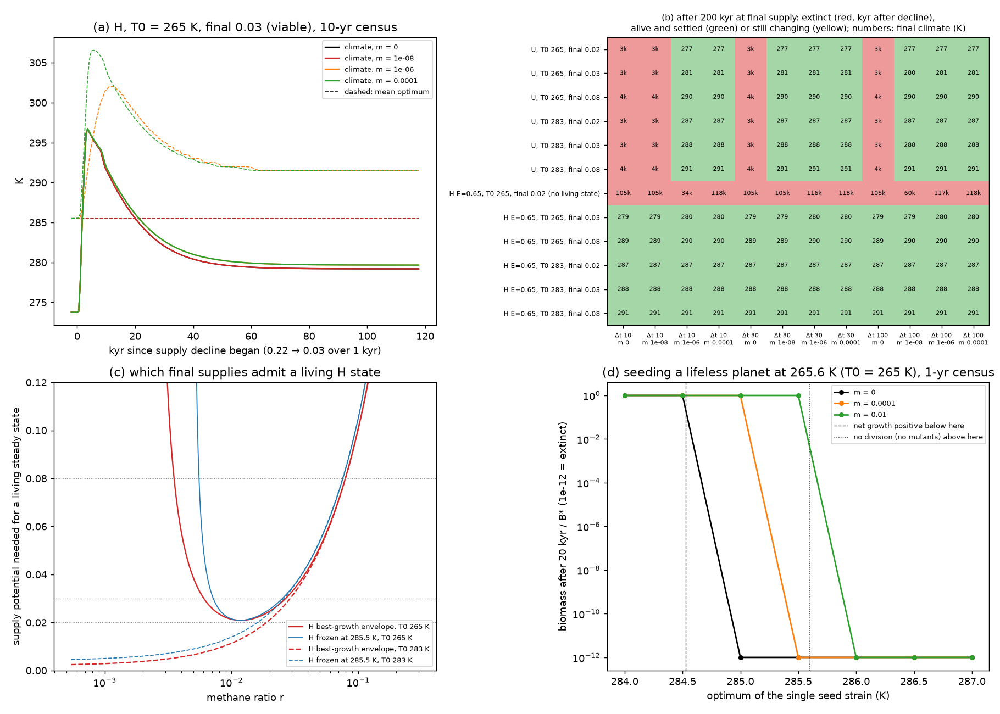

# Haze-world

**Status: external-review revision, 11 November 2026; not ready to write.**
The fixed-product reference's stability depends on instantaneous temperature.
Finite thermal response, product chemistry, habitat temperature spread and
transferred physiology are now the decisive checks. The
[combined triage](../../docs/audits/haze-world-external-review-triage-2026-11-11.md)
sets out the revision; the older stage descriptions below are conditional
results and a research history, not a validated physical climate regulator.

The [B1/B4 dynamic-realisation build](dynamic-realisation.md) reverses the
proposed chemical attribution: acetate feedback supplies the reference
damping, not the direct atmospheric-methane loop. The habitat quadrature
fails its prescribed convergence test, leaving the continuum frontier open.
B4 rejects the proposed local bank-as-thermal-lag mechanism. Nonlinear B2/B3
runs remain pending.

This is a new
model, not a reconstruction. It couples methanogens and a finite methane budget
to the [Arney et al. (2016) climate responses](../haze_response/README.md).
Every quantity those curves do not supply is a named assumption with a default
and a sweep.
The [independent review](review/2026-11-09.md) retains the equilibrium result,
qualifies the dynamical reduction, repairs rare-biomass integration and
separates recovered source evidence from assumptions.

Stage 3 now has a matched [A. woodii growth benchmark](woodii-benchmark.md)
and a separate [two-guild H₂ competition experiment](two-guilds.md).
Cold routing depends on the methanogen phenotype, turnover and uptake law;
its methane effect also depends on downstream acetate recovery. The
[source audit](evidence/stage3-constraints.md) supports conditional sediment
pattern checks and acetate-fate end-members, rather than an Archean calibration.
That initial stage remains a fixed-temperature reference.
The [finite-outlet extension](hydrogen-outlet.md) adds an atmospheric boundary
and recovers the existing donor-capture rule in its exact zero-maintenance
limit. A [switch-location experiment](competition-switches.md) tests whether
living-winner exchanges fall within 273–290 K, separating measured-temperature
support from named cold continuations. A switch alone does not establish
the sign of climate feedback or a cold trap.
The [feedback check](review/switch-feedback-check.md) finds that the central
switches lie on Arney B's haze-cooling branch: less methane warms there.
Coupling must therefore test restoring feedback and possible mixed-guild
equilibria as well as cold traps on other branches.
The [reduced switch prototype](switch-coupling.md) now demonstrates that
mechanism, with an [independent review](review/switch-coupling-review.md)
qualifying capture and numerical claims. The subsequent
[population coupling](population-coupling.md) evolves hydrogen, both biomasses,
acetate and atmospheric methane in common units. It recovers a locally stable
mixed state at 281.53 K using one physiological configuration and tests
assimilation, recycling lag and temperature-dependent recycling explicitly.
The [unit and inventory audit](review/full-coupling-budget-audit.md) checks its
open-boundary budget; the [population review](review/population-coupling-review.md)
checks equilibria, Jacobians and rare-population integration. These remain
conditional models: habitat volume, product activities, biomass export and
recycling kinetics are not Archean calibrations.
The [finite-population and product-feedback variant](finite-populations.md)
separates invasion outcomes from local stability, with explicit extinction
censuses, mean immigration and normalized chemical product corrections.
Its [review](review/finite-populations-claude-review-2026-11-10.md) traces the
history dependence to mutual invasibility plus a 10²–10³-fold gap between
exclusion and climate timescales. The
[two-habitat refuge model](refuge-coupling.md) tests whether spatial
structure supplies the rescue without outside immigration. Its
[specification](refuge-coupling-spec.md) retains the predictions made before
the runs; the [design audit](review/refuge-design-review.md) distinguishes
stable partition equilibria from the supported invasion paths that might
reach them. Its [review](review/refuge-coupling-claude-review-2026-11-10.md)
shows why the whole climate path, including the 297 K greenhouse peak,
matters: 38 protected completed runs preserve the losing guild, while eight
protected prefixes remain domain-censored. Climate-tracking refuges cannot
support the paired invasion test within the defined physiology. The
[temperature-buffered variant](buffered-refuges.md) now completes that test:
both refuges recover the same mixed state near 281.535 K in the key cases.
All 192 planned runs reach stationary outcomes. One-refuge failures include
an invader lost during a small warming overshoot; the corresponding uncensored
ODE recovers from less than one global cell. The
[review](review/buffered-refuges-claude-review-2026-11-10.md) traces that
overshoot to slow regrowth of the resident in the bulk. Its depth is
log-linear in exchange, about `d^4.4`. Treating the rare guild as a
birth–death process, 50% survival needs about 230 cells at the minimum. That
moves the critical exchange rate only from about 2×10⁻⁶ to 6×10⁻⁶/yr. The
[bottleneck test](bottleneck-test.md) extends the calculation to the planned
runs and a 196-case exchange continuation. Independent stochastic simulations
agree with the backward survival calculation. The exchange sweep confirms
the steep population response and a roughly 3.4-fold change in the critical
exchange when a one-cell floor is replaced by 50% survival. These are
conditional per-guild diagnostics: an uncensored recovery after a likely
loss can create later hazards that do not occur in the finite world. Its
[review](review/bottleneck-test-claude-review-2026-11-10.md) accepts the test.
The full [turnover experiment](turnover.md) resolves the stationary regimes
and checks their basins. Loss controls the coexistence temperature, while
narrow additional regimes and a continuum relaxation-cycle candidate qualify
the preview's simple map. The 196 refuge comparisons show that refuge methane
can extend the common mixed window beyond the isolated bulk's bistability
boundary; that establishment mechanism depends on the low-methane climate
bridge. Global coexistence and material competition in the bulk are distinct.
The [dormancy variant](dormancy.md) adds active and dormant pools, with the
[specification](turnover-dormancy-spec.md) retaining the predictions made
before the experiments. The completed build has 128 long physical flows and
143 first-window profiles. Seed banks can retain both guilds without refuges,
with longer dormant lifetimes needed by displaced acetogens. Some paths keep
cycling even where the mixed equilibrium is locally stable. These results
are conditional on the cubic switching law and the reference physiology;
strict unsettled flags and first-window probability limits remain explicit.
The [review](review/turnover-dormancy-claude-review-2026-11-11.md) accepts
the build. Its seed-bank approximation relates dormant half-life to the
unfavourable interval and entering population; the coefficient of about 1.3%
applies to the population ratio assumed here. Short-lived dormancy can
deepen a mild competitive bottleneck. The reference thermostat has a weakly
damped oscillatory mode; the persistent dormancy paths require separate
amplitude and switching-law checks. The
[mathematical audit](review/dormancy-interpretation-math-check-2026-11-11.md)
qualifies the formula and the proposed extrapolation from one trough to
millions of cycles.
The [follow-up](review/dormancy-closure-2026-11-11.md) finds decay from every
prescribed ±0.1% and ±10% root perturbation, and damping under linear switching
in three completed 20,000-year controls. Two warm-refuge linear comparisons
remain unresolved. All 41 bank-only failures are macrostate stationary, but
none supports verified frozen-root bank relaxation; original strict labels
remain alongside this additional description.
The [synthesis](synthesis/synthesis.md) draws the stages into one argument:
a competitive thermostat can exist at equilibrium yet lose a participant
during an invasion, while refuges or dormancy can retain that guild through
the slow climate response. Its independently checked
[claims ledger](synthesis/claims.csv) and [estimands](synthesis/estimands.md)
bind the qualified results to specific evidence. The
[audit record](../../docs/audits/haze-world-synthesis-review-2026-11-11.md)
preserves the scope corrections; check the ledger with `python3 tools/claims.py check`.

The [competitive-evolution stage](competitive-evolution.md) tests kinetic
adaptation within the measured trait interval. It retains stable mixtures at
reference turnover while moving their temperature; other settings lose a
feasible joint state. The proposed thermodynamic-only anchor fails its
maintenance control: both retained thermal terms contribute local restoring
slope. The measured-range trait bounds, local stability, plateau endpoints
and canonical branch-loss limits remain explicit. The C07 figure export is
also committed; Claude reviews the stage before the writing handoff.

**Code.** [`src/terra_prisca/haze_world/methane_budget.py`](../../src/terra_prisca/haze_world/methane_budget.py)
(model) and [`experiments.py`](../../src/terra_prisca/haze_world/experiments.py)
(the runs below). Tests are in
[`tests/test_methane_budget.py`](../../tests/test_methane_budget.py).

```bash
uv run python -m terra_prisca.haze_world.experiments
uv run pytest
```

## Model

The state is an electron-donor pool D, methanogen biomass B and atmospheric
methane M, scaled to a CO₂ column. Identifying atmospheric M with Arney's
**surface** CH₄/CO₂ ratio r assumes well-mixed methane. Arney's methane profile
is not an isoprofile; this column-to-surface mapping is our approximation.

| Equation | Meaning |
|---|---|
| dD/dt = φ − k_D D − U | donor supply, an alternative sink and methanogen uptake |
| U = μ(T) B D/(K + D) | Monod uptake with thermal performance μ(T) |
| dB/dt = Y U − δ B | methanogen growth and loss |
| dM/dt = U + φ_abiotic − M/τ | methane production, abiotic source and first-order loss |
| T = T(M) | climate closure (below) |

Setting donor and biomass derivatives to zero gives an exact **equilibrium
elimination**. Using the resulting expression as a time-dependent scalar
equation is a quasi-steady approximation:

  dr/dt = c [η(T(r)) Φ + Φ_abiotic] − r/τ,  η = max(0, 1 − Φ_K / (Φ (ρ(T) − 1)))

Here:
- Φ is the donor supply as a CH₄-equivalent flux;
- ρ = Yμ/δ is the methanogens' maximum growth over loss;
- Φ_K = K k_D / c is the physical supply at which the abiotic donor level equals K;
- c converts molecules cm⁻² s⁻¹ to ratio units per year.

η is the equilibrium fraction of supply methanogens capture. Feasibility of the
positive branch coincides with invasion of the donor-only equilibrium. An
endpoint integration test checks equilibrium agreement to 10⁻⁴, not equality
of trajectories. Near the headline equilibrium, temperature feedback shortens
the methane response to decades: the full ODE oscillates while the scalar
approximation relaxes monotonically. Comparing biological rates with the bare
10-kyr methane lifetime does not establish time-scale separation.

The full integrator now evolves log biomass when biomass starts positive,
preventing numerical extinction during a cold interval. Exactly zero initial
biomass remains zero. This preserves the deterministic continuum model; it
does not demonstrate survival of a finite population through an arbitrarily
deep biomass decline.

Equilibria are the roots of dr/dt, found on a fine grid and refined. In one
dimension a root is stable when the flow crosses it from + to −; a test confirms
each label by perturbation. Sweeps step the supply and move from the previous
equilibrium to a detected root in the direction of the reduced flow.

## What comes from the source and what is assumed

| Quantity | Treatment | Basis |
|---|---|---|
| T(r) within the extracted domain | Arney Fig. 4, case B by default (all four cases are used in panel c) | Extracted; S/S₀ = 0.81, 2.7 Ga, fixed CO₂ and pressure |
| T(r) below the first vertex (**low-methane bridge**) | T₀ + (T₁ − T₀) ln(1 + r/s)/ln(1 + r₁/s), continuous at r₁; T₀ = 265 K, s = 0.01; T₀ swept 250–292 K | **Assumption.** Concave like methane forcing; no published zero-methane temperature for these cases is in hand |
| T(r) above the last vertex | Plateau at the last vertex (274.0 K for B) | Arney's text says case B stabilises at 274 K as haze self-shields; the plateau shape is ours |
| Methane loss | First order, τ = 10 kyr | **Assumption.** Assigning Arney's aggregate onset-flux range to case B at r = 0.15 and assuming well-mixed methane gives 6–19 kyr; this is not a published case-specific lifetime |
| Abiotic methane | 6.8 × 10⁸ molecules cm⁻² s⁻¹ | Earth-mass serpentinization estimate quoted by Arney; gives r ≈ 0.00054 for case B under the assumed loss. The previous 1.3 × 10⁹ value applies to five Earth masses |
| Column and mixing | Well mixed; 2.19 × 10²⁵ molecules cm⁻² at 1 bar (mean molar mass 28 g mol⁻¹) | Assumption |
| Donor supply Φ | Generic electron donor: volcanic H₂ or photosynthetic organic matter, in CH₄ equivalents | Swept as the *potential ratio* τcΦ. This rescales the supply axis for a chosen τ; it does not remove lifetime dependence from donor competition or the abiotic equilibrium |
| Thermal performance ρ(T) | ρ_max (1 − ((T − T_opt)/w)²)₊ with ρ_max = 10, T_opt = 300 K, w = 20 K | **Placeholder**, with the same form as Daisyworld's β. Only the cold edge matters for the main result, and it is swept |
| Φ_K | 10¹⁰ molecules cm⁻² s⁻¹ | Placeholder. The positive-equilibrium derivation assumes finite positive donor removal and half-saturation; the zero-maintenance limit is singular |

The model leaves out:
- methane shielding once haze UV optical depth exceeds about 1; the available
  text does not determine the loss function's slope along increasing r;
- the luminosity dependence of the response;
- ice-albedo feedback;
- H₂'s own greenhouse effect;
- spatial refugia.

## Results



Data: [`budget_sweeps.csv`](figures/budget_sweeps.csv),
[`setpoint.csv`](figures/setpoint.csv), [`regimes.csv`](figures/regimes.csv).

**1. With ample supply, the assumed budget has a stable equilibrium near its
cold net-growth threshold (panels b and c).** The restricted reduced experiment
needs no low/high climate extrapolation. It still assumes the thermal response,
donor diversion, methane loss and atmospheric mixing. On the haze-cooling branch
the feedback runs as follows: more
methane cools the planet, which slows the methanogens, which in turn cut
methane production. The surplus supply goes to the alternative donor sink, and
η falls. In panel c's 78 invariant reduced cases, the equilibrium sits
0.015–0.037 K above the threshold where η becomes zero. These are numerical differences in
the toy model, not the accuracy of the extracted climate physics. The threshold
is a resource-dependent net-growth boundary, not a measured lethal temperature.

For the specified high-supply runs, the **reduced scalar flow** points into
Arney's extracted interval at both ends over these cold-edge ranges:

| Case | Cold edges giving an invariant domain |
|---|---|
| A | 264–282 K |
| B | 274–291 K |
| C | 263–281 K |
| D | 252–273 K |

Every reduced trajectory starting in such an interval stays there. This does
not establish the same property for arbitrary full-system donor/biomass states:
rare biomass at the lower endpoint can initially produce too little methane,
so the full state can leave the interval. Local full-system stability of the
positive equilibrium follows separately from its Jacobian on the cold-growth,
climate-cooling branch; see the review.

The original high-supply temperature-independent control uses the assumed
plateau outside the extracted domain. A separate source-contained comparison
at potential ratio 0.22 gives 281.36 K for thermal methanogens versus 273.44 K
for temperature-independent methanogens, both inside Arney B's interval.
Both reduced intervals are invariant; the 7.93-K contrast still depends on the
assumed biological and loss budget. Daisyworld holds the
temperature where growth balances death. Here the temperature is held at the
limit of the methanogens' tolerance, because capture becomes temperature
sensitive only near that limit.

**2. Away from the thermal edges, biology has almost no effect on the
equilibrium (panel b).** When ρ(T) ≫ 1 + Φ_K/Φ, the capture fraction η ≈ 1.
Methane then tracks the supply, and thermal and temperature-independent
methanogens give the same equilibria. Up to the haze peak, the methane
greenhouse is limited by supply. The methanogens' temperature response does not
matter there.

**3. If the zero-methane climate is colder than the cold edge, the lifeless
planet is a stable cold trap (panels b and d).** In that case methanogens need
warmth that only their own methane provides. This result depends on the bridge
assumption. With the defaults (T₀ = 265 K, edge 281 K):
- a sweep that raises supply from a lifeless start stays on the assumed cold bridge;
- a sweep that lowers supply from a high start keeps the biotic state until the
  potential ratio falls to about 0.045, then collapses to the lifeless state;
- between those, an unstable threshold near 281 K on the bridge separates the
  two basins.

Panel (d) places the boundary 1–2 K above the line T₀ = edge. The
lifeless-only band at the top of the panel holds edges above the warmest
temperature the case allows (297 K). The bistable corner at the lower right
comes from the warm edge, which is tied to the cold edge by the fixed width w.

The default T₀ = 265 K has no published anchor. Eager-Nash et al. (2023) give
a separate haze-free 3D zero-methane reference at the same epoch and similar
sunlight and background pressure. Our chosen log-CO₂ interpolation to case B's
CO₂ gives about 283 K; it is not a published case-B baseline. At that T₀ the trap
needs cold edges of 284 K or higher, so the default 281-K edge has none. The
comparison is across models, not a splice; see the
[evolution scope](evolution-scope.md).

## Variant: an evolving thermal optimum (stage 1)

**Code.** [`darwinian.py`](../../src/terra_prisca/haze_world/darwinian.py)
is a named variant; the budget above is unchanged. Tests are in
[`tests/test_darwinian.py`](../../tests/test_darwinian.py).
Scope and assumptions: [evolution-scope.md](evolution-scope.md).

**Review history.** Codex's
[independent review](review/darwinian-review-2026-11-09.md) reproduced the
205 endpoint climates and their full local stability, and found two errors in
the first version (`88fbad8`):
- **Supply response.** It used finite ±0.5% supply changes, which straddle
  vertices of the climate curve. The response is now the analytical local
  derivative.
- **Return threshold.** Panel (d) labelled the net-growth edge as a bridge
  threshold. It now shows the critical bridge T₀.

The corrected values reproduce the review's independent audit.

```bash
uv run python -m terra_prisca.haze_world.darwinian
```

**Method.** The methanogens' thermal optimum θ evolves by monomorphic adaptive
dynamics. A rare mutant invades a resident at its equilibrium when it grows
faster at the resident's temperature T\*. The selection gradient is
E/(kθ²) − 2x/(w² − x²), with x = θ − T\*. It depends on the resident only
through T\*, so each evolved endpoint solves a single methane balance. Three
constraint scenarios are compared:

- **U**, unconstrained: peak growth fixed at 10;
- **F**, a hard floor on θ, swept from 274 to 300 K;
- **H**, hotter-is-better: peak growth 10·exp[(E/k)(1/300 K − 1/θ)], with E
  swept from 0 to 0.65 eV. These values of E are sensitivities, not measured
  for methanogens.

Five loss shapes are compared: power laws with elasticity d ln L/d ln r of 0.2,
0.5, 1 and 2, and Codex's logarithmic law. Each is anchored at the
temperature-independent ρ = 10 control, so every shape leaves the control
climate unchanged. All runs use case B at potential ratio 0.22.

**Measures.** Each endpoint is compared with two controls: the ρ = 10 control,
and a matched-peak temperature-independent strain with the same peak growth.

*Regulation* is the local response of temperature to a change in supply,
dT/d ln Φ, divided by the same response of a temperature-independent strain
that has the same realized growth at the same equilibrium. With S the methane
source, L the loss and subscripts for derivatives with respect to r:

R = L_r/(L_r − S_r), where S_r = cΦ_K ρ_T T_r/(ρ − 1)².

Using the same equilibrium matters: sensitivities taken at different
equilibria are dominated by the local slope of Arney's curve. A ratio of 1
means no buffering. Below 1, the methanogens' temperature response opposes
the change.

The optimum is singular or held at the floor, so re-evolving it adds nothing
at first order, and the ecological and evolutionary responses coincide. At a
vertex of the piecewise-linear climate curve, the two one-sided values are
both stored; no endpoint falls on a vertex.

*Persistence* is local stability of the full (D, B, M) Jacobian.
*Re-invasion* is whether the evolved strain can grow at the lifeless,
abiotic-only equilibrium r_a. That requires T(r_a) to lie between the strain's
resource-dependent cold and warm net-growth edges. On the bridge,
T(r_a) = (1 − z)T₀ + zT₁ with z = ln(1 + r_a/s)/ln(1 + r₁/s), so each edge
maps to a critical T₀. The critical values and the classifications at
T₀ = 265 K and 283 K are both reported.



Data: [`darwinian_endpoints.csv`](figures/darwinian_endpoints.csv) and
[`darwinian_paths.csv`](figures/darwinian_paths.csv). All 205 endpoints
persist and lie inside Arney's extracted interval.

**4. Without a constraint, evolution erases every thermal signature (panels a
and b).** Under U, θ evolves to T\*. Growth is then at its peak, so its
temperature derivative is zero. Under every loss shape, the climate equals the
ρ = 10 control exactly and the regulation ratio is 1. This null result holds
for any loss law at a feasible interior singularity. The original cold-edge
equilibrium does not survive selection.

**5. With hotter-is-better, any surviving signal depends on how steeply methane
loss rises with abundance (panels b and e).** The lowest regulation ratios
all occur at E = 0.65 eV.

| Loss | Lowest ratio | Largest offset from control (K) | First E with ratio < 0.5 (eV) |
|---|---:|---:|---:|
| Power, n = 0.2 | 0.296 | 4.32 | 0.45 |
| Power, n = 0.5 | 0.312 | 1.04 | 0.65 |
| Power, n = 1 | 0.917 | 0.32 | none |
| Power, n = 2 | 0.953 | 0.13 | none |
| Logarithmic | 0.295 | 4.61 | 0.40 |

Most of the offset is the thermal response itself, not the changed peak
growth: the matched-peak control accounts for at most 0.35 K. Low elasticity
amplifies the effect because a shallow loss curve converts a small change in
methane capture into a large change in methane.

The jumps in panel (e) occur where the equilibrium moves onto a steeper
segment of the extracted curve. Their size reflects the curve's local slope;
their sharpness reflects the piecewise-linear interpolation.

So the empirical quantity that matters is how steeply photochemical loss
rises with methane. Published haze-free photochemistry gives finite-range
elasticities of about 0.29–0.34 at r < 0.03
([loss evidence](evidence/loss-elasticity.md)). That supports exploring
shallow loss, but does not calibrate the hazy branch near r = 0.2.

**6. A floor restores regulation only when the floor is the set point (panels c
and f).** Floors below about 287 K change the climate by less than 0.1 K. The
ratio first falls below 0.3 at a floor of 291 K (n = 0.2 and log), 292 K
(n = 0.5) or 293 K (n = 1 and 2). Above that, temperature follows the cold
edge, 0.14–2.4 K above it, with a ratio of 0.01–0.16. The lower elasticities
reach the threshold first but buffer less. This is Lenton & Lovelock's point:
regulation returns, but its set point is the constraint. These thresholds
depend on the scenario grid; they are not organismal measurements.

For comparison, the evidence pack reports optima of 288–297 K for modern
cold-adapted isolates ([thermal margins](evidence/thermal-margins.md)). That
range spans the threshold. This is a consistency check, not a calibration:
w = 20 K and the mapping from habitat to global mean are placeholders.

**7. A regulated biosphere can return only if the methane-free climate is
nearly as warm as the regulated one (panel d).** Re-invasion needs the abiotic
climate above the strain's net-growth cold edge, and that edge lies below the
living temperature. The lifeless planet may therefore be somewhat cooler than
the living one; the earlier statement that it must be warmer was wrong.

In the regulated floor states the gap is narrow. The critical bridge T₀ lies
0.55–2.4 K below the living equilibrium for n ≤ 1, and 5.0–8.2 K below it for
n = 2, whose anchoring gives more abiotic methane. For example, at a 300-K
floor with linear loss, the living climate is 281.36 K and the critical T₀ is
280.82 K.
- **With the 265-K bridge:** strains under H at E ≥ 0.4–0.45 eV, or under
  floors of 284–285 K or above, persist but cannot re-establish after a loss.
  With n = 2 the floor threshold rises to 293 K.
- **With the 283-K reference:** every evolved strain re-invades.

Strong buffering and failed return coexist under the cold bridge. This is a
conditional result, controlled by the assumed low-methane climate, not a
general equivalence.

## Variant: strains, mutation and extinction (stage 2)

**Code.** [`strains.py`](../../src/terra_prisca/haze_world/strains.py), with
tests in [`tests/test_strains.py`](../../tests/test_strains.py).

An [independent review of the revision](review/revision-review-2026-11-09.md)
supports results 8–10 within this experiment. Selected survivors also have
negligible climate and strain-composition drift, with tiny turnover at each
census; “settled” describes that censused regime. A small vertex-flag
reproducibility issue remains, without changing these survival results.

```bash
uv run python -m terra_prisca.haze_world.strains
```

**Review history.** The first version (`85041a0`) followed each run for
60 kyr with a single final supply of 0.02. Codex's
[review](review/strains-review-2026-11-09.md) showed two problems:
- That supply is below the least supply that admits any living H state under
  the 265-K bridge, so every H population there eventually dies. The
  stranding contrast was an artefact of when the runs stopped.
- Declining seed clones can be rescued by mutation.

Results 8–10 below come from the revised experiment, which adds viable final
supplies, a no-mutation control, three census intervals and a 200-kyr hold.

**Model.** The methanogens occupy 131 bins of thermal optimum, from 245 to
310 K at 0.5-K spacing. Each bin follows the stage-1 physiology, and all
bins share the donor pool and the climate. Linear loss is used throughout,
with τ = 10 kyr.

Mutation sends a fraction m of each bin's births to each neighbouring bin.
Methane comes from uptake, so mutation leaves methane production unchanged.
Two consequences follow:
- **A strain that cannot divide produces no mutants.**
- **Extinction is explicit.** At every census of Δt years, any bin below B_min
  is set to zero. Mutation from a living neighbour can repopulate an emptied
  bin, but extinction of every bin is permanent. Establishment of a new bin
  therefore depends on mutant inflow per census, about m·U·Δt, compared with
  B_min.

This is a deterministic removal rule, not a calibrated stochastic demography.
m, B_min and Δt are uncalibrated.

**Viability.** A positive steady state at methane ratio r with optimum θ
needs supply potential

P_req(r, θ) = r − r_a + P_K/(ρ(T(r), θ) − 1), where P_K = τcΦ_K.

Its minimum over r, either for a frozen θ or for the best-growth envelope,
is the least supply that admits a living state (panel c). Under the 265-K
bridge, H needs 0.02088. U needs 0.00089 at its best, and 0.0011–0.0012
frozen at its 273.5-K starting optimum.

**Experiments.**
- **Rescue.** Start at the evolved state for potential ratio 0.22 and lower
  the supply over 1 kyr to 0.02, 0.03 or 0.08. Hold it for 200 kyr.
  Constraints U and H (E = 0.65 eV); m = 0, 10⁻⁸, 10⁻⁶ and 10⁻⁴;
  Δt = 10, 30 and 100 yr; B_min = 10⁻⁶ B\*; bridge T₀ = 265 and 283 K.
  That is 144 runs. A survivor is classed as settled if its total biomass
  changed by less than 1% over the last 20 kyr. Δt = 1 and 3 yr and other
  grid spacings are in Codex's review.
- **Seed.** On the lifeless planet with T₀ = 265 K (265.6 K at the abiotic
  methane level) and potential ratio 0.22, seed one strain at 10⁻³ B\*.
  Optimum 284–287 K; m = 0, 10⁻⁴ and 10⁻²; B_min = 10⁻⁹ B\*; Δt = 1 yr;
  followed for 20 kyr.



Data: [`strains_rescue.csv`](figures/strains_rescue.csv),
[`strains_seed.csv`](figures/strains_seed.csv), and the H/U example series in
[`strains_series.csv`](figures/strains_series.csv).

**8. Losing the supply means losing the haze, and the danger is heat (panel
b).** At potential ratio 0.22 the climate sits at the haze minimum near
273 K. As supply falls, methane decays over about 10⁴ years, and the planet
passes back through Arney's warm peak (297 K) before cooling onto the bridge.

Unconstrained methanogens frozen at their 273.5-K optimum can survive
every final supply tested: their threshold is 0.0011–0.0012. They still die
in the warm phase, 2.9–4.2 kyr after the decline begins, at every final
supply, both T₀ values and every Δt. This is death in transit, not an
infeasible destination.
- With m ≥ 10⁻⁶ the U populations track the warming and survive. All 48 U
  survivors settle.
- With m = 10⁻⁸, survival depends on the census: they die at Δt = 10 yr and
  survive at 30 and 100 yr, where more mutant inflow accumulates per census.

**9. When a living state exists, H populations do not strand (panels a and
b).** All 60 H runs with a viable final supply survive and settle, frozen
or mutating. Hotter-is-better already places the starting optimum at
285.5 K, whose thermal window spans both the warm peak and the cooled
endpoint. Mutation shifts the optimum to 291–302.5 K and warms the final
climate by up to 0.48 K.

At the infeasible supply of 0.02 under the 265-K bridge, every H run dies,
34–118 kyr after the decline. When it dies depends on Δt and m, including
their ranking. That is collapse caused by insufficient supply, not stranding
by evolution. The earlier result 9 is withdrawn.

**10. Mutation can rescue a declining seed, but not one that cannot divide
(panel d).**
- Without mutation, only seeds that can already grow at 265.6 K survive
  (optimum ≤ 284.5 K).
- With mutation, clones that are declining but still dividing recover to
  their full biomass within 20 kyr. This holds at optimum 285.0 K with
  m = 10⁻⁴, and at 285.0 and 285.5 K with m = 10⁻².
- Seeds at 286 K or above cannot divide at that temperature, so they make no
  mutants and die within 14 years.

The barriers are zero division and total extinction, not negative net
growth. How far mutational rescue reaches depends on m and B_min. Escape from
the cold trap is therefore possible for introductions near the viable range,
and gets rarer the further the seed's optimum lies from it.

## Limits and next steps

- **Low-methane branch.** The restricted reduced equilibria can avoid it;
  the cold-trap claim cannot. Published low-methane checkpoints are now
  [recovered from Eager-Nash](../haze_response/README.md), including zero methane.
  They remain a separate 3D scenario rather than a matched replacement for
  Arney's missing branch. Other candidate sources include:
  - Haqq-Misra et al. (2008), [doi:10.1089/ast.2007.0197](https://doi.org/10.1089/ast.2007.0197)
  - Byrne & Goldblatt (2015), [doi:10.5194/cp-11-559-2015](https://doi.org/10.5194/cp-11-559-2015)
  - Eager-Nash et al. (2023), [doi:10.1029/2022JD037544](https://doi.org/10.1029/2022JD037544)

  Differences in atmosphere, radiative transfer, clouds and ice must be resolved
  or retained as separate scenarios before these replace a bridge.
- **Loss law.** No matched per-ratio sustaining-flux curve was recovered.
  A [new source review](evidence/loss-elasticity.md) recovers published
  haze-free finite-secant elasticities around 0.29–0.34 and separate Arney
  2018 haze-threshold anchors. Neither identifies the local loss slope near
  r = 0.2 for this climate case.
  A shielding-induced reduction at fixed r does not establish a negative
  slope of total loss along increasing r. Recovering sustaining fluxes would
  constrain equilibrium balance; transients also require methane column
  storage N(r), since dr/dt = (source − required flux)/N′(r) in consistent time units. See the
  [source-recovery record](review/source-recovery.md).
- **Evolution.** Stages 1 and 2 (results 4–10) use one deterministic
  physiology with uncalibrated mutation, census and extinction settings, and
  a single forcing (declining supply) in case B. Stage 3, hydrogen
  competition with homoacetogens, now has a runnable
  [hydrogen-uptake benchmark](hydrogen-uptake.md). Its equations and kinetic
  table are reconstructed, while full figure reproduction remains unresolved
  because cessation thresholds are missing and the source's culture-rate and
  equal-biomass interpretations disagree at a central-value checkpoint.
  The matched [growth benchmark](woodii-benchmark.md) and
  [population model](two-guilds.md) are now built. Alternative uptake structure
  and phenotypes change cold routing; methane delivery is bounded by an
  explicit downstream acetate-recovery fraction. The
  [yield and maintenance evidence](evidence/growth-parameters.md) supplies
  anchors but no matched cold-strain calibration; combining some published
  coefficients across assays would demand more maintenance than the
  historical uptake capacity can supply. Climate coupling also needs habitat
  activities and colder physiology; transients also need acetate residence
  times. The new [population coupling](population-coupling.md) now supplies
  the resource, biomass, acetate and methane dynamics for a declared mapping.
  Its [finite-population extension](finite-populations.md) adds product feedback
  and deterministic extinction/immigration, while local habitat temperature,
  photochemistry, spatial refugia and stochastic survival remain unresolved. The decisive
  empirical inputs are:
  - the elasticity of photochemical methane loss near r ≈ 0.2
    ([evidence](evidence/loss-elasticity.md));
  - the methane-free climate of a matched atmosphere;
  - the scale of mutation supply relative to demographic extinction.

  See the [scope](evolution-scope.md) and
  [thermal evidence](evidence/thermal-margins.md). This links the haze-world to
  the "evolving daisies" re-imagining in [`docs/vision.md`](../../docs/vision.md).
- **Luminosity.** All results are for one epoch. A solar sweep, the analogue
  of Daisyworld's L axis, needs climate responses at other S/S₀.

## Contributions

Claude (Opus 5.5, `claude-opus-5-5`) designed the model, derived the reduction,
wrote the code, tests and this page, and ran the experiments. The response
curves and bounded interface come from Codex's extraction of Arney et al.
(2016). Codex (GPT-6), with independent review and source-recovery subagents,
checked the equilibrium/dynamics distinction and source statements, repaired
rare-biomass integration, corrected the Earth-mass abiotic flux, regenerated
the experiments and recovered separate low-methane comparison checkpoints.
Codex and review subagents independently checked the evolution preview,
derived the singular-strategy and loss-shape checks, corrected the scope's
generalizations and compiled the thermal and hydrogen-competition evidence.
Claude designed and wrote the evolving-optimum variant (`darwinian.py`), its
loss family, matched controls, regulation and re-invasion measures, tests and
the variant section above, building on Codex's loss-shape counterexample.
Claude also built the strain-resolved stage-2 variant (`strains.py`), its
rescue and seed-escape experiments, tests and the stage-2 section.
Claude designed the stage-3 growth specification. Codex and subagents built
the matched A. woodii benchmark and fixed-temperature two-guild implementation,
checked equilibria and local stability independently, and sourced the sediment,
maintenance and acetate-fate constraints.
Claude built the reduced switch–climate prototype. Codex (GPT-6) and independent
review subagents audited that reduction and implemented the explicit population,
acetate and methane coupling, its unit and inventory checks, stability and
supply/lag experiments, and positive-coordinate rare-population integration.
