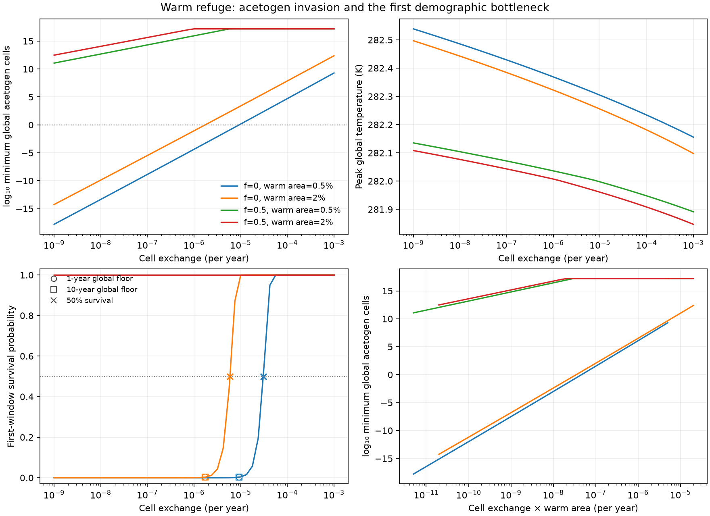

# Demographic survival through refuge bottlenecks

Codex (GPT-6, OpenAI), 10 November 2026. Implements Claude (Opus 5.5)'s
[specification](bottleneck-test-spec.md), following the accepted
[buffered-refuge model](buffered-refuges.md). The original outcomes remain
frozen; the probability tables refer to them by case ID and raw checksum.

**Status: complete and numerically checked; scientific review pending.**
This test estimates conditional survival of a microbial guild through a
recorded environment. It does not replace deterministic removal with a full
stochastic climate–ecosystem model.

## What a probability means here

For each habitat, the reference physiology gives synthesis
`a = Y(q − m)` per hour. The specified event model turns it into cell birth
`b = max(a,0)` and death `δ = L + max(−a,0)`, converted to years. Tests assert
that `b−δ` equals the physical model's net growth, including below floating
point biomass representation. Treating maintenance deficits as cell death
is an assumption; shrinkage and dormancy would define different processes.

Cells migrate from habitat `j` to `k` at rate `d w_k`. This is the count form
of conservative density exchange. In the recorded, uncensored environment,
the single-cell probability of descendants being alive at the window's end
satisfies the specification's backward multitype equation. The
[branching module](../../src/terra_prisca/haze_world/branching.py) solves it
in logarithms. It checks variable pure death, critical birth–death survival
`1/(1+bt)`, and multitype migration against matrix-exponential controls.

For independent **Poisson entry counts**, the expected number of surviving
lineages is `Λ = sum_j N_j u_j` and `P = 1−exp(−Λ)`. With known integer
counts the exact expression is `1−product_j(1−u_j)^N_j`; both conventions
are implemented. Every probability is conditional on the birth–death split,
count conversion, supplied environmental path and terminal time.

The count scale `s` multiplies the reference conversion: cell mass
3×10⁻¹³ gDW, habitat volume 0.00897 L/cm² and global area 5.1×10¹⁸ cm².
It changes the number of cells, not the model's density or climate path.
The specified classes are robust loss if `P(1000)<0.01`, robust persistence
if `P(0.001)>0.99`, and contingent otherwise. A contingent case need not
have its 50% point inside that scale range.

## Experiment and qualifications

E1 retains all 192 planned buffered-refuge cases. The 81 cases with any
local removal are rerun uncensored, initially for 30,000 years, sampled
annually. Cases without any removal reuse their already uncensored frozen
trajectories. Both guilds receive separate rows. Late growth, the full
migration/growth operator and environmental stationarity distinguish an
unreturned tail from supported exclusion; non-return alone is not assigned
an exact zero probability.

Case IDs and the `years` design field retain the original census baseline;
`horizon_yr` is the duration of the uncensored rerun.

For a guild's global minimum, the prescribed rarity ceiling is
`N_lin = min(10¹⁶, 10⁸ N_min)`. Every excursion is bracketed. The analysis
reduces the ceiling where necessary to keep the guild's uptake below
10⁻¹⁰ of total uptake locally as well as globally. Globally nonrare guilds
receive a full-path, frozen-environment calculation, labeled separately
from the rare-guild approximation. Dense-flow and sampled minima, numerical
curvature and width, birth and death, and terminal diagnostics remain visible.

The primary `P` and class concern the **first** rare excursion, making them
comparable with the pilot and E3. Later windows have their own evidence.
A secondary product of window probabilities explicitly assumes a reset to
each recorded entry distribution; it is not the correlated, coupled
ecosystem's probability of surviving every excursion.

There is a second conditioning issue. If one guild would almost certainly
disappear, the continuous equations can still recover its tiny retained
tail and generate a later hazard for the other guild. Those downstream
windows are flagged. Separate guild probabilities must not be multiplied
into a joint endpoint or climate prediction. With zero exchange, global
survival also does not establish robustness of local occupancy: an isolated
patch can recover a below-cell tail while the same guild remains abundant
elsewhere but cannot send it immigrants. The global causal flag does not
detect that separate spatial conditioning problem.

E2 comprises 196 uncensored 6,000-year runs: acetogens invade methanogens,
`f=0/0.5`, warm-refuge area 0.005/0.02, and 49 log-spaced exchanges from
10⁻⁹ to 10⁻³/year. Annual and ten-year one-cell diagnostics are applied
after the fact to global counts. They locate count-threshold crossings;
they are not counterfactual reruns of local census removal. Transition
interpolations retain their surrounding grid brackets.

The [method notes](bottleneck-method-notes.md) record these qualifications
and the numerical amendment before interpretation. Long uncensored runs
exposed inadmissible LSODA trials overflowing the acetate coordinate. A
[named numerical variant](../../src/terra_prisca/haze_world/bottleneck_integration.py)
reuses the frozen accepted-flow code with a private solver constructor and
retries that specific error from the last accepted state. It adds no seeds,
clipping or inventory jumps. No-retry trajectories, logarithms, dense minima
and ledgers match bit for bit. E1 records this protocol and its retries;
E2 retains its original frozen source.

## Independent stochastic check (E3)

The [checker](review/check_bottleneck_montecarlo.py) simulates 10,000
replicates per condition in the small
[recorded environment](figures/bottleneck/main_0010_environment.npz), using
exact constant-rate birth–death transitions and split, exact migration
transitions. Rates vary between intervals. Halving the maximum interval
from 0.5 to 0.25 years checks discretization at Monte Carlo resolution.

At the scale giving full-window `Λ=1` (`s=3779.67`), the simulation starts
when the expected population reaches 100,000 cells on its decline, at year
1293.056. This later Poisson initialization changes the predicted probability
by 0.000170; the [receipt](review/check_bottleneck_montecarlo.json) reports it.

| Entry counts; maximum interval | Simulated survival | Backward prediction |
|---|---:|---:|
| Poisson; 0.5 year | 0.6341 | 0.632290 |
| Poisson; 0.25 year | 0.6323 | 0.632290 |
| Fixed 100,000; 0.25 year | 0.6285 | 0.632292 |

All predictions lie inside the preselected 99% Wilson intervals. The step
change is −0.0018, compared with Monte Carlo SE 0.00682. This validates the
finite-time branching calculation, not stochastic establishment or feedback
on climate. The extraction script reproduces the environment artifact's
SHA-256 exactly from the archived pilot record.

## Reproduction

```sh
uv run python -m terra_prisca.haze_world.bounded_bottleneck_runs --workers 4
uv run python -m terra_prisca.haze_world.bottleneck_runs --stage exchange --workers 4
uv run python -m terra_prisca.haze_world.bottleneck --stage planned --workers 4
uv run python -m terra_prisca.haze_world.bottleneck --stage exchange --workers 4
uv run python -m terra_prisca.haze_world.bottleneck_assessment
uv run python models/haze_world/review/extract_bottleneck_environment.py
uv run python models/haze_world/review/check_bottleneck_montecarlo.py \
  --input models/haze_world/figures/bottleneck/main_0010_environment.npz
uv run pytest
```

The runners require the archived buffered-refuge baselines restored under
`local/haze/buffered_refuges/`. New raw records and completion receipts stay
under ignored `local/haze/bottleneck/`; selected tables and figures are emitted
under `models/haze_world/figures/bottleneck/`. `--case-id` and E1 `--years`
support selected extensions. Do not regenerate a frozen baseline in place.

## E1/E2 results

### Exchange controls the first overshoot bottleneck

All 196 E2 runs complete and their first probability windows are resolved.
At `f=0` and 2% warm-refuge area, fitting `log₁₀ N_min` against `log₁₀ d`
through `d=10⁻⁴/year` gives a slope of **4.423**, within K2's predicted
4.4 ± 0.3. The largest fit departure is 0.053 decades. The trend continues
through 10⁻³/year; the hypothesized later flattening is not reached.

Resident methanogens maintained by the warm refuge regrow sooner in the bulk
when exchange is greater. That damps the warming overshoot and protects
invading acetogens. At the 2% settings, replacing a one-cell floor with the
demographic criterion moves the exchange transition about **3.4-fold**, not
orders of magnitude. K3 is supported.

| Warm-refuge area | One-cell, annual counts | One-cell, ten-year counts | 50% first-window survival |
|---:|---:|---:|---:|
| 2% | 1.73×10⁻⁶/year | 1.73×10⁻⁶/year | 5.88×10⁻⁶/year |
| 0.5% | 9.24×10⁻⁶/year | 9.21×10⁻⁶/year | 3.06×10⁻⁵/year |

These are interpolated crossings, not precision estimates for Earth. The
2% survival crossing lies between sampled exchanges 5.62×10⁻⁶ and
7.50×10⁻⁶/year; the 0.5% crossing between 2.37×10⁻⁵ and
3.16×10⁻⁵/year. The two census intervals differ by less than 0.4% in the
interpolated threshold. All brackets are in
[exchange_thresholds.json](figures/bottleneck/exchange_thresholds.json).



Scaling the horizontal axis by warm area brings the two area curves within
0.862 decades of population at `f=0`, and 0.444 decades at `f=0.5`, over
their overlapping range. K4's one-decade criterion passes, although the
collapse is approximate and area has a residual effect.

All 98 half-recycling cases are robust first-window survivors across the
specified cell-count scales. Their smallest acetogen population is
**1.16×10¹¹ cells**, in the 0.5% refuge at the smallest exchange. Thus K5's
persistence prediction holds, while its numerical claim that every minimum
exceeds 10¹² cells is refuted. The high-exchange plateaus of the population
curves here are the initial invader dose becoming the global minimum,
not evidence of a new physiological limit.

The E2 table contains 50 robust-loss, 30 contingent and 116 robust-persistence
first-window diagnostics. Many newly sampled exchanges deliberately lie near
the transition; that does not contradict a prediction of only one contingent
case in the much coarser original planned matrix.

### Planned outcomes and conditioning (E1)

All 81 required reruns complete at 30,000 years; the other 111 trajectories
are reused by reference. No rare excursion remains flagged for a longer
horizon. The
[survival table](figures/bottleneck/survival.csv) has 384 guild rows:
291 robust-persistence, 92 robust-loss and **one contingent** first-window
diagnostic. The full [window evidence](figures/bottleneck/survival_windows.json)
retains later episodes and the conditioning flags.

The contingent entry is the predicted `main_0010` acetogen invasion: no
acetate recycling, warm refuge only, exchange 10⁻⁶/year. Its first-window
`P=0.00026454` at reference counts rises to about 0.232 at a thousandfold
count scale, so it is not a robust loss under the specified 1% criterion.
Its 50% count scale is about 2,620, outside the classification range. A
second excursion has conditional survival 0.56145; the secondary reset-product
is 0.00014852. These are different diagnostics, not alternative estimates of
an exact coupled-climate probability. The 10⁻⁹/year default-area invasion and
the 0.5%-area, 10⁻⁶/year invasion are robust losses.

Every guild missing from a frozen census endpoint is a robust first-window
loss except that one contingent entry. But K1's statement that every census
survivor is also a robust survivor of the uncensored path fails literally:
**24 census survivors have a robust-loss diagnostic in that alternate path.**
Twenty are downstream of the other guild's first strong loss. The other four
have zero exchange and an unresolved local-occupancy counterfactual.

For example, in `main_0000` without refuges, methanogens fall below one
global cell at year 19. Their retained continuous tail recovers above one
around year 1,934; acetogens then fall below one at year 1,950. The census
model instead removes methanogens early and acetogens remain. The later
acetogen hazard is conditional on an extremely improbable methanogen
recovery; it does not overturn that finite-world acetogen endpoint.
With zero exchange, an analogous recovery can occur in one isolated patch
while the guild stays abundant elsewhere, so a global loss flag alone cannot
resolve spatial endpoint robustness.

Thus the single-contingent-case part of K1 holds, while independent
uncensored guild probabilities cannot identify robustness of every community
endpoint. This is a limitation of the proposed endpoint test, not evidence
that both groups disappear in those 24 finite worlds.

| Prediction | Assessment |
|---|---|
| K1 | One contingent planned entry, as predicted; the blanket census-survivor claim fails on conditional paths and cannot be read as an endpoint forecast. |
| K2 | Slope 4.423 and the predicted reference 50% exchange range hold; later flattening is not observed within the tested range. |
| K3 | Supported: the demographic crossing is 3.3–3.4 times the one-cell crossing; changing census interval has a much smaller effect. |
| K4 | Supported within the specified one-decade tolerance, with a residual area effect. |
| K5 | Robust half-recycling survival holds; the proposed 10¹²-cell lower bound is false. |

The [assessment](figures/bottleneck/prediction_assessment.json) records exact
values and table hashes. All **262 tests pass**. The
[raw manifest](figures/bottleneck/raw_manifest.json) and
[read-back receipt](figures/bottleneck/payload_receipt.json) cover 278 new
profiles and 556 files: E1, E2 and the E3 pilot. The 111 reused originals
remain in the preceding buffered-refuge archive. The trajectory source is
frozen at `66c46a2`; analysis source hashes are recorded separately.

## What remains uncertain

The conclusion is conditional: exchange strongly controls the reference
overshoot, while replacing a one-cell floor changes its threshold modestly.
This does not measure Archean extinction risk. Turnover fixes both the
demographic noise and the temperature at which competition reverses; fixed
heat baths, physiology, habitat size, methane loss and acetate recycling
retain their earlier assumptions. Turnover and dormancy are the next proposed
scientific stage. A full coupled stochastic model would be needed for joint
endpoint probabilities where the conditional bottlenecks materially affect
the question; these tables alone do not supply them.
