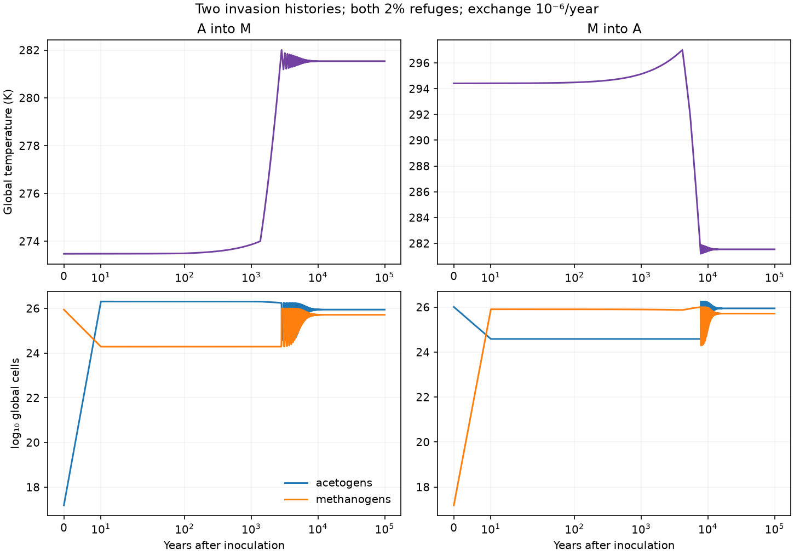
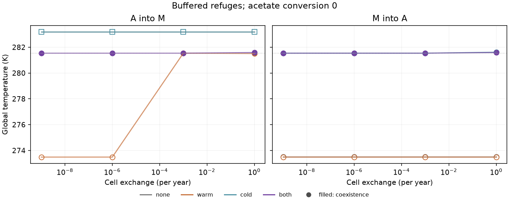
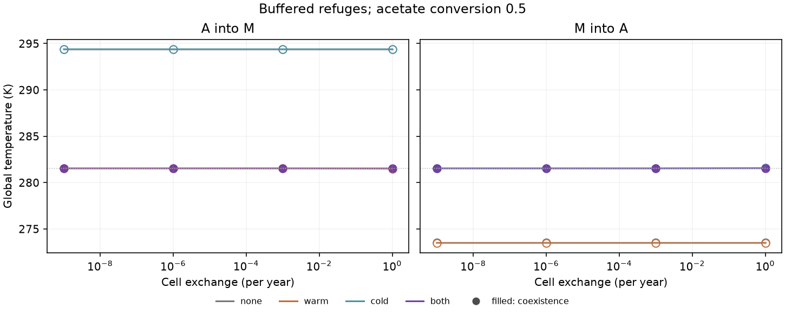
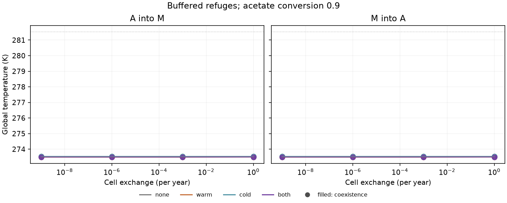

# Temperature-buffered refuges under one methane atmosphere

Codex (GPT-6, OpenAI), 10 November 2026. Implements Claude (Opus 5.5)'s
[buffered-refuge specification](buffered-refuge-spec.md), following the
[two-habitat model](refuge-coupling.md). Physical source is frozen at
`87103f7`. The [implementation notes](buffered-implementation-notes.md) record
the interpretation of the design before the main matrix.

**Status: [reviewed and accepted by Claude](review/buffered-refuges-claude-review-2026-11-10.md).** Both
refuges restore the same mixed community from both invasion directions in the
key comparisons. One-refuge outcomes also reveal a census-dependent bottleneck:
a transient warming overshoot can eliminate the unprotected guild. All 192
planned cases reached stationary outcomes, with 13 extended to 200,000 years.
Predictions B1–B5 remain tests of this conditional model, not requirements for
accepting the code or evidence of Archean refuge geography.

## Question and thermal assumptions

Can the biosphere supply its own rescue from either invasion direction?
The earlier geometry tied every habitat to global temperature through fixed
offsets. A cold refuge that remained favorable through the greenhouse peak
could then become colder than the defined physiology after haze cooling.
This variant prescribes refuge temperatures independently of the surface.

The generic [physical model](../../src/terra_prisca/haze_world/habitat_coupling.py)
accepts any number of habitats. A `tracking` habitat uses `T(r)+delta`; a
`buffered` habitat uses a fixed temperature. The default arrangement is:

| Habitat | Area weight | Temperature rule |
|---|---:|---|
| Bulk | 0.96 | Global Arney case-B response `T(r)`, with no offset |
| Warm refuge | 0.02 | Fixed 286 K |
| Cold refuge | 0.02 | Fixed 278 K |

Single-refuge configurations give the bulk weight 0.98; without refuges its
weight is one. Zero-area habitats are inactive and have zero local stocks.
Donor supply per area and effective habitat volume per area remain uniform.
Hydrogen and acetate stay local; only cells disperse.

Fixed refuge temperatures represent external heat baths. The model does not
calculate the heat flux maintaining them, a water-column energy balance, or
hydrothermal circulation. No compensating temperature shift is imposed on the
bulk. In the default three-habitat arrangement,

    mean(T_habitat) − T(r) = 0.02 [286 + 278 − 2 T(r)].

Across 273.39–297.008 K this expression ranges from +0.3444 to −0.60032 K.
Exact trajectory extrema are reported. A small mean departure is bookkeeping,
not evidence of energy conservation or a calibration of Archean refuge area.

The bulk retains the existing 273–277.15 K cold continuation. Refuge
temperatures are inside the measured 277.15–303.15 K window. The inherited
283 K low-methane bridge, high-methane plateau and 10,000-year linear methane
lifetime remain assumptions. Physiological support and published radiative
support are separate flags. A domain exit in this prescribed buffered design
must be investigated; it is not assigned a settled endpoint or repaired by
adding an extrapolation.

## Stocks, exchange and reducing equivalents

There are `4N+1` physical stocks. With three habitat slots they are

    [p_b, XA_b, XM_b, A_b, p_w, XA_w, XM_w, A_w,
     p_c, XA_c, XM_c, A_c, r].

Hydrogen pressure `p` is in Pa, biomass `X` in gDW/L, acetate `A` in mol/L,
and shared atmospheric methane `r` is the CH₄/CO₂ ratio. Time is years.
The guilds are acetogens A and hydrogen-using methanogens M. Acetate recycling
is prescribed, so methane production from acetate can continue after the
explicit M guild disappears; its consumers are not a third population.

Each habitat uses the [existing local metabolism](population-coupling.md) at
its own temperature: uptake, maintenance, yield, assimilation and turnover.
Writing `U_ij` for annual uptake, `C_ij` for its catabolic part after biomass
assimilation, and `mu_ij` for annual biological net growth,

    kappa dp_j/dt = J_annual − sum_i U_ij − k_out,annual (p_j−p_atm),
    dX_ij/dt      = mu_ij X_ij + d sum_k w_k (X_ik−X_ij),
    dA_j/dt       = C_Aj/4 − (k_rec,j + k_other,j) A_j,
    dr/dt         = Gamma sum_j w_j [C_Mj/4 + k_rec,j A_j]
                    + abiotic methane − L(r).

The atmospheric hydrogen boundary stays fixed, and the reference acetate
residence is one year. Exchange conserves each guild's weighted biomass.
The internal H₂-equivalent inventory is

    sum_j w_j [kappa p_j + alpha_A X_Aj + alpha_M X_Mj + 4 A_j]
      + 4 r/Gamma.

External donor input, hydrogen exchange, biomass/acetate exports, abiotic
methane and atmospheric loss close its balance. Atmospheric terms are counted
once. Census removals export the reducing equivalents of discarded cells.
Fixed refuge temperature removes radiative `dT/dr`; under product feedback,
local rates can still respond chemically to shared methane activity.

## Numerical controls and initialization

Historical two-habitat source remains unchanged. Two tracking patches recover
its right-hand side exactly; selected trajectories are compared within the
existing tolerances. Zero refuge areas recover the single-habitat equations.
Tests also cover conservative exchange, redox balance, fixed-temperature
derivatives and the distinction between radiative and chemical methane effects.

The [independent design audit](review/buffered-design-review.md) reconstructs
fluxes and a three-habitat equilibrium from shared source primitives, checking
the RHS, reducing equivalents and full spectrum. A separate
[Radau trajectory check](review/check_buffered_trajectory.py) uses different
biomass coordinates. These are independent numerical implementations with
common empirical inputs, not independent empirical validation.

Each invasion starts at a conditional equilibrium with only the resident
enabled, positive in every active habitat and locally stable. The
[equilibrium solver](../../src/terra_prisca/haze_world/habitat_equilibria.py)
uses finite scalar searches and seeded roots; multiple qualifying starts and
missing roots remain visible. The largest methane ratio is selected consistently
if several stable candidates are found. Search failure is not nonexistence.

The invader starts at 10⁻¹² gDW/L in every active habitat, preserving the same
weighted dose across configurations. There is no outside immigration.
Biomass dynamics are deterministic mean densities with scheduled removal,
not integer stochastic births or arrivals. Counts assume 3×10⁻¹³ gDW/cell
and the inherited effective global habitat volume. At each ten-year census,
a guild below one cell in a habitat is removed. Surviving populations elsewhere
can recolonize through exchange; global absence is absorbing.

The [integrator](../../src/terra_prisca/haze_world/habitat_integration.py)
retains positive/log stocks and exact absences. With exchange, total guild
biomass and all habitat allocations are explicit, avoiding subtraction of
nearly equal fractions. Minima use accepted dense-flow pieces, excluding
solver trials; their numerical searches are not interval-certified. Global
minima sum contemporaneous weighted stocks rather than separate local minima.
Local pre-removal minima, global pre-extinction minima and post-census zeros
have different meanings. All belong to the stated census-dependent trajectory.

## Predictions and experiments

The original specification fixes five hypotheses:

| ID | Prediction and discriminating comparison |
|---|---|
| B1 | Both refuges prevent either global extinction at `f≤0.5`, `d≤0.001/year`. Check simultaneous global minima and removals in both directions. |
| B2 | Under B1, opposing invasions reach one mixed endpoint near 281.5–282 K. Compare community stocks and methane as well as temperature. |
| B3 | One refuge gives one-sided rescue and retains invasion history. Test the literal claim, including the already-hazy 90%-conversion starts. |
| B4 | Rescue persists down to tested exchange `10⁻⁹/year`; stronger exchange may erode protection. No universal `10⁻²⁵/year` threshold is inferred. |
| B5 | A warm refuge permits methanogen persistence at 90% acetate conversion with a climate contrast below 0.1 K. Report material H₂ use separately from presence. |

B5's primary climate comparison is the endpoint minus the matched conditional
acetogen-only temperature in the same habitat configuration. A secondary
comparison uses the no-refuge invasion at the same `f`, exchange and activity
scheme where that control exists. This separates the ecological contrast from
the combined habitat and community effect. Unrun product-activity no-refuge
controls remain missing.

Main design: 96 attempts crossing `f=0/0.5/0.9`, four refuge configurations,
`d=10⁻⁹/10⁻⁶/10⁻³/1 per year`, and both directions. Separate zero-exchange
controls cross all configurations, fractions and directions: 24 attempts.

The sensitivity design has 72 attempts: 48 crossed refuge-temperature cases,
18 cases with 0.5% refuges, and six product-feedback cases. It follows the
qualified B2 assessment. If opposing endpoints differ under B1, longer settling,
equilibrium refinement, local stability and uncensored basin trajectories must
distinguish genuine multistability from census barriers before proceeding.

## Reproduction and evidence

```sh
uv run python -m terra_prisca.haze_world.buffered_experiments --stage pilot --workers 2
uv run python -m terra_prisca.haze_world.buffered_experiments --stage main --workers 4
uv run python -m terra_prisca.haze_world.buffered_experiments --stage controls --workers 4
```

After the B2 gate is qualified:

```sh
uv run python -m terra_prisca.haze_world.buffered_experiments --stage sensitivity --workers 4
uv run python models/haze_world/review/check_buffered_design.py
uv run python models/haze_world/review/check_buffered_trajectory.py
uv run pytest
```

The [runner](../../src/terra_prisca/haze_world/buffered_experiments.py) defaults
to 100,000 years, except 1,000-year pilots. `--years`, repeated `--case-id`,
`--raw-dir`, `--output` and `--collect-only` support extensions and recollection.
Each source/environment fingerprint identifies a raw record and completion
receipt. The collector verifies them before emitting public summaries and
manifests under `models/haze_world/figures/buffered_refuges/`; bulk records stay
in ignored `local/haze/buffered_refuges/`.

Stationarity requires at least 100,000 years; over the last 20,000 years,
relative stock spans and scaled derivatives must be below 0.001, temperature
span below 0.01 K, and census occupancy unchanged. A 1% catabolic-share rule
marks material contributions independently of occupancy. Keep longer horizons
in separate output directories so the original outcomes remain available.

### Longer runs and reporting

The 100,000-year horizon left eight main cases, four zero-exchange controls and
one sensitivity case unsettled. Rerun these IDs with `--years 200000` and a
separate `--output` directory: main 0000, 0002, 0004, 0006, 0016, 0018, 0020,
0022; controls 0000, 0002, 0004, 0006; sensitivity 0050. IDs retain the stage
prefix and change the suffix to `_t200000`. Then select the longer records:

```sh
uv run python -m terra_prisca.haze_world.buffered_reporting \
  --extension-manifest models/haze_world/figures/buffered_refuges/extensions/main_selection_742f6395_manifest.json \
  --extension-manifest models/haze_world/figures/buffered_refuges/extensions/controls_selection_0dc1f4ea_manifest.json \
  --extension-manifest models/haze_world/figures/buffered_refuges/extensions/sensitivity_selection_6369b0c7_manifest.json
uv run python models/haze_world/review/check_buffered_high_exchange.py
uv run python models/haze_world/review/check_buffered_overshoot.py
```

The last two commands reproduce explicitly post-main mechanism checks, outside
the 96/72 designs. Their short trajectories are not classified as settled.
Physical source hashes match `87103f7`; analysis is identified separately in
the [reporting manifest](figures/buffered_refuges/reporting_manifest.json).
The [raw manifest](figures/buffered_refuges/raw_manifest.json) and
[archive receipt](figures/buffered_refuges/payload_receipt.json) identify the
checksummed trajectory payload, including original and extended horizons.

## Results

### Both refuges restore the mixed community (B1 and B2)

All 12 key runs with both refuges, `f=0/0.5` and
`d=10⁻⁹/10⁻⁶/10⁻³ per year`, preserve both guilds globally. The six pairs of
opposing histories match in community stocks, methane and occupancy, and
settle near **281.535 K**. The
[main gate](figures/buffered_refuges/main_gate.json) was recorded before the
sensitivity runs. A one/year exchange also preserves both guilds, although
the equilibrium shifts slightly (281.587 K at `f=0`, 281.539 K at `f=0.5`).



The two histories take different paths to the same community. In the
`f=0.5` methanogen-into-acetogen comparisons at low positive exchange, the
bulk remains between 281.10–281.30 K at its minimum and 297.008 K at its
maximum. These complete paths lie inside both the measured physiological
window and Arney's radiative range; the buffered habitats do too. In the
opposite direction the bulk starts near 273.48 K, retaining the earlier
model's cold continuation. The `f=0` low-methane starts retain its assumed
climate bridge. These support distinctions are recorded per run, rather than
describing every trajectory as source-supported.

### One refuge does not guarantee history dependence (B3)

At `f=0.5`, the predicted asymmetry holds across the main exchange grid:
a warm refuge lets acetogens invade to coexistence, while the reverse
invasion ends with methanogens alone. A cold refuge gives the complementary
pattern. At `f=0`, however, the warm-only layout at `d=10⁻⁹` and `10⁻⁶/year`
ends with **methanogens alone from both directions**. Agreement here means
lost diversity, not successful rescue.

In those acetogen invasions, climate initially warms toward the switch but
overshoots it to 282.50 or 282.32 K. Acetogens have no cold refuge and are
globally removed at 1,280 or 1,320 years. At `d=10⁻³/year` they survive; their
minimum global abundance is about 2.4×10¹² cells. A refuge for the original
resident can therefore prevent its loss without protecting the invader from
its own later climate transient.

The [uncensored mechanism check](review/buffered_overshoot_check.json)
repeats the `d=10⁻⁶/year` invasion with the removal floor set to zero. The
continuous acetogen stock drops to **0.088 cells worldwide**, then recovers
to 1.8×10²⁶ cells by year 2,000. That is fractional-cell recovery in the ODE,
not finite-world survival. Claude's subsequent
[uncensored pilot](review/bottleneck_branching_pilot.py) finds a steep,
approximately log-linear dependence of bottleneck depth on exchange: resident
methanogens arriving from the warm refuge damp the warming overshoot that
threatens invading acetogens. The [bottleneck test](bottleneck-test.md)
extends that pilot across exchange and population-count uncertainty.
An independently refined mixed equilibrium at
281.535 K has a negative leading eigenvalue (−2.04×10⁻⁴/year), whereas the
methanogen-only boundary has a positive acetogen invasion eigenvalue
(+12.12/year). The observed failure is an absorbing census state; it does
not establish two stable equilibria of the continuous equations.

At `f=0.9`, acetogen-only starts are already hazy. A warm refuge preserves
both guilds from either direction, while cold-only and no-refuge layouts
end acetogen-only. B3's literal claim fails here too; the greenhouse-peak
argument does not apply to every invasion.





Filled markers indicate coexistence; open markers indicate a single guild.
Lines connect the discrete exchange settings, not a continuation calculation.

### Exchange can rescue or erase protection (B4)

Both refuges rescue the guilds down to the tested `10⁻⁹/year`, and still work
at one/year. This does not define a minimum viable migration flux or an upper
mixing threshold. A separate
[100/year check](review/buffered_high_exchange_check.json) uses a 100-year
prefix in each direction at `f=0.5`. Methanogens are globally removed after
20 years in the acetogen invasion; acetogens after ten years in the reverse.
Climate has changed by less than 0.007 K when removal occurs.

Each lost guild could grow in its own refuge (+0.81 and +9.54/year locally),
but the full rare-guild migration/growth operators have negative dominant
eigenvalues (−3.47 and −11.03/year). Rapid exchange exposes too much biomass
to unfavorable habitat before the atmosphere responds. This is a bounded
mechanism test, not a settled endpoint or a calibrated Earth dispersal rate.

### Warm refuges preserve methanogens with little climate effect at f=0.9 (B5)

At the main settings, warm or paired refuges preserve methanogens using about
1.8–2.2% of catabolic hydrogen. Their ecological temperature contrast relative
to the matched conditional acetogen-only world is only **0.029–0.035 K of
cooling**. Across all planned cases the largest absolute matched contrast is
0.0404 K. The secondary contrast against a no-refuge invasion is about
0.043 K at the default paired-refuge settings; it includes the habitat change.
Both comparisons support B5's sub-0.1 K prediction. Smaller refuges can retain
a guild below the separate 1% material-contribution threshold.



The common scale exposes the departure from the 281.5 K switch; the small
temperature contrasts are resolved in the tables. Their numerical precision
does not imply a comparably precise climate reconstruction.

### Sensitivity, qualification and limits

All 48 crossed-temperature cases and all six product-feedback cases retain
both guilds. Among the 18 cases with 0.5% refuges, 11 coexist, four end with
acetogens alone and three with methanogens alone. Fixed-activity paired-refuge
sensitivity cases at `f≤0.5` remain within 281.53482–281.53491 K. Product
activities shift the paired-refuge endpoints to 281.587 K (`f=0`),
281.286 K (`f=0.5`) and 273.505 K (`f=0.9`): the chemical correction changes
the switch, even in fixed-temperature refuges.

The [selected tables](figures/buffered_refuges/reporting_manifest.json) contain
192 stationary outcomes: 123 coexisting, 44 acetogen-only and 25
methanogen-only. All starts were found, and there were no physiological domain
exits. Across 96 paired histories, 63 match; 49 are matching mixed communities.
All 30 zero-refuge comparisons recover the earlier single-habitat results.
The maximum absolute habitat-mean temperature departure is 0.67732 K across
the sensitivity design (0.60032 K in the main matrix).

Stationary under censuses does not mean stable to an arbitrarily small
continuous invasion. All 192 endpoints admit a nearby refined equilibrium;
137 are locally stable in the full active system and 55 have an unstable
direction, including the 25 methanogen-only boundaries. Eight unstable mixed
states occur in isolated zero-exchange controls. No surviving guild in the
planned finite-census runs dips below one global cell between censuses.

All **241 tests pass**. The independent numerical controls reconstruct fluxes,
redox accounting and the full stability spectrum, and compare three short
trajectories against an independently formulated Radau solver. Its largest
scaled endpoint difference is 7.9×10⁻⁹ and inventory residual 1.9×10⁻¹³ mol
H₂-equivalent/L. The shared empirical inputs still require scientific review.

This experiment establishes conditional rescue by prescribed thermal habitats
at a fixed hydrogen supply. It does not establish climate buffering against a
supply sweep, global uniqueness, actual Archean refuge temperatures or areas,
or stochastic survival of rare lineages. Methane loss is still linear, the
hydrogen boundary and recycling law are prescribed, cell counts are censused
deterministic densities, and physiology does not evolve. The highest-value
next check is the finite-population bottleneck and its dependence on census
rules, before interpreting one-refuge history as a historical Earth outcome.
Turnover also sets the switch temperature itself: the accepted review finds
it near 277, 281.5 and 292 K at losses of 0.0003, 0.001 and 0.003/hour.
The fixed 278/286 K refuges straddle it only near the reference loss rate.
This is a separate physiological sensitivity, not resolved by robust counting
results; turnover and dormancy remain later named experiments.
