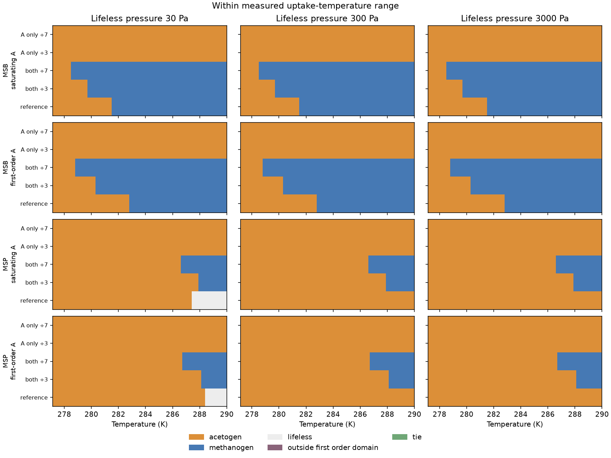
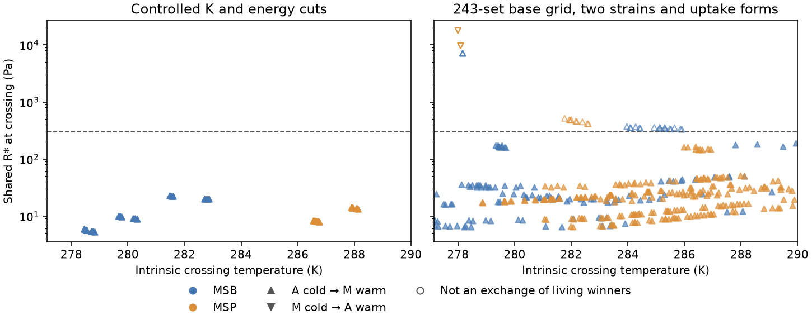
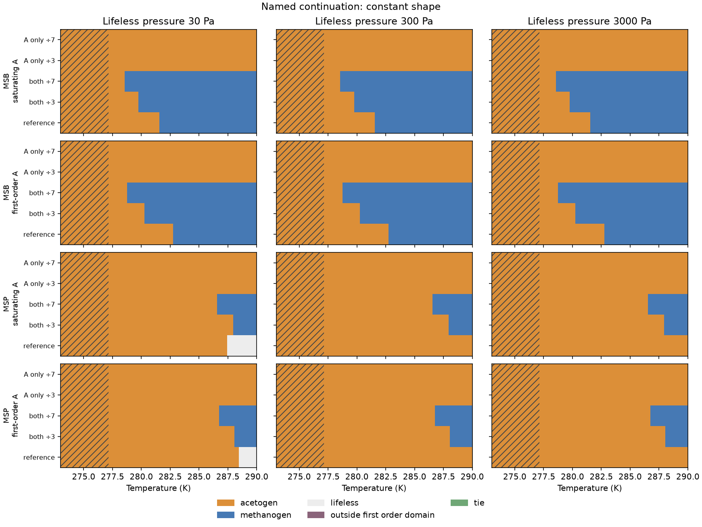
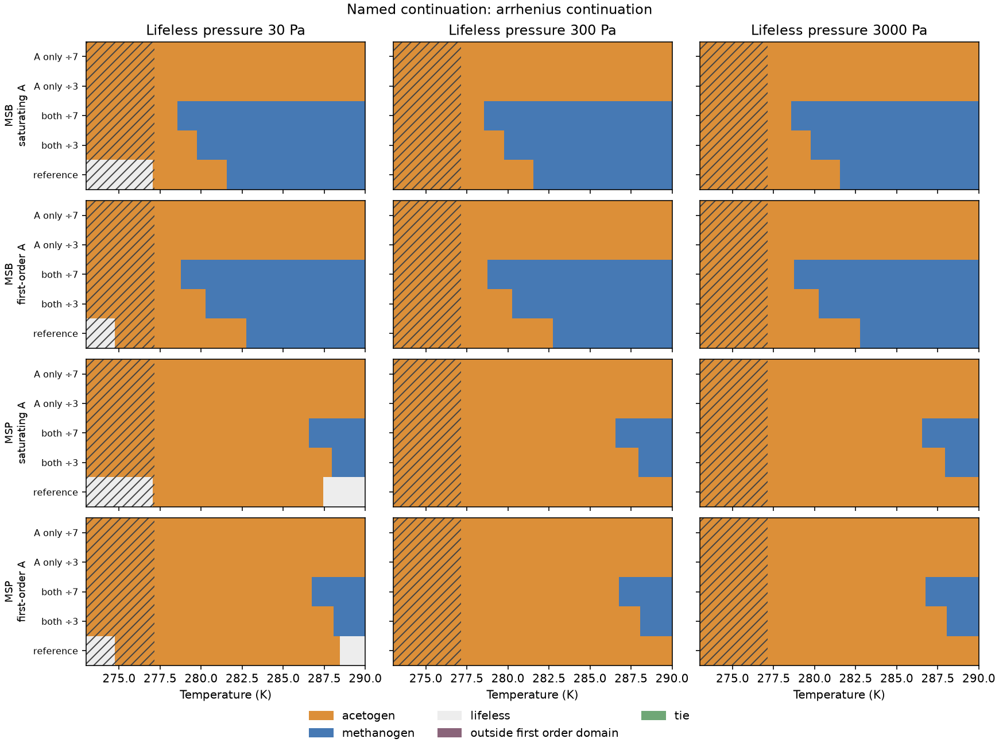

# Competition switches with a finite hydrogen outlet

The fixed-temperature model can switch from acetogens to methanogens as it
warms. Whether this exchange occurs, and where, depends on uptake affinity,
population parameters and hydrogen supply relative to the outlet. An intrinsic
crossing of the guilds' break-even pressures is insufficient: both may require
more hydrogen than a lifeless system can retain.

This experiment extends the [two-guild model](two-guilds.md). It does not couple
competition to climate or establish climate bistability. On Arney's haze-cooling
branch, more methane lowers temperature. An acetogen-cold/methanogen-warm
exchange can therefore provide a restoring feedback; its orientation is not
evidence for a cold trap. A coupled climate may also select a mixture of guilds
at their shared break-even pressure. That possibility requires a coupled
calculation, rather than inheriting the undetermined mixture at an imposed
temperature. See the [feedback sign check](review/switch-feedback-check.md).

## Design and reproduction

```sh
UV_CACHE_DIR=/tmp/terra-prisca-uv-cache MPLCONFIGDIR=/tmp/terra-prisca-matplotlib \
  uv run python -m terra_prisca.haze_world.competition_switches
uv run pytest tests/test_competition_switches.py
```

Code: [`competition_switches.py`](../../src/terra_prisca/haze_world/competition_switches.py).
The [manifest](figures/competition_switches/manifest.json) records input hashes,
counts, windows and numerical resolution. The complete
[configuration table](figures/competition_switches/configurations.csv),
[path summaries](figures/competition_switches/path_summary.csv),
[switch locations](figures/competition_switches/switch_locations.csv) and
[status transitions](figures/competition_switches/status_transitions.csv) are
small committed outputs. All temperature samples are regenerated to the ignored
`local/haze/competition_switches/raw_points.csv.gz`; its compressed hash is in
the manifest. No source PDF is redistributed.

Every active experiment has input `J=10⁻⁶ mol H₂ L⁻¹ h⁻¹`, atmospheric pressure
zero, and positive outlet coefficient `k=J/p₀`. The lifeless pressures
`p₀=30, 300, 3000 Pa` are illustrative scenarios, not Archean calibrations.
The explicit zero-outlet reference in the model remains a separate case.
All actual pressures here remain within the declared first-order concentration
domain; the scanner nevertheless retains unresolved-domain statuses.

There are two separate experiment groups, rather than one large product of
every sensitivity:

- **Controlled cuts:** central biological parameters, both methanogen
  phenotypes, both acetogen uptake forms, five affinity cuts, nine threshold
  energy pairs and three outlets. The five cuts leave both `K` values unchanged,
  divide both by three or seven, or divide only the acetogen's by three or seven.
  Cessation energies are `−20, −24, −28 kJ` for acetogens and
  `−24, −28, −32 kJ` for methanogens, per four-H₂ reaction. The threshold law
  uses those energies with its 30 °C anchors; this is not a fit of reaction
  thermodynamics. The measured uptake-temperature window tested is
  **277.15–290 K**, giving **540 paths**.
- **Base-grid audit:** the existing 243 combinations of methanogen capacity,
  yield, maintenance, demographic loss and acetogen threshold, for each of two
  phenotypes and two acetogen uptake forms: **972 paths**, at `p₀=300 Pa`.
  These use reference affinities and the central cessation energies, within
  277.15–290 K. The central configuration occurs in both experiment groups;
  the groups are comparisons, not independent samples.

Both groups use the named fixed-energy threshold scenario. The constant-
threshold alternative is not crossed with this design. Methanogen assimilation
is zero during the switch scans. Warm methanogen victories at 20 and 30 °C are
recorded as a conditional pattern check, not used to reject other outcomes.
Parameter-grid counts are not probabilities or calibrated frequencies.

Each controlled path is also run over **273–290 K** with two explicitly named
continuations below 4 °C: one freezes measured relative capacities and `K` at
4 °C; the other continues capacities using the 4–10 °C Arrhenius slope while
freezing `K`. Chosen maintenance and threshold laws continue in both. Each
continuation has another 540 paths. Neither supplies observations below 4 °C.

## Located exchanges

At the central cessation energies and `p₀=300 Pa`, the exchange temperatures
are:

| Affinity cut | MSB, saturating A | MSB, first-order A | MSP, saturating A | MSP, first-order A |
|---|---:|---:|---:|---:|
| Reference | 281.535 K | 282.780 K | none | none |
| Both K ÷3 | 279.723 K | 280.252 K | 287.925 K | 288.094 K |
| Both K ÷7 | 278.504 K | 278.759 K | 286.596 K | 286.714 K |
| Acetogen K ÷3 | none | none | none | none |
| Acetogen K ÷7 | none | none | none | none |

“None” means no living-winner exchange inside this window, not that either
guild is absent at every temperature or in other parameter sets. All located
controlled exchanges have acetogens on the colder side and methanogens on the
warmer side. Changing both affinities can shift the exchange; increasing only
acetogen affinity can remove it from the window.

Across all nine cessation-energy pairs, the MSB reference exchange spans
281.476–281.594 K with saturating acetogens, or 282.695–282.866 K with
first-order acetogens. Dividing both K values by seven moves these intervals to
278.453–278.557 K and 278.699–278.820 K. These are scenario ranges, not
confidence intervals.



| Experiment group | Paths | Paths with intrinsic crossings | Paths with actual living-winner exchanges | Paths with multiple intrinsic crossings |
|---|---:|---:|---:|---:|
| Controlled, source window | 540 | 270 | 270 | 0 |
| Base grid, source window | 972 | 366 | 336 | 6 |
| Controlled, frozen low-temperature shape | 540 | 270 | 270 | 0 |
| Controlled, Arrhenius capacity continuation | 540 | 270 | 270 | 0 |

The six multiple-crossing base paths use MSP, saturating acetogen uptake,
capacity ratio 1.5, methanogen yield 1.7, loss 0.01 h⁻¹, maintenance
0.0003 or 0.001 mol H₂ gDW⁻¹ h⁻¹, and each of the three acetogen threshold
anchors. Each contains a reverse intrinsic crossing as well as a subsequent
acetogen-cold/methanogen-warm crossing. Both require pressures above their
300 Pa lifeless level. They therefore provide no actual winner exchange at
that outlet. The model has not been forced to have one switch or one
orientation.



The two low-temperature continuations add no controlled crossing below
277.15 K. Their agreement in this design does not establish the low-temperature
kinetics, and does not exclude crossings in other biological configurations.





## Methanogen assimilation and numerical checks

The [assimilation comparison](figures/competition_switches/assimilation_delivery.csv)
pairs methanogen assimilation 0 and 0.0824 mol H₂/gDW at six measured-range
temperatures, both phenotypes, both uptake forms and three outlets. All 72 pairs
retain identical intrinsic R* values. In the 36 methanogen-winning pairs,
explicit assimilation reduces delivered methane by 3.61–5.78%. This changes
delivery without changing growth competition under the model's yield
convention. Lifeless and exact-tie states have no selected delivery estimate;
an exact tie is not assigned zero methane.

The scanner samples temperature every 0.1 K and includes all measured kinetic
knots. It locates each adjacent finite sign change with a bracketed root solver,
retains sampled tie intervals, and never joins signs across an undefined R*.
Actual exchanges are checked against winners on both sides and against the
finite-outlet establishment condition. Status transitions involving lifeless,
tie or unresolved states retain their sampled brackets.

The [resolution audit](figures/competition_switches/resolution_audit.csv)
halves the spacing on 122 selected paths: all central-energy controlled paths
at 300 Pa, all multiple-crossing paths, and a deterministic sample of the base
grid. It finds no crossing-count, orientation or actual-exchange mismatch;
located temperatures differ by at most 2.2×10⁻¹⁰ K. That figure describes solver
agreement, not scientific precision. A finite grid cannot rule out two missed
crossings within one cell on every unaudited path. Six regression tests cover
multiple crossings, undefined intervals, ties, outlet reachability, the active
design and assimilation's effect on delivery.
