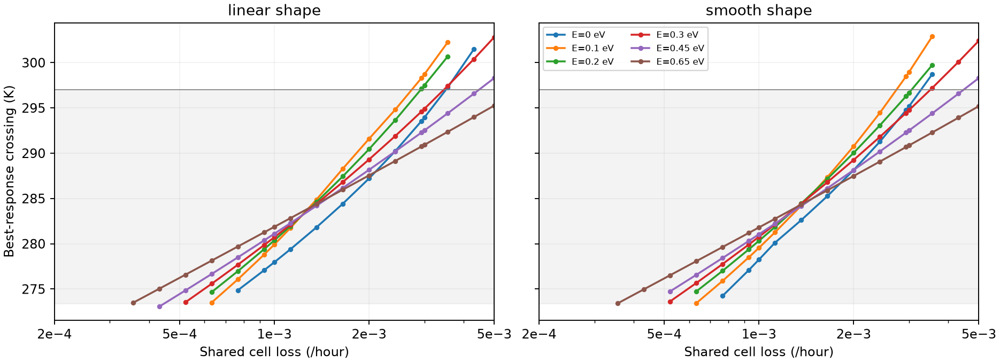
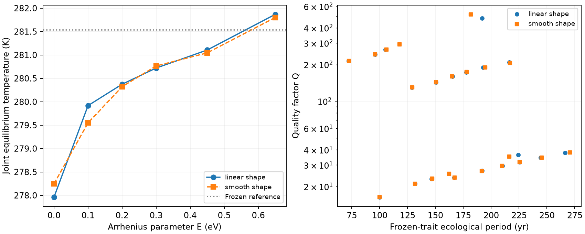

# Competitive kinetic evolution

Kinetic adaptation preserves a locally stable competitive thermostat at the
reference turnover, but it moves its temperature. With no Arrhenius constraint,
the linear-shape equilibrium moves from 281.535 to **277.960 K**. Across the
full72-setting community experiment, **42 settings retain stable cooling-branch
communities and 30 have no joint community**. A pressure crossing outside the
climate range cannot set a planetary equilibrium.

The proposed exclusive thermodynamic anchor fails its test. Freezing either
thresholds or maintenance at 30 °C removes the reference crossing. A separate
matched-level diagnostic shows that **both retained thermal terms supply
local restoring slope**. Their non-evolution is part of this model family,
not proof that evolution cannot alter a climate thermostat.

The [specification](competitive-evolution-spec.md) and KE1–KE7 remain unchanged.
The [implementation choices](competitive-evolution-methods.md) resolve the
preview's trait-bound error and explain the nonsmooth convergence criteria.
The [independent mathematical review](review/competitive-evolution-math-review-2026-11-11.md)
checks the mapping, selected roots and spectra, and every recorded mutant assay.

## Model and comparison

Each guild has a heritable kinetic position `u` within measured4–30 °C. At
actual temperature `T` in kelvin,

    V_i(T,u) = V_ref_i(u) exp[-E/k_B (1/T - 1/(u+273.15))]
    K_i(T,u) = K_ref_i(u).

Threshold `h_i(T)`, maintenance `m_i(T)`, yield, turnover and product activities
do not evolve. The best response minimizes the break-even hydrogen pressure

    R*_i = h_i + K_i q_i/(V_i-q_i),    q_i = m_i + L/Y_i,

with infinite pressure requirement when capacity cannot meet demand. The
reference saturating-uptake model and its source remain unchanged. The named
variant retains the full hydrogen, two biomass, acetate and methane budgets.
Its identity and inventory tests compare those budgets with the reference.

The linear variant interpolates the measured V/K shapes; `smooth_shape` uses
PCHIP on their logarithms. Both evaluate every0.01 °C trait position and refine
candidate minima continuously. E is a phenomenological Arrhenius translation
parameter, not a calibrated genetic cold-adaptation cost.

S1 covers 21 turnover settings, six E values and both interpolations. S3 uses
three turnovers, both acetate fractions `f=0/0.5`, every E and both shapes:
72 settings. Climate is the fixed Arney case-B response and its declared
extensions; methane loss, habitat volume and reference supply stay fixed.

## S1: the crossing can move or disappear

The252-setting map finds166 crossings, all acetogen-cold/methanogen-warm;
86 settings have no detected crossing within 273–303.15 K. Searches are finite
grid/bracketing calculations, not interval certificates for every possible
narrow or tangent root.

At reference turnover0.001/hour, every tested E/interpolation retains a
cooling-branch crossing. The linear values are:

| E, eV | Crossing, K |
|---:|---:|
| 0 | 277.960 |
| 0.1 | 279.918 |
| 0.2 | 280.374 |
| 0.3 | 280.720 |
| 0.45 | 281.105 |
| 0.65 | 281.868 |

At the lowest S3 turnover0.0003/hour, no tested E retains the crossing under
either interpolation. At 0.003/hour some crossings instead exceed the
297.008 K climate maximum. The largest specified interpolation shift is1.231 K,
but even a smaller shift matters near that boundary: at E=.2, the linear
crossing297.509 K lies outside the climate range while the smooth crossing
296.675 K lies inside it.



The shading shows the temperature span of the extracted cooling branch, not
feasibility of every plotted crossing. Missing points mean no detected
crossing within the searched temperature range. Lines join sampled settings.

## S2: the anchor is not thermodynamics alone

At reference turnover and E=0, the baseline crossing is277.960 K with kinetic
positions10 °C and 25 °C. Holding either h(T) or m(T) at its30 °C value removes
the crossing and favours methanogens. This refutes KE5's maintenance clause.
The prescribed controls change function levels as well as thermal slopes.

A separate post-prediction control holds each function at its value **at the
baseline root**, preserving the operating point. There,

    d(R*_A-R*_M)/dT = 0.402999 Pa/K
                    = 0.197474 from thresholds + 0.205526 from maintenance.

Either retained term supplies a positive local slope when the other is held
at that matched level. Both fixed together give degenerate equality in this
E=0 diagnostic. These local slopes do not replace the prescribed30 °C controls
or certify the full dynamics of a new control variant.

The supported conclusion is that non-evolving thermal budgets preserve a
crossing in this kinetic family. The test does not establish an evolutionary
immunity conferred solely by reaction thermodynamics.

## S3/S4: trait optima and climate equilibria are different tests

Of 72 settings,42 have a stable cooling-branch joint community. Fourteen
additional mixed roots occur on the greenhouse branch and are ecologically
unstable. Thirty settings have no feasible joint community. All other
fixed-trait ecological states are retained in `equilibria.csv`; their
501/1001-point inventory comparisons agree. This is numerical inventory
agreement, not a global-attractor theorem. Other stable ecological states at
frozen traits need not themselves be evolutionary optima.

At all 56 joint roots, each guild's2601-mutant grid passes the growth tolerance
of 1e-8/hour; the largest growth is7.07e-17/hour. The unstable greenhouse roots
also pass: trait noninvasibility does not imply ecological stability.

All 42 stable cooling communities are convergence-attracting under the three
positive relative mutation supplies0.1,1 and 10. Twenty-six use smooth canonical
matrices; sixteen need one-sided node criteria. At smooth interior optima,
first-order environmental responses vanish and the canonical matrix reduces
to own fitness curvatures times positive population/supply weights. An
ordinary Jacobian is not assigned at an interpolation corner. Neither
criterion supplies a global evolutionary basin or a calibrated evolutionary
rate.

The frozen-trait ecological modes have Q between 16.30 and 516.53. Matrices,
spectra, periods and damping times are stored with every state. Their time
units are years in the specified methane budget, not predicted Earth periods.



Left: reference-turnover joint temperatures at the six specified E values
with lines as guides. Right: stable cooling-state ecological modes across the
S3 grid. The dotted temperature is the frozen reference.

## Conditional S5: branch loss is not demographic extinction

The30 missing settings trigger two projected canonical continuations each,
with maximum trait steps 0.05 and 0.025 °C. Every recorded path stops at loss
of the supported mixed branch. Ecology is checked at every accepted step;
terminal rows separate the last supported state from attempted next traits.
S5 uses equal per-cell mutational supply; the three supply ratios belong to
the local S3 convergence checks.
The maximum paired terminal differences are0.207 K and 0.0267 °C. Nearest-root
tracking and finite steps do not exclude every between-step branch jump.

Initial positions match the original reference-switch temperature. For the
linear shape this matches instantaneous reference kinetics; PCHIP generally
changes off-node kinetic values and is a named smooth-baseline start.
Canonical time is arbitrary. No finite-population extinction or arrival at a
pure endpoint is inferred from stopping the canonical branch.

Separate adapted pure-state/invasion assays find stable methanogen-only
states at low turnover, at **274.002 K on the imposed high-methane plateau**.
They also find acetogen-only alternatives for the missing high-turnover
settings. These are independently checked endpoints, not completed ecological
trajectories from the stopped paths. KE3's informal "near 273.5 K" had no fixed
numerical tolerance; the actual plateau temperature and its closure dependence
are reported rather than forcing a numerical pass.

## Fixed predictions

| Prediction | Assessment | Evidence |
|---|---|---|
| KE1: reference E=0 crossing near 277.96 K and stable mixtures | Supported |277.960221 K; both f values locally stable on cooling branch. |
| KE2: no inverted orientation | Supported on the searched domain |All 166 detected crossings retain acetogen-cold orientation; joint crossings agree. |
| KE3: low-turnover loss and a cold methanogen world | Qualified support |No crossing; stable pure M at 274.002 K, with the plateau and path qualifications above. |
| KE4: constrained reference shifts below 2.5 K | Supported |Largest shift0.491 K across both shapes for E≥.45. |
| KE5: threshold dependence, but not maintenance, anchors it | Refuted |Either prescribed30 °C freeze removes the reference crossing. |
| KE6: convergence-attracting cooling communities and Q>10 | Supported at stated local scope |42 states;126 supply-ratio checks; minimum Q16.30; nodes use one-sided tests. |
| KE7: interpolation shifts below 2 K | Supported numerically |Maximum1.231 K; feasibility can nevertheless change. |

The [machine assessment](figures/competitive_evolution/prediction_assessment.json)
preserves each prediction, its result and the qualifiers. The trait-bound
correction explains the preview discrepancy without rewriting the preview.

## C07 figure data and reproduction

The compact [C07 export](figures/finite_populations/c07_transient.csv) has209
sampled rows from the exact focal100,000-year trajectory. Its
[manifest](figures/finite_populations/c07_transient_manifest.json) pins the
selected raw hash, original cell-count conversion, verified climate sources
and event-preserving sampling. Values are post-census stocks; the pre-removal
cell count is a separate column. It performs no interpolation or new physical
integration.

```sh
uv run python -m terra_prisca.haze_world.competitive_best_response --run
uv run python -m terra_prisca.haze_world.competitive_evolution --run
uv run python -m terra_prisca.haze_world.competitive_assessment
uv run python -m terra_prisca.haze_world.export_c07
uv run python models/haze_world/review/competitive-evolution-math-review-2026-11-11.py
uv run pytest
```

The compact CSV/JSON results and figures are in Git. Producing source and input
hashes are in the [S1/S2 manifest](figures/competitive_evolution/best_response_manifest.json)
and [S3–S5 manifest](figures/competitive_evolution/communities_manifest.json).
The C07 raw record is in the existing finite-invasion archive. E13 in the
[estimands](synthesis/estimands.md) governs these claims. Claude reviews this
stage before declaring readiness for Barry's writing process.
