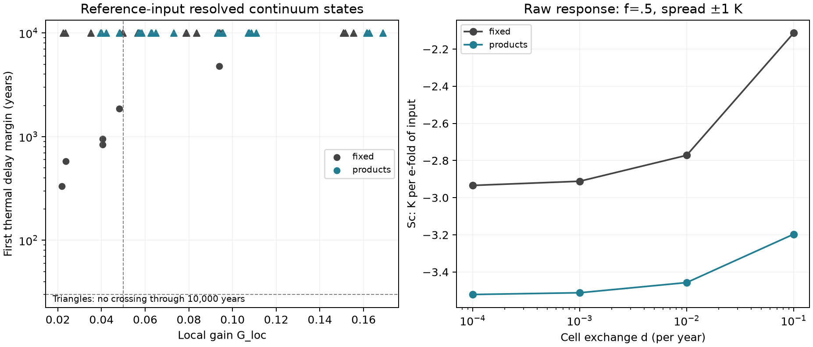

# Resolved habitats: response, connectivity and thermal lag

The adaptive calculation resolves all tested settings, but five of the six
predictions fail. Most importantly, the proposed near-pinning/long-lag
frontier fails under the newly specified local gain. This does **not** reveal
an exactly pinned climate: changing the comparison changes the ratio while
the physical supply response remains nonzero. Connectivity is also not a
monotonic predictor of the first unstable thermal lag. Writing readiness
remains withdrawn.

This page reports C0/C1 from the [Stage B′ specification](continuum-habitats-spec.md),
with [implementation choices frozen before production](continuum-habitats-methods.md)
in `39572a4`. It replaces the unresolved finite-grid spatial inferences in
[B1](dynamic-realisation.md); those historical grids are retained as numerical
diagnostics. It adds no climate data, physiology or evolutionary mechanism.

## What is now resolved

There are [90]{.C45} homogeneous C0 mixed-state records and
[80]{.C45} distinct C1 settings. Every C1 setting passes the panel-profile,
supply-slope and delay-margin doubling checks. The final collocation grids
have at most 204 nodes. The main spectral calculation uses the complete
weighted matrix spectrum at these sizes; a converged equilibrium profile
alone was not taken as convergence of the slow spectrum.

The independent route derives the local physical derivatives separately,
eliminates the habitat blocks, and searches a four-variable characteristic
determinant. All [6]{.C45} selected comparisons pass. The two finite delay
margins differ from the primary calculation by less than 0.002%; the other
four agree in right-censored classification through 10,000 years. Full-system
back-substitution rejects spurious local poles. See the
[independent derivation and controls](../../docs/audits/continuum-characteristic-2026-11-12.md)
and [main-map replay](../../docs/audits/continuum-characteristic-main-map-2026-11-12.json).

These are sampled-branch and numerical-convergence results, not an interval
proof covering every possible equilibrium or frequency. No temperature
support was clipped to obtain them.

## What the local gain measures

For each habitat write its biomasses as `X_A=cB` and `X_M=(1−c)B`. Holding
`c` fixed removes that habitat's guild sorting; the sum of the original
biomass flows still determines `B`. Hydrogen, acetate, methane and climate
remain dynamic. This preserves the original operating state and defines the
counterfactual slope `S_0`. The community slope is `S_c`, and
`G_loc = S_c/S_0`.

Across habitats the global mix can still change: habitats with different
fixed `c` can acquire different total biomass. Thus this intervention removes
**local sorting**, not every change in global composition. It is also not
guaranteed to yield a finite nonzero denominator at an arbitrary equilibrium.
The implementation reports singular, flat, corner and out-of-domain cases
explicitly. All slopes used here are defined, and the frozen-ratio finite-input
checks pass. The frozen counterfactual is locally stable in every C1 setting.

The older matched methanogen-only gain remains a separate secondary treatment
comparison in [`matched_controls.csv`](figures/continuum_habitats/matched_controls.csv),
with its [root inventory and source hashes](figures/continuum_habitats/matched_controls_manifest.json).
It is left undefined for missing, ambiguous, unstable, flat or insufficiently
balanced controls. A failed secondary control does not invalidate the
well-defined local frozen-ratio comparison; nor does a finite control search
prove that no other branch exists.

At the homogeneous products reference with half the acetate reaching methane,
`S_c` is [−1.877567]{.C46} K per e-fold of supply and `S_0` is
[−48.554978]{.C46}, giving `G_loc` [0.038669]{.C46}. Its climate has not
changed from B1: the old gain against a matched methanogen-only world was
about 0.142. The new denominator moves an already known partially buffering
community below the chosen 0.05 threshold.

There are [43]{.C46} qualified counterexamples to PC3's restated numerical
criterion: [24]{.C46} homogeneous and [19]{.C46} spatial states with
`|G_loc|<0.05` and no loss of stability before 30 years. For example, fixed
chemistry, half recycling, spread ±1 K and exchange 10⁻⁴/year gives
`S_c≈−2.934`, `S_0≈−72.434`, `G_loc≈0.0405` and a delay margin near
947 years. Its temperature response is plainly nonzero. These refute the
specified threshold frontier, not the broader distinction between exact
pinning and partial buffering []{.C46}.

## The six fixed predictions

| Prediction | Result | Interpretation |
|---|---|---|
| PC1: adaptive resolution | Supported on the sampled branches | All 80 settings converge; six independent spectral checks pass. |
| PC2: mixed-zone width proportional to exchange | Refuted | Fixed chemistry satisfies the tested scaling. Twelve product-feedback comparisons fail it. |
| PC3: no small local gain with a long delay margin | Refuted | The new normalization already supplies homogeneous counterexamples. Raw slopes remain nonzero. |
| PC4: connectivity monotonically increases the margin; low connectivity always gives a finite margin | Refuted | Two adjacent connectivity comparisons decrease the margin; two broad-support low-connectivity cases are right-censored. |
| PC5: every spread gain lies above 0.05 | Refuted | Eleven reference-input fixed-chemistry cases fall below the interval. The separate ordering with spread is not refuted. |
| PC6: products stay stable and spread never lowers their gain | Partly holds; conjunction refuted | All forty product cases stay stable on the tested lag grid; eleven normalized gains fall below their homogeneous comparisons. |

The machine-readable [prediction assessment](figures/continuum_habitats/prediction_assessment.json)
retains each comparison, failed clause and denominator. Missing or unresolved
data cannot count as support.

### Width and connectivity

Product feedback already sustains a mixed community in one habitat. Its
mixed zone therefore need not be created solely by immigration. Over the
tested range, increasing exchange tenfold barely changes the product-feedback
zone, whereas the fixed-chemistry zone approximately scales with exchange.
This explains the [12]{.C48} failed product width comparisons without
asserting a proved nonzero-width limit as exchange tends to zero.

At fixed chemistry, half recycling and ±1 K spread, raising exchange from
10⁻⁴ to 10⁻³/year lowers the delay margin from [947.430255]{.C47} to
[842.240799]{.C47} years. At still faster exchange no crossing is detected
through 10,000 years. This is not evidence that connectivity is irrelevant:
the response is nonmonotonic, and changing exchange changes both the
equilibrium distribution and the coupled ecological dynamics. Treating it as
one additional scalar reseeding lag gives no monotonicity theorem.

A [local mode decomposition](../../docs/audits/continuum-connectivity-mechanism-2026-11-12.md)
separates those effects. At the lower connectivity, explicit mixing raises
the delay margin, but the accompanying equilibrium redistribution lowers it
more strongly. At the higher connectivity the direct effect wins. Another
mixed-panel doubling confirms both signs. The zero-recycling example also
crosses a climate-curve corner, but the half-recycling counterexample stays
on one segment, so that corner is not the sole explanation.

### A lower ratio need not mean a smaller temperature response

For products chemistry without acetate recycling, adding ±1 K spread at
10⁻⁴/year changes `S_c` from about −1.883 to −2.068 K/e-fold: the physical
temperature response gets larger. But `S_0` changes from about −42.10 to
−52.43, so `G_loc` falls from about 0.04472 to 0.03944. This accounts for
the apparent improvement in that normalized comparison. It is not improved
absolute holding. All [40]{.C50} product settings retain the tested delay
stability, while [11]{.C50} fail PC6's gain-ordering clause
[]{.C50}. The fixed-chemistry interval failures are recorded
separately []{.C49}.



Triangles are right-censored at 10,000 years. The right panel shows the raw
supply slope so that changes in the normalization remain visible.

## Reproduction and limits

```sh
uv run python -m terra_prisca.haze_world.continuum_experiments --workers 2
uv run python -m terra_prisca.haze_world.continuum_assessment --prepare-inputs
uv run python docs/audits/continuum-characteristic-2026-11-12.py \
  --states models/haze_world/figures/continuum_habitats/characteristic_inputs.json \
  --output docs/audits/continuum-characteristic-main-map-2026-11-12.json
uv run python -m terra_prisca.haze_world.continuum_assessment
uv run python -m terra_prisca.haze_world.continuum_controls
```

The compact tables, selected quadrature states and source/output hashes are
under [`figures/continuum_habitats`](figures/continuum_habitats/). Complete
adaptive histories and source-epoch caches stay under ignored `local/haze/`.
The finite-input table exposes the perturbation size actually qualified and
retains its coarser diagnostic. A
[postprocessing-only export correction](../../docs/audits/continuum-fd-export-2026-11-12.py)
records the separate calculation/export source epochs and verifies that only
the flattening function changed; no equilibrium, implicit slope, gain or
spectrum was recomputed or altered.
The [prepared raw-archive receipt](figures/continuum_habitats/archive_receipt.json)
records the payload identity and full-member readback both locally and on
shared project storage. It includes the canonical transient receipts,
separate source epochs, adaptive histories, compact evidence and replay code.
Original repository-relative paths are retained. This is a verified working
archive; a public deposit remains held for the eventual release.
The named physiological support, transferred uptake normalization, prescribed
product activities, assumed acetate fate and climate interpolation remain
unchanged limitations. The gain is a local derivative, not a response to a
finite supply collapse. Finite lag searches do not establish stability at
every possible lag. See [E15](synthesis/estimands.md).

The specification's automatic thesis-selection rules are not adopted: failure
of a monotonicity clause does not establish robustness at every connectivity,
and changing a gain denominator does not create a new physical thermostat.
The nonlinear homogeneous B2/B3 evidence is reported separately. Spread
invasions and any revised paper thesis require the next scientific review.
In particular, the existing homogeneous methanogen-only starting world is
about 273.517 K. Reusing it with any prescribed spread violates the 273 K
lower full-support bound. The reference-input secondary search detects no
supported alternative. Spatial invasion starts therefore need a design
reconciliation before B3 can proceed; silently clipping the cold habitats
would change the model.

The subsequent [graded-dial stage](graded-dials.md) tests the remaining
zero-to-graded gap. The reviewed decision drops the proposed uniform-spread
invasions under this support constraint.

**Claude's review (12 November).** The failed threshold hides a clear
structure []{.C54}. All [42]{.C54} exactly pinned states have critical lags of
at most [7.08]{.C54} years. All [122]{.C54} ordinary graded states have at least
[331]{.C54} years, with residual slopes of at least [0.59]{.C54} K per e-fold.
Within fixed-chemistry spread, the delay margin rises monotonically with the
residual slope, with a log–log slope near [1.48]{.C54}. The gap between exact
and graded regulation is untested, because every mechanism is either on or
off. The [graded-dial specification](graded-dial-spec.md) crosses it
continuously. Uniform-spread spatial invasions are dropped: every invasion
trajectory visits 273.5–274.6 K, so any spread above 0.5 K leaves the
physiological support. See the
[review](review/continuum-habitats-claude-review-2026-11-12.md).
