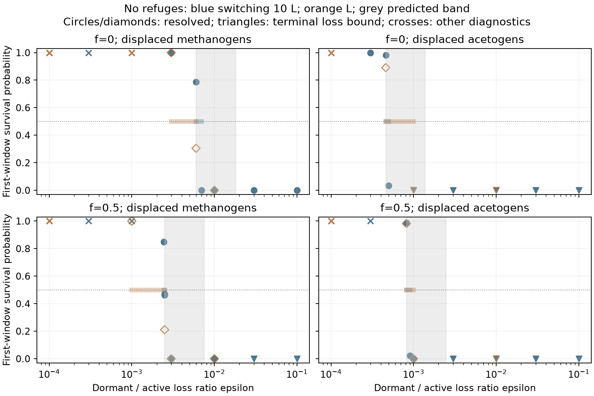
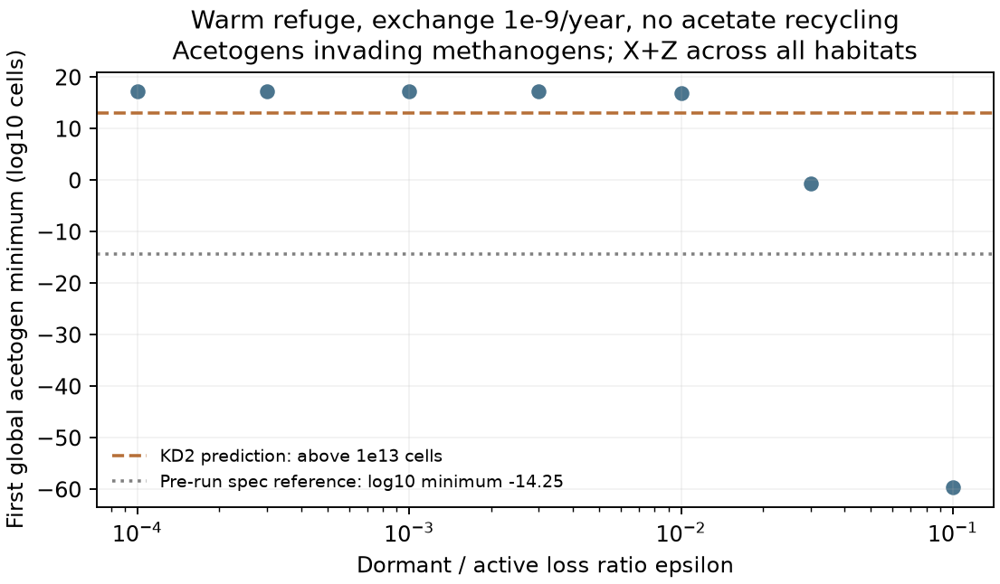
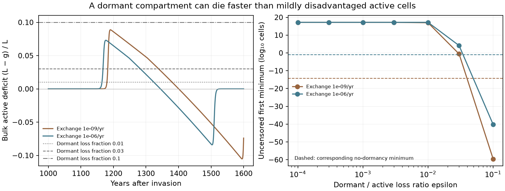
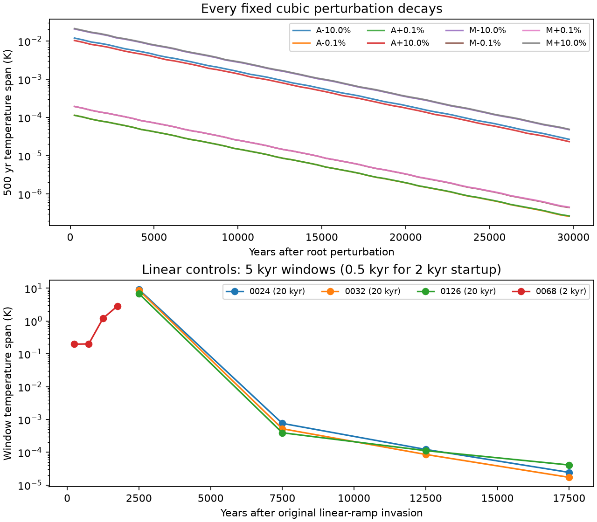
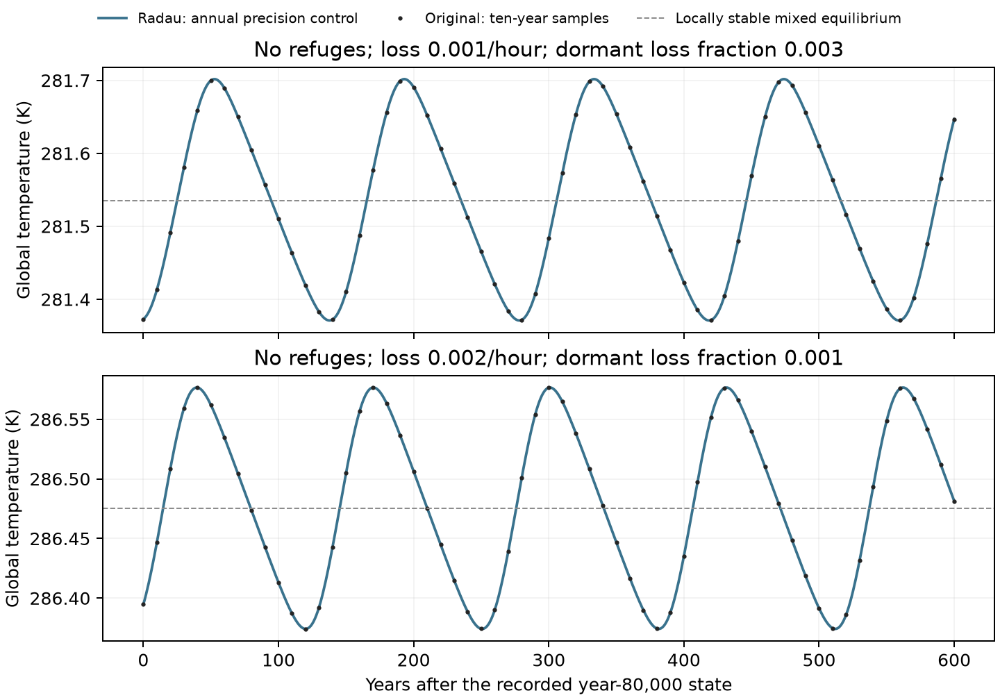
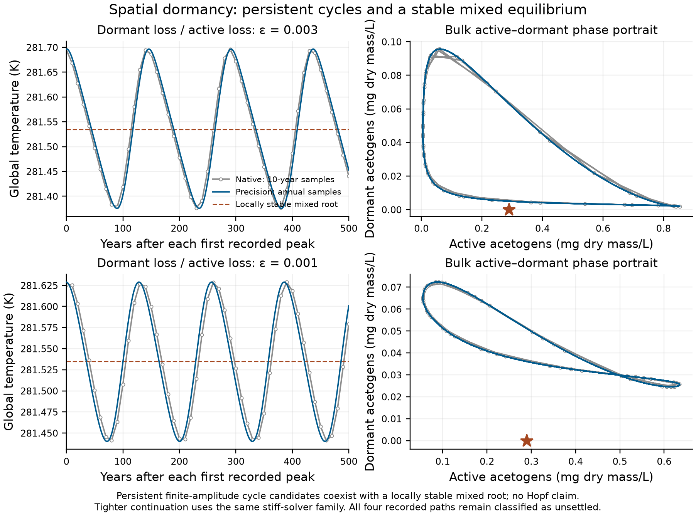
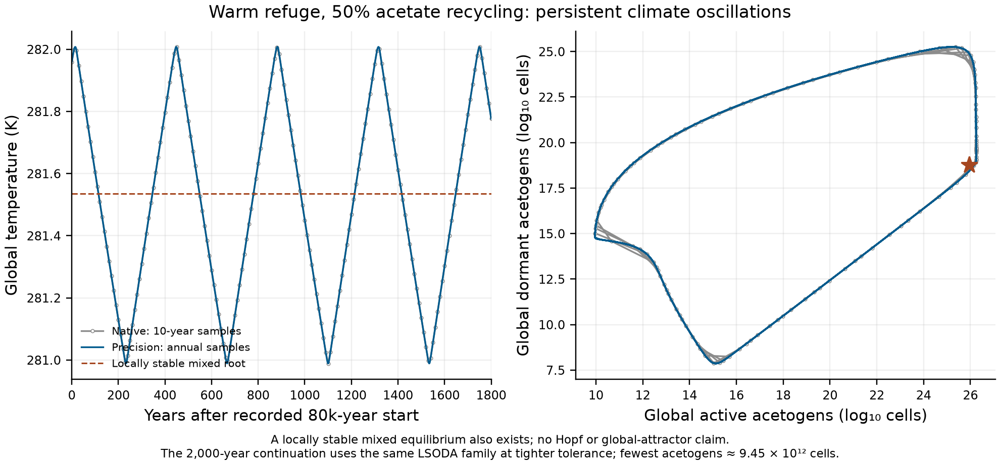
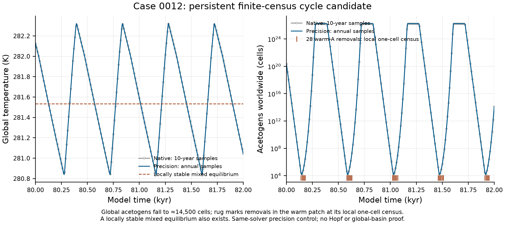

# Dormancy in haze-world

Dormancy can retain the microbial group displaced during a climate swing,
but it does not always protect it. The completed experiment and its
[independent review](review/turnover-dormancy-claude-review-2026-11-11.md)
support four results:

- **A seed bank can replace a refuge.** In the four no-refuge tests, half
  survival requires dormant half-lives of about 12–32 years for displaced
  methanogens and 90–170 years for displaced acetogens. The longer acetogen
  requirement spans the greenhouse warming excursion. These are conditional
  first-bottleneck probabilities, not guarantees of a common endpoint.
- **Short-lived dormancy can deepen a bottleneck.** During mild competitive
  disadvantage, dormant death can exceed the active net loss. The model's
  growth-triggered switching law then transfers cells into the less viable
  state.
- **Some climate paths keep oscillating.** Checked ranges are 0.2–1.5 K,
  alongside a locally stable mixed equilibrium. Switching-law and amplitude
  controls distinguish these finite trajectories from the reference model's
  weakly damped ringing; no global-attractor claim follows.
- **Macrostate stationarity differs from dormant-bank stationarity.** The
  original strict labels remain: 56 stationary and 72 unsettled. In 41 of the
  latter, climate, chemistry, active stocks and total guild biomass meet the
  existing tolerances, while the dormant bank remains unresolved.

**Status: original build accepted; review closure reported below.** All 128
planned cases completed at least 100,000 years. The first-window assessment
covers 143 profiles and 286 guild diagnostics. Earlier outputs, strict flags
and probability calculations remain unchanged.

The preceding [T1 gate and T2 experiment](turnover.md) are complete within
their stated scopes. The original
[specification](turnover-dormancy-spec.md) records KD1–KD5 before the runs;
the [method notes](turnover-dormancy-method-notes.md) record qualifications
made before full-grid scoring and the later numerical record. The
[prediction assessment](figures/dormancy/prediction_assessment.json) binds the
final inputs and outcomes.

That gate is scoped to the checked starts and reconciled local stability,
not a proof that equilibrium roots exhaust every global attractor. T3 uses
only `f=0` and `0.5`. The assessment retains the gate's qualifications
alongside its hash.

This variant asks whether a dormant seed bank can retain the microbial group
that temporarily loses the competition for hydrogen. The atmosphere adjusts
over millennia while active populations can decline within years. Dormancy
can bridge that interval without a spatial refuge, but its success depends
on the duration and shape of the climate excursion, not just the final
environment. The dormant loss rates and switching law are hypotheses for
this model, not measurements of an Archean biosphere.

## Model and units

Each habitat has hydrogen, active acetogens `X_A`, active methanogens `X_M`,
acetate, dormant acetogens `Z_A` and dormant methanogens `Z_M`. Habitats share
atmospheric methane and the existing case-B climate response. Biomass is in
g dry weight/L, and the integration time is years. The reference hourly
growth, loss and switching rates are converted to years consistently.

For each guild, with synthesis `g = Y(q − m)` and active loss `L`,

    dX/dt = (g − L)X − σX + ρZ + cell exchange
    dZ/dt = σX − ρZ − εLZ + cell exchange

    σ = kL c((L − g)/L)
    ρ = kL c((g − L)/L)

T3 uses the documented cubic ramp `c(x)=x²(3−2x)` between zero and one,
clipped to those values outside that interval. Thus entry occurs only under
negative active growth, and waking only under positive active growth. The
main switching factor is `k=10`, with `k=1` as the slow control. The permitted
linear ramp remains a separate named control. A short matched linear/cubic
comparison does not establish equal long-term outcomes; T3 conclusions are
conditional on the cubic law.

Dormant cells neither consume hydrogen nor incur maintenance or generate
products. They retain their biomass, die at `εL`, and disperse at the same
per-cell rate as active cells. Conversion preserves biomass; dormant death
enters the same turnover accounting as active death. The census counts
`X+Z` in each habitat and removes a guild there below one cell. A surviving
population elsewhere can rescue a local loss; global removal is absorbing.

The physical model is [`dormancy.py`](../../src/terra_prisca/haze_world/dormancy.py).
The [method notes](turnover-dormancy-method-notes.md#numerical-provenance-and-source-epochs)
retain the numerical qualifications, source epochs and platform comparison.
They distinguish completed trajectories from endpoint convergence and from
rare-lineage accuracy; no physical equation or census rule changes here.

## Stationary locations and resident preparation

The specification's KD1 statement requires a distinction. In one well-mixed
habitat with `ε>0`, a stationary living resident has `g=L`, no switching and
`Z=0`. Its stationary location is therefore the reference location. For the
cubic ramp the switching derivative also vanishes at break-even growth;
this supports the local resident stability comparison stated in the
[independent design review](review/turnover-dormancy-design-review.md).
It does not establish unchanged finite-dose basins.

Spatial source–sink residents differ. Dispersal balances unequal local
growth, so `g−L` need not vanish in every habitat. A habitat can maintain a
dormant bank even at a stationary global state. Thus the claim that *every*
spatial equilibrium remains unchanged is false. Each spatial resident is
prepared at its own stationary bank, solving

    [diag(ρ + εL + d) − d 1 wᵀ] Z = σX

and refining its hydrogen, active biomass, acetate and atmospheric methane
together. A root qualifies only with supported physiology, a small residual
and agreeing conditional resident spectra at two step sizes on each climate
side. The bounded stencil refinement retains every coarse spectrum.

Each experiment uses the highest-methane qualifying resident, then adds
`10⁻¹² gDW/L` active invader in every positive-area habitat and zero dormant
invader. This is the earlier finite invasion dose. The root search and
selection do not prove global uniqueness or resistance to invasion by the
other guild.

## Experiments and endpoint comparisons

The 128 planned runs comprise:

- 112 main cases: acetate recycling `f=0` or `0.5`, seven `ε` values from
  `10⁻⁴` to `0.1`, both invasion directions, and no refuge, a 2% warm refuge
  at exchange `10⁻⁹` or `10⁻⁶/year`, or both 2% refuges at `10⁻⁶/year`;
- 12 slow-switching cases without refuges, at `ε=0.01`, `0.001` or `0.0001`;
- four no-refuge cases at active loss `0.002/hour`, testing the bistable
  reference regime at `f=0` and `ε=0.01` or `0.001`.

The initial horizon is 100,000 years with a ten-year census. Identifiable
physical tails receive bounded extensions; cycles and dormant-stock drift
retain their unsettled labels. A stationary endpoint needs less than 0.1%
change in every stock, less than 0.01 K temperature change, small scaled derivatives
and no occupancy changes over its final 20,000 years. Opposite invasion
directions agree only when both endpoints qualify, every habitat has the
same guild occupancy, their temperatures differ by less than 0.01 K, and
every active, dormant, chemical and atmospheric stock agrees within 0.1%
using declared near-zero floors. Equal temperature alone is insufficient.

All 128 cases completed the required 100,000 years; five selected endpoints
use bounded 200,000-year settling extensions. **56 endpoints are stationary
and 72 remain unsettled.** Of the 64 invasion pairs, ten agree, nine have
different stationary endpoints and 45 include an unsettled path. These are
endpoint comparisons, not an inventory of global attractors.

The [endpoint diagnostic](review/dormancy_endpoint_diagnostics.json) separates
41 dormant-stock stationarity failures from 31 persistent oscillation
envelopes. Eight oscillating paths have the bounded checks described below;
23 remain unreviewed oscillation candidates. This triage preserves every
original settling flag. The checked dormant tails include cell counts of order `10^18`; their small
biomass fractions do not establish numerical noise.

The post-review [bank assessment](review/dormancy-tail-assessment-2026-11-11.json)
adds a description alongside those flags. All 41 bank-only cases satisfy the
unchanged macrostate criteria, including total guild biomass and census
occupancy. They also agree with nearby present-guild roots at those
tolerances. **None passes a resolved frozen-root bank forecast**, which must
explain each failing bank's variation within 0.1%. They are therefore
**macrostate stationary; dormant bank unresolved**, rather than verified
settled up to dormant decay. Small entry or waking sources can dominate
such banks, even while the active community is nearly stationary.

Under the additional macro comparison, 41 of the 64 invasion pairs have two
qualifying endpoints and 25 agree. The original strict counts remain 19
pairs with two stationary endpoints and ten identical pairs. This expands
finite-record macrostate agreement; it establishes neither identical
unresolved banks nor a common full-state attractor or joint survival. The
[fixed criteria](review/dormancy-tail-classification-design-2026-11-11.md)
and [closure](review/dormancy-closure-2026-11-11.md) preserve those distinctions.

KD1's no-removal reference clause additionally compares matching frozen
buffered-refuge endpoints. It projects active plus dormant biomass into the
reference guild stocks and records dormant fractions separately. Selected
stationary horizons are explicit; an extended endpoint comparison is not
reported as a literal 100,000-year identity.
The literal finite-time clause compares completed states at matching declared
and actual 100,000-year horizons, independently of whether either is stationary.
Asymptotic endpoint comparisons retain the separate stationarity requirement.

## First bottlenecks and KD1–KD5

The two-stage backward branching calculation treats active birth/death,
dormant death, stage conversion and habitat migration explicitly. With zero
switching and zero initial dormant cells, it reproduces the frozen active
probabilities bit for bit. Closed-form and independent forward controls,
including reopening pathways after severe underflow, are recorded in the
design review.

Each guild is assessed at its first resolved globally rare bottleneck. The
boundary is lowered only around that first minimum until local and global
hydrogen uptake shares are negligible. A later continuum recovery cannot
replace an earlier failed bottleneck. Terminal declines retain their finite
horizon. Their survival probability is an upper bound for survival through
any later horizon, so a terminal value below 0.5 supplies a one-sided loss
constraint without waiting for an implausible continuum recovery. A
terminal value above 0.5 needs a longer hold.

The probabilities assume the recorded environment and a Poisson population
at window entry. They concern survival somewhere across all habitats and
both stages. They do not certify local occupancy or a joint community
endpoint. Rows flag dependence on the other guild's improbable continued
survival. Demographic classes use the accepted thousandfold range in the
global cell-count scale.

The result assessment keeps the predictions separate:

| Prediction | Assessment rule |
|---|---|
| KD1: unchanged stationary states | Preserve the well-mixed theorem; test spatial endpoints and qualify its failed spatial premise. |
| KD2: warm-refuge acetogens never fall below `10¹³` cells | Use the global `X+Z` first minimum, plus the first-window persistence class; never substitute a patch minimum or a later ghost minimum. |
| KD3: a seed bank replaces refuges | Retain every measured `P=0.5` bracket. Compare it with the predicted 1–3× bands, without imposing monotonicity or a unique threshold. |
| KD4: switching speed changes the critical `ε` by less than threefold | Compare all fast/slow bracket ratios. A broad ratio interval requests refinements rather than a fabricated point estimate. |
| KD5: dormancy cannot alter the bistable outcome | Test the specified finite doses and both invasion directions. Preserving stationary locations is not a proof about these basins. |

### Checked first-window results

The public [table](figures/dormancy/first_survival.csv),
[full guild diagnostics](figures/dormancy/first_survival.json) and
[manifest](figures/dormancy/first_survival_manifest.json) contain all 143
profiles and 286 rows. The [compressed provenance](figures/dormancy/reuse_inputs.json.gz)
pins selected receipts, payloads, source epochs and the cell-count convention.
The final scoring epoch recomputed 142 profiles and reused one completed
official task with identical source, input and selector hashes. No probability
is substituted for a failed calculation.

With **no refuges**, active loss `L=0.001/hour` and fast switching `k=10`,
the displaced resident's first-window survival crosses one half within the
following brackets. `P` uses the default global cell-count conversion.
The dormant half-life is `ln(2)/(8766 εL)` years when `L` is given per hour.

| Displaced resident | Acetate recycling `f` | Epsilon bracket | `P` at lower / upper epsilon | Dormant half-life bracket, yr |
|---|---:|---:|---:|---:|
| Methanogens | 0 | 0.006–0.007 | 0.787 / 0.000158 | 11.3–13.2 |
| Methanogens | 0.5 | 0.00245–0.002499 | 0.849 / 0.470 | 31.6–32.3 |
| Acetogens | 0 | 0.00046–0.0005 | 0.982 / 0.0350 | 158–172 |
| Acetogens | 0.5 | 0.00082–0.0009 | 0.988 / 0.0221 | 88–96 |

All eight bracket endpoints have locally linear rare windows that close
strictly inside their recorded horizons. None overlaps the other guild's
flagged likely loss, and all eight windows lie inside the extracted Arney
climate domain. This domain statement concerns the scored windows; resident
starts and earlier portions of the path can still depend on the low-methane
bridge. The brackets do not assume a globally monotone response or
fit a precise threshold between the samples. They show a substantially
longer seed-bank requirement for displaced acetogens, whose suppression
passes through the greenhouse warming excursion.

The pre-run KD3 prediction bands are `0.006–0.018` and `0.0025–0.0075` for displaced
methanogens at `f=0` and `0.5`, and `0.00046–0.00138` and
`0.00082–0.00246` for displaced acetogens. The reference-duration argument
that produced them is a prediction, not a rigorous lower bound once
dormancy changes the climate path. Three measured fast brackets lie within
their proposed bands. The `f=0.5` methanogen bracket lies just below the
proposed 0.0025 lower bound, refuting that strict bound in the specified model.
These first-window results do not establish common long-term endpoints
from both invasion histories; the strict endpoint comparison retains 45
unsettled pairs.

The review's useful approximation is
`ε* ≈ ln(N₀/N₅₀)/(Lτ)`: an isolated bank must retain enough viable cells over
an unfavourable interval `τ`. Its half-life is then
`ln(2) τ / ln(N₀/N₅₀)`, about **1.3% of the interval for the assumed population
ratio here**. The measured epsilon brackets are 0.992–1.167 times the
review's approximate predictions. They support the approximation, not exact
equality or a universal 1.3% coefficient. Entry and waking can indirectly
change the climate through active populations, so the suppression duration
is not generally fixed by the no-dormancy path. The
[mathematical check](review/dormancy-interpretation-math-check-2026-11-11.md)
states the assumptions and retains the original failed lower-bound test.

KD4's factor-of-three prediction is supported conservatively by the current
slow-switching (`k=1`) brackets. In the table's row order, the slow epsilon
brackets are `0.003–0.006`, `0.001–0.0025`, `0.00046–0.001` and
`0.00082–0.001`. Combining both edges of the fast and slow brackets gives
slow/fast threshold-ratio intervals of `0.428–1`, `0.400–1.021`,
`0.920–2.174` and `0.911–1.220`; all fit within `1/3–3`. The slow
acetogen `f=0` upper point is a terminal finite-horizon loss bound. It is used
only as that conservative constraint, rather than as a completed late
recovery or a precise asymptotic threshold. This upper-bound window includes
the adopted low-methane bridge, so that part of KD4's support is conditional
on the bridge.

**KD2 is refuted as a universal overshoot-protection claim.** In
`dormancy_0010` (`f=0`, warm refuge, exchange `10⁻⁹/year`, `ε=0.03`),
the first global acetogen minimum is about **0.27 cell** at year 1419, rather
than above `10¹³` cells. Its first-window survival probability is
**0.001117**. The window closes at year 1531, lies inside Arney's domain and
has no other-guild loss-conditioning flag. Its classification is
**contingent**, with probabilities from `1.12×10⁻⁶` to `0.673` across the
thousandfold cell-count range in either direction. A small default probability
therefore does not justify calling this a robust-loss result.

These are T3 first-bottleneck tests of KD2–KD4. The KT1–KT4 turnover/refuge
tests remain the separate [T1/T2 results](turnover.md), including their
qualification of the Gaussian demographic approximation. None of the
probabilities above is a joint community-endpoint probability.

Macroscopic protection is retained separately: a guild whose complete
census trajectory remains above `10¹⁶` cells is protected on that recorded
horizon, even if it has no linear rare-population window. Such a point can
guide a targeted refinement between protection and a measured loss. It is
not assigned an exact rare-lineage probability of one and does not by
itself close a stochastic threshold bracket.

**KD1 preserves the well-mixed stationary-location theorem, but its spatial
claim is refuted.** All 17 stationary no-reference-removal comparisons fail
the strict full-stock identity criterion, with the largest difference in
warm-refuge acetogens. Their temperatures agree within `6.34e-8 K`; this is a
change in small community compartments rather than a measured climate shift.
The separate literal 100,000-year identity also fails, including paths that
keep cycling.

**KD5 is supported for the specified finite methanogen doses.** At active
loss `0.002/hour`, methanogens invading an acetogen world are removed globally
at years 230 and 2,250 for `ε=0.01` and `0.001`. Both active and dormant
methanogens remain absent through the completed horizon. With no immigration,
that absence is absorbing. The stationary-endpoint clause remains unresolved
because the latter path retains dormant-stock drift. Neither observation
proves continuous-attractor stability, eternal acetogen persistence or the
outcome for untested dormant losses.





The [deficit check](review/dormancy-deficit-check-2026-11-11.json) compares
the active acetogen deficit `(L−g)/L` on the frozen no-dormancy overshoot with
`ε`. At a fixed environment, converting active biomass into a dormant bank
changes the total-biomass derivative by `[(L−g)−εL] Z`. Thus dormant
allocation helps locally when `ε < (L−g)/L`. The deficit varies through the
overshoot: its year-1200–1400 mean is about 0.046 at exchange `10⁻⁹/year`
and 0.021 at `10⁻⁶/year`, rather than a constant 3% of loss. This local
condition explains why short-lived banks can deepen the measured continuum
bottleneck; it is not a universal threshold for the coupled climate path.
Both the original bottleneck and the added dormant loss can already imply
very poor survival.



## Cycles with and without census removals

The [review-closure controls](review/dormancy-closure-2026-11-11.md)
refute the predicted amplitude split: all eight ±0.1% and ±10% single-guild
perturbations of the case-0024 mixed root decay through 30,000 years. The
fitted period is about 119.6 years and damping time about 4,900 years. The
larger kicks were not increased to seek a cycling start. These tests do not
locate the basin of the previously observed cycling invasion path.

With the named linear switching law, cases 0024, 0032 and 0126 show decaying
oscillations through 20,000 years, reaching final 5,000-year temperature
ranges below `4.1×10⁻⁵ K`. Thus their sustained cubic-law paths are sensitive
to the switching law. The linear law is nonsmooth at break-even growth;
these trajectories do not supply a general stability certificate. The two
warm-refuge linear controls (0012 and 0068) remain computationally unresolved:
0068 returns only its 2,000-year startup, and 0012 no completed original-start
flow. Bounded continuations from the recorded cycles also return no flow.
Their timeouts do not indicate whether the cycles persist or vanish.



**The dormancy variant exhibits recurrence without any refuge.** No-refuge cases
0024 and 0032 at the reference active loss, and case 0126 at twice that
loss, retain macroscopic populations and recurring climate envelopes.
Independent Radau continuations of cases 0024 and 0126 reproduce 2,000 years
of the recorded flow with tenfold tighter tolerance and a one-year maximum
step. Their periods are 140.43 and 130.61 years and their temperature ranges
0.331 and 0.202 K. Common-time temperatures agree within `2.11e-7 K`.
Neither control needs census removals, interpolation extensions or chart
restarts; both guilds remain above `10^24.5` cells.



The mixed equilibria remain locally stable, near 281.535 and 286.475 K.
Cycle averages lie within 0.001 K of those roots, but this comparison does
not measure buffering against a changed supply. These are additional
nonlinear cycle candidates, rather than a demonstrated loss of local root
stability. The [cross-solver review](review/dormancy126_cycle_review.md)
and [comparison](review/dormancy126_cycle_comparison.json) retain source,
initialization, spectrum and raw-data checks. They establish finite
recurrence, not periodic-orbit stability or global basins. The original
strict unsettled flags remain.

Four completed census trajectories have persistent finite-amplitude cycles:
both invasion directions at `f=0`, with both fixed refuges, exchange
`10^-6/year`, active loss `0.001/hour`, and `epsilon=0.003` or `0.001`.
Their 40,000–100,000-year envelopes remain constant within the sampling
resolution. The respective periods are about 145.5 and 128.7 years, with
temperature ranges of 0.321 and 0.189 K. Both guilds remain above `10^24`
cells during the late cycles. No late census removal or stage-chart change
occurs.



The mixed equilibrium near 281.535 K is still locally stable: its leading
real eigenvalue converges to approximately `-1.986e-4/year` at four numerical
difference scales. Thus these paths are candidates for an additional
finite-amplitude attractor, not evidence that the equilibrium loses linear
stability. Their phases differ, so equal endpoint stocks are not claimed.

Two 2,000-year continuations from the exact recorded 80,000-year states use
tenfold tighter relative tolerance, a one-year maximum step and annual
observation while retaining the ten-year census. They agree with the
original temperatures within `7e-7 K` at common times. Period estimates
change by less than 0.006% and temperature ranges by less than 0.001%.
Neither control needs numerical recovery or removes a guild. The
[root and envelope audit](review/dormancy_spatial_cycle_check.json) and
[precision evidence](review/dormancy_spatial_cycle_precision.json) retain
source, input and raw-output hashes. These are controls within the same
stiff-solver family; they do not prove a periodic orbit or exhaust its basin.
All four original paths retain their nonstationary classification.
They also refute KD1's literal 100,000-year matching-state clause: the
completed states differ from their no-removal reference states, even though
a stationary comparison is unavailable. The completed 128-case assessment retains these nonstationary flags.

A further checked case has only the warm refuge, `f=0.5`, `epsilon=0.03`
and exchange `10^-6/year`. Acetogens invading methanogens reach persistent
oscillations with a **1.019 K temperature range and 434-year period**.
Its complete-cycle mean is 281.5001 K, about 0.0347 K below the switch.
The tighter 2,000-year continuation agrees within `3e-8 K`; even its lowest
acetogen population exceeds `9e12` cells. A locally stable mixed equilibrium
also exists. The [extended audit](review/dormancy_extended_cycle_check.json)
and [precision record](review/dormancy_extended_cycle_precision.json) retain
the same solver-family and finite-observation qualifications.
The observed case-0068 path has no census removals, so its cycle is a candidate
of the unculled continuous flow.



The reverse invasion loses acetogens and approaches the cold methanogen
world. Its remaining dormant banks are still relaxing, so it retains the
strict unsettled flag. That outcome is absorbing under the finite census:
acetogens could grow if reintroduced. It is therefore not a demonstrated
third attractor of the continuous equations. Small banks are not automatically
numerical noise; this audit distinguishes their relaxation toward a refined
resident root from the independently observed platform discrepancy below.

**Case 0012 is a different kind of cycle.** With the same warm-refuge geometry,
exchange and `ε=0.03`, but no acetate recycling, its late temperature range is
**1.482 K** and its period about **443 years**. Acetogens are repeatedly
removed locally from the warm patch while both guilds remain present
globally. This is a finite-census hybrid-cycle candidate. Case 0068's cycle
candidate follows the unculled continuous equations.



A tighter 2,000-year continuation of the recorded year-80,000 state preserves
the same 28 local culls and census occupancies, and agrees at common dates
within `7.15×10⁻⁸ K`. Its dense global acetogen minimum is only about
**14,500 cells**, compared with more than `9×10¹²` in case 0068. The
[case review](review/dormancy0012_cycle_review.md),
[comparison](review/dormancy0012_cycle_compare.json) and
[figure manifest](review/dormancy0012_cycle_figure.json) retain the exact
sources and receipts. A locally stable mixed equilibrium also exists near
281.535 K. These same-solver controls support persistent finite-amplitude
recurrence; they establish neither a Hopf transition nor a global basin.
Retention of 14,500 deterministic cells does not establish stochastic
survival through repeated bottlenecks or robustness to the global cell-count
conversion. The first-window probabilities above do not answer that repeated
hazard question.

## Reproduction and current evidence boundary

Restore the raw archive according to its README and
[payload receipt](figures/dormancy/payload_receipt.json), retaining
`receipt_selection.json`. These commands then recompute the endpoint,
first-window and prediction assessments:

```sh
uv run python -m terra_prisca.haze_world.turnover_assessment --variant dormancy
uv run python -m terra_prisca.haze_world.turnover_survival --variant dormancy --workers 8
uv run python -m terra_prisca.haze_world.dormancy_assessment
```

The new review controls use a separate
[incremental payload](figures/dormancy/closure_payload_receipt.json); they do
not overwrite the accepted original archive. After restoring both payloads,
reproduce their derived diagnostics with:

```sh
uv run python -m terra_prisca.haze_world.dormancy_tail_assessment
uv run python models/haze_world/review/dormancy_cycle_closure_analysis.py
uv run python models/haze_world/review/dormancy-deficit-check-2026-11-11.py
uv run python models/haze_world/review/dormancy-interpretation-math-check-2026-11-11.py
```

Physical replication uses each selected receipt's producing module, recorded
case and horizon, source graph and environment. Earlier completed numerical
epochs are retained. First-window horizons follow the closed-window question;
short refinement profiles are excluded from long-horizon endpoint claims.

The probability stage requires annual uncensored profiles for culled cases
or cases whose dense minima enter the rare-population range. Its missing
profile error identifies where those runs are needed. Large raw arrays stay
under gitignored `local/haze/dormancy/`; receipts pin the source graph,
protocol, environment and payload checksum. Derived summaries, assessment
JSON and figures belong under `figures/dormancy/`.

The climate response, assumed methane loss, low-methane bridge, cold
physiology continuation, strain transfer, homogeneous habitat mapping and
cell-count conversion remain separate model assumptions. None of these
thresholds or cycles is an Archean calibration.

The declared build is complete: all required physical horizons, annual
first-window inputs, selected-source checks and the final assessment/figures
are present, with no outstanding epsilon or first-window horizon requests.
Strict endpoint flags, recurrent paths and dormant-stock drift remain in the
results. The prediction assessment supports finite-dose exclusion separately
from stationary-state claims and per-guild survival separately from joint
community persistence. The original independent review accepts that build. The subsequent
closure checks preserve its evidence boundary and separately test the
switching-law and endpoint interpretations.
