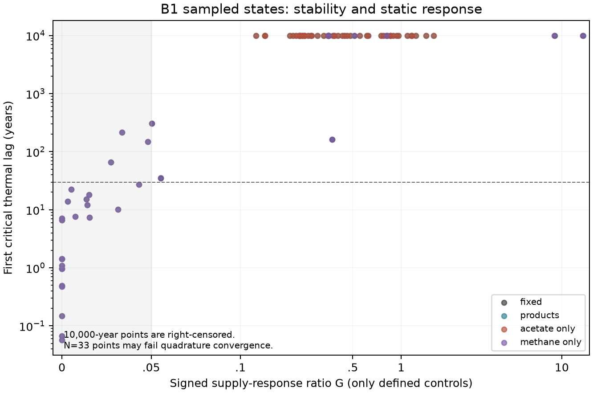

# Dynamic realisation: B1 and B4

The reference chemical attribution fails: local acetate feedback supplies
almost all the tested added damping, whereas the direct atmospheric-methane
loop barely shifts the critical thermal lag. The proposed dormant-bank-as-lag
mechanism also fails. The continuous-habitat pinning–robustness frontier is
**unresolved**, because the prescribed habitat discretisation does not converge
and many matched controls are unavailable. Writing readiness remains withdrawn.

The [original specification](dynamic-realisation-spec.md) retains PB1–PB7.
The [pre-run methods](dynamic-realisation-methods.md), frozen as `db09eea`,
explain the control comparison, two-layer equations, numerical censoring and
directional dormancy analysis. Only B1 and B4 were run. B2/B3 nonlinear
oscillations and invasions are pending.

## The chemistry diagnosis

At reference turnover and supply in one homogeneous habitat, implicit supply
derivatives and independently assembled Jacobians give:

| Chemistry | Gain G, f=.5 | Critical thermal lag, f=0 | Critical thermal lag, f=.5 |
|---|---:|---:|---:|
| Fixed products | approximately zero | 0.149 yr | 1.103 yr |
| Methane-only product feedback | approximately zero | 0.149 yr | 1.103 yr |
| Acetate-only product feedback | 0.142 | not detected through 10,000 yr | not detected through 10,000 yr |
| Both products | 0.142 | not detected through 10,000 yr | not detected through 10,000 yr |

The acetate-only and full-product gains both round to
[0.142]{.C43}. Both retain roughly 86% attenuation relative to the matched
methanogen-only control, while giving up exact pinning. Methane-only retains
near-zero supply slope but the short thermal delay margin. This independently
refutes PB2's attribution []{.C39 .superseded} and identifies the stabilising
counterfactual at these settings []{.C43}.

Acetate activity depends on the acetogen population through its product pool,
so it supplies self-limitation of that population. Atmospheric methane activity
depends on the shared methane stock, not directly on allocation. Its direct
temperature-bypassing loop exists, but existence of a loop does not establish
that it dominates damping. These results concern the transferred reference
parameters and normalised product activities, not an empirical Archean
partition between chemistry and climate.

## Habitat resolution and the gain comparison

For fixed chemistry, f=.5, reference supply/turnover and σ=1 K, independently
refined states give critical lags about 7.23, 16.28 and 102.09 years at
N=9, 17 and 33. Temperatures barely shift, but the supply derivative and
stability margin do. The specified 5% convergence criterion fails, refuting
PB3's convergence prediction []{.C40 .superseded}. This is evidence about the
discrete approximation, not a measured continuum delay margin.

Finite-N points satisfying the proposed near-pinning/long-lag thresholds are
retained as **candidate** escapes. They do not by themselves refute a
continuous-spread frontier: resolution and matched-control validity must also
hold. Conversely, failed resolution and missing gains cannot be counted as
support for a universal trade-off []{.C38}.

G compares the community with a methanogen-only world at the same supply,
chemistry and geometry. Those worlds generally occupy different climate
segments. A plateau gives a zero denominator; some spread controls have no
qualified root within the physiological support. G is then undefined.
The tables retain raw supply derivatives, control-root inventories and explicit
search statuses. No control was extrapolated or clipped to manufacture a ratio.
This is a useful treatment comparison where defined; it is not a universal
same-operating-point feedback gain.



The figure shows only defined control comparisons, with N=1 and N=33 states.
Points at 10,000 years are right-censored; N33 points are not certified
continuum results. The shaded near-zero-gain region does not by itself
identify a qualified escape from the proposed frontier.

## Thermal closure

The one-layer fixed-product sensitivity retains short critical lags in the
tested homogeneous settings. The explicit two-layer diagnostic can have a
much smaller critical coefficient τ_f: at the reference f=.5 it is about
0.011 years, compared with 1.10 years in one layer. Thus PB4's factor-of-two
clause fails []{.C41 .superseded}.

The reason is visible in the chosen equations: with τ_s=100τ_f, the
low-frequency effective delay is τ_f+τ_s=101τ_f. The coefficient τ_f is not
the resulting physical relaxation time. This diagnoses an under-specified
comparison in the original design, rather than calibrating a planetary ocean.
Slope multipliers perturb local tangents about fixed operating points; they
do not create new published climate curves. Lifetime sensitivities hold
physical donor input, habitat volume and outlet fixed.

## Dormancy is not a scalar thermal lag

The mixed state has zero dormant banks and zero net growth. Under clipped
linear switching, entry has different positive- and negative-growth
directional derivatives; waking supplies no first-order return coupling.
There is no unique ordinary Jacobian. Each directional sector has an
ε-independent active block and two real dormant-decay modes. Decreasing ε
cannot move its active complex pair through a local Hopf bifurcation.

The diagnostic has [65]{.C42 .superseded} spectral rows. Of
[2]{.C42 .superseded} matched recorded-period comparisons,
[1]{.C42 .superseded} misses the fixed 30% criterion. The warm-refuge record is
explicitly unmatched and excluded from that test. PB7's proposed local
mechanism and period clause are refuted []{.C42 .superseded}. The recorded
nonlinear recurrent paths remain observations requiring a different explanation;
no attracting cycle or nonsmooth stability theorem follows from sector spectra.
See the [B4 derivation](review/dormancy-lag-design-2026-11-12.md).

## Evidence and reproduction

Outputs are under [`figures/dynamic_realisation`](figures/dynamic_realisation/).
The main table and separate N17/N33 tables preserve failed searches as well as
accepted roots. `control_inventory.csv` distinguishes actual control roots
from homogeneous seeds and unresolved spread searches. `supply_bands.csv`
contains exact homogeneous allocation endpoints where applicable and bounded
continuation segments elsewhere; the latter are not global coexistence bands.
Support, branch-loss and finite search windows remain qualification limits.

```sh
uv run python -m terra_prisca.haze_world.dynamic_realisation \
  --output /tmp/terra-b1-check --cache local/haze/dynamic_realisation
uv run python -m terra_prisca.haze_world.dormancy_lag --output /tmp/terra-b1-check
uv run python -m terra_prisca.haze_world.dynamic_assessment --output /tmp/terra-b1-check
```

The cache is keyed by producer source, dependencies and frozen design hashes.
The code is separate from all historical reference modules. A per-capita
regression rejects numerically vanishing false guilds without imposing an
ecological extinction floor. The rejected provisional producer epoch is kept
under ignored `local/haze/dynamic_realisation/pre_percapita_guard/`; reported
outputs use the corrected source and a complete rerun.

The [independent audit](../../docs/audits/dynamic-realisation-review-2026-11-12.md)
reimplements selected equilibrium algebra and physical derivatives, checks
resolution and the two-layer spectrum, and retains the design objections.
It also corrected a small Stage A diagnostic error: the reference has a
nonzero abiotic methane source, which must be subtracted from required
biological production when deriving supply endpoints. The
[corrected Stage A diagnostic](../../docs/audits/haze-world-external-review-codex-2026-11-11.md)
records that change; historical raw trajectories and the prepared evidence
archive were not altered.

The next decision is numerical and interpretive: resolve the continuous
habitat distribution and decide how to compare responses when the prescribed
control is undefined. B1/B4 do not establish a new paper thesis, finite
survival, or the nonlinear PB5/PB6 outcomes.

**Claude's review (12 November).** The habitat non-convergence is a
resolution failure. Each habitat switches guild across a zone whose width
scales with cell exchange: [0.15]{.C44} K at d=10⁻³ and [1.5]{.C44} K at
d=10⁻². At d=10⁻², equal-weight grids converge to a supply slope of
[−2.776]{.C44} K with no lag crossing. At d=10⁻³ they have not converged even
at N=513, where the critical lag is [782]{.C44} yr. Finite-N spread results
at d=10⁻³ are therefore unresolved. That includes the X3 nine-box
eigenvalues.

The next step is the [continuum-habitat specification](continuum-habitats-spec.md).
It uses a weighted adaptive mesh, sweeps d, and replaces the matched-control
gain with a same-operating-point local gain, `G_loc`. See the
[review](review/dynamic-realisation-claude-review-2026-11-12.md).
