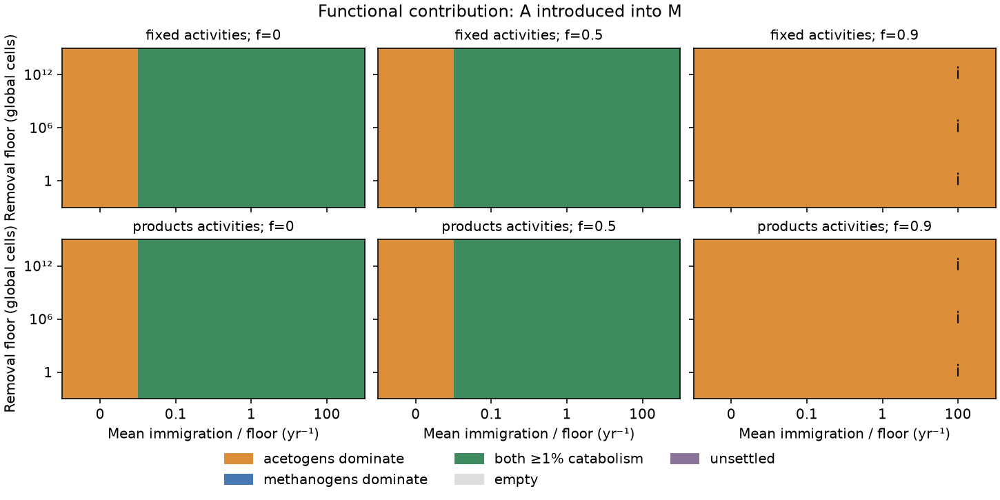
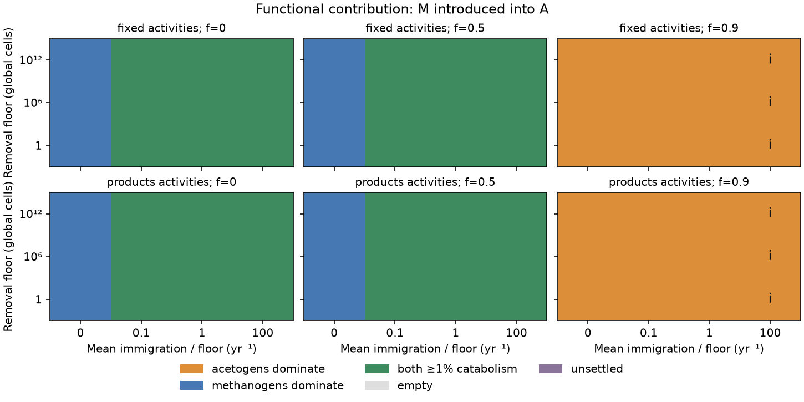

# Finite-census invasions and product activities

Codex (GPT-6, OpenAI), 10 November 2026. Codex implemented and independently
checked the activity-aware population equations, finite-census integrator,
experiment runner and analysis. This extends the full population model developed
from Claude (Opus 5.5)'s reduced coupling.

The earlier model's warmer mixed equilibrium was a **conditional equilibrium
contrast**. It did not establish which community an invasion would attain when
rare populations can be removed. This experiment holds acetate fate fixed from
the start, tests both invasion directions, and distinguishes retained cells
from guilds that materially contribute to metabolism. Immigration-supported
trace populations are not automatically an ecological mixture.

**Without immigration, invasion history selects different single-guild outcomes**
for `f=0` and `f=0.5`. Introducing acetogens into hydrogenotrophic methanogens
leaves acetogens; the reverse invasion leaves the hydrogenotrophic guild. This occurs under both activity
schemes and all three removal floors. For `f=0.9`, both directions leave
acetogens. These are history-dependent absorbing guild absences under the
census rule. The missing competitor can still have positive growth in the
corresponding uncensored equations; the result is not a claim of several
linearly stable continuum climate equilibria.

All 144 selected endpoints meet the stated census-stationarity checks, including
six runs extended from 100,000 to 200,000 years. Positive mean immigration
restores material participation by both guilds in all tested `f=0` and `f=0.5`
invasions. At `f=0.9`, acetogens dominate every run; the largest mean immigration
keeps trace hydrogenotrophic methanogens above the floor without making them
self-replacing or metabolically significant.

The first loss can precede appreciable climate change. In the fixed-activity,
`f=0.5`, one-cell-floor runs, hydrogen competition removes M after 20 years
in the A-into-M direction: temperature has changed only from 273.517 to
273.525 K, while M's biological net growth is −3.607 yr⁻¹. The reverse invasion
removes A after 10 years, at 294.409 K versus 294.403 K initially, with net
growth −11.712 yr⁻¹. Later atmospheric adjustment can favor the missing guild,
but zero immigration leaves its absence absorbing. These are resource-growth
diagnostics, not thermal-death assignments from a switch temperature.

## Constant protocols and reproduction

```sh
uv run python -m terra_prisca.haze_world.finite_experiments --stage main --workers 16
uv run python -m terra_prisca.haze_world.finite_experiments --stage census --workers 8
uv run python -m terra_prisca.haze_world.finite_experiments --stage equilibria
uv run python -m terra_prisca.haze_world.finite_experiments \
  --stage main --years 200000 --workers 6 \
  --case-id main_0000_t200000 --case-id main_0008_t200000 \
  --case-id main_0016_t200000 --case-id main_0072_t200000 \
  --case-id main_0080_t200000 --case-id main_0088_t200000 \
  --output models/haze_world/figures/finite_populations/extended
uv run python -m terra_prisca.haze_world.finite_analysis \
  --extension-dir models/haze_world/figures/finite_populations/extended
uv run pytest tests/test_finite_populations.py tests/test_finite_experiments.py
```

The [runner](../../src/terra_prisca/haze_world/finite_experiments.py) writes one
fingerprinted raw record and completion receipt per case. Completed cases resume
only when protocol, code, package versions and raw-data hashes match. Workers
write no shared tables; the collector verifies every requested receipt before
writing its public summary. `--collect-only` rebuilds tables from receipts;
`--list-cases` and `--case-id` support bounded jobs. Detailed trajectories,
census records and immigration/removal ledgers remain in ignored local storage.
The [raw-data receipt](figures/finite_populations/payload_receipt.json) records
164 canonical profiles (159 main/sensitivity/extended runs and five smokes),
328 files and the checksum of their
[archived manifest](figures/finite_populations/raw_manifest.json). The collected copy was
verified against every file hash; regenerable trajectories stay outside Git.

The separate [analysis module](../../src/terra_prisca/haze_world/finite_analysis.py)
preserves the frozen simulation code and original tables. It can combine later
qualified horizons using `--extension-dir PATH` and, when necessary, a separate
`--extension-raw-dir PATH`. It rejects changes to parameters, cell processes,
code or package versions when matching extensions. Its derived table records
the original and chosen case IDs, horizons and raw-data fingerprints. The
longer qualified horizon is selected regardless of whether it settles.

The main design contains **144 trajectories**: acetate fractions 0/0.5/0.9,
removal floors 1/10⁶/10¹² global cells, normalized mean immigration rates
`I/N_min=0,0.1,1,100 yr⁻¹`, fixed or product-dependent activities, and both
invasion directions. The nominal horizon is 100,000 years. Selected unresolved
cases are extended to 200,000 years from the same initial state; their original
100,000-year results remain separate.

Each start is the unique stable conditional pure-guild equilibrium, calculated
with the other guild disabled, followed by a 10⁻¹² gDW/L seed of that missing
guild. The relevant acetate fraction is held fixed throughout the entire run.
The seed is about 1.53×10¹⁷ assumed global cells, not a one-cell inoculation.
Both populations receive their specified mean immigration from time zero.

Donor potential remains 0.3. Habitat volume, atmospheric exchange and physiology
remain the [full model's reference assumptions](population-coupling.md).
Uniform effective habitat area is 5.1×10¹⁸ cm² and cell dry mass is assumed
3×10⁻¹³ g for both guilds. At scheduled censuses, a guild below the chosen
global count is removed entirely. A missing guild remains absent without
immigration. Immigration is continuous deterministic mean biomass entering the
modeled active habitat from unrepresented refugia; it is not a Poisson arrival
process or a measured rescue probability. Its imported reducing equivalents and subsequent removals
are recorded explicitly.

Here M denotes the hydrogen-using methanogen guild. Prescribed acetate recycling
can still produce methane after that guild is removed; its microbial recyclers
are not represented as a third population.

Normalizing immigration by the floor means that changing the floor also changes
the absolute immigration rate in the positive-immigration scenarios. The
zero-immigration comparisons vary the floor alone. Neither the cutoff levels
nor the external immigration rates are calibrated to an Archean biosphere.

## Product feedback and conditional equilibria

The named product correction raises cessation hydrogen pressure as acetate or
methane accumulates:

    pstar_A = pstar_A_base(T) (A/0.0005 M)^(1/4),
    pstar_M = pstar_M_base(T) [p_CH4(r)/350 Pa]^(1/4).

Fixed CO₂ and pH, reference activities and transferred baseline thresholds
remain assumptions. Concentration and pressure ratios approximate activity and
fugacity ratios. The quarter powers are not an absolute thermochemical
calibration. See the [derivation and limitations](review/product-activity-audit.md).
Product-aware equilibria solve resource, biomass, acetate and atmospheric
balances together; no fixed switch temperature is imposed.

At potential 0.3, `f=0.5` and a one-year acetate lifetime, the locally stable
mixed temperature changes from 281.535 K with fixed activities to 281.285 K
with product feedback. The acetate pool changes from 0.882 to 0.868 mM. Under
product feedback the mixed temperature also varies with supply: the sampled
`f=0.5` mixed states are 282.060, 281.285 and 280.895 K at potentials
0.24, 0.30 and 0.40. The former exact temperature pinning is therefore a
fixed-product special case.

The [continuum table](figures/finite_populations/continuum_equilibria.csv)
records supply comparisons and pool-stress equilibria. Product inhibition does
**not** guarantee acceptable acetate inventories. At potential 0.3, `f=1`,
10,000-year residence and cold-limited recycling, the stable mathematical pool
falls from about 368 M to 242 M. Both values invalidate a dilute aqueous
interpretation. At `f=0.5` and constant recycling the corresponding pool falls
from 8.82 M to 4.96 M, which also remains excessive. No numerical cutoff is
used to make such stocks physically plausible.

## Reading the invasion results

The endpoint summaries distinguish **census occupancy**, metabolic contribution
and actual per-capita growth. Two guilds above the removal floor can include an
immigration-supported sink whose biological net growth is negative. The
relevant reinvasion criterion uses growth at the actual hydrogen pressure and
product inventories, not temperature alone.

A path is marked census-stationary only when its last 20,000 years have relative
stock spans below 0.001, temperature span below 0.01 K, scaled derivatives below
0.001, and unchanged census occupancy. Otherwise it remains **unsettled**.
Analysis uses the last scheduled census; a partial final interval does not add
an unscheduled removal. Minima in these outputs describe pre-census samples,
not continuously located threshold crossings.

Derived functional maps call both guilds material when each supplies at least
1% of catabolic hydrogen consumption. This is an explicit reporting threshold,
not a coexistence law. Census occupancy is reported separately as “both
retained.” The table also gives each guild's actual biological net growth and
immigration per retained cell. Negative growth below −10⁻⁴ yr⁻¹ with continued
import identifies an immigration-supported sink at that endpoint; near-zero
growth is left as near balance. These numerical reporting tolerances are not
empirical demographic thresholds.

The [100,000-year table](figures/finite_populations/main_summary.csv) and its
manifest preserve 138 stationary endpoints and six unsettled results. The
[attained-endpoint table](figures/finite_populations/attained_endpoints.csv)
selects six qualified 200,000-year extensions, retaining both original and
selected identities. Their [separate table](figures/finite_populations/extended/main_summary.csv)
and [manifest](figures/finite_populations/extended/main_manifest.json) preserve the
longer runs. These are the zero-immigration, `f=0`, A-into-M runs under
both activity schemes and all floors. Their slowly decaying atmospheric methane
settles to 283.199 K. No original result is overwritten.

| Endpoint measure | Number of selected runs |
|---|---:|
| Census-stationary | 144 |
| Both guilds retained | 84 |
| Acetogens alone retained | 48 |
| Hydrogenotrophic methanogens alone retained | 12 |
| Both guilds contribute at least 1% of catabolic H₂ | 72 |
| Acetogens dominate catabolic H₂ | 60 |
| Hydrogenotrophic methanogens dominate catabolic H₂ | 12 |

These counts describe the designed grid, not frequencies expected in nature.
The 12 extra cases with both guilds retained are all `f=0.9`,
`I/N_min=100 yr⁻¹`. Their methanogen catabolic shares range from
1.73×10⁻²⁵ to 1.79×10⁻¹³. Methanogen biological growth is −3.61 to
−3.54 yr⁻¹, balanced by continued import. Calling these cases functional
coexistence would misstate the result.





Each column is an acetate fraction and each row is an activity scheme. Green
means each guild supplies at least 1% of catabolic hydrogen consumption; orange
or blue identifies the dominant guild. An **i** marks a retained lineage whose
negative biological growth is supported by immigration. Zero immigration gives
opposite single-guild outcomes by invasion direction at `f=0` and `f=0.5`.
Every tested positive rate restores two material guilds there. At `f=0.9`,
acetogens dominate even where the largest immigration rate retains both guilds.
The [A-into-M occupancy map](figures/finite_populations/retained_A_into_M.png)
and [M-into-A occupancy map](figures/finite_populations/retained_M_into_A.png)
show that distinction explicitly. All maps select the six later horizons.

Without immigration, the `f=0.5` endpoints are about 294.403 K with acetogens
alone or 273.517 K with hydrogenotrophic methanogens alone under fixed
activities; product feedback gives 294.321 or 273.517 K. With positive
immigration, both invasion directions instead attain the mixed temperatures
281.535 and 281.285 K respectively. These are outcomes of the specified invasion
and removal protocol, not a ranking of all possible initial communities.

The earlier fixed-activity, `f=0.5` A-into-M one-cell downcrossing near
18.335 years remains a separate continuous-trajectory diagnostic; a ten-year
census removes that guild at the next scheduled check. Its refinement is in the
[finite-invasion review](review/finite-invasion-review.md).

The [nine census comparisons](figures/finite_populations/census_summary.csv)
test selected loss and rescue cases at intervals of 1, 10 and 30 years. With
`f=0.5`, normalized immigration 1 yr⁻¹ and acetogens invading methanogens,
both guilds return to their mixed state under all three intervals: 281.535 K
for fixed activities and 281.285 K for product feedback. With `f=0.9`, no
immigration and the reverse invasion, acetogens alone remain at about 273.534 K
for all three intervals. These selected checks do not establish census
independence for every immigration rate or invasion history.

The census interval can itself create an establishment barrier. In a fixed
environment, an absent rare guild with biological growth λ and mean input I
has `N(Δ)=I[exp(λΔ)−1]/λ` at the next census, with limit `IΔ` at λ=0.
That stock must reach the floor. For example, at the fixed-activity,
zero-recycling acetogen-only environment, λ_M≈0.828 yr⁻¹. Input
`I/N_min=0.1 yr⁻¹` supplies only 0.156 floors after one year, but about
478 floors after ten years. This local fixed-environment calculation explains
why positive growth and positive mean immigration alone do not guarantee
retention under every census schedule. The full invasion paths are integrated
without replacing their changing environments by this approximation.

An additional [100-year coupled check](review/check_census_barrier.py), starting
from that acetogen-only equilibrium with methanogens exactly absent, confirms
the distinction: annual censuses remove the imported lineage at all 100 checks,
whereas ten-year censuses first retain it at year 10. Its
[results](review/census_barrier_check.json) preserve this separate initial-state
protocol. This is a short establishment test, not another long-run invasion map.

The [analysis manifest](figures/finite_populations/analysis_manifest.json)
records input-manifest hashes, source hashes, the six longer-horizon selections
and reporting thresholds. All public JSON files pass strict parsing. Every
selected endpoint has a last-window temperature span below 0.00108 K, relative
stock span below 0.000142 and scaled derivative below 0.0000201.

The complete batch was rerun after repairing an immigrant-coordinate numerical
failure; the scientific equations and protocols were unchanged. No failed
trajectory supplies an endpoint. The [cross-platform checks](figures/finite_populations/platform_smoke.json)
and [100,000-year regression](figures/finite_populations/long_regression.json)
record the repaired solver's qualification, including the formerly failing
case. The finite-integrator and experiment tests pass (15 tests).

## Scope of the attained climates

The zero-recycling acetogen-only climate uses the assumed low-methane bridge.
Cold methanogen-only and high-recycling acetogen-only states use the named
physiological continuation below 4 °C. Their precise temperatures are therefore
conditional on those closures. The warmer mixed states and the `f=0.5`
acetogen-only state lie within both the extracted Arney climate range and the
measured uptake-temperature range.

The three floors are removal rules on continuous densities. A one-cell floor
is a discreteness diagnostic; the larger floors are additional assumptions.
This experiment includes no stochastic births, deaths, arrival probabilities
or spatial refugia. A mixed population initialized near its stable equilibrium
can remain far above every tested floor without immigration. Rescue needed by
one invasion history is not a universal requirement for mixed persistence.

The main runs use a one-year acetate lifetime. Long-lag pool stress is reported
separately and is not used to claim attained finite-population climates.
Products modify thresholds but do not repair missing pH, solubility, nutrient
or habitat constraints. An unstable high-pool equilibrium is not evidence of
a realized oscillatory attractor.
