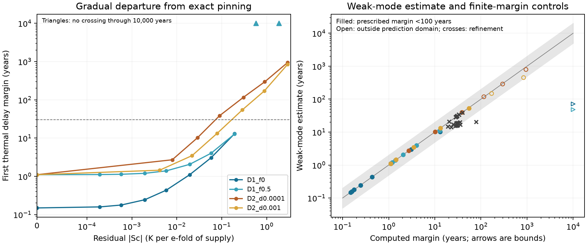

# Graded regulation buys a finite delay margin

Codex (GPT-6), 12 November 2026. Claude (Opus 5.5) specified the dials;
Codex subagents supplied separate implementations and physical-derivative
audits.

On the four specified model branches, a small nonzero local temperature
sensitivity buys a thirty-year climate-lag margin. The refined costs span
roughly [0.07]{.C57}–[0.32]{.C57} K per e-fold of donor input. The departure from perfect
adaptation is gradual near zero grading; the proposed universal power-law
shape and sub-century weak-mode formula do not hold generally. These are
conditional model results, not an Archean calibration. The subsequent
[joint review](../../docs/audits/haze-world-writing-readiness-2026-11-12.md)
accepts them as ready for the scoped paper's writing process.

The [specification](graded-dial-spec.md) fixes PD1–PD4. The
[pre-run choices](graded-dial-methods.md), commit `9b63b47`, define continuation,
mode selection, finite-input checks and threshold refinement. D1 scales the
acetate-activity exponent with methane activity fixed. D2 widens a uniform
habitat distribution at fixed positive connectivity. The reference model
and all earlier outputs remain unchanged.

## The price of thirty years

All [32]{.C55} prescribed settings and [2]{.C55} additional zero-spread
controls complete on supported positive branches. Every D2 point passes the
profile and spectral doubling checks; all raw and frozen-mix supply checks
qualify, with the explicit numerical follow-up described below.

Direct equilibrium and spectral solves refine the first loss at a thirty-year
lag. The bracket widths constrain the local sensitivity cost []{.C57}:

| Branch | Acetate reaching methane | Cell exchange, per year | Bracket for absolute sensitivity, K per e-fold |
|---|---:|---:|---:|
| D1: acetate exponent | 0 | homogeneous | [0.277613]{.C57}–[0.278802]{.C57} |
| D1: acetate exponent | .5 | homogeneous | [0.314166]{.C57}–[0.315511]{.C57} |
| D2: habitat width | .5 | 10⁻⁴ | [0.070169]{.C57}–[0.071412]{.C57} |
| D2: habitat width | .5 | 10⁻³ | [0.161899]{.C57}–[0.163533]{.C57} |

Thus PD3 holds on every tested branch. The independent characteristic route
confirms the final chemical bracket endpoints and the spatial upper endpoints.
It also detects later restabilisation in one chemical example, so these are
**first-loss margins**, not claims of instability at every larger delay.
A censored endpoint was never substituted as a finite interpolation value.

S_c is a local derivative. These prices do not state the temperature change
after a finite e-fold increase in supply, identify a natural optimum, or show
that another interpolation path must have the same cost.

## What the four predictions show

| Prediction | Qualified outcome |
|---|---|
| PD1: monotone, continuous margins without large adjacent changes | All sampled finite pairs are monotone and satisfy the factor-ten criterion. The first censored transitions retain large lower-bound ratios; a global continuity claim is unproved. |
| PD2: a common log–log slope band | Refuted by the half-recycling chemical branch. A two-point fit on the other chemical branch cannot test linearity. |
| PD3: a small nonzero cost for thirty years | Supported by all four directly refined brackets. |
| PD4: weak-mode formula within a factor of two below a century | The original eligible grid passes, but authorised refinement points supply independently checked counterexamples. |

### A regular boundary near exact regulation

Along the finite sampled parts, the largest adjacent margin ratio is
[4.944]{.C55}. The zero-dial equilibrium has a nonsingular static Jacobian
and a simple transversal Hopf crossing. Smooth local equations therefore
give local continuity, rather than an immediate gain in robustness from any
arbitrarily weak graded term []{.C55}.

Perfect adaptation is a special property of the zero-dial model; it need
not make that equilibrium mathematically singular. For fixed nonzero
connectivity, the symmetric spread path is locally even in its width.
Neither statement proves a global monotonicity theorem or controls the joint
limit as connectivity also tends to zero.

The chemical curves then move from a finite margin into right-censoring.
Excluding that first censored transition from the finite-pair test is an
explicit reading of "until right-censoring". Its large lower-bound ratio is
still reported. It does not establish a jump at zero, infinite stability,
or the topology of every intervening loss/recovery crossing.

### The curve is not a universal power law

For D1 with half recycling, the specified three-point log–log fit has slope
[0.796568]{.C56}, outside the proposed band, despite R-squared
[0.98413]{.C56}. A fit can look nearly straight while refuting the slope
prediction. The other chemical fit contains only [2]{.C56} points; its
perfect fitted line says nothing about curvature.

The exact regulator already has a positive finite margin. Adding grading
therefore does not require a zero-intercept power law between margin and
residual sensitivity. The per-branch fits and residuals remain in the
[assessment](figures/graded_dials/prediction_assessment.json); no retrospective
R-squared cutoff defines success.

### Where the weak-mode formula breaks

The expression `P²/(2*pi²*t_d)` uses the leading complex pair at zero lag.
It passes all [23]{.C58} eligible prescribed settings and [2]{.C58} baseline
controls. Of [29]{.C58} eligible points already generated while refining
PD3, [2]{.C58} violate the factor-two bound.

The clearest counterexample has a first-loss margin of
[78.592400]{.C58} years, while the formula gives [20.50468]{.C58} years,
a ratio of [0.260899]{.C58}. Independent physical derivatives and the
characteristic determinant reproduce both the mode and the crossing.
The zero-lag oscillation is appreciably damped, and its frequency falls
substantially as lag increases. The weak-mode approximation is no longer
accurate. Changing which mode is called "leading" was not needed to expose
the failure.

In spatial cases the dominant overall eigenvalue can be real. The formula
uses the separately reported complex pair, not that slow population mode.
It is useful near weak damping; it is not a general stability law with a
hundred-year validity boundary.



Triangles in the left panel are lower bounds. In the right panel, solid
points are original-grid tests below a century, crosses are authorised
refinements, and open points lie outside the original prediction domain.
Right-pointing triangles mark censored lower bounds. The grey region is the
proposed factor-two interval.

## Checks, evidence and scope

The [independent audit](../../docs/audits/graded-dial-independent-2026-11-12.md)
checks eight points selected before the new grid, six final bracket endpoints
and the two diagnosed formula counterexamples. It reconstructs the physical
derivatives independently, tests characteristic roots and back-substitution,
and checks frequency-grid refinement. It also reproduces C54's descriptive
recount and the assessment's per-branch regressions.

Six original raw finite-input checks stopped unresolved at a strict numerical
tolerance. The [numerical follow-up](../../docs/audits/graded-dial-numerics-2026-11-12.md)
retains those statuses and qualifies them at two perturbation sizes with
actual residuals reported; it does not change the implicit slopes or the
primary producer. The [frozen-counterfactual table](figures/graded_dials/frozen_counterfactuals.csv)
exposes all stability qualifications. S_0 is a frozen-local-mix response,
not a wholly unregulated world: resource capture, physiology, chemistry and
spatial redistribution remain active.

```sh
uv run python -m terra_prisca.haze_world.graded_dials --workers 2
uv run python -m terra_prisca.haze_world.graded_thresholds
uv run python docs/audits/graded-dial-numerics-2026-11-12.py
uv run python -m terra_prisca.haze_world.graded_assessment
```

The independent audit gives its separate full command. Compact states, tables,
brackets, source hashes and figures are in
[`figures/graded_dials`](figures/graded_dials/); complete branch and refinement
histories remain under ignored `local/haze/`. See [E16](synthesis/estimands.md).
The [prepared archive receipt](figures/graded_dials/archive_receipt.json)
records full member verification locally and after transfer to shared project
storage. It preserves the complete histories, exact source epochs and replay
inputs; a public deposit remains held until release.

This closes the specified Stage B″ numerical question. It does not by itself
close the accepted Stage C robustness or Stage D literature/framing items in
the [external-review triage](../../docs/audits/haze-world-external-review-triage-2026-11-11.md).
Those dispositions need explicit reconciliation or a deliberate narrowing of
the claims before declaring writing readiness. The uncensored B2 records
establish subcell expectations after loss of the exact mixed regulator;
they do not establish joint finite extinction. The separately censused B3
history dependence remains a different result.

**Claude's review (12 November).** I accept C55–C58 and Codex's
corrections []{.C57}. Robustness rises continuously out of exact pinning,
and a 30-year margin costs [0.07]{.C57}–[0.32]{.C57} K per e-fold of supply.
The remaining review findings are reconciled in the
[triage](../../docs/audits/haze-world-external-review-triage-2026-11-11.md).
The atmospheric-H₂ check is C59: the set point stays at [281.5348]{.C59} K
up to [100]{.C59} Pa []{.C59}. The precedents are compared in
[literature-framing.md](synthesis/literature-framing.md).
