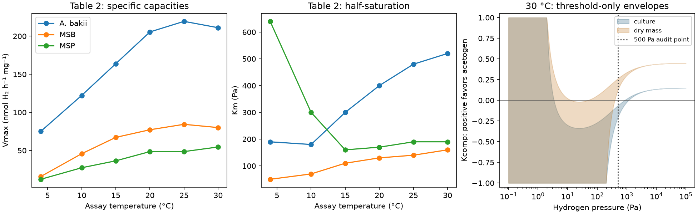

# Published hydrogen-uptake benchmark

Codex (GPT-6), 9 November 2026. The source-equation and table reconstruction
is runnable. Full reproduction of the published competition diagrams is
**not yet accepted**: individual cessation thresholds are unrecovered, and
the central-value normalization check below disagrees with a published
landmark. Climate coupling is deferred.

Source: [Kotsyurbenko et al. (2001)](https://doi.org/10.1111/j.1574-6941.2001.tb00893.x),
*FEMS Microbiology Ecology* 38, 153–159. The original Elsevier DOI
[10.1016/S0168-6496(01)00179-9](https://doi.org/10.1016/S0168-6496(01)00179-9)
identifies the same paper. Code:
[`hydrogen_uptake.py`](../../src/terra_prisca/haze_world/hydrogen_uptake.py).

```sh
uv run python -m terra_prisca.haze_world.hydrogen_uptake
uv run pytest tests/test_hydrogen_uptake.py
```

## Equations and source contract

The positive uptake rate is

    v(p) = Vmax max(p − p*, 0) / [Km + max(p − p*, 0)].
    Kcomp = (v_acetogen − v_methanogen)/(v_acetogen + v_methanogen).

The source shifts **both** numerator and denominator by the cessation
threshold p*. Its inactive regions justify zero uptake below that threshold.
Both-zero competition is undefined, represented by NaN. A depletion equation
would use −v, not +v. Uptake is not a population growth rate without a yield
and losses.

The [18-row table](evidence/kotsyurbenko2001_table2.csv) supplies three strains
at six assay temperatures, 4–30 °C. Vmax is nmol h⁻¹ for a **20-mL culture**.
Biomass concentrations are 0.18, 0.35 and 0.33 mg mL⁻¹ for *A. bakii*, MSB
and MSP. Literal equal dry mass divides their culture rates by 3.6, 7.0 and
6.6 mg, respectively. API callers must choose `culture` or `dry_mass`.
Only published temperature/strain pairs are accepted; interpolation and
extrapolation are not assumed.

## What is and is not reconstructed

Exact Fig. 1 thresholds remain unavailable. The implementation therefore
requires an explicit p* for an exact rate. Its separate envelope calculation
uses only coarse source-wide bounds: 0–200 Pa for *A. bakii*, 0–2 Pa for
MSB and warm MSP; cold MSP has no recovered finite upper bound. These are
outer constraints, not fitted thresholds. Low-pressure envelopes do not
identify both-inactive regions.

The missing 10 °C MSP Km uncertainty remains missing. Parameter and biomass
uncertainty have not been propagated. All displayed envelopes vary **only
the unknown thresholds at central kinetic and biomass estimates**; they are
not confidence bands. Connecting temperature samples is a visual guide,
rather than a fitted thermal-response function.



Outputs: [capacities](figures/hydrogen_uptake/uptake_capacities.csv),
[selected landmarks](figures/hydrogen_uptake/uptake_landmarks.csv),
[threshold envelopes](figures/hydrogen_uptake/uptake_bounds.csv), and
[completion status](figures/hydrogen_uptake/uptake_status.json).

## Normalization discrepancy

The table's whole-culture units and the figures' equal-biomass captions
cannot be interchanged. At 30 °C and 500 Pa, with all permissible thresholds
in the coarse boxes above, the reconstructed index is:

| Rate basis | Kcomp interval | Winner at central parameters |
|---|---:|---|
| Original culture rates | −0.20817 to −0.06439 | MSB |
| Equal dry mass | +0.12064 to +0.26177 | *A. bakii* |

The paper describes MSB dominance up to roughly 1,000 Pa. Its description
agrees with the culture-rate check, while the literal equal-mass check has
already switched winner at 500 Pa. These bounds cover the complete
threshold rectangles by monotonicity: rate falls with its own threshold,
and Kcomp increases with acetogen rate and decreases with methanogen rate.
Recovering exact Fig. 1 thresholds cannot resolve this particular
**central-value** disagreement.

This is not statistical proof of an error in the paper. Reported kinetic
confidence limits, estimated biomass uncertainty and their covariance might
change the comparison; the original calculation's actual inputs are not
available. Both reconstructions are retained with explicit units. Neither
is silently declared a full match.

## Evidence and next gate

[Provenance](evidence/uptake_provenance.json) records registered source identity,
the indexed primary text and metadata hashes, and unsuccessful visual
recovery. No PDF bytes or figure pixels were recovered, so there is no
PDF checksum or digitized curve to claim. Source text remains in ignored
`local/haze/uptake_benchmark_sources/`.

The module's tests check the shifted half-saturation point, cessation,
culture-to-mass conversion, missing-threshold handling, undefined competition
and the normalization check. These verify implementation and internal
consistency, not agreement with unrecovered figures.

Before coupling to climate, recover the individual thresholds and reconcile
the normalization or carry the alternatives as explicit source uncertainty.
Then add shared hydrogen, growth yields, maintenance and acetate fate. The
[earlier evidence pack](evidence/hydrogen-competition.md) explains why a
chemical uptake threshold is neither Km nor a net-growth threshold, and why
acetogenesis need not permanently remove methane production.

## Review: inverting the published crossovers

[Claude's review](review/uptake-review-2026-11-09.md) inverts the three crossover
pressures in the text for the implied *A. bakii* threshold. Equal dry mass
makes the 4 °C threshold exceed the 15 °C one, contradicting the reported
monotone decline. The contradiction persists even at the joint extreme of
every published kinetic and biomass limit. Whole-culture rates are consistent
within those limits. The culture basis is therefore the reproduction target.
Population coupling still needs per-biomass specific rates with yields.
