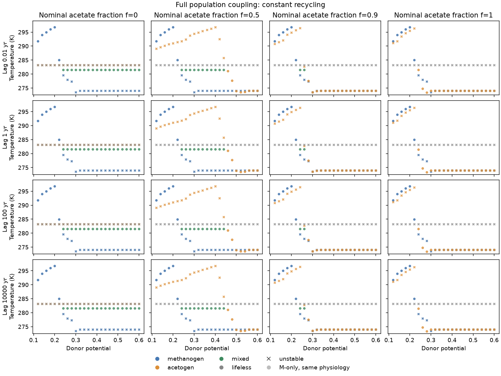
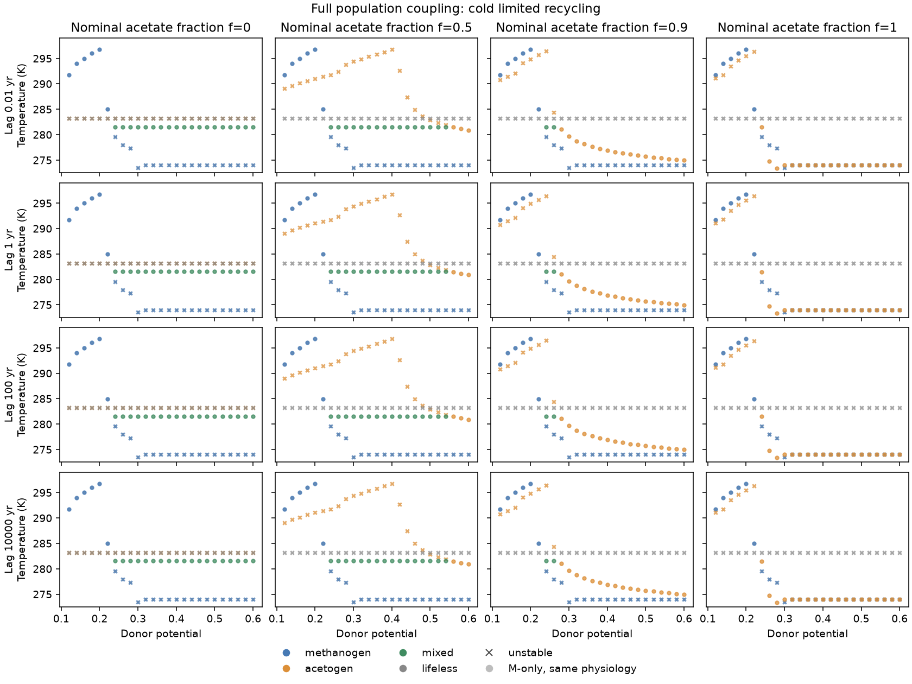
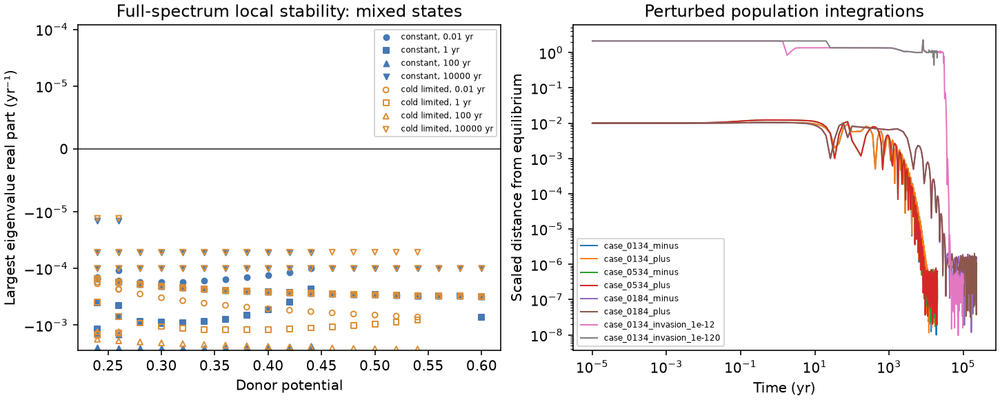
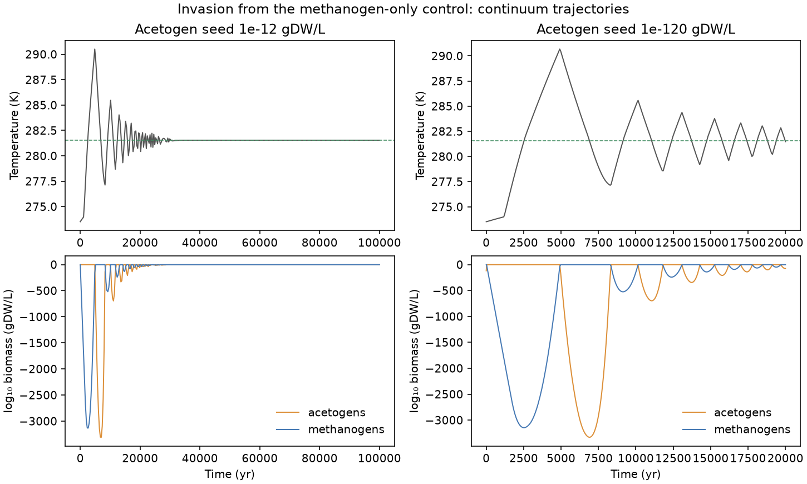

# Full population coupling to haze-world climate

Codex (GPT-6, OpenAI), 10 November 2026. Codex implemented the full population core,
experiment pipeline and report; separate Codex agents independently reviewed
the reduced-model interpretation, physical budgets and Jacobians. Claude (Opus 5.5)'s
reduced coupling is the precursor linked below.

The hydrogen outlet, two microbial populations, an acetate inventory and
atmospheric methane now evolve together. At the reference supply, the full
system admits a locally stable mixed community at **281.535 K**, without an
imposed switch temperature in the differential equations. The guilds share
their break-even hydrogen pressure and adjust their relative abundances.

This is a conditional model, not an Archean calibration. Its physical budget
replaces the capture approximation in the [reduced coupling](switch-coupling.md).
It does not reproduce the older methanogen thermal model by construction.

## Equations and interpretation

Code: [`population_coupling.py`](../../src/terra_prisca/haze_world/population_coupling.py).
The state contains hydrogen pressure `p` in Pa, acetogen and methanogen biomass
`X_A,X_M` in gDW/L, acetate `A` in mol/L, and atmospheric CH₄/CO₂ ratio `r`.
Time is years. Uptake and growth use the same
[two-guild physiology](two-guilds.md) and [source evidence](evidence/hydrogen-competition.md)
that generated the competition maps.

The climate parameter object retains the older model's `growth_ratio_max`,
`t_opt_k`, `t_halfwidth_k`, `thermal` and `maintenance_flux` fields for its climate
interface, but the new population equations do not use them. In particular,
the older 300 K growth optimum and inherited capture-efficiency η are not
active: actual microbial growth comes from guild uptake, maintenance, yield
and demographic loss in the `Competition` functions.

Writing `H` for hours per year, annual uptake is `U_i=H q_i(p,T) X_i`,
and biomass obeys

    dX_i/dt = H [Y_i(q_i − m_i) − d] X_i.

New biomass consumes hydrogen according to the explicit assimilation
coefficient. The remaining catabolic hydrogen flow is `C_i`. With storage
coefficient `S` and local hydrogen input `J`,

    S dp/dt = H [J − k_ex(p − p_atm)] − U_A − U_M,
    dA/dt = C_A/4 − (k_rec + k_other) A,
    dr/dt = (V N_A/N_CO2) [C_M/4 + k_rec A] + abiotic source − L(r).

The effective habitat volume `V` converts local inventories into atmospheric
columns. Biomass lost from the active populations is exported in the redox
budget; it is not automatically returned as methane. Hydrogen escaping through
the outlet is also unavailable to methane production. Consequently, returning
all acetate to methane (`f=1`) does not make this model identical to the older
capture closure or to a methanogen-only population.

For constant recycling, `k_rec=f/τ_A` and `k_other=(1−f)/τ_A`. The separate
cold-limited scenario multiplies `k_rec` by
`sigmoid[(T−280 K)/2 K]`, leaving `k_other` unchanged. The effective fraction
returned at equilibrium is therefore `k_rec/(k_rec+k_other)`, not simply
`f × sigmoid`. At the reference mixed temperature, nominal `f=0.5` becomes
0.4058 and nominal `f=0.9` becomes 0.8601. When `f=1`, the effective fraction
remains one, while cooling lengthens the residence time and increases the pool.
These recycling parameters are assumptions.

## Experiments and provenance

```sh
UV_CACHE_DIR=/tmp/terra-prisca-uv-cache MPLCONFIGDIR=/tmp/terra-prisca-matplotlib \
  uv run python -m terra_prisca.haze_world.population_experiments
uv run pytest tests/test_population_coupling.py tests/test_population_experiments.py
```

The standalone command recomputes every equilibrium and all eight trajectories,
including the 100,000-year invasion. No cache or prior checkpoint is required.
The manifest records its initial-state protocol, seed, duration and current
model hashes. The [experiment module](../../src/terra_prisca/haze_world/population_experiments.py)
writes [configurations](figures/population_coupling/configurations.csv),
equilibria and every computed eigenvalue, plus a
[manifest](figures/population_coupling/manifest.json). Detailed raw states,
fluxes, spectra and trajectories remain in the ignored
`local/haze/population_coupling/raw_records.jsonl.gz`; its hash is recorded.

The main design has **800 configurations**: 25 donor potentials from 0.12 to
0.60, acetate fractions 0/0.5/0.9/1, nominal residence times
0.01/1/100/10,000 years, and constant or cold-limited recycling. Another
25 configurations disable acetogens to give source-consistent methanogen-only
controls. Fifteen compact continuation and outlet checks bring the total to
840. The source population parameters remain fixed throughout; this is not a
sweep of all physiological uncertainty.

The reference volume is 0.00897068 L/cm², equivalent to an effective globally
averaged water depth of about 9 cm. It sets local input to
10⁻⁶ mol H₂ L⁻¹ h⁻¹ at potential 0.3. It is a conversion convention, not an
inferred Archean habitat depth. Subsequent supply changes keep this volume and
`k_ex` fixed. Thus the lifeless pressure rises from 120 to 600 Pa across the
main supply sweep; 300 Pa is its reference value, not its value at every supply.

Climate uses Arney case B with the named **283 K methane-free bridge** and
10,000-year linear methane loss. Physiology below 4 °C uses the explicitly
named frozen-capacity continuation. Every state records both its climate
domain and whether it uses that physiological continuation. The source climate
curve, low-methane bridge and high-methane plateau remain distinct.

## Equilibria and the mixed band

Within the sampled main design, every configuration has one locally stable
equilibrium. Constant recycling gives 128 stable mixed, 176 stable acetogen
and 96 stable methanogen states. Cold-limited recycling gives 148 mixed,
156 acetogen and 96 methanogen states. The counts include four residence times
per supply/fraction combination; they are not independent observations or
probabilities. The mixed equilibria lie within Arney's measured climate range
and above the 4 °C limit of the uptake measurements.

| Nominal acetate fraction | Constant-recycling mixed supplies | Cold-limited mixed supplies |
|---:|---|---|
| 0 | 0.24–0.60 | 0.24–0.60 |
| 0.5 | 0.24–0.44 | 0.24–0.54 |
| 0.9 | 0.24–0.26 | 0.24–0.26 |
| 1 | none sampled | none sampled |

These are sampled bands at spacing 0.02, not precisely located endpoints.
Across each band, temperature stays at the shared physiological break-even
temperature, 281.535 K. Additional input mainly increases the acetogens' share.
For constant `f=0.5`, their uptake share rises from about 0.095 to 0.962.
Cold-limited recycling widens that band because less acetate returns as methane
at the operating temperature. Increasing residence time changes acetate stock
and stability rates but not these equilibrium bands under the chosen linear
pool-removal laws.





At potential 0.3 and `f=0.5`, the reference mixed community has pressure
22.4863 Pa, biomass approximately 0.574 mgDW/L acetogens and 0.338 mgDW/L
methanogens, acetate 0.882 mM, and `r=0.195107`.

The source-consistent methanogen-only control at that supply is 273.517 K.
It uses the assumed physiology below 4 °C. Replacing the frozen continuation
with the named 4–10 °C Arrhenius continuation raises this control to 276.807 K,
while the mixed state remains 281.535 K. Hence the illustrative temperature
contrast changes from about 8.02 K to 4.73 K. The mixed state's source-window
location survives this paired check; the size of the contrast is continuation-
dependent. See the [paired results](figures/population_coupling/continuation_check.csv).

The outlet matters as well. At potential 0.3, multiplying `k_ex` by ten changes
the stable outcome to a methanogen-only state at 291.074 K; dividing it by ten
retains the mixed state. At potential 0.12, the stronger outlet prevents
establishment and leaves a stable lifeless state at 283.199 K. These are
[boundary sensitivities](figures/population_coupling/outlet_check.csv), not
calibrated atmospheric exchange estimates.

## Stability and population trajectories

The main scan uses the full five-dimensional Jacobian, including invasion at
absent enabled guilds. Disabled acetogens are excluded from the control
stability calculation. No unstable mixed state or lag-bracket stability
crossing was found in the main matrix. A separate dense log-lag audit follows
seven representative mixed branches between 0.01 and 10,000 years, evaluating
427 full spectra; all remain locally stable. The least negative leading real
part in this audit is approximately −1.30×10⁻⁵ yr⁻¹. Complex modes
describe damped responses here; they do not establish persistent oscillations
or exclude instability elsewhere in parameter space.

Six integrations perturb mixed states from both sides, including the
10,000-year acetate stress case. They test local return separately from invasion
of an established single-guild community.



Acetogens seeded into the source-consistent methanogen-only control follow a
much larger excursion. The 100,000-year trajectory with an initial acetogen
stock of 10⁻¹² gDW/L eventually approaches the mixed equilibrium. Its warm and
cold excursions are a long transient, not evidence of a persistent cycle.
The endpoint methane tendency is about −3.5×10⁻¹² ratio units/year.
The separate 10⁻¹²⁰ gDW/L seed run is still far from the mixed state at its
20,000-year endpoint, with methane tendency about 6.6×10⁻⁶/year. These different
horizons do not measure a causal effect of seed size on eventual convergence.
The time horizon and endpoint diagnostics are retained in the
[transient table](figures/population_coupling/transient_summary.csv).



These trajectories are deterministic continua. Biomass can fall to roughly
10⁻³³⁰⁰ gDW/L before recovering mathematically. That cannot establish survival
of a finite biosphere. There is no demographic extinction threshold or
stochastic rescue in this model. Positive-coordinate integration preserves the
equations; it does not supply missing individuals.

## Limits that affect interpretation

The explicit acetate inventory does **not** yet change uptake cessation
thresholds through product activity. Thresholds retain their reference chemical
conditions. This assumption applies even to small pools. A diagnostic flag at
10 mM highlights especially strained cases; it is not a measured toxicity or
validity boundary. Long-lag stress cases reach about 37 M acetate with constant
recycling and 773 M with cold-limited recycling. Those inventories fall outside
a credible dilute-solution interpretation. Even the one-year cold-limited
extremes can reach about 77 mM. Numerical stability does not validate that
chemistry.

The current warm methane-free bridge keeps the climate above the 273 K
physiology-continuation floor. It does not test cold traps under the older,
unsupported 265 K bridge, where this population model's physiology is undefined.
One stable state per sampled configuration is not a global uniqueness proof.

Habitat volume, atmospheric exchange, mortality, residence times and the
recycling-temperature response remain assumptions. The finite equilibrium grid
also cannot exclude every tangent root or short unresolved branch. The
[resolution audit](figures/population_coupling/resolution_audit.csv) checks a
denser grid on 60 configurations, with no kind/stability mismatch and maximum
ratio difference 2.4×10⁻¹⁴. The
[full spectra](figures/population_coupling/eigenvalues_constant.csv),
[cold-limited spectra](figures/population_coupling/eigenvalues_cold_limited.csv)
and [dense lag audit](figures/population_coupling/lag_spectral_audit.csv)
make the stability claims reviewable without treating them as field calibration.
