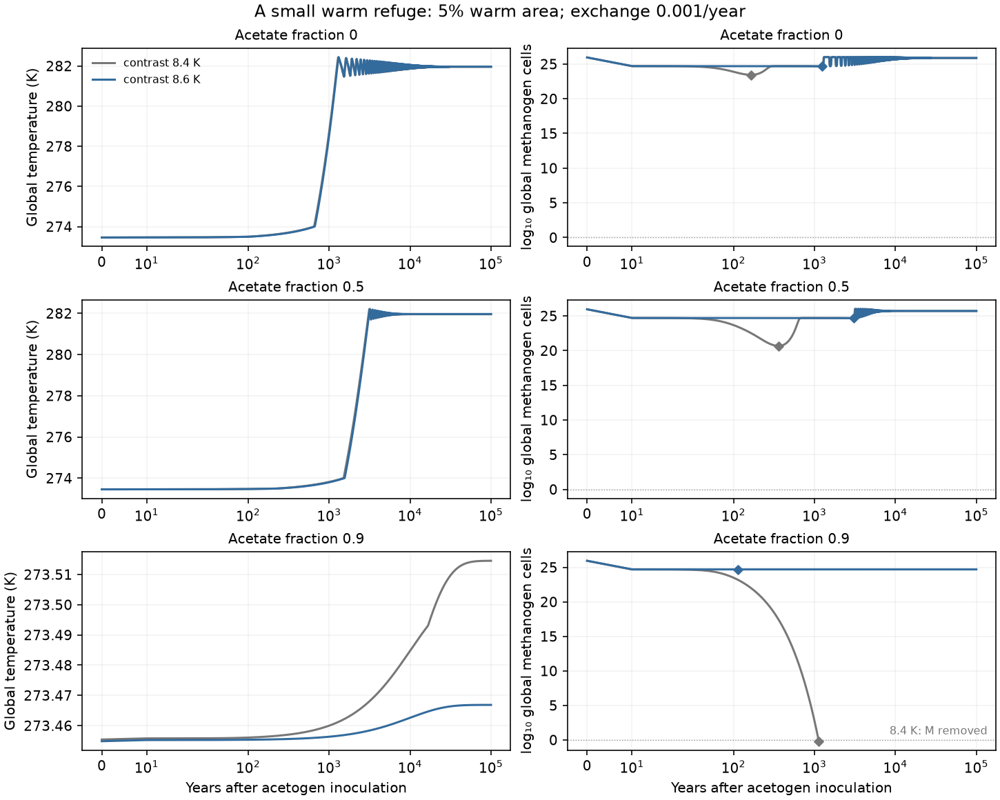
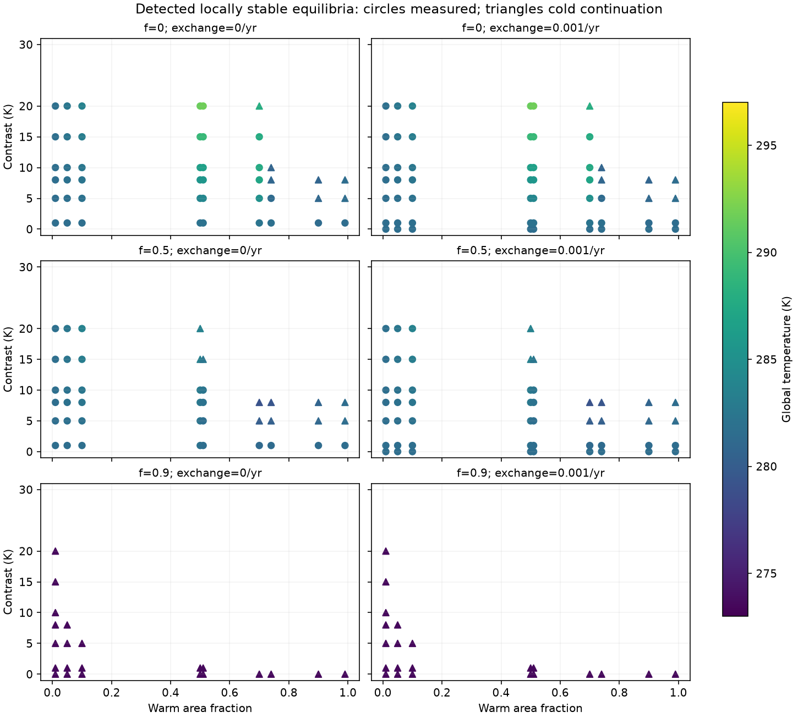
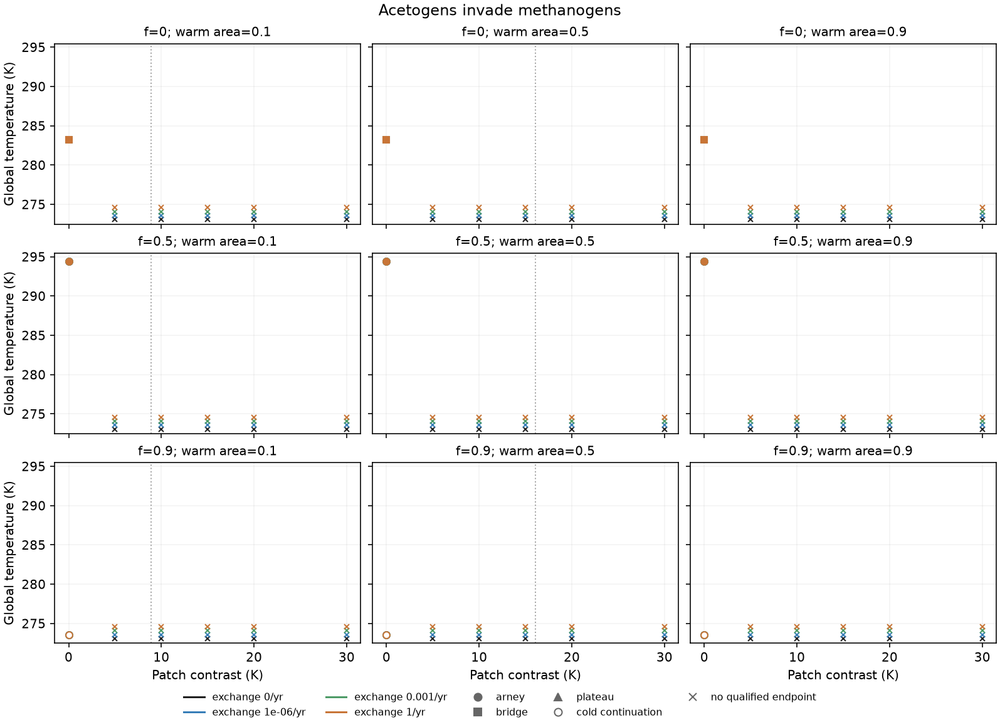
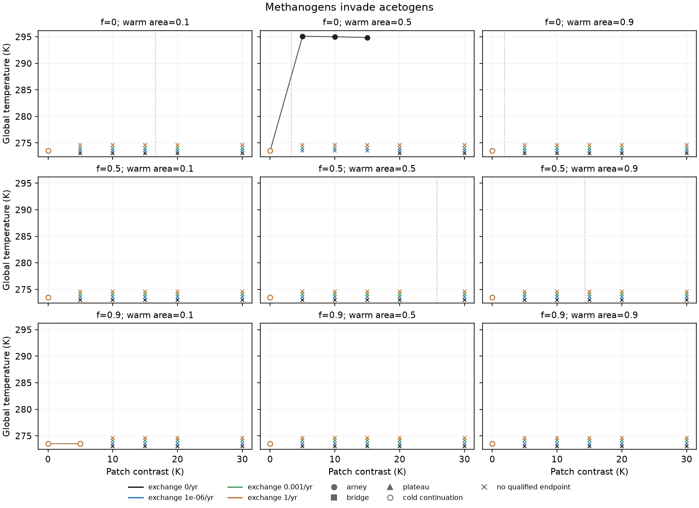

# Two habitats under one methane atmosphere

Codex (GPT-6, OpenAI), 10 November 2026. Codex implemented the coupling,
equilibrium solver and experiment pipeline from Claude (Opus 5.5)'s
[specification](refuge-coupling-spec.md). The
[implementation boundaries](refuge-implementation-notes.md) record corrections
and supplemental comparisons chosen before the full invasion matrix.

**Status:** implementation, full experiment and twelve 200,000-year settling
extensions are complete. All 199 tests pass. Claude's scientific review of
this build remains pending. The numerical and ecological claims remain
conditional on the named physiology, habitat and climate assumptions.

The question is whether a biosphere can supply its own rescue. The
[one-habitat model](finite-populations.md) can lose a guild through hydrogen
competition before atmospheric methane changes enough to reverse its fortunes.
Here two habitats exchange cells, retain separate resources and acetate, and
share one atmospheric methane inventory. There is no external immigration.

## State, temperatures and units

The nine stocks are

    [p_c, X_Ac, X_Mc, A_c, p_w, X_Aw, X_Mw, A_w, r].

Hydrogen pressure `p` is in Pa, microbial biomass `X` in gDW/L, acetate `A`
in mol/L, and `r` is the atmospheric CH₄/CO₂ ratio. Time is years. Subscripts
`c,w` identify cold and warm habitats; `A,M` identify acetogens and
hydrogen-using methanogens. Prescribed acetate recycling can still produce
methane after the explicit M guild disappears; its consumers are not represented
as a third population.

For warm area fraction `w_w`, cold fraction `w_c=1−w_w` and contrast `Delta`,

    T_c = T(r) − w_w Delta,
    T_w = T(r) + w_c Delta.

Thus `w_c T_c+w_w T_w=T(r)`. The global response remains the quasi-static Arney
case-B curve, with the inherited 283 K low-methane bridge and high-methane
plateau reported separately. Main runs retain the assumed 10,000-year linear
methane lifetime. Constant temperature offsets are a prescribed
spatial structure, not a reconstructed meridional energy balance or a dynamic
local heat budget.

Both habitats have the same effective volume per unit area and uniform donor
supply. Reference donor potential is 0.3: local input is
10⁻⁶ mol H₂/L/hour and effective volume is 0.00897068 L/cm². This normalization
does not estimate an Archean habitat depth. The atmospheric hydrogen reservoir
and exchange coefficient retain the [full model's](population-coupling.md)
assumptions; hydrogen and acetate do not move directly between patches.

## Local metabolism and shared budgets

Code: [physical coupling](../../src/terra_prisca/haze_world/refuge_coupling.py)
and [local-temperature fluxes](../../src/terra_prisca/haze_world/population_coupling.py).
The existing uptake, maintenance, yield, assimilation and turnover equations are
evaluated at each patch's actual temperature. Methane activity uses the shared
`r`; acetate activity uses the local pool. The main runs retain fixed product
activities. A supplemental subset uses the normalized quarter-power correction.

Writing `H` for hours per year, uptake `U_ij=H q_i X_ij` and catabolic hydrogen
`C_ij` subtract the hydrogen allocated to gross biomass synthesis. With Henry
storage coefficient `kappa`, the local and atmospheric equations are

    kappa dp_j/dt = H J − sum_i U_ij − H k_ex(p_j−p_atm),
    dX_ij/dt      = mu_ij X_ij + E_ij,
    dA_j/dt       = C_Aj/4 − (k_rec(T_j)+k_other) A_j,
    dr/dt         = Gamma sum_j w_j [C_Mj/4+k_rec(T_j) A_j]
                    + abiotic source − L(r).

Here `mu_ij` is annual biological net growth, `Gamma` converts a local methane
inventory into atmospheric ratio, and all displayed fluxes are annual. Biomass
loss is exported in the reducing-equivalent budget. Reference acetate residence
is one year, with the same conversion fraction `f` in both patches.

For dispersal rate `d` per year,

    E_ic = d w_w (X_iw−X_ic),
    E_iw = d w_c (X_ic−X_iw).

The weights make `sum_j w_j E_ij=0`. The conserved internal bookkeeping is

    sum_j w_j [kappa p_j + sum_i a_i X_ij + 4 A_j] + 4 r/Gamma,

where `a_i` is the biomass hydrogen-equivalent allocation. Only donor input,
the hydrogen outlet, acetate/biomass exports, abiotic methane and atmospheric
loss enter its external balance. Atmospheric terms are counted once. Census
removals export the reducing equivalents in discarded biomass; cell exchange
adds no external source. The [design audit](review/refuge-design-review.md) and
[implementation check](review/check_refuge_implementation.py) examine these
balances independently of endpoint classification.

## Equilibria and the temperature-domain gate

The [equilibrium solver](../../src/terra_prisca/haze_world/refuge_equilibria.py)
enumerates fixed-activity, zero-dispersal patch branches and solves their shared
methane balance. A locally mixed patch imposes equal break-even hydrogen
pressures. Product feedback instead solves the local inventories and activity
thresholds together. Positive-dispersal candidates are continued numerically;
additional endpoint seeds can be solved directly at their target exchange rate.

At zero dispersal a pure A-cold/M-warm partition may be an algebraic equilibrium
while invadable. The strict condition `T_c<T_sw<T_w`, with
`T_sw=281.534823 K`, gives local invasion protection in the reference fixed-product
physiology; viability, methane balance and full-system stability also need
checking. At positive dispersal, occupied patches seed their counterparts, so
exactly pure spatial partitions become source/sink communities. Local net growth
can then balance export or import instead of vanishing.

Two independently checked fixed-product equilibria open the specification's
measured-temperature gate:

| f | Warm area | Contrast | Global T | Cold T | Warm T |
|---:|---:|---:|---:|---:|---:|
| 0 | 0.74 | 1 K | 281.792641 K | 281.052641 K | 282.052641 K |
| 0.5 | 0.51 | 8 K | 282.002304 K | 277.922304 K | 285.922304 K |

Both are protected partitions with stable full nine-state spectra. They also
continue to stable source/sink states at `d=0.001/year`. These are equilibrium
checks, not demonstrations that the specified invasions reach them. See the
[independent calculation](review/check_refuge_design.py) and
[numeric evidence](review/refuge_design_check.json).

Physiological measurements span **277.15–303.15 K**. The reference model has a
named cold continuation to **273 K**, and no rates below 273 K or above
303.15 K. Each patch retains its measured/continuation flag, separately from
the global radiative `arney`, `bridge` or `plateau` flag. Unsupported starts and
domain exits supply no physical endpoint. Numerical boundary extensions are
used only to locate exits; they do not define an accepted temperature
continuation. Zero-area patches are inactive.

Every candidate retains its full active-state spectrum, including invasion
modes of absent enabled guilds. Climate vertices use both one-sided spectra.
The zero-contrast, zero-dispersal fixed-product model has a neutral family of
mixed equilibria, represented as marginal states. Finite branch searches and
root-grid checks do not establish global completeness or exclude cycles.
Mutual invasibility of boundary states alone does not prove a unique interior
attractor.
An [independent target-d search](review/check_refuge_target_d.py) challenges
three missing methanogen-only starts at `d=1/year` without using zero-dispersal
parent branches. Its [54-fit evidence](review/refuge_target_d_check.json)
finds no additional root and recovers an acetogen-only positive control. This
bounded check strengthens those individual search results without proving
completeness of the map.

## Predictions and what would test them

The original P1–P5 predictions remain in the specification. Their role is to be
tested, rather than imposed as solver acceptance conditions.

- **P1, refuge thresholds.** The single-habitat estimates are warm offsets
  above 8.02 K for A into M, and cold offsets above 12.87 K (`f=0.5`) or
  1.66 K (`f=0`) for M into A. Actual two-habitat conditional starts can shift.
  Persistence depends on integrated local growth and exchange; the dominant
  eigenvalue of the rare guild's two-patch growth matrix is the relevant
  instantaneous invasion criterion.
- **P2, history independence.** Compare opposite invasions only when both have
  supported starts and qualified endpoints. Protection at the initial climate
  does not by itself prove survival throughout the transient or common final
  basins.
- **P3, coexistence at 90% recycling.** The independent audit excludes a
  wholly measured, protected pure partition at `d=0,f=0.9` under the reference
  physiology and climate. It does not exclude every finite-d state. Any
  continuation-dependent coexistence must keep that flag visible.
- **P4, climate pinning.** An isolated partition can have a supply- and
  geometry-dependent global temperature. Exact local switch pinning is a
  zero-dispersal, fixed-product limit. A finite-d mixed patch can contain a
  declining imported population, so occupancy alone does not establish pinning.
- **P5, exchange.** A strongly declining sink has leading concentration
  `X_sink≈d w_source X_source/|lambda_sink|`. Rapid exchange equalizes biomass
  while retaining local temperatures, resources and acetate. The resulting
  averaged growth generally differs from growth at area-mean conditions.

The identical-habitat trajectory limit is checked with symmetric starts and
without removals. A one-cell floor in each patch is a different intervention
from one global cell; the finite zero-contrast comparison reports that
distinction explicitly.

## Experiment design and reproduction

The main design keeps all **432 attempts**: `f=0/0.5/0.9`, warm fractions
`0.1/0.5/0.9`, contrasts `0/5/10/15/20/30 K`, exchange rates
`0/10⁻⁶/10⁻³/1 per year`, and both invasion directions. Each start is stable
with the competing guild disabled and has the resident in every active patch.
Where several qualifying starts occur, the largest methane ratio is selected
and the ambiguity retained. An absent supported start is a finite-search
outcome, not extinction or a proof of nonexistence.

The invader's total area-weighted dose is 10⁻¹² gDW/L. Seeding one patch divides
that concentration by its area fraction, preserving the total dose across
seed-origin comparisons. There is no external immigration. Counts use the
assumed 3×10⁻¹³ gDW/cell and total area 5.1×10¹⁸ cm². A guild below one cell
in a patch is removed at each ten-year census. Supplemental comparisons include annual censuses,
product activities and small refuges described in the implementation note.

```sh
uv run python -m terra_prisca.haze_world.refuge_experiments --stage pilot --workers 2
uv run python -m terra_prisca.haze_world.refuge_experiments --stage equilibria --workers 4
uv run python -m terra_prisca.haze_world.refuge_experiments --stage main --workers 4
uv run python -m terra_prisca.haze_world.refuge_experiments --stage subsets --workers 4
uv run python -m terra_prisca.haze_world.refuge_experiments --stage main --years 200000 --workers 4 \
  --output models/haze_world/figures/refuge_coupling/extensions \
  --case-id main_0000_t200000 --case-id main_0002_t200000 --case-id main_0004_t200000 --case-id main_0006_t200000 \
  --case-id main_0048_t200000 --case-id main_0050_t200000 --case-id main_0052_t200000 --case-id main_0054_t200000 \
  --case-id main_0096_t200000 --case-id main_0098_t200000 --case-id main_0100_t200000 --case-id main_0102_t200000
uv run python -m terra_prisca.haze_world.refuge_reporting \
  --extension-manifest models/haze_world/figures/refuge_coupling/extensions/main_selection_395dfd8c_manifest.json
uv run pytest tests/test_refuge_coupling.py tests/test_refuge_equilibria.py \
  tests/test_refuge_integration.py tests/test_refuge_experiments.py tests/test_refuge_reporting.py
```

The [runner](../../src/terra_prisca/haze_world/refuge_experiments.py) defaults to
100,000 years for main/subset attempts and 1,000 years for pilots. `--n-grid`
defaults to 201. `--list-cases`, `--case-id`, `--years` and `--collect-only`
support bounded jobs and later horizons. Each case has a fingerprinted raw
file and completion receipt recording sources, parameters and package versions.
The collector verifies every requested receipt and data hash before publishing
tables; large tables are split into named files listed by their manifest.
Raw data remain under ignored `local/haze/refuge_coupling/`.

The [reporting module](../../src/terra_prisca/haze_world/refuge_reporting.py)
reads the main, subset and equilibrium manifests from
`models/haze_world/figures/refuge_coupling/`. Later horizons can be supplied with
`--extension-manifest PATH`; only duration and case identity may differ from
their original protocols. A later qualified horizon is selected regardless of
whether it settles.

Only completed integrations can supply endpoint fields. Stationarity requires
at least 100,000 years, unchanged last-window census occupancy, relative stock
spans below 0.001, temperature span below 0.01 K and scaled derivatives below
0.001 over the last 20,000 years. Unsettled results and unsupported-domain
attempts remain visible. A 1% catabolic-share threshold reports material guild
contributions separately from occupancy.

Minima use accepted dense-flow pieces, excluding rejected solver trials. Local
pre-removal minima freeze at the first local removal; global pre-extinction
minima freeze when the last patch of that guild is removed. Post-census zeros
are separate, and simultaneous area-weighted global biomass is minimized
directly. Summing minima from different patches or treating censored minima
as census-independent would change their meaning. Negative-infinite log stock
is encoded as a blank/null with an explicit zero flag.
Polynomial extrema are located directly where the coordinate transform permits;
the remaining searches use 17-node derivative brackets and bounded refinement.
These are numerical extrema searches, not certified interval bounds. Temperature
extrema include accepted methane-polynomial extrema and radiative vertices,
so a short excursion need not coincide with an output sample to be flagged.

The [independent Radau check](review/check_refuge_trajectory.py) uses separate
local log-biomass coordinates for three ten-year, uncensored prefixes. Its
[results](review/refuge_trajectory_check.json) check stocks and integrated redox
against the production solver. They validate the numerical implementation over
those prefixes, not the long-term ecological interpretation.

## Results

The source-frozen main matrix has 432 attempts: 79 completed integrations,
69 physiological domain exits and 284 finite searches with no supported
conditional start found. At 100,000 years, 67 completions pass stationarity and
12 need longer settling. All twelve settle at 200,000 years; their original
100,000-year results are retained. The separate equilibrium map covers 432 configurations;
356 yield candidates and 76 do not. A search finding no candidate is not proof that
an equilibrium or conditional start cannot exist.
The map retains 1,991 detected candidates: 236 locally stable, 54 marginal
and 1,701 unstable. Of the stable candidates, 156 lie wholly within the measured
temperature window, all at `f=0` or `f=0.5`.

Across the main and supplemental designs, 117 selected completed trajectories
are stationary; 103 stop at a physiological boundary and 290 lack a supported
conditional start found by the search. All 72 zero-contrast endpoints match the
existing single-habitat controls within the declared comparison tolerances.
None of the numerically located global minima of a surviving guild falls below
one cell. Those minima do not erase the named census or density assumptions.

### Endogenous rescue and a shifted global temperature

A 5% warm habitat with exchange `d=0.001/year` lets both guilds persist after
acetogens invade. At contrast 8.4 K, the initial warm temperature is
281.435 K, below the 281.535 K competitive switch. Nevertheless the global
methanogen minimum is about 2.8×10²³ cells at `f=0` and 4.6×10²⁰ at `f=0.5`.
The changing climate reverses the competitive disadvantage before global loss.
Thus P1's instantaneous threshold is not a necessary survival boundary.
Nor is initial protection sufficient. In main case 0267 (`f=0.5`, warm area
90%, contrast 15 K, `d=10⁻⁶/year`, M into A), the 13.5 K cold offset exceeds
the proposed 12.87 K threshold. The cold refuge initially favors acetogens.
Increasing methane first warms this world before haze cools it; acetogens
are removed globally at year 1,560, when the cold habitat is 281.878 K.
The radiative path to this loss lies inside Arney's curves and both habitats
remain within the measured temperature window. The run later reaches its
cold physiological boundary at year 6,711, so it has no reported final endpoint.
The extinction observed before that exit is a distinct, supported result.

| Acetate conversion f | Contrast | Global T | Cold T | Warm T | Methanogen catabolic share |
|---:|---:|---:|---:|---:|---:|
| 0 | 8.4 K | 281.95475 K | 281.53475 K | 289.93475 K | 75.2% |
| 0.5 | 8.4 K | 281.95469 K | 281.53469 K | 289.93469 K | 52.1% |
| 0.9 | 8.6 K | 273.46684 K | 273.03684 K | 281.63684 K | 5.4% |

The first two endpoints have a nearly switch-pinned cold habitat, not a
switch-pinned global mean. With contrast 8.6 K the global endpoint rises to
about 281.9647 K, while the cold habitat stays near 281.5347 K. Cell exchange
allows a surviving warm population to supply the other habitat. At positive
exchange these are source/sink communities, not exactly pure partitions.

### A warm refuge changes coexistence at 90% recycling

At `f=0.9`, contrast 8.4 K loses methanogens from either invasion direction.
Contrast 8.6 K retains both guilds from either direction, with and without
exchange. At zero exchange the protected partition has A in the cold habitat
and M in the warm habitat; at `d=0.001/year`, M supplies about 5.4% of catabolic
hydrogen use. This confirms the conditional coexistence mechanism proposed
in P3. Its climate effect is small: about 0.048 K cooler than the corresponding
acetogen-only endpoint, not a large new warming or thermostat.



These are acetogen invasions with 5% warm area and `d=0.001/year`. Grey and blue
curves use contrasts 8.4 and 8.6 K. Diamonds locate the accepted-flow global
methanogen minimum before global extinction, if any; an annotated removed
lineage remains absent. Counts sum contemporaneous patch biomasses. The first
two cases have damped transients, while the last distinguishes rescue from
global loss. Every trajectory shown begins with the cold continuation below
4 °C. The first two endpoints lie within the measured temperature window;
the 90%-recycling endpoints retain a cold habitat below it.

The 78 supplemental attempts include 38 completed stationary trajectories,
34 domain exits and six searches with no supported conditional start found.
At the selected 8.6 K contrast, changing the inoculated patch while matching
the global dose, or counting annually rather than every ten years, preserves
the completed coexistence outcomes. Product feedback also preserves those
coexistence outcomes: final global temperatures are 281.971 K, 281.687 K and
273.481 K at `f=0,0.5,0.9`, respectively. The unsupported reverse invasions at
`f≤0.5` remain unsupported. These are the declared subset comparisons, not a
claim about every seed dose, exchange rate or census rule.

### Predictions, history and stability

| Prediction | Outcome and scope |
|---|---|
| P1: initial refuge thresholds delimit survival | Refuted as both necessary and sufficient by the two transient counterexamples above. |
| P2: opposing invasions reach the same state at f≤0.5 | Not established. No tested pair has supported starts with both residents initially favored somewhere. The 24 stationary pairs at f≤0.5 are zero-contrast controls and retain opposite single-guild outcomes. |
| P3: a warm refuge enables coexistence at f=0.9 | Confirmed for the selected small warm refuges, from both directions; the cold habitat uses the below-4 °C continuation. |
| P4: geometry changes global temperature and can pin a local habitat | Confirmed in equilibrium calculations and attained source/sink examples. A pure finite-census partition need not be invasion-protected. |
| P5: slow exchange creates sinks, fast exchange approaches mean-temperature biology | The sink balance is recovered. Biomass homogenizes at fast exchange, but the mean-temperature claim is false: local growth is averaged across distinct temperatures. |

There are 47 pairs with two stationary outcomes. The 23 matching pairs are all
at `f=0.9`; fourteen recover the same single-acetogen state and nine recover
coexistence. These counts do not establish history independence under the
unmet P2 conditions.

Three zero-exchange main runs at `f=0`, warm fraction 0.5 and contrasts
5–15 K reach hot, isolated A-cold/M-warm partitions near 295 K. They are
stationary under the census process but invadable in the full continuum model.
For contrast 5 K the exact equilibrium has a positive eigenvalue about
7.14/year: methanogens missing from the cold habitat could grow rapidly there.
Local extinction plus zero exchange prevents their arrival. The table's
`protected_partition` and terminal linearization fields separate these states
from protected partition equilibria. At positive exchange, an exactly pure
spatial partition cannot be stationary.

The fast-exchange [regression control](../../tests/test_refuge_equilibria.py)
has almost equal patch biomass concentrations but a different global temperature
from the single-habitat mixed state. This follows from
`sum_j w_j mu(T_j,p_j) ≠ mu(T_global,p_mean)`, even when biomass is uniform.
Exchange of cells does not mix heat, hydrogen or acetate in this model.



Only detected locally stable candidates are shown; multiple roots may overlap.
Circles mark wholly measured endpoint temperatures and triangles mark cold
continuations. The candidate table retains the unstable and marginal states,
full numerical spectra remaining in the raw records. A blank grid point means
that the finite search found no stable supported candidate.





These preserve the original coarse invasion grid. Dotted vertical lines are the
original P1 estimates; connecting segments are guides between sampled points,
not continued branches. Marker shape shows the final global radiative domain;
filled points have measured endpoint physiology and open points use the cold
continuation. Crosses at the panel floor mean no qualified endpoint, not a
low-temperature state. Start failures and domain exits remain distinct in the
tables. Full-path temperature flags are separate from endpoint flags: all
attained refuge coexistence examples use the cold continuation somewhere,
even when their final temperatures lie in the measured window.

## Evidence and remaining limits

Physical source is frozen at `99a5146`, with independent numerical evidence
added in `1feb31e`. The [report manifest](figures/refuge_coupling/reporting_manifest.json)
records input and analysis hashes. The [sensitivity overview](figures/refuge_coupling/sensitivity_overview.csv),
[direction comparisons](figures/refuge_coupling/direction_comparisons.csv),
[zero-contrast checks](figures/refuge_coupling/zero_contrast_checks.csv) and
[equilibrium candidates](figures/refuge_coupling/equilibria_candidates.csv)
provide the concise derived evidence; the main and subset summaries retain
continuous/global/local minima, occupancy, fluxes and domain flags.
The [raw manifest](figures/refuge_coupling/raw_manifest.json) and
[archive receipt](figures/refuge_coupling/payload_receipt.json) cover 954
canonical records and 1,908 raw/receipt files, about 170 MB. Every archived
file was read back and checksum-verified. Bulk trajectories remain outside Git.

Habitat offsets remain fixed while haze changes, hydrogen sees a fixed
atmospheric reservoir, acetate recycling is prescribed rather than an explicit
third guild, and methane loss is the assumed linear law. The small-refuge and
temperature-response results therefore do not calibrate an Archean biosphere
or demonstrate robustness to evolving physiology. Equilibrium feasibility,
finite-population attainability and empirical temperature support are separate
claims in this build.
