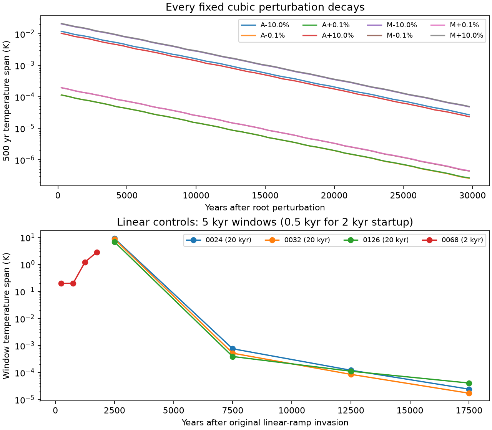

# Closing the dormancy cycle checks

All eight fixed perturbations of the case 0024 mixed equilibrium decay. This
includes changing either active guild by ±10%, with both dormant pools initially
zero. The fitted periods are 119.54–119.57 yr and the damping times 4.854–4.875 kyr,
matching the independently derived 119.57 yr mode and 4.854 kyr damping time within
0.5%. Each flow runs 30,000 yr; the final 5,000 yr spans are about 0.006 times the
first 5,000 yr spans.

Claude's prediction that these large starts would reach the sustained cycle
fails. The previously checked invasion-start cycle and the stable equilibrium
still coexist. These eight biomass directions do not locate their basin
boundary, and do not establish the size of a whole neighbourhood around the
equilibrium.

The matched linear-ramp original-start controls decay in all three completed
nonspatial cases:

| Case | Actual horizon | Temperature span, 10–15 kyr | Temperature span, 15–20 kyr |
|---|---:|---:|---:|
| 0024 | 20,000 yr | 1.22×10⁻⁴ K | 2.43×10⁻⁵ K |
| 0032 | 20,000 yr | 8.56×10⁻⁵ K | 1.72×10⁻⁵ K |
| 0126 | 20,000 yr | 1.12×10⁻⁴ K | 4.09×10⁻⁵ K |

Thus the persistent nonspatial recurrence depends on the switching law in these
matched invasion experiments. This does not prove the absence of other cycles.
The linear response is nonsmooth where net growth is zero. Its residual-qualified
resident root and the observed decay are retained as separate facts; no arbitrary
single-Jacobian stability certificate is assigned. Optional long directional
screens at that root did not return within the bounded effort and are unresolved.

The warm-refuge cases 0012 and 0068 remain unresolved under the linear law.
Case 0068 retains a completed 2,000 yr positive-coordinate original-start segment.
The guarded continuation declined because a guild became smaller than its
deliberately macroscopic 10¹⁶-cell scope; this is not a biological extinction.
The bounded frozen-Radau continuation did not return a longer flow. Case 0012's
positive-coordinate original-start attempt did not return a completed segment.
Both switch-only attempts from each exact recorded 80 kyr cubic-cycle state
also hit their 180 s limits without returning a new flow. The final machine
summary retains these attempts and labels their completed durations as zero.
Those are different starting-state comparisons and cannot establish equal invasion
basins. No conclusion that every
cycling case loses its cycle under the linear response is warranted.



The design is in [cycle-closure-design-2026-11-11.md](cycle-closure-design-2026-11-11.md).
The [machine summary](cycle-closure-results-2026-11-11.json) pins source graphs,
receipts, raw hashes, actual horizons, rejected and stopped attempts, positivity,
census events and all observed physiology-domain flags. The nonspatial amplitude
checks stay in measured physiology; some original-start linear paths use the
existing named cold-continuation assumption. Physical and earlier numerical
producer modules, native classifications and earlier receipts remain unchanged.

The guarded reduced physical solver rejects negative/nonfinite accepted endpoints
and midpoints, unsupported climates, rare guilds and required census removal.
Every recorded observation is checked again in the analysis. These sampled
restrictions are not a whole-piece positivity or rare-lineage certificate.
Rejected tiny-negative dormant-stock trials use the existing frozen
positive-coordinate producer without clipping or reseeding. The one-thousand-year
physical/Radau smoke has identical initial states and common 10 yr observations;
the maximum methane-ratio difference is 4.49×10⁻¹³. Actual solver settings are the
explicit receipt fields, including rtol 2×10⁻⁹; historical case fields retain their
original nominal settings.

Reproduce the new analysis and figure with:

```sh
uv run python models/haze_world/review/dormancy_cycle_closure_analysis.py
```

The three focused tests cover physical perturbations with exact-zero dormant
banks, rejection rather than clipping, and distinguishing known exponential
decay from constant-amplitude recurrence. The parent ran the full suite:
820 tests passed. No Floquet, basin enumeration, global uniqueness or asymptotic
periodic-orbit proof is claimed.
