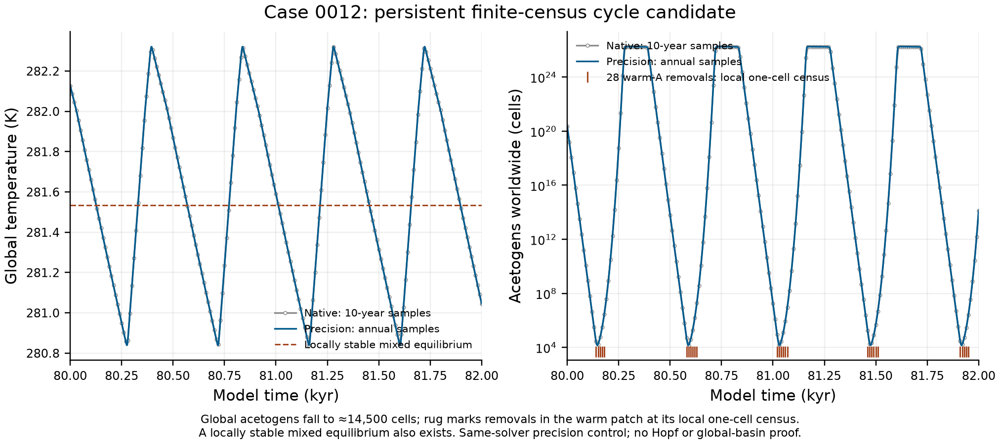

# Case 0012: a finite-census oscillation candidate

The canonical 100,000-year run has a persistent 1.482 K temperature swing,
with a period of about 443 years. Successive 20,000-year windows from year
40,000 retain the same envelope. This is a **finite-census hybrid-cycle
candidate**: the warm patch repeatedly loses acetogens at its local one-cell
census, while both guilds remain present globally. It is not an unculled
continuous orbit or a demonstrated global attractor.

The case uses no acetate recycling, dormant loss `epsilon = 0.03`, active
loss `0.001/hour`, and cell exchange `1e-6/year` between bulk and a 2% warm
refuge at 286 K. Both stages are counted at the ten-year census.



One authorized 2,000-year continuation starts from the exact recorded
year-80,000 physical state. It uses the same `75c538cb` chemical helper,
tenfold tighter relative tolerance (`2e-9`), a one-year maximum step and annual
observations. It completed in 87 seconds. No finite stage logs were lost on
initialization; the physical coordinate round trip differed by at most
`2.35e-16` relative. Solver history, charts and the relative clock restart;
no seed or physical stock reset is introduced.

| Comparison over years 80,000–82,000 | Result |
|---|---:|
| Maximum temperature difference at 201 shared census dates | `7.15e-8 K` |
| Local and global census occupancy | Identical |
| Warm-patch acetogen culls | Same 28 times, patches and guilds |
| Maximum difference in cells removed at a matched cull | `6.16e-7` cell |
| Precision-control dense global acetogen minimum | About 14,500 cells |
| Precision-control dense global methanogen minimum | `10^24.2854` cells |

Annual samples resolve a 1.482003 K range. The longer native late window gives
1.482007 K and a 442.602-year period; the annual control gives 442.6 years.
The matched native 2,000-year segment contains only four ten-year-sampled
peaks, so its raw 440-year period estimate and narrower sampled envelope are
limited by sampling. The common-time comparison is the stronger precision
check.

A directly recovered mixed equilibrium at 281.534823 K also has a locally
stable physical Jacobian: its largest real eigenvalue remains approximately
`-2.0354e-4/year` across four difference scales. This supports coexistence of a
local stable equilibrium and a persistent finite-amplitude cycle candidate;
it does not identify a Hopf transition or enumerate basins. The native mean
over 44 complete sampled peak intervals is 281.595269 K.

The global acetogen minimum is much smaller than in case 0068. Deterministic
retention of 14,500 cells does not establish survival under demographic
randomness, repeated bottlenecks or uncertainty in the global cell-count
conversion. No stochastic-survival or infinite-time stability claim is made.

The [compact audit](dormancy0012_cycle_check.json),
[read-only comparison](dormancy0012_cycle_compare.json) and
[figure manifest](dormancy0012_cycle_figure.json) record protocol, source,
receipt and payload hashes. Canonical fingerprint:
`14f5c49a3088e852d97f80363fccb5c42ba6988ea03778e4ebf7c140c0430d2a`.
Raw continuation files remain under the ignored
`local/haze/dormancy_0012_cycle_precision/` directory.

Regenerate the comparison and figure without integrations:

```sh
uv run python models/haze_world/review/dormancy0012_cycle_compare.py
uv run python models/haze_world/review/dormancy0012_cycle_figure.py
```
