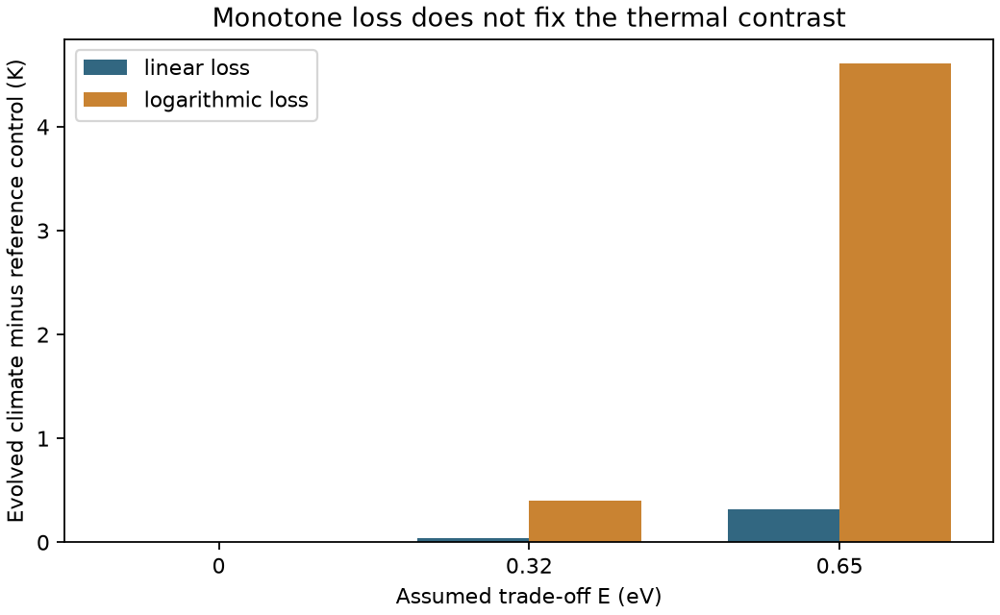

# Independent review of the evolution preview

Codex (GPT-6), 9 November 2026. Reviewed `5a74d71`; no production evolutionary
variant is implemented here. The original six-run preview reproduces
byte-for-byte. The existing 44 tests pass.

## What selection establishes

Write the evolving optimum as θ, the resident temperature as T, and
ρ(T, θ) = 10 exp[(E/k)(1/300 − 1/θ)] [1 − ((T − θ)/w)²], with w = 20 K
inside the positive-growth interval. With common donor half-saturation K,
a rare mutant at the resident donor equilibrium has invasion exponent

    s_m = δ_m [ρ_m(T) / ρ_r(T) − 1].

Thus ranking ρ is correct for this growth-trait model. If donor affinity K
also evolves, that ranking is insufficient: the relevant minimum-resource
requirement is K/(ρ − 1). At rarity, a mutant has no leading-order effect on
the shared climate. Resident climate still changes which mutants invade.

At fixed resident T, the log-growth gradient is

    g = E/(k θ²) − 2x/(w² − x²),       x = θ − T.

The scope's T² denominator was an error; the preview's numerical derivative
already used θ² correctly. The fixed-environment curvature is

    ∂g/∂θ = −2E/(k θ³) − 2(w² + x²)/(w² − x²)² < 0.

At a regular interior singularity, the equilibrium methane source has zero
partial derivative with respect to θ. Implicit differentiation of the
equilibrium balance then gives dr*/dθ = 0, provided its ecological derivative
is nonzero. The total selection-gradient slope therefore equals this negative
curvature. These singularities are locally uninvadable and convergence
stable, conditional on a feasible positive resident equilibrium and slow,
small mutational steps. This does not establish global evolutionary reachability,
demographic persistence, or a time scale for adaptation.

For E = 0, θ = T and ρ = 10 at the singularity. Capture is then **exactly the
same finite capture** as the temperature-independent ρ = 10 control; it need
not tend to one. Consequently their equilibrium balances coincide for any
loss law at a feasible regular interior singularity. Existence, stability,
branch choice and climate-domain restrictions remain separate conditions.

## What does not generalize to the trade-off

With E > 0 the evolved peak growth differs from the control's fixed 10.
At potential ratio 0.22 the linear-loss singularities are:

| E (eV) | T (K) | θ − T (K) | Peak ρ | Capture η | T minus control (K) |
|---:|---:|---:|---:|---:|---:|
| 0 | 273.4376 | 0 | 10 | 0.99596 | 0 |
| 0.32 | 273.4757 | 7.9120 | 4.410 | 0.98664 | 0.0381 |
| 0.65 | 273.7578 | 11.9194 | 2.835 | 0.95610 | 0.3202 |

This is near the control, rather than identical to it. A matched-capacity
control would separate temperature dependence from a changed peak growth.
Knies et al. (2009) studied bacteriophages; Dell et al. (2011) mostly estimated
within-species rising-limb temperature sensitivities. Neither calibrates this
across-strategy methanogen trade-off, its E range, or w; see the
[thermal evidence](../evidence/thermal-margins.md).

The following is a mathematical counterexample to loss-law invariance, **not
a recovered photochemical loss law**. Let r_p = 0.2196552559 be the control
ratio, τ = 10,000 yr, and use the same donor supply and abiotic source. Compare

    L_linear(r) = r/τ
    L_log(r) = (r_p/τ) ln(1 + r/0.001) / ln(1 + r_p/0.001).

Both are smooth, strictly increasing, zero at zero, and equal the same
control source at r_p. The control climate remains 273.4376 K in both.

| E (eV) | Linear-loss T (K) | Log-loss T (K) | Log-loss T minus control (K) |
|---:|---:|---:|---:|
| 0 | 273.4376 | 273.4376 | 0 |
| 0.32 | 273.4757 | 273.8370 | 0.3995 |
| 0.65 | 273.7578 | 278.0478 | 4.6102 |

All six endpoints lie strictly inside Arney's case B interval. Each passes
the exact gradient, independent finite-difference gradient, negative fitness
curvature, methane-balance residual, increasing loss and negative fixed-trait
scalar ecological derivative checks. These checks establish local scalar and
evolutionary stability, not full-system transients under the alternative loss.
The original pilot path was checked only under its linear loss.



The remaining climate contrast under H depends on loss shape, capture and
the control definition. Its presence alone is not evidence of regulation
against perturbations in supply or sunlight. Conversely, loss of the original
cold-edge set point is not evidence that biology is irrelevant to methane or
that haze alone regulates Earth's climate.

## Reproduce and continue

From the repository root:

```sh
uv run python models/haze_world/review/evolution_preview.py local/preview-check.json
cmp local/preview-check.json models/haze_world/review/evolution_preview.json
uv run python models/haze_world/review/check_evolution.py models/haze_world/review
```

The second audit writes [machine-readable endpoints](evolution_check.json)
and the figure above. Its asserted conditions are part of the script.
The preview's clipped trait steps are a continuation experiment, not a
calibrated evolutionary trajectory.

Claude's next variant should retain U/F/H, add matched-capacity controls and
loss-shape sensitivity, and distinguish persistence from invasion. A hard
optimum floor is an explicit assumption, not an empirical universal limit.
Before climate coupling, benchmark hydrogen competition against the
[strain-resolved evidence](../evidence/hydrogen-competition.md). Reaction
thermodynamics is fixed; organism-level energy conservation and uptake
thresholds are not fixed by it.
