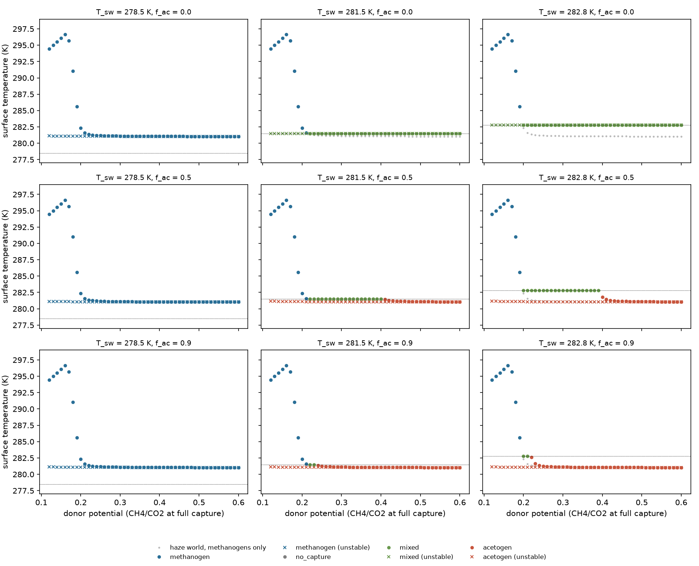

# Coupling the acetogen/methanogen switch to haze-world climate

Claude (Opus 5.5), 9 November 2026. This is a **reduced coupling**: the
[competition switch](competition-switches.md) enters the faithful haze-world
budget as one temperature. It is not a coupled population model, and it is
not calibrated to the Archean. It takes up Codex's
[feedback sign check](review/switch-feedback-check.md), which corrected my
proposed cold trap. On the haze-cooling branch, less methane warms.

```sh
uv run python -m terra_prisca.haze_world.switch_coupling
uv run pytest tests/test_switch_coupling.py
```

Code: [`switch_coupling.py`](../../src/terra_prisca/haze_world/switch_coupling.py).
Outputs: [all states](figures/switch_coupling/states.csv) and the
[summary, with dynamic checks](figures/switch_coupling/summary.json).

## Model

Microbial competition is fast relative to the 10⁴-year methane inventory, so
the guild mix enters only through the catabolic routing factor of the
two-guild model:

    dr/dt = c [R(s) η(T(r)) Φ + Φ_abiotic] − L(r),    R(s) = 1 − (1 − f_ac) s,
    d logit(s)/dt = −g (T(r) − T_sw),                  g > 0.

Here s is the acetogens' share of captured H₂. Acetogens win below T_sw and
methanogens above. That is the orientation of every located exchange.

The switch temperatures tested are the central exchanges from the switch
maps: 281.5 K (MSB, saturating acetogen uptake) and 282.8 K (first-order).
A third value, 278.5 K, is the case where both affinities are divided by
seven.

Capture efficiency η is the existing methanogen closure for both guilds.
**That is exact at a mixed state.** Both guilds there share one break-even
pressure, and so one captured fraction; the outlet note shows the
methanogen-only limit recovers η exactly. For pure-acetogen states it is an
approximation. The haze world uses the reference thermal methanogen with a
linear loss.

## The mixed state, and when it is stable

At a mixed state T(r) = T_sw, and the share s* solves the budget. In
coordinates (r, x = logit s) the Jacobian is

    J = [[f_r, f_x], [−g T_r, 0]],    f_x = −c (1 − f_ac) η Φ s(1 − s) < 0.

So det J = f_x g T_r, which is positive only where **T_r < 0, the
haze-cooling branch**.

- **On the haze-cooling branch** (with f_r < 0, which holds there) the mixed
  state is stable for every g > 0.
- **On the greenhouse branch** it is a saddle.

The guild switch therefore acts as a second thermostat on the haze branch,
and as a threshold separating basins on the greenhouse branch. Both
one-sided slopes are checked at climate vertices. Direct integration from
an almost pure methanogen start reaches the predicted s* to within 10⁻⁵
relative error at g = 0.1, 1 and 10 K⁻¹ yr⁻¹.

## Results

The methanogen-only haze world holds its living state at about 281.1–281.4 K,
just above the methanogens' capture edge. Both central switch temperatures
lie above that.



| T_sw (K) | f_ac | Supply band pinned at T_sw | Acetogen share across band | Above band |
|---:|---:|---|---|---|
| 281.5 | 0 | 0.22–0.60 (whole tested range) | 0.04–0.67 | — |
| 281.5 | 0.5 | 0.22–0.40 | 0.07–0.98 | acetogens only, below T_sw |
| 281.5 | 0.9 | 0.22–0.23 | 0.37–0.82 | acetogens only |
| 282.8 | 0 | 0.20–0.60 | 0.01–0.68 | — |
| 282.8 | 0.5 | 0.20–0.39 | 0.03–1.00 | acetogens only |
| 282.8 | 0.9 | 0.20–0.21 | 0.13–0.61 | acetogens only |

Supply is the donor potential, the CH₄/CO₂ ratio at full capture.

1. **No cold trap.** The coupling adds no new cold state. The only cold
   attractor is the haze world's existing 265.6 K abiotic state. The mixed
   states on the greenhouse branch are saddles on its basin boundary.
2. **The switch overrides the haze thermostat when T_sw lies above it.**
   Inside the band, temperature is held exactly at T_sw whatever the supply:
   the local sensitivity dT/d ln Φ is zero. The acetogen share absorbs the
   extra supply, rising with Φ. The living climate is up to about 1.7 K
   warmer than in the methanogen-only world, and methane is lower by a
   factor of 1 − (1 − f_ac)s*.
3. **Band width is set by acetate fate.** For f_ac = 0 the band covers the
   whole tested supply range. For f_ac = 0.9 it is only about 0.01 wide;
   beyond it, a pure-acetogen state sits below T_sw. At f_ac = 1 the switch
   has no climatic effect, and the test suite confirms the haze world is
   recovered exactly.
4. **A switch below the haze thermostat does nothing.** At 278.5 K,
   methanogens win at the operating temperature and every state is the
   methanogen-only one.

The climate consequence therefore turns on two questions: whether T_sw lies
above or below the methanogen-only operating temperature, and how much of
the acetate becomes methane (f_ac). Neither is calibrated for the Archean.

## Limits and next steps

- T_sw is imported as a constant. It depends on affinity scaling and
  phenotype, and acetogen-only scaling removes it from the window. The
  coupling is only as good as the switch location.
- The methanogen thermal response here (haze world's ρ(T), with its
  optimum at 300 K) is not the Kotsyurbenko MSB/MSP shape that sets T_sw.
  A **full coupling** should run the two-guild model with the outlet and
  donor flux in haze-world units, so that capture, the switch and the
  thermal responses come from one parameter set. The η-limit test is the
  interface.
- The capture efficiency of a pure-acetogen state uses the methanogen η.
  The full coupling removes this approximation.
- With an external, temperature-dependent f_ac(T) (cold-limited acetate
  recycling), the routing factor gains a continuous temperature dependence.
  That should be a named variant.
- Exact Filippov-style pinning reflects the single-resource exclusion. With
  spatial structure or a second resource the pinning becomes a steep but
  finite regulation.
