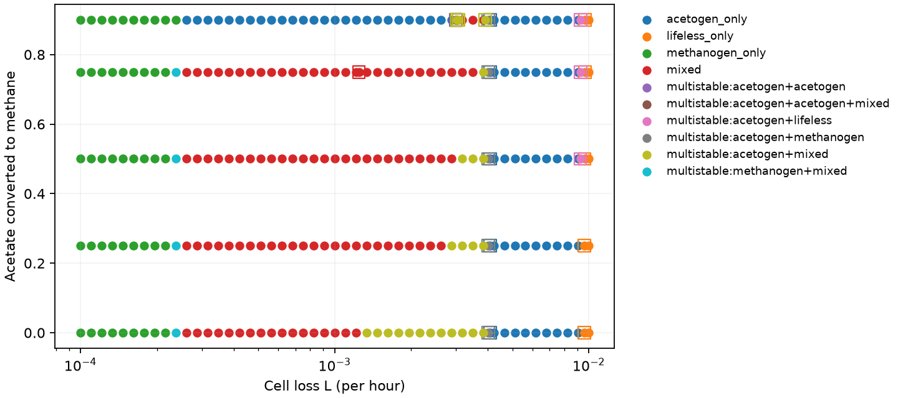
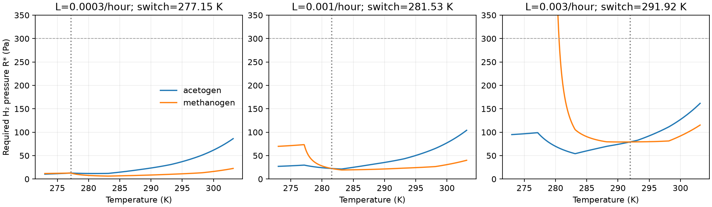

# Turnover, stationary regimes and refuges

Turnover changes both the temperature of coexistence and the number of stable
stationary states. The full map supports the preview's main turnover mechanism,
but adds narrow regimes that its grid missed. The equilibrium map also does
not describe every global outcome: one high-recycling setting has a recurring
relaxation trajectory, independently reproduced with a second stiff solver.

This is a sensitivity experiment on the reference physiology and the fixed
Arney case-B climate response. Turnover is the same constant loss rate for both
guilds. It is not an estimate of Archean turnover.

## T1: equilibrium map

The planned grid has 49 logarithmic loss rates from `10^-4` to `10^-2 h^-1`
(24 intervals per decade) and acetate-to-methane fractions
`f = 0, 0.25, 0.5, 0.75, 0.9`. It contains **859 equilibria at 245 parameter
settings**. Root-defined intervals missed by that grid add 26 check settings
and 110 equilibria. There are 39 multistable settings among these checked
settings: 38 with two stable equilibria and one with three.



Filled points are the planned grid; outlined squares resolve intervals between
rooted boundaries that contain no planned point. The map classifies stable
equilibria, not all possible dynamical attractors.

The calculation includes the lifeless state, both pure-guild branches and all
feasible mixed branches. Pure-guild roots are bracketed at both radiative and
physiological interpolation corners. Every inventory agrees when its ratio
grid is refined from 501 to 1001 points; an independent 6001-point temperature
grid agrees with the thermal-switch roots at all 49 planned loss rates.
Stability uses the full five-stock Jacobian, including invasion by an absent
enabled guild. Difference stencils stay within a smooth segment; an exact
corner is reported using both one-sided spectra.

Boundaries are roots of the actual resident balance, invasion rate, climate
geometry or spectral condition. They are not targets rounded from the preview.
The [boundary file](figures/turnover/boundaries.json) separates thermal equality
of hydrogen requirements from the feasibility of a planetary mixed state.

| Event | Loss rate, `h^-1` | Qualification |
|---|---:|---|
| Thermal switch enters the supported 273 K physiology range | 0.000226899 | A thermal crossing need not be a planetary equilibrium. |
| Mixed states first become feasible at the 273.390 K climate minimum | 0.000233352 | At `f <= 0.75`, a stable mixed state coexists with the methanogen world. |
| Switch reaches the imposed 274.002 K high-methane plateau | 0.000243664 | Methanogen-world stability changes here. At exact equality, there is a neutral mixed continuum. |
| Switch reaches the fixed cold refuge, 278 K | 0.000434396 | Thermal reference for T2. |
| Acetogen world becomes stable, `f = 0` | 0.001238145 | Stable acetogen and mixed worlds coexist above this boundary. |
| Switch reaches the fixed warm refuge, 286 K | 0.001881792 | Thermal reference for T2. |
| Acetogen world becomes stable, `f = 0.5` | 0.003007511 | Stable acetogen and mixed worlds coexist above this boundary. |
| Two stable pure-guild worlds | 0.003936106–0.004088515 | This narrow interval occurs at all five fractions. |
| Lifeless world becomes stable against acetogen invasion | 0.009238000 | For `f >= 0.5`, a living acetogen world persists over a further narrow interval. |

The preview's `f = 0` and `0.5` bistability boundaries are within 2% of the
rooted values. Stable cooling-branch set points span about 273.4–296.1 K
across a roughly 17-fold loss-rate range; the sampled set points rise
monotonically along that branch. Its statement that no switch exists below `2.44e-4 h^-1` is
incorrect. A supported thermal crossing exists below that value, and a
planetary mixed branch starts at `2.33352e-4 h^-1`. The small low-turnover
bistable window comes from the digitized climate curve's **0.612 K upturn**
from its minimum to its high-methane plateau, combined with the named
below-4 °C physiology continuation. It should not be read as a resolved
physical prediction from the publication's plotted curve.

Other narrow intervals contain two stable acetogen worlds, or two acetogen
worlds plus a stable mixed world, at `f = 0.9`. These depend on the prescribed
piecewise climate and uptake curves. At the high-loss end, both guilds fail
and only the lifeless state is stable. The flat high-methane extension also
creates a neutral continuum exactly at plateau contact; the continuum is
reported as a family, not as many isolated grid roots.

## T1: basin checks and the global qualification

The frozen [basin protocol](figures/turnover/basins_protocol.json) specifies
245 integrations: 144 at planned grid settings and 101 at additional rooted
settings. Each multistable setting includes resident-plus-invader starts in
both directions wherever the resident exists. Stable mixed states receive
`+/-1%` perturbations in each guild. Pure-guild or lifeless perturbations
also check the narrow intervals without a stable mixture. A resident that
cannot exist is not supplied as an invented start.

The numerical variant retains the frozen physical equations and the
softplus/log coordinates of every initially present guild. It uses Radau,
an explicitly scaled numerical Newton matrix and a 1000-year maximum step.
Guilds absent initially stay on their exact invariant face. This prevents
implicit-solver rounding from creating immigrants. Acetate absolute tolerance
is `10^-13 mol/L`; stocks are not clipped. Automatic Jacobian differencing
in the initial LSODA and Radau trials could stall near underflowed rare stocks;
those trial receipts remain separate from the qualified numerical epoch.

An equilibrium endpoint must match an actual stable equilibrium within
`0.1%` in scaled stocks, change by less than `0.1%` over the final 20,000 years,
and meet the scaled derivative and invasion checks. The final window is
sampled every ten years so population oscillations are visible.

Of the 245 starts, **242 meet those criteria**: 210 at 100,000 years,
28 at 300,000 years, two at one million years and two at 1.3 million years.
All **79 stable equilibria** in the multistable settings are reached by at
least one checked start. All **112 small mixed-state perturbations** return
to their original mixture. There is no observed contradiction of the local
stability classification.

Three invasion paths at `f = 0.9` remain nonstationary at one million years.
They are retained as unresolved global endpoints in
[the gate report](figures/turnover/basins_gate.json), which distinguishes
local-stability reconciliation from global attractor completeness. None is
at `f = 0` or `0.5`, the fractions used by T2 and T3.

Two of these paths, from opposite invasion directions at
`L = 0.003072199 h^-1`, approach a large relaxation cycle while the mixed and
acetogen equilibria remain locally stable. A review-only BDF calculation
starts from the same original positive seed, retains rare log stocks, uses
tenfold tighter tolerances and samples the whole million-year path every
100 years. It independently reproduces the recurrence:

| Check | Qualified Radau path | Independent BDF control |
|---|---:|---:|
| Last two cycle periods | 172,737 and 172,728 yr | 172,737 and 172,736 yr |
| Last methanogen minimum, natural log of gDW/L | -169,443.378 | -169,443.365 |
| Late temperature range | 286.143–297.004 K | 286.119–297.008 K |

The small temperature-range difference is consistent with the original
1000-year sampling outside its final window. The
[control record](figures/turnover/basins_cycle_control.json) includes the
independent code, inputs, raw-data hash and return samples. This supports a
candidate attracting cycle; it is not a mathematical proof of a periodic
orbit or of all attractors. The third unresolved path, at
`L = 0.003011473 h^-1`, has recurring but still changing population minima.

These paths depend on continuous populations far below one cell worldwide.
The model's one-world-cell biomass is about `exp(-67.2) gDW/L`; the cycle's
minima are many thousands of natural-log units lower. They describe the
continuum equations, not finite-population survival. Finite-population
outcomes are assessed separately in T2 and T3.

Thus KT1 is partly supported. Turnover controls the stationary switch
temperature and its main preview boundaries. The earlier feasible mixed
branch refutes its low-turnover onset as stated, and the additional regimes
and recurring paths refute a universal two-equilibrium basin account.

## T1: why the switch rises

For saturating uptake, the hydrogen pressure required to replace losses is

```text
q_required = m + L/Y
R* = h + K q_required / (V - q_required),   q_required < V
dR*/dL = K V / [Y (V - q_required)^2]
```

Here `m` is maintenance, `Y` yield, `h` the cessation threshold, `K` the
half-saturation pressure and `V` uptake capacity. The switch is where the two
guilds have equal `R*`.



The methanogen's lower yield (`0.78` versus `1.7 gDW/mol H2`) makes replacement
more costly as loss rises; its lower uptake capacity adds to that disadvantage.
Its smaller half-saturation pressure and lower maintenance oppose it. Local
fixed-temperature checks replacing only its yield with the acetogen yield
reverse the sign of the difference in direct loss sensitivities at all three
plotted switch temperatures. Matching only its uptake capacity reverses it
at the two lower loss rates. These checks identify contributions within the
reference model; they do not recalibrate strains or recompute counterfactual
climates.

The cessation threshold has no direct derivative in `L`, but changes the
crossing and its temperature sensitivity. The
[component table](figures/turnover/mechanism.csv),
[implicit-derivative check](figures/turnover/mechanism_slopes.csv) and
[local parameter checks](figures/turnover/mechanism_local_checks.json) keep
those roles separate. At `L = 0.0003, 0.001, 0.003 h^-1`, implicit and numerical
switch derivatives agree, giving about `6.55, 6.74, 6.58 K` per local increase
of `0.001 h^-1`.

## T2: refuges across turnover

T2 results and interpretation are being integrated separately. The T1 gate
permits that assessment at its `f = 0, 0.5` settings; it does not remove the
global-basin qualifications above.

## Reproduction and source identity

```sh
uv run python -m terra_prisca.haze_world.turnover --stage map --workers 4
uv run python -m terra_prisca.haze_world.turnover --stage mechanism
uv run python -m terra_prisca.haze_world.turnover --stage basins --workers 8
uv run python -m terra_prisca.haze_world.turnover --stage collect
uv run pytest tests/test_turnover.py
```

The extension protocol files beside the basin tables give the selected case
IDs and horizons for the longer runs; `--years` and repeated `--case-id`
arguments reproduce those selections. Raw profiles and receipts live under
`local/haze/turnover/`, outside Git. Their hashes are retained in the manifests.

The qualified `turnover.py` SHA256 is
`9d964b8cbf6f81a848be43707e0625fa6be05771a857a061593bfa91e9605de3`.
The [map manifest](figures/turnover/regimes_manifest.json),
[thermal-root audit](figures/turnover/regimes_thermal_audit.json),
[basin manifest](figures/turnover/basins_manifest.json) and gate record bind
the outputs to that source and the unchanged climate, uptake and physical
model inputs. Twelve targeted tests cover the new regimes, continuum contact,
corner stability, positive-coordinate fidelity and exact absence of a guild.
