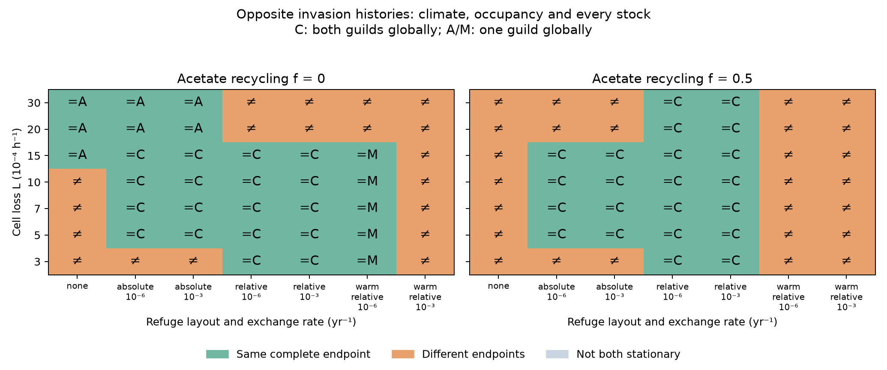
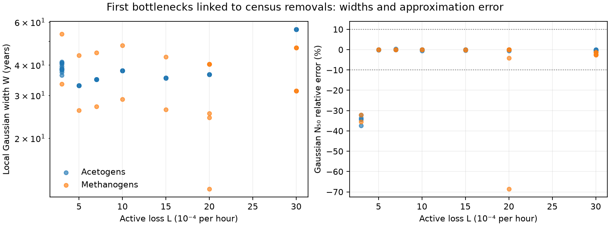
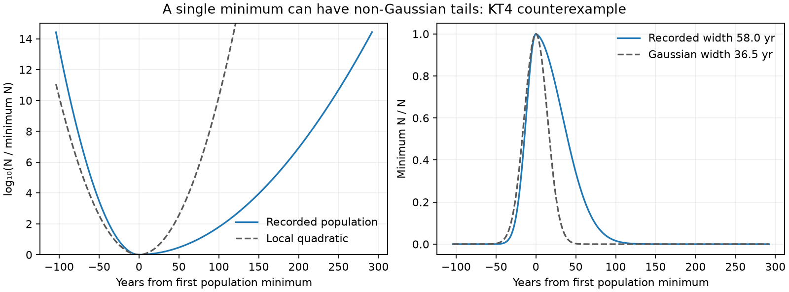

# Turnover, stationary regimes and refuges

Turnover changes both the temperature of coexistence and the number of stable
stationary states. The full map supports the preview's main turnover mechanism,
but adds narrow regimes that its grid missed. The equilibrium map also does
not describe every global outcome: one high-recycling setting has a recurring
relaxation trajectory, independently reproduced with a second stiff solver.

This is a sensitivity experiment on the reference physiology and the fixed
Arney case-B climate response. Turnover is the same constant loss rate for both
guilds. It is not an estimate of Archean turnover.

## T1: equilibrium map

The planned grid has 49 logarithmic loss rates from `10^-4` to `10^-2 h^-1`
(24 intervals per decade) and acetate-to-methane fractions
`f = 0, 0.25, 0.5, 0.75, 0.9`. It contains **859 equilibria at 245 parameter
settings**. Root-defined intervals missed by that grid add 26 check settings
and 110 equilibria. There are 39 multistable settings among these checked
settings: 38 with two stable equilibria and one with three.


Filled points are the planned grid; outlined squares resolve intervals between
rooted boundaries that contain no planned point. The map classifies stable
equilibria, not all possible dynamical attractors.

The calculation includes the lifeless state, both pure-guild branches and all
feasible mixed branches. Pure-guild roots are bracketed at both radiative and
physiological interpolation corners. Every inventory agrees when its ratio
grid is refined from 501 to 1001 points; an independent 6001-point temperature
grid agrees with the thermal-switch roots at all 49 planned loss rates.
Stability uses the full five-stock Jacobian, including invasion by an absent
enabled guild. Difference stencils stay within a smooth segment; an exact
corner is reported using both one-sided spectra.

Boundaries are roots of the actual resident balance, invasion rate, climate
geometry or spectral condition. They are not targets rounded from the preview.
The [boundary file](figures/turnover/boundaries.json) separates thermal equality
of hydrogen requirements from the feasibility of a planetary mixed state.

| Event | Loss rate, `h^-1` | Qualification |
|---|---:|---|
| Thermal switch enters the supported 273 K physiology range | 0.000226899 | A thermal crossing need not be a planetary equilibrium. |
| Mixed states first become feasible at the 273.390 K climate minimum | 0.000233352 | At `f <= 0.75`, a stable mixed state coexists with the methanogen world. |
| Switch reaches the imposed 274.002 K high-methane plateau | 0.000243664 | Methanogen-world stability changes here. At exact equality, there is a neutral mixed continuum. |
| Switch reaches the fixed cold refuge, 278 K | 0.000434396 | Thermal reference for T2. |
| Acetogen world becomes stable, `f = 0` | 0.001238145 | Stable acetogen and mixed worlds coexist above this boundary. |
| Switch reaches the fixed warm refuge, 286 K | 0.001881792 | Thermal reference for T2. |
| Acetogen world becomes stable, `f = 0.5` | 0.003007511 | Stable acetogen and mixed worlds coexist above this boundary. |
| Two stable pure-guild worlds | 0.003936106–0.004088515 | This narrow interval occurs at all five fractions. |
| Lifeless world becomes stable against acetogen invasion | 0.009238000 | For `f >= 0.5`, a living acetogen world persists over a further narrow interval. |

The preview's `f = 0` and `0.5` bistability boundaries are within 2% of the
rooted values. Stable cooling-branch set points span about 273.4–296.1 K
across a roughly 17-fold loss-rate range; the sampled set points rise
monotonically along that branch. Its statement that no switch exists below `2.44e-4 h^-1` is
incorrect. A supported thermal crossing exists below that value, and a
planetary mixed branch starts at `2.33352e-4 h^-1`. The small low-turnover
bistable window comes from the digitized climate curve's **0.612 K upturn**
from its minimum to its high-methane plateau, combined with the named
below-4 °C physiology continuation. It should not be read as a resolved
physical prediction from the publication's plotted curve.

Other narrow intervals contain two stable acetogen worlds, or two acetogen
worlds plus a stable mixed world, at `f = 0.9`. These depend on the prescribed
piecewise climate and uptake curves. At the high-loss end, both guilds fail
and only the lifeless state is stable. The flat high-methane extension also
creates a neutral continuum exactly at plateau contact; the continuum is
reported as a family, not as many isolated grid roots.

## T1: basin checks and the global qualification

The frozen [basin protocol](figures/turnover/basins_protocol.json) specifies
245 integrations: 144 at planned grid settings and 101 at additional rooted
settings. Each multistable setting includes resident-plus-invader starts in
both directions wherever the resident exists. Stable mixed states receive
`+/-1%` perturbations in each guild. Pure-guild or lifeless perturbations
also check the narrow intervals without a stable mixture. A resident that
cannot exist is not supplied as an invented start.

The numerical variant retains the frozen physical equations and the
softplus/log coordinates of every initially present guild. It uses Radau,
an explicitly scaled numerical Newton matrix and a 1000-year maximum step.
Guilds absent initially stay on their exact invariant face. This prevents
implicit-solver rounding from creating immigrants. Acetate absolute tolerance
is `10^-13 mol/L`; stocks are not clipped. Automatic Jacobian differencing
in the initial LSODA and Radau trials could stall near underflowed rare stocks;
those trial receipts remain separate from the qualified numerical epoch.

An equilibrium endpoint must match an actual stable equilibrium within
`0.1%` in scaled stocks, change by less than `0.1%` over the final 20,000 years,
and meet the scaled derivative and invasion checks. The final window is
sampled every ten years so population oscillations are visible.

Of the 245 starts, **242 meet those criteria**: 210 at 100,000 years,
28 at 300,000 years, two at one million years and two at 1.3 million years.
All **79 stable equilibria** in the multistable settings are reached by at
least one checked start. All **112 small mixed-state perturbations** return
to their original mixture. There is no observed contradiction of the local
stability classification.

Three invasion paths at `f = 0.9` remain nonstationary at one million years.
They are retained as unresolved global endpoints in
[the gate report](figures/turnover/basins_gate.json), which distinguishes
local-stability reconciliation from global attractor completeness. None is
at `f = 0` or `0.5`, the fractions used by T2 and T3.

Two of these paths, from opposite invasion directions at
`L = 0.003072199 h^-1`, approach a large relaxation cycle while the mixed and
acetogen equilibria remain locally stable. A review-only BDF calculation
starts from the same original positive seed, retains rare log stocks, uses
tenfold tighter tolerances and samples the whole million-year path every
100 years. It independently reproduces the recurrence:

| Check | Qualified Radau path | Independent BDF control |
|---|---:|---:|
| Last two cycle periods | 172,737 and 172,728 yr | 172,737 and 172,736 yr |
| Last methanogen minimum, natural log of gDW/L | -169,443.378 | -169,443.365 |
| Late temperature range | 286.143–297.004 K | 286.119–297.008 K |

The small temperature-range difference is consistent with the original
1000-year sampling outside its final window. The
[control record](figures/turnover/basins_cycle_control.json) includes the
independent code, inputs, raw-data hash and return samples. This supports a
candidate attracting cycle; it is not a mathematical proof of a periodic
orbit or of all attractors. The third unresolved path, at
`L = 0.003011473 h^-1`, has recurring but still changing population minima.

These paths depend on continuous populations far below one cell worldwide.
The model's one-world-cell biomass is about `exp(-67.2) gDW/L`; the cycle's
minima are many thousands of natural-log units lower. They describe the
continuum equations, not finite-population survival. Finite-population
outcomes are assessed separately in T2 and T3.

Thus KT1 is partly supported. Turnover controls the stationary switch
temperature and its main preview boundaries. The earlier feasible mixed
branch refutes its low-turnover onset as stated, and the additional regimes
and recurring paths refute a universal two-equilibrium basin account.

## T1: why the switch rises

For saturating uptake, the hydrogen pressure required to replace losses is

```text
q_required = m + L/Y
R* = h + K q_required / (V - q_required),   q_required < V
dR*/dL = K V / [Y (V - q_required)^2]
```

Here `m` is maintenance, `Y` yield, `h` the cessation threshold, `K` the
half-saturation pressure and `V` uptake capacity. The switch is where the two
guilds have equal `R*`.


The methanogen's lower yield (`0.78` versus `1.7 gDW/mol H2`) makes replacement
more costly as loss rises; its lower uptake capacity adds to that disadvantage.
Its smaller half-saturation pressure and lower maintenance oppose it. Local
fixed-temperature checks replacing only its yield with the acetogen yield
reverse the sign of the difference in direct loss sensitivities at all three
plotted switch temperatures. Matching only its uptake capacity reverses it
at the two lower loss rates. These checks identify contributions within the
reference model; they do not recalibrate strains or recompute counterfactual
climates.

The cessation threshold has no direct derivative in `L`, but changes the
crossing and its temperature sensitivity. The
[component table](figures/turnover/mechanism.csv),
[implicit-derivative check](figures/turnover/mechanism_slopes.csv) and
[local parameter checks](figures/turnover/mechanism_local_checks.json) keep
those roles separate. At `L = 0.0003, 0.001, 0.003 h^-1`, implicit and numerical
switch derivatives agree, giving about `6.55, 6.74, 6.58 K` per local increase
of `0.001 h^-1`.

## T2: refuges across turnover

Refuges let the two planned invasion histories reach the same material bulk
mixture over a wider range than KT2 and KT3 predicted. A warm refuge can also
sustain methanogens while they contribute almost nothing in the bulk. Global
coexistence, a shared endpoint and a functioning bulk thermostat are therefore
reported separately.

The **196 census runs** cover seven loss rates, `L = 3, 5, 7, 10, 15, 20, 30
times 10^-4 h^-1`, `f = 0, 0.5`, and both invasion directions. There are 28
unrefuged runs and 56 each with two absolute refuges, two relative refuges,
or a relative warm refuge alone. The absolute refuges remain at 278 and
286 K; relative refuges remain at `T_sw - 3.535 K` and `T_sw + 4.465 K`.
Each refuge occupies 2% of the effective habitat volume, and the bulk follows
the shared case-B climate response. Cell exchange is `10^-6` or `10^-3 yr^-1`.
Hydrogen and acetate remain local; atmospheric methane is shared.
The lowest relative cold refuge is 273.616 K. Its physiology uses the named
`constant_shape` continuation below the measured 4 °C limit. Numerical support
for that continuation does not supply a measurement of cold growth.

Each guild is removed locally if fewer than one cell remains at a ten-year
census. Global absence is absorbing. The initial invader density is
`10^-12 gDW/L` in each active habitat. These are outcomes of that finite census
protocol, not joint stochastic endpoint probabilities.

Of the original 100,000-year runs, **178 meet the stationarity rule**. Eleven
acetogen-only paths still have an abiotic methane tail, and seven mixtures
are approaching equilibrium through slowly damped oscillations. The 18
selected runs were extended to 200,000 years; **all 196 selected endpoints
then pass**. No stationarity threshold was relaxed.

Stationarity requires less than 0.1% change in every stock over the final
20,000 years, less than 0.01 K temperature change, small scaled derivatives
and unchanged census occupancy. Opposite histories count as the same endpoint
only when both qualify, their local and global guild occupancies agree, their
temperatures differ by less than 0.01 K, and every physical stock agrees within
0.1%. Biomass comparisons use each habitat's actual one-cell density as the
near-zero scale. The other floors are 1 Pa for hydrogen, `10^-9 M` for acetate
and 0.001 for the methane ratio.



Across the **98 paired histories**, 52 pairs match in the complete state and
46 differ. Forty matching pairs have a material bulk mixture: both guilds
provide at least 1% of bulk hydrogen catabolism and the climate lies close to
their thermal switch. The other twelve matching pairs contain only one guild.
The [pair table](figures/turnover/endpoint_pairs.csv) and
[assessment record](figures/turnover/endpoint_assessment.json) retain local
occupancy, both global and bulk catabolic shares, `T - T_sw`, every final stock,
the selected horizons and the source receipt hashes.

### KT2 and KT3: the common mixed window

The following categories hold at both tested exchange rates. **Mix** means the
same complete endpoint with material bulk competition; **A** means the same
acetogen-only endpoint; **different** means the two histories retain distinct
complete states.

| `L`, `10^-4 h^-1` | `T_sw`, K | Absolute, `f = 0` | Absolute, `f = 0.5` | Relative, `f = 0` | Relative, `f = 0.5` |
|---:|---:|---|---|---|---|
| 3 | 277.151 | different | different | Mix | Mix |
| 5 | 278.401 | Mix | Mix | Mix | Mix |
| 7 | 279.617 | Mix | Mix | Mix | Mix |
| 10 | 281.535 | Mix | Mix | Mix | Mix |
| 15 | 284.390 | Mix | Mix | Mix | Mix |
| 20 | 286.475 | A | different | different | Mix |
| 30 | 291.921 | A | different | different | Mix |

KT2 correctly anticipated failure of the absolute cold refuge at the lowest
loss rate: both fixed refuges favour methanogens there. It also anticipated
loss of the common thermostat after the switch rises above the warm refuge.
Its proposed upper limit at the well-mixed `f = 0` bistability boundary was
too restrictive. At `L = 0.0015 h^-1`, both histories still reach the same
mixed state with absolute refuges, although the corresponding unrefuged
equations have a stable acetogen world as well.

KT3 holds throughout the tested `f = 0.5` relative-refuge grid. At `f = 0`,
its predicted return of history dependence starts at `L = 0.002`, rather
than at `0.0015 h^-1`. The warm refuge changes establishment as well as
preserving cells. At `L = 0.0015`, holding the recorded refuge methane flux
fixed while omitting bulk methane gives a low-methane climate near 284.670 K,
above `T_sw = 284.390 K`. A methanogen introduced to the corresponding local
acetogen resident grows at about `0.224 yr^-1`. This forcing diagnostic
explains how a warm source can enable establishment from the acetogen start;
it does not enumerate spatial equilibria or prove global basin uniqueness.

At larger loss, the same refuge forcing is too weak to bring the low-methane
bulk across the switch. The histories then reach two globally coexisting
communities with very different functions. For the `f = 0`, two-relative-refuge
runs at `d = 10^-3 yr^-1`:

| `L`, `h^-1` | Invasion | Temperature, K | `T - T_sw`, K | Methanogen global catabolism | Methanogen bulk catabolism |
|---:|---|---:|---:|---:|---:|
| 0.002 | A into M | 286.475 | +0.00006 | 78.708% | 79.866% |
| 0.002 | M into A | 284.606 | -1.86948 | 2.082% | 0.001080% |
| 0.003 | A into M | 291.921 | +0.00015 | 85.945% | 87.415% |
| 0.003 | M into A | 284.444 | -7.47697 | 1.957% | 0.000230% |

In the lower states, bulk methanogens have negative local net growth and are
maintained by immigration from the warm patch. Their many cells do not make
them competitive bulk residents. The supplied methane affects climate, but
the bulk mixture does not hold temperature at its switch.

A warm refuge alone never gives the same material bulk mixture from both
starts on this grid. Some opposite histories agree because both finish as
methanogen-only worlds. Elsewhere one history reaches a mixture or a
source–sink community while the other loses acetogens.

Finite extinction also creates absorbing outcomes where a missing guild
could grow if reintroduced. Such census-stationary worlds are distinct from
the stable equilibria of the continuum equations in T1. At `f = 0.5`,
`L = 0.003` with absolute refuges, the two endpoint temperatures differ by
only about 0.052 K, but one has no methanogens and the other assigns about
76% of bulk hydrogen catabolism to them. The methane ratios are about
0.0991 and 0.1779.

The lower basin and the refuge-establishment diagnostic use the adopted
**low-methane bridge**, including its 283 K methane-free anchor. The forcing
ratios above are around 0.005, below the extracted Arney curves. These history
results are conditional on that climate closure. The thermostat endpoints in
the table lie on the extracted cooling branch; their existence alone does
not establish the history by which a finite biosphere reaches them.
This climate qualification is separate from the below-4 °C physiology
continuation. The closure choices and threshold geometry are sensitivities
of the specified model, not an empirical calibration of Archean communities.

### Convergence and numerical checks

With no methanogens and `f = 0`, methane obeys the exact forced linear loss
equation. The eleven late abiotic tails approach
`r = 0.0005437715868` with a 10,000-year time constant. Their last 20,000 years
agree with that exponential to better than `10^-14` in methane ratio.

The slowly relaxing mixtures have a stable oscillatory mode. Four difficult
examples have observed periods of 114–171 years and amplitude damping times
of 8–19 thousand years. Independently refined spatial equilibria predict
their periods within 0.01% and damping times within 2.1%. The
[transient checker](review/turnover_endpoint_transients.py) and
[control record](review/turnover_endpoint_transients.json) record the
raw-trajectory hashes, source inputs, root continuation and fits. This is a local
relaxation check on the recorded paths.

The endpoint comparator has five targeted tests, including local occupancy
and symmetric one-cell scaling, and received an independent read-only audit.
The complete 196-profile postprocessing pipeline was also checked against
the checksum-verified raw records.

### T2 replication

The census equations, accepted-flow integrator, starts and source inputs stay
at the frozen `eb41adb` T2 epoch. Every original and extended receipt is retained
under `local/haze/turnover/`. The assessment selects the longest recorded
protocol for each design ID and records that choice explicitly.

```sh
uv run python -m terra_prisca.haze_world.turnover_experiments --workers 4
uv run python -m terra_prisca.haze_world.turnover_experiments --workers 4 --years 200000 \
  --case-id refuges_0000 --case-id refuges_0028 --case-id refuges_0056 \
  --case-id refuges_0084 --case-id refuges_0112 --case-id refuges_0115 \
  --case-id refuges_0117 --case-id refuges_0119 --case-id refuges_0121 \
  --case-id refuges_0140 --case-id refuges_0142 --case-id refuges_0144 \
  --case-id refuges_0146 --case-id refuges_0152 --case-id refuges_0168 \
  --case-id refuges_0170 --case-id refuges_0172 --case-id refuges_0174
uv run python -m terra_prisca.haze_world.turnover_assessment --variant turnover
uv run python models/haze_world/review/turnover_endpoint_transients.py
uv run pytest tests/test_turnover_assessment.py
```

### KT4: first-bottleneck survival

The 87 cases with a local removal or a dense-flow global minimum below
10¹⁶ cells have annual, uncensored prefixes. Other cases reuse their census
trajectories. Every selected protocol and raw checksum is verified. One
prefix completed natively on a second architecture after the remote run's
accepted-step refinement left a persistent small step ceiling; its physical
source and protocol are unchanged, and its execution provenance is retained.

The [first-window table](figures/turnover/first_survival.csv) has 392 guild
diagnostics. Each first minimum is anchored before lowering the rarity
boundary, so a later impossible recovery cannot replace it. A rare window
requires negligible hydrogen uptake locally as well as globally. Terminal
values retain their finite horizon; survival to that time is an upper bound
on survival to any later time without outside immigration.

There are 78 case–guild combinations with at least one local census removal.
Their first windows give 72 robust-loss and six contingent classifications
over the thousandfold range in either direction in cell count. None overlaps
the other guild's likely first loss. These are conditional probabilities of
the guild surviving somewhere, not probabilities of individual local removals
or of a community endpoint. Later ghost-conditioned hazards are flagged in
the complete table rather than treated as hazards of the finite census world.

All six contingent classes survive the rate-grid and window-boundary checks.
Using two-year rather than annual rates changes log surviving-lineage
intensity by at most 0.00042; trimming 10% from each end of the first window
changes it by at most 0.000042. The
[first-window control](review/check_turnover_first_window.json) records these
checks and their source profiles.



The width panel includes interior minima in terminal windows; the error panel
uses the 58 resolved, nonterminal first windows.

KT4 is **refuted as a universal 10% rule**. Among the 58 resolved interior
rare first minima linked to removals, 51 satisfy that accuracy, while seven
underestimate the required population by 32–69%. A single minimum does not
ensure a Gaussian shape.

The independently checked counterexample is `refuges_0002`, acetogens at
`L=0.0003/hour`, with two absolute refuges and exchange `10⁻⁶/year`.
Its minimum is about 40 cells, with conditional first-window survival near
0.229 at the default count scale. The exact multitype calculation needs
**105.65 cells** at that minimum for 50% survival. The local Gaussian width
is 36.52 years, giving only **66.57 cells** at the effectively constant death rate
2.6298/year: 37% too low.



The inverse-population profile has an integrated width of 57.95 years,
broader than the local quadratic predicts. The scalar hazard identity on
that recorded path gives 105.64 cells, within 0.01% of the multitype result;
varying mortality or strong spatial mixing is therefore unnecessary to
explain this failure. An independent half-year sampled physical integration
changes the exact threshold by only 0.022%. The
[checker](review/check_turnover_gaussian.py) and
[evidence](review/check_turnover_gaussian.json) retain rate-grid controls,
curvature sensitivity, source hashes and the scalar comparison. The earlier
accepted pilot is also recovered by the
[first-window control](review/check_turnover_first_window.json).

The counterexample's climate window stays within the extracted Arney curve;
part of its microbial response uses the named below-4 °C continuation.

```sh
uv run python -m terra_prisca.haze_world.turnover_survival --variant turnover --workers 4
uv run python models/haze_world/review/check_turnover_first_window.py
uv run python models/haze_world/review/check_turnover_gaussian.py
```


## Reproduction and source identity

```sh
uv run python -m terra_prisca.haze_world.turnover --stage map --workers 4
uv run python -m terra_prisca.haze_world.turnover --stage mechanism
uv run python -m terra_prisca.haze_world.turnover --stage basins --workers 8
uv run python -m terra_prisca.haze_world.turnover --stage collect
uv run pytest tests/test_turnover.py
```

The extension protocol files beside the basin tables give the selected case
IDs and horizons for the longer runs; `--years` and repeated `--case-id`
arguments reproduce those selections. Raw profiles and receipts live under
`local/haze/turnover/`, outside Git. Their hashes are retained in the manifests.

The qualified `turnover.py` SHA256 is
`9d964b8cbf6f81a848be43707e0625fa6be05771a857a061593bfa91e9605de3`.
The [map manifest](figures/turnover/regimes_manifest.json),
[thermal-root audit](figures/turnover/regimes_thermal_audit.json),
[basin manifest](figures/turnover/basins_manifest.json) and gate record bind
the outputs to that source and the unchanged climate, uptake and physical
model inputs. Twelve targeted tests cover the new regimes, continuum contact,
corner stability, positive-coordinate fidelity and exact absence of a guild.

The [raw-payload receipt](figures/turnover/payload_receipt.json) pins the
shared T1–T3 archive. Its `source_epochs/t2_analysis/` directory retains the
exact T2 endpoint and survival producers from commit `b759291`, as recorded
by their manifests. The common analysis helpers were subsequently extended
for T3; exact historical replication uses those retained source versions.
