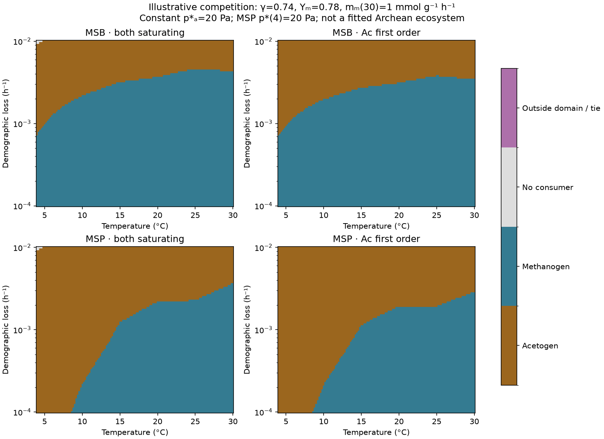
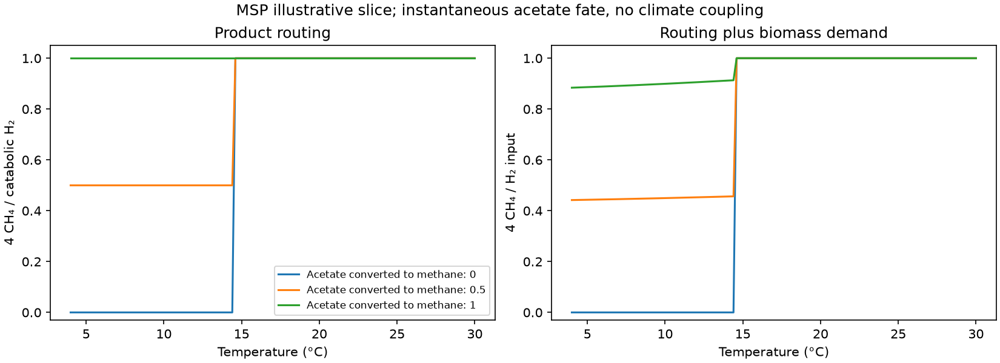

# Two guilds competing for hydrogen

**Status: fixed-temperature mechanism and sensitivity experiment, not an
Archean calibration.** The matched [A. woodii benchmark](woodii-benchmark.md)
now precedes a population model of acetogens and hydrogenotrophic methanogens.
MSB and MSP are alternative methanogen phenotypes, each competing with one
acetogen. This implements the [stage-3 specification](stage3-growth-spec.md)
with the dimensional and evidential choices below. Climate is not coupled.

**Outlet and sensitivity extension:** [hydrogen-outlet.md](hydrogen-outlet.md)
adds finite atmospheric exchange, K scaling, cessation-energy brackets and
the exact methanogen-only capture limit. The
[switch-location experiment](competition-switches.md) uses positive outlets;
the figures and counts on this page retain the no-outlet reference.

```sh
uv run python -m terra_prisca.haze_world.woodii1998
uv run python -m terra_prisca.haze_world.two_guilds
uv run pytest tests/test_woodii1998.py tests/test_two_guilds.py
```

Code: [`two_guilds.py`](../../src/terra_prisca/haze_world/two_guilds.py).
[Summary](figures/two_guilds/two_guilds_summary.json) and
[temperature slices](figures/two_guilds/two_guilds_reference_slices.csv)
are reproducible outputs. The figures show selected assumptions; they are
not fits to a published competition figure.

## Resource, population and products

With equivalent H₂ pressure p in Pa, biomass X in gDW/L, uptake q and
maintenance m in mol H₂ gDW⁻¹ h⁻¹, true yield Y in gDW/mol H₂, and demographic
loss d in h⁻¹:

    κ dp/dt = J − q_A X_A − q_M X_M
    dX_i/dt = X_i [Y_i (q_i − m_i) − d]
    q_i = s_i(T) (p − p*_i)₊ / [K_i(T) + (p − p*_i)₊].

J is mol H₂ L⁻¹ h⁻¹. The pressure equation needs κ: omitting it equates
Pa/h to mol/L/h. We use the uptake paper's **30 °C Henry coefficient
κ = 7.65 × 10⁻⁹ mol L⁻¹ Pa⁻¹** (Kotsyurbenko et al., §2.3), held fixed
as a reference storage across the temperature experiment. It does not
represent an atmospheric column or gas headspace. Other storage changes
transient times, not the fixed-temperature resource winner.

There is constant input and **no resource washout**. The demographic loss
in this reference experiment
is independent of maintenance and is counted once. When q < m, the chosen
Pirt extension gives extra starvation-related biomass decline; it does not
track intracellular reserves or methane from decaying biomass. There is no
physical extinction cutoff, mutation or temperature evolution here. Direct
integration uses log biomass, so numerical underflow does not turn a rare
strain into a permanently absent one.

Let Q_i = m_i + d/Y_i. For 0 < Q_i < s_i,

    R*_i = p*_i + K_i Q_i / (s_i − Q_i).

The guild with the smaller finite R* excludes the other in this homogeneous,
single-resource model. At its equilibrium p = R*, X = J/Q; the other
guild has negative invasion growth. Exact equal R* gives a degenerate
coexistence family, rather than robust coexistence. If neither guild can
meet demand even at saturation, H₂ accumulates: **there is no finite
lifeless steady state under this input law**. “No consumer” in the maps
means this, rather than a planet with no available energy.

## Source anchors and deliberate transfers

| Input | Adopted value or treatment | Evidential status |
|---|---|---|
| Acetogen Y, m(30), reference s(30) | 1.7 gDW/mol, 0.0016 mol/gDW/h, 0.015717647 mol/gDW/h | Peters 1998 matched A. woodii benchmark. s is inferred from μ_max/Y + m; using it as a saturating capacity is a closure, not a measured q_max. |
| Temperature shape and K | Kotsyurbenko 2001 Table 2, within-strain relative V_max and K in Pa | Transfer from resting/uptake assays to population growth; piecewise linear interpolation between the six measurements, restricted to 4–30 °C. |
| Methanogen s(30)/acetogen s(30) | γ = 0.38, 0.74, 1.5 | Sensitivity grid, absorbing the unresolved normalization and other transfers. |
| Methanogen Y and m(30) | Y = 0.4, 0.78, 1.7; m = 0.3, 1, 2.3 mmol/gDW/h | Explicit transfers/sensitivities. No matched cold-strain yield–maintenance calibration was recovered. |
| Demographic loss | d = 0.0001, 0.001, 0.01 h⁻¹ | Assumed grid, not measured sediment turnover. Half-lives 289, 28.9, 2.89 days. |
| Maintenance temperature dependence | m(T)/m(303.15) = exp[−69000/R (1/T − 1/303.15)] | Tijhuis 1993 reports 69 kJ/mol for pooled energetic maintenance; transferring that slope to H₂ demand is assumed. 4 °C is just below its reported 5–75 °C dataset. |
| Cessation levels | Acetogen p*(30) = 5, 20, 95 Pa; MSB p*(30) = 1 Pa | Inside coarse source bounds; not recovered Figure 1 values. |
| Threshold temperature shape | Constant, or fixed-cessation-energy scaling | Two separate structural scenarios, described below. |
| MSP cold anomaly | p*(4) = 2, 20, 200 Pa, joined logarithmically to the baseline at 15 °C | Deliberately swept; source says MSP loses its low-threshold advantage at ≤10 °C but does not give recovered coordinates. |

MSP does **not** share MSB's observed 30 °C capacity ratio. The source central
ratios are MSB **0.379 / 0.737** and MSP **0.258 / 0.474**, for dry-mass /
culture comparisons respectively. Both phenotypes use the same γ grid for
a controlled comparison of shapes; it is not an MSP-specific calibration.
The exact source ratios are retained in the output. The
[growth evidence](evidence/growth-parameters.md) explains why neither
normalization supplies the absolute population uptake scale.

For fixed non-H₂ activities and a fixed cessation energy per **four-H₂
reaction**, the alternative shape is

    ln[p*(T)/p*(303.15)] = (ΔH° − ΔG_c)/(4R) (1/T − 1/303.15).

The source enthalpies are −270.7 and −253 kJ/mol reaction, and the chosen
ΔG_c are −24 and −28 kJ/mol reaction for acetogenesis and methanogenesis.
The latter values are explicit assumptions within the reported approximate
adapted-range energies, not fitted thresholds. Keeping the ΔG_c term
corrects the discarded enthalpy-only argument. Changing acetate, methane,
pH or CO₂ activities would change these levels; this experiment holds them
implicitly fixed rather than solving a full thermodynamic environment.
The [source audit](evidence/cessation-energy-audit.md) verifies the negative
single-digit per-H₂ ranges and corrects a later PDF extraction error in the
review. New sweeps use all nine combinations across the two source windows.

### First-order structural alternative

Muñoz-Duarte et al. (2025), [doi:10.1002/bit.28904](https://doi.org/10.1002/bit.28904),
measured acetogen uptake proportional to dissolved H₂ up to approximately
450–600 μM. We therefore also test q_i = s_i (p − p*_i)₊ / K_i. This
matches the acetogen saturating law's low-pressure slope; it is **not** a fit
of the new paper's absolute coefficient. The methanogen retains its
saturating law: the new evidence concerns acetogens. At finite demand the
first-order acetogen's R* is p* + KQ/s.

The alternative is declared unresolved above **450 μM H₂**, using the
fixed 30 °C pressure conversion. It cannot be extrapolated to arbitrarily
high pressures to claim survival. Source A. woodii's directly measured
19.36 L gDW⁻¹ h⁻¹ coefficient belongs to a different assay; substituting it
alongside Peters maintenance is another unmatched transfer, not a way to
calibrate this slope by fiat.

## Which group wins?

The core grid has 243 combinations of γ, methanogen yield/maintenance,
demographic loss and acetogen threshold. There are 16 structural scenarios
covering MSB/MSP, the two uptake laws, the two threshold shapes, and the three
MSP cold levels. All cases are retained. We also report cases where M wins
at 30 °C, and the stricter condition where M wins at **both 20 and 30 °C**.
These are conditional pattern checks, not likelihoods or statistical samples.

The independent reconstruction exactly recovers Claude's initial MSB,
saturating, constant-threshold scoping result: **167** sets have M winning at
30 °C; at 4 °C their outcomes are **33 A, 107 M, 27 no consumer**. The
specification had described a 20–30 °C filter while its script checked
30 °C alone; the two conditions are now labelled separately.

The stricter warm condition gives the following selected comparisons:

| Methanogen | Uptake | Threshold shape | MSP p*(4) | Retained | A / M / no consumer at 4 °C |
|---|---|---|---:|---:|---:|
| MSB | Saturating | Constant | — | 164 | 30 / 107 / 27 |
| MSB | Saturating | Fixed energy | — | 161 | 48 / 86 / 27 |
| MSB | Acetogen first order | Constant | — | 157 | 50 / 107 / 0 |
| MSP | Saturating | Constant | 2 Pa | 153 | 103 / 27 / 23 |
| MSP | Saturating | Constant | 20 Pa | 153 | 111 / 19 / 23 |
| MSP | Saturating | Constant | 200 Pa | 153 | 130 / 0 / 23 |

These counts show that **cold routing is sensitive to phenotype, turnover
and the uptake law**. The “neither survives when cold” result depends on
saturating uptake. The slope-matched first-order alternative has consumers
within its declared concentration domain throughout this grid. No source
here establishes which structural alternative describes an Archean community.



The illustrative maps vary T and d at the other displayed settings. A
single switch temperature is not guaranteed: MSP's imposed cold anomaly
can generate a different sequence from MSB. The CSV retains temperature
slices at 0.2 °C spacing; the interpolated boundaries should not be read as
measured physiological thresholds.

## Methane delivery and acetate fate

For biomass synthesis μ_syn = max[Y(q − m), 0], the model allocates
a_i μ_syn X_i of H₂ to biomass and the remainder to catabolism. The
acetogen coefficient is **a_A = 0.0824 mol H₂/gDW**, from Peters' biomass
assimilation assumption. The methanogen coefficient is separately exposed
and defaults to **zero**, an unresolved biomass-composition assumption,
not evidence that methanogens fix no carbon. Biomass losses and their
possible recycling remain outside the product router.

For catabolic uptake F_A and F_M:

    CH₄ delivery = (F_M + f_ac F_A)/4
    acetate delivered elsewhere = (1 − f_ac) F_A/4
    routing factor = 4 CH₄ / (F_A + F_M)
                   = 1 − (1 − f_ac) share_A.

The identity is exact within this product balance. It does **not** say that
whole-input conversion 4 CH₄/J is independent of guild when f_ac = 1:
assimilation and any resource accumulation still matter. The figure shows
both denominators. All substrate routed to biomass, methane and residual
acetate is accounted for; CO₂ abundance is held implicit, so this is not
a complete carbon-cycle model.

Use **f_ac = 0 and 1 as bounding scenarios**, with intermediate values for
sensitivity. The [acetate-fate evidence](evidence/stage3-constraints.md)
does not support a narrower quantitative Archean interval. Direct acetate
cleavage and syntrophic acetate oxidation followed by hydrogenotrophic
methanogenesis can both recover the same net methane per acetate, but
neither guarantees immediate recycling. No acetate stock or delay is
included in this first fixed-temperature model.

The downstream recycling capacity is external to the two competing guilds;
it is not removed when the explicit hydrogenotroph is excluded. The
nonmethane acetate flux denotes export or another external sink, rather
than an unmodelled accumulating pool at a claimed steady state. Fixed-energy
thresholds also hold product activities constant while the fate fraction is
varied. A closed acetate system would have to solve those activities and
downstream populations together.



## Verification and what remains open

Tests independently solve scalar net-growth roots, reconstruct the earlier
243-set result, check exclusion through invasion signs, and compare direct
population integrations with predicted pressure and biomass for both winners
and both uptake laws. They also check substrate/product accounting, the
cessation-energy term, source-temperature anchors, the first-order domain
limit and input scaling. A separate reviewer checked units and the core
equilibrium reasoning. Its [reproducible Jacobian audit](review/check_two_guilds.py)
checks [5,508 living states](review/two_guilds_review.json) across eight
structures and 4/20/30 °C, at the default 20-Pa MSP cold level. All have
negative invasion growth and locally stable resident-resource blocks;
analytic and numerical Jacobians agree within 10⁻⁹ relative difference.
This is local stability conditional on the transfers, not a global
convergence or field-validation claim. Figures were inspected after generation.

The strongest next step is to challenge the **joint physiological transfer**:
an A. woodii scale, A. bakii/MSB/MSP uptake shapes, assumed cold yields,
maintenance scaling, and mortality. The source data do not distinguish
these freedoms well enough to infer an Archean switch or methane deficit.
The observed temperature range starts at 277.15 K, above the earlier
haze-world endpoint near 273–274 K. Climate coupling therefore also needs
an explicit lower-temperature extension, activity/pressure mapping, methane
inventory and an acetate timescale. A non-unit routing factor alone does
not yet resolve those requirements.

Codex (GPT-6), with independent benchmark, source-audit and review subagents,
implemented this experiment from Claude's stage-3 design on 9 November 2026.
