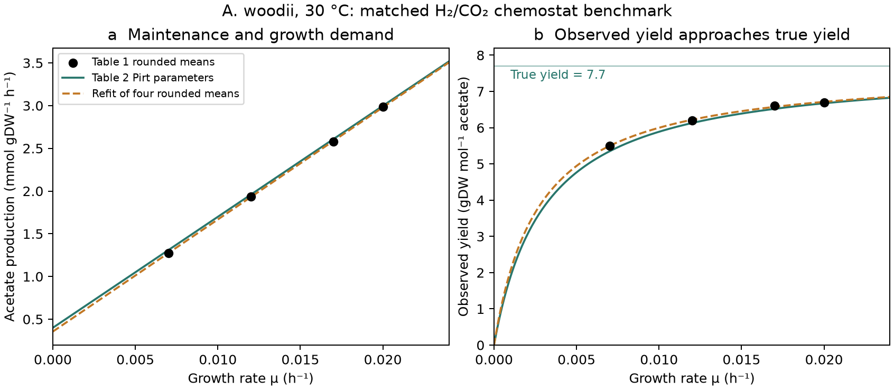

# A matched acetogen growth and maintenance benchmark

**Status: matched benchmark; approximate agreement with four rounded means.**
This independent benchmark reconstructs the H₂/CO₂ chemostat growth balance
of *Acetobacterium woodii* DSM1030 at 30 °C and pH 7 from
[Peters, Janssen & Conrad (1998)](https://doi.org/10.1111/j.1574-6941.1998.tb00516.x).
It establishes a matched growth–yield–maintenance reference for stage 3;
transferring it to cold *A. bakii* remains an assumption.

Code: [`woodii1998.py`](../../src/terra_prisca/haze_world/woodii1998.py).
The recovered observations are in
[`peters1998_chemostat.csv`](evidence/peters1998_chemostat.csv); source
identity and access are recorded with the
[growth-parameter evidence](evidence/growth-parameters.md). Third-party
source material remains in ignored local storage.

```sh
uv run python -m terra_prisca.haze_world.woodii1998
uv run pytest tests/test_woodii1998.py
```



## Balance and rate bases

At steady chemostat growth, μ equals dilution. The Pirt balance is

    q_ac = μ / Y_ac,true + m_ac,
    Y_ac,observed = μ / q_ac.

Here q_ac is **acetate production**, in mol acetate gDW⁻¹ h⁻¹; Y_ac is
gDW per mol acetate produced; and m_ac is the non-growth acetate-production
intercept. Maintenance is substrate expenditure, not a population death rate.

| Quantity | Source or derivation | Value |
|---|---|---:|
| True acetate-basis yield | Reported Table 2, H₂ column | 7.7 gDW mol⁻¹ acetate |
| Acetate maintenance | Reported Table 2, H₂ column | 0.40 mmol acetate gDW⁻¹ h⁻¹ |
| True total-H₂ yield | Reported Table 2, H₂ column | **1.7 gDW mol⁻¹ H₂** |
| Maximum growth | Reported Table 2, H₂ column | 0.024 h⁻¹ |
| H₂ maintenance | Derived as 4 m_ac | **1.60 mmol H₂ gDW⁻¹ h⁻¹** |
| H₂ reference uptake | Inferred as μ_max / 1.7 + m_H₂ | **15.717647 mmol H₂ gDW⁻¹ h⁻¹** |

The last row is an **inferred reference scale**, not a directly measured
maximum uptake. Using it as a saturating capacity in the later two-guild
model is an explicit closure. No uptake saturation curve is recovered here.

The source assumes biomass assimilation equivalent to a = 0.0206 mol
acetate per gDW. Including it gives a second, separately labelled conversion:

    q_H₂ = 4 q_ac + 4 a μ,
    Y_H₂,converted = 1 / [4 (1 / Y_ac,true + a)] = 1.661459 gDW mol⁻¹ H₂.

This reconciles the two source yield bases to their reported precision.
Dividing 7.7 by four alone omits assimilation. The converted yield would
give a reference uptake of **16.045132 mmol H₂ gDW⁻¹ h⁻¹**; it does not
silently replace the reported **1.7** yield or the **15.717647** rate scale.

## Agreement with the recovered observations

An equal-weight least-squares fit of q_ac = μ/Y_ac,observed against μ uses
four rounded Table 1 means. It gives true yield **7.621915 gDW/mol acetate**
and maintenance **0.355452 mmol acetate gDW⁻¹ h⁻¹**, respectively 1.0% and
11.1% below Table 2. This is a reproducible fit to the recovered means;
the original unrounded fit and its uncertainty are unavailable.

| μ (h⁻¹) | Reported observed yield | Table 2 prediction | Prediction − reported |
|---:|---:|---:|---:|
| 0.007 | 5.5 | 5.347222 | −0.152778 |
| 0.012 | 6.2 | 6.127321 | −0.072679 |
| 0.017 | 6.6 | 6.518924 | −0.081076 |
| 0.020 | 6.7 | 6.672444 | −0.027556 |

All yields in this table are gDW/mol acetate. The Table 2 observed-yield
RMSE is **0.094810 gDW/mol acetate**. Its acetate-production RMSE is
**0.027512 mmol gDW⁻¹ h⁻¹**, compared with **0.006452** for the refit.
Differences between yields derived from rounded concentrations and the
separately rounded reported yield are retained in the output, not reconciled
by altering the source observations.

The machine-readable [fidelity table](figures/woodii1998/fidelity.csv) retains
the measured residual H₂ values and every prediction residual. The
[status file](figures/woodii1998/status.json) separates reported quantities,
derived conversions, the inferred reference rate and the rounded-means fit,
and records the input CSV hash. Tests check mass-balance equivalence,
the two distinct H₂ rate scales, least-squares residuals, and maintenance
limits. The generated figure was visually inspected.

Residual H₂ is source information here. These four points are not used to
force a Monod affinity or cessation-pressure fit, and they do not validate a
thermal extrapolation or a cold-community competition model.
