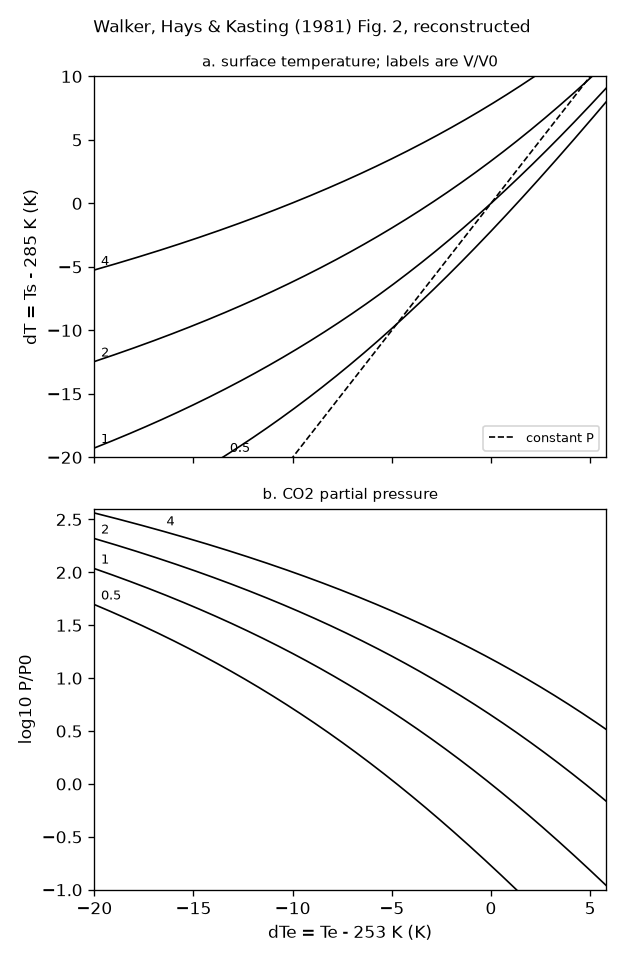
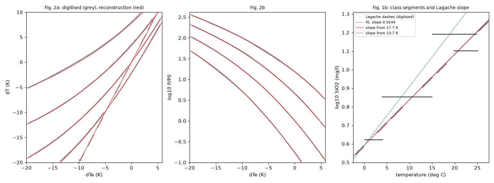

# Walker, Hays & Kasting (1981): the silicate-weathering thermostat

The first quantitative statement of the abiotic thermostat. Silicate weathering
removes CO₂ faster when the planet is warmer, so a fainter Sun is partly offset
by more CO₂. Reconstructed faithfully here and scored against the printed paper.
Cross-review is by Codex on board thread 170; its findings WHK-R1 to R6 are applied.

## Source

Walker, J. C. G., Hays, P. B. & Kasting, J. F. (1981). A negative feedback
mechanism for the long-term stabilization of Earth's surface temperature.
*J. Geophys. Res.* 86(C10), 9776–9782.
[doi:10.1029/JC086iC10p09776](https://doi.org/10.1029/JC086iC10p09776)
(authors, title, volume, issue, pages and date 1981-10-20 checked against
Crossref on 15 November 2026).

- Wiley/AGU blocked automated download. With Barry's approval, we used the
  AGU/Wiley publisher PDF posted on a University of Chicago course page. Its
  metadata carries the DOI, and it holds 7 pages of 300-ppi bilevel scans with
  an OCR layer. SHA-256
  `e8efc69a42ad77e71644e32e512ec3a8225090b50ed7050597b548f8337a849a`.
- The article is under Wiley's standard terms (Crossref licence field:
  [Wiley terms and conditions](http://onlinelibrary.wiley.com/termsAndConditions#vor)).
  It is copyrighted and is not redistributed. The overlay figure plots values
  digitised from the scan, never the scan itself.
- Place the PDF at `local/sources/walker_hays_kasting/whk1981.pdf` to rerun the
  fidelity check. The scripts refuse any file with a different hash.
- Table 1 (Meybeck's rates, 13 numbers) was transcribed by hand from the scan at
  native resolution.
- Owen, Cess & Ramanathan (1979), *Nature* 277, 640–642,
  [doi:10.1038/277640a0](https://doi.org/10.1038/277640a0), supplied by Barry on
  16 November 2026 for the eq. (5) check. Its Table 1 (nine rows) is
  transcribed in [`owen1979.py`](../../src/terra_prisca/walker_hays_kasting/owen1979.py).

## Code

All in [`src/terra_prisca/walker_hays_kasting/`](../../src/terra_prisca/walker_hays_kasting/):
- [`whk1981.py`](../../src/terra_prisca/walker_hays_kasting/whk1981.py): the model, its readings and controls;
- [`figures_whk1981.py`](../../src/terra_prisca/walker_hays_kasting/figures_whk1981.py): the reconstructed Fig. 2 and its table;
- [`scan_whk1981.py`](../../src/terra_prisca/walker_hays_kasting/scan_whk1981.py): calibrates Figs 1 and 2 and traces their curves, segments and dashes;
- [`fidelity_whk1981.py`](../../src/terra_prisca/walker_hays_kasting/fidelity_whk1981.py): every score, number and claim check.

The tracing reuses
[`budyko_sellers/digitise.py`](../../src/terra_prisca/budyko_sellers/digitise.py)
unchanged, by import. Tests are in [`tests/test_whk1981.py`](../../tests/test_whk1981.py).

```bash
uv run python -m terra_prisca.walker_hays_kasting.figures_whk1981
uv run python -m terra_prisca.walker_hays_kasting.fidelity_whk1981 local/sources/walker_hays_kasting/whk1981.pdf
uv run pytest tests/test_whk1981.py
```

## The model as published

The model has two algebraic balances, written as departures from today:
T_s = 285 K, T_e = 253 K, CO₂ partial pressure P₀ and volcanic and metamorphic
release V₀. It has no time dependence.

| Eq. | Content |
|---|---|
| (1) | Weathering W/W₀ = (P/P₀)^0.3 exp(ΔT/13.7) |
| (2) | W = V solved for P: P/P₀ = (V/V₀)^(10/3) exp(−ΔT/4.11) |
| (3) | T_s = T_e + T_g(H₂O) + T_g(CO₂), ignoring band overlap |
| (4) | T_g(H₂O) = 29.7 + 0.5(T_s − 285) K |
| (5) | T_g(CO₂) = 2.3(P/P₀)^0.364 K |
| (6) | ΔT = 2ΔT_e + 4.6(P/P₀)^0.364 − 4.6 |

ΔT = T_s − 285 K and ΔT_e = T_e − 253 K. The constants in eq. (1) combine
three dependences:
- P^0.3, from Lagache's feldspar experiments;
- exp(−4600/T), from the same experiments, about exp(ΔT/17.7) near 285 K;
- runoff ∝ exp(ΔT/60), from Manabe and colleagues.

1/17.7 + 1/60 gives the 13.7 K. Eq. (4) rests on Rodgers & Walshaw (1966) and
eq. (5) on Owen et al. (1979). The external factors T_e and V fix ΔT and P.

**Solution.** Substituting eq. (2) into eq. (6) gives one equation in ΔT. Its
left side minus its right side is strictly increasing, so the root is unique.
It is found by Brent's method to 10⁻¹² K. The implicit derivative gives the
sensitivity dΔT/dΔT_e = 2 / [1 + 4.6·0.364·(P/P₀)^0.364 / 4.11]. That is 2
without feedback, and the feedback divides it down.

## Interpretive choices

| Choice | What we did | Why |
|---|---|---|
| Constants in eqs (2) and (6) | As printed: 4.11, 10/3, 2, 4.6, 0.364 | The figure was presumably computed from the printed equations. Unrounded constants (13.64 K from 285²/4600 and 60 K; 4.093 K) tie with the printed ones on every curve: RMSE within 0.02 K and 0.003 decades. The data cannot tell them apart, and no result depends on the choice |
| "LOG P/P₀" in Fig. 2b | log₁₀ | The natural-log reading misses every curve by 1.2–2.4 in ln units, against 0.005–0.009 decades for log₁₀ |
| Present T_e and T_s | 253 K and 285 K, as stated | Eq. (3) then closes exactly today: 253 + 29.7 + 2.3 = 285 K |
| ΔT_e for a fainter Sun | T_e ∝ L^¼ at fixed albedo, as stated (p. 9780) | A 25% fainter Sun gives −17.56 K; the text rounds this to −18 K. We report both |
| Fig. 2 calibration | Affine map fitted to the inner ticks and the labelled frame lines (10 and −20 K in panel a; −1 in panel b; −20 K on the left frame) | The drafted ticks and frame lines disagree by 2–5 px (0.1–0.2 K), and the affine fit has a relative residual of 0.43%. With ticks only, the faithful RMSEs rise from 0.11–0.22 to 0.17–0.28 K, the panel-a offsets grow from −0.08…−0.21 to −0.14…−0.27 K, and panel b changes by at most 0.004 decades. No conclusion depends on the choice |
| Band removed around the broken line | ±6 px | It must cover the dash's stroke where it crosses a solid curve. With ±4 or ±9 px, the RMSEs of V/V₀ = 2, 1 and 0.5 move by at most 0.012 K, with 14–23 more or fewer columns |
| Fig. 1 calibration | One tick (1.0) and the bottom frame labelled 0.5 for the y axis; ticks every 200 (panel a) and every 5 °C (panel b) for x | That is all the figure carries, so its y scale has no redundancy. The x ticks agree top to bottom within 1.5 px |
| Fig. 1a runoff units | mm yr⁻¹, although the axis says cm yr⁻¹ | The printed segments end at 29, 117, 274–292 and 621–639 on the axis. Those are Table 1's class limits of 30, 120, 280 and 630 mm yr⁻¹. Read as mm, the concentrations and Table 1's rates agree (below). Read as cm, every implied runoff is 10× outside its class |

## Results



- **Faint young Sun.** A 25% fainter Sun (ΔT_e = −17.56 K, or −18 K as the
  paper rounds it) gives ΔT = −17.7 K at today's CO₂ release (−17.98 K at
  −18 K). That is T_s = 267.3 K. P/P₀ rises to 74, or 79.5 at the
  paper's rounded −18 K (the text gives no value).
- **Without the feedback,** the same Sun gives ΔT = 2ΔT_e = −35 K.
- **Holding today's temperature** under that Sun would take P/P₀ = 373 in
  eq. (6), or 397 at the paper's rounded ΔT_e = −18 K.
- **The feedback weakens toward the present.** At V/V₀ = 1, dΔT/dΔT_e is 0.62
  at ΔT_e = −20 K, 1.42 today and 1.70 at +6 K, against 2 without feedback.
  The weakening comes from the CO₂ greenhouse term flattening as P falls.

Curve table: [`figures/whk1981_fig2.csv`](figures/whk1981_fig2.csv).

## Fidelity against the published paper

**Method.**
- **Fig. 2 (page 5).** Each panel is calibrated by an affine fit to its ticks
  and labelled frame lines. Each of the eight solid curves is the connected
  stroke containing a seed pixel. Seeds were read from two pixel columns of
  the scan, never from the model.
- **The broken constant-P line** touches three of the panel-a curves. It is read
  as its seven isolated dashes, and a straight line is fitted to them. A band
  of ±6 px around that line is then removed from the solid curves, which takes
  out 155, 342 and 330 crossing pixels from V/V₀ = 2, 1 and 0.5.
- **One tick** that the V/V₀ = 2 curve runs into (panel b, log P = 0) is
  clipped.
- **Every trace was checked by eye** on a native-resolution overlay of the scan.
  The test suite checks trace identity: each trace lies at least 5× nearer its
  own model curve than any other.
- **Scores.**
  - Column error: in each pixel column where the printed curve is
    single-valued, its value against the model evaluated directly at the same
    ΔT_e. No column is interpolated or extrapolated from a model grid.
  - Two-way pixel distance, in
    [`fidelity/whk1981_chamfer.csv`](fidelity/whk1981_chamfer.csv).
    - Ink to model is measured from every traced pixel to the full model curve
      inside the plot box.
    - Model to ink is measured from model samples every 0.01 K of ΔT_e (under
      0.5 px apart) to the nearest traced pixel.
    - Model samples where ink was deliberately removed have nothing to meet, so
      they are left out of model to ink and counted. These are the ±6 px band
      around the broken line (149, 202 and 205 samples for V/V₀ = 2, 1 and 0.5)
      and the clipped tick (27 samples).
    - Solid curves: model-to-ink p95 is 0.65–4.3 px and ink-to-model p95 is
      2.1–6.1 px. The worst curve is panel a, V/V₀ = 4, which carries the
      uniform 0.21 K (4.7 px) offset described below.
    - Broken line: model to ink is scored only over the rows its dashes span.
      It still includes the gaps between dashes and the four dashes that touch
      solid curves, which are not traced. Its 53% within 3 px therefore
      measures dash coverage, not fit. Ink to model is 92% within 3 px.
- **Fig. 1 (page 4).**
  - The class segments are read as boxes.
  - The dashed Lagache line is read as its six isolated dashes.



*Grey: values digitised from the scan. Red: this reconstruction. Right: Fig. 1b
class segments (black), the digitised Lagache dashes, and the slopes implied by
17.7 K (red) and 13.7 K (blue).*

**Faithful reading.** ΔT is in K; log P/P₀ is in decades. Bias is model minus
printed.

| Printed curve | Columns | RMSE | Median abs. | Max abs. | Bias |
|---|---|---|---|---|---|
| Fig. 2a, V/V₀ = 4 | 472 | 0.22 K | 0.22 | 0.36 | −0.21 |
| Fig. 2a, V/V₀ = 2 | 522 | 0.15 K | 0.12 | 0.37 | −0.11 |
| Fig. 2a, V/V₀ = 1 | 513 | 0.11 K | 0.11 | 0.24 | −0.08 |
| Fig. 2a, V/V₀ = 0.5 | 379 | 0.21 K | 0.21 | 0.38 | −0.20 |
| Fig. 2a, constant P (dashes) | 163 | 0.13 K | 0.07 | 0.54 | −0.04 |
| Fig. 2b, V/V₀ = 4 | 553 | 0.009 | 0.005 | 0.021 | +0.005 |
| Fig. 2b, V/V₀ = 2 | 549 | 0.008 | 0.007 | 0.018 | −0.007 |
| Fig. 2b, V/V₀ = 1 | 553 | 0.005 | 0.003 | 0.018 | −0.003 |
| Fig. 2b, V/V₀ = 0.5 | 457 | 0.009 | 0.007 | 0.022 | +0.006 |

On the scan, 1 K is 22 px in panel a, and 0.01 decade is 2.2 px in panel b.
- **Panel b agrees to within 2 px RMS;** its worst column is 0.022 decades (5 px).
- **Panel a's printed curves sit 0.08–0.21 K (2–5 px) above the model,**
  mostly as a uniform offset (bias −0.08 to −0.21 K). That is the size of the disagreement between the
  drafted ticks and frame lines, so it does not distinguish a drafting offset
  from a calibration offset.
- **The fitted broken line has slope 2.016 and intercept +0.10 K,** against 2
  and 0 for ΔT = 2ΔT_e.

**Controls and rejected readings.** RMSE on each curve the reading changes, in
K for panel a and in decades for panel b (ln units for the natural-log
reading). Full table:
[`fidelity/whk1981_fidelity.csv`](fidelity/whk1981_fidelity.csv), including
each alternative's faithful RMSE on the same columns.

| Reading | 2a: 4 | 2 | 1 | 0.5 | const. P | 2b: 4 | 2 | 1 | 0.5 |
|---|---|---|---|---|---|---|---|---|---|
| **Faithful** | **0.22** | **0.15** | **0.11** | **0.21** | **0.13** | **0.009** | **0.008** | **0.005** | **0.009** |
| Unrounded constants (13.64, 4.093 K) | 0.23 | 0.15 | 0.11 | 0.19 | — | 0.009 | 0.008 | 0.004 | 0.012 |
| No runoff term (17.7 K) | 0.65 | 1.19 | 1.74 | 1.30 | — | 0.081 | 0.084 | 0.13 | 0.22 |
| Runoff following precipitation (7.85 K) | 1.40 | 2.26 | 3.56 | 2.76 | — | 0.20 | 0.18 | 0.26 | 0.43 |
| No water-vapour amplification | 1.35 | 1.93 | 3.55 | 4.32 | 5.62 | 0.20 | 0.22 | 0.37 | 0.61 |
| Panel b read as natural log | — | — | — | — | — | 2.36 | 1.91 | 1.50 | 1.21 |
| Null: no feedback (P = P₀) | 20.97 | 14.38 | 9.76 | 3.38 | — | 1.80 | 1.48 | 1.16 | 0.92 |
| Null: perfect thermostat (W independent of P) | 18.07 | 14.30 | 11.95\* | 6.11\* | — | 0.70 | 0.66 | 0.83\* | 0.85\* |
| Null: no change (ΔT = 0, P = P₀) | 4.43 | 6.93 | 11.35 | 11.22 | 11.19 | 1.80 | 1.48 | 1.16 | 0.92 |

\* The thermostat has no equilibrium where eq. (6) would need P ≤ 0. There
it returns neither a temperature nor a pressure. Those columns are excluded
from both panels and counted:
- panel a: 68 for V/V₀ = 1 and 174 for V/V₀ = 0.5;
- panel b: 71 and 80.

The faithful RMSE on the remaining columns is 0.10 and 0.23 K, and 0.004 and
0.010 decades.

Every null and every rejected reading fails every curve it changes, by
2.9–320× the faithful RMSE. The unrounded constants tie.

The calibration point needs saying separately. At ΔT_e = 0 and V/V₀ = 1, the
model returns ΔT = 0 and P = P₀ by construction, as does the "no change" null.
That point tests nothing. The test lies in the other three V/V₀ curves, the
curvature of all four, and panel b.

**Fig. 1 and Table 1.**
- **Lagache line.** The dashed line in Fig. 1b has slope 0.02441 decades
  per °C. That is an e-folding of 17.79 K, against the 17.7 K stated, a
  difference of 0.5%. The combined 13.7 K would give 0.0317, and a natural-log
  axis 0.0565. The line therefore shows Lagache's direct temperature dependence
  alone on a log₁₀ axis, as the caption says.
- **Implied runoff.** Table 1's rates divided by Fig. 1a's concentrations
  give a runoff for each class (1000 × rate / mg l⁻¹, in mm yr⁻¹):
  [`fidelity/whk1981_fig1_implied_runoff.csv`](fidelity/whk1981_fig1_implied_runoff.csv).
  - **Condition.** The quotient is a runoff only if both class means come from
    the same rivers with the same weights, and the concentration mean is
    arithmetic. Under that condition it is a weighted mean of the rivers'
    runoffs and must fall inside the class. WHK do not state how Meybeck
    averaged.
  - **Pairing.** Two tropical >630 mm yr⁻¹ cells (plains 11.4, mountains 16.4)
    face two printed tropical >630 levels that the paper does not label. Both
    one-to-one pairings are reported, as pairings A and B.
  - **Result.** Under either pairing, 12 of the 13 cells fall inside their
    class. The exception is under What stays open.
- **Fig. 1b's class concentrations** (0.62, 0.85, 1.19 and 1.10 in log₁₀ mg l⁻¹)
  lie within the spread of the corresponding Fig. 1a segments:
  [`fidelity/whk1981_fig1_segments.csv`](fidelity/whk1981_fig1_segments.csv).

**Stated numbers** (from [`fidelity/whk1981_numbers.csv`](fidelity/whk1981_numbers.csv)):

| Quantity | Text | Reconstruction |
|---|---|---|
| Direct e-folding, T²/4600 at 285 K | 17.7 K | 17.66 K |
| Combined e-folding with runoff (60 K) | 13.7 K | 13.67 K |
| 0.3 × 13.7; 1/0.3 (eq. 2) | 4.11 K; 10/3 | 4.110 K; 3.333 |
| 1/(1 − 0.5); 2.3/(1 − 0.5) (eq. 6) | 2; 4.6 | 2; 4.6 |
| Eq. (3) today | 285 K | 285.0 K |
| Warming for doubled CO₂ | 1.3 K | 1.32 K |
| ΔT_e for a 25% fainter Sun | −18 K | −17.56 K |
| ΔT at ΔT_e = −18 K, V/V₀ = 1 | −18 K | −17.98 K |
| T_s at that point | **265 K** | **267.0 K** |
| Reduction of the temperature change by the feedback, V/V₀ = 1 | "about a half" | 0.500 at ΔT_e = −18; 0.58 at −10; 0.68 at −2; locally 0.71 today |
| 1 bar of CO₂ at 3.3(±1.1) × 10¹⁴ g yr⁻¹ | 20 Myr | 15.8 Myr (11.8–23.6) |
| Fluid carbon doubled in 400 kyr | — | implies 1.3 × 10²⁰ g CO₂ (3.6 × 10¹⁹ g C) |

**Claims about the model,** each tested as an inequality on a grid from
ΔT_e = −20 to +6 K
([`fidelity/whk1981_claims.csv`](fidelity/whk1981_claims.csv)):
- more release gives more CO₂ and stronger feedback;
- the curvature reflects weaker feedback at low P;
- a weaker pressure dependence of weathering gives stronger feedback;
- a stronger runoff dependence gives stronger buffering;
- T_e and V determine T and P uniquely.

All hold.

## What holds

- **Fig. 2 is reproduced from the printed equations alone,** with nothing fitted.
  Panel b agrees to 0.005–0.009 decades RMS (at most 2 px).
  Panel a agrees to 0.11–0.22 K, with every printed curve 2–5 px above the model.
  That offset matches the disagreement between the figure's own ticks and frame.
- **Every derived constant follows from its stated ingredients:**
  - 17.7 K from exp(−4600/T);
  - 13.7 K with runoff;
  - 4.11 and 10/3 in eq. (2);
  - 2 and 4.6 in eq. (6) from eqs (3)–(5), which close exactly today;
  - 1.3 K per doubling of CO₂.
- **The Fig. 1b dashed line shows the 17.7 K slope** on a log₁₀ axis, to 0.5%.
- **Fig. 1a and Table 1 are compatible in 12 of 13 cells** once the runoff
  axis is read in mm yr⁻¹. This assumes matched arithmetic class averages, and
  holds under either pairing of the two tropical >630 levels.
- **All five qualitative claims about the model hold.**
- **"About a half" holds where the paper uses it,** at the faint-young-Sun end
  (0.500 at ΔT_e = −18 K). Nearer the present the feedback removes less: 0.71
  of the no-feedback slope today.
- **Eq. (5) is approximately consistent with Owen, Cess & Ramanathan (1979,
  Table 1)** ([`owen1979.py`](../../src/terra_prisca/walker_hays_kasting/owen1979.py);
  `fidelity/whk1981_eq5_owen_*.csv`). This was checked after the merge, once
  the source was in hand.
  - Owen et al.'s present row is 290 K, not 285 K. WHK's subtraction applied
    to the printed temperatures leaves T_g(CO₂) = 4.8 K today, not 2.3 K.
  - An inferred procedure comes close to the printed law. Lower Owen et al.'s
    temperatures by 5 K, so that today is 285 K, and pass a power law through
    today and their 4.25 Gyr row: the result is 2.3(P/P₀)^0.367, against the
    printed 0.364. The table's printed precision (temperatures to 1 K) admits
    0.364.
  - WHK state neither the normalisation nor which rows they fitted, so their
    actual procedure remains undocumented. Without the shift, or without the
    weak CO₂ bands, the exponents are 0.27 and 0.28.
  - The usual power-law fit, least squares in log T_g on log P, gives
    2.74(P/P₀)^0.360 from all nine shifted rows, against the printed 0.364, so
    the exponent does not need a choice of rows (Gemini 4 Carbon's review). Least
    squares in kelvin would give 3.38(P/P₀)^0.314, because the 310 K row
    dominates the squared residuals. Eq. (5) falls up to 2.7 K below Owen
    et al.'s intermediate rows (3.0–2.5 Gyr), which eq. (6)'s factor of 2
    makes 5.3 K in T_s.
  - Keeping Owen et al.'s printed temperatures and taking T_e(0) = 255.5 K
    gives the same fits (0.368 through the end rows, 0.360 in log-log). Owen
    et al. print S₀ = 1,360 W m⁻² but not their albedo, and 255.5 K is the
    value that leaves T_g(CO₂) = 2.3 K today. It is the same one-parameter
    offset as the 5 K shift (2.5 K in T_g either way), so it does not add
    support.
  - WHK's summary, that Owen et al. found CO₂ "up to 1000 times" today's, matches
    Owen et al.'s 4.25 Gyr row: P/P₀ = 969 at 76% of today's sunlight
    (ΔT_e = −16.5 K), with T_s = 310 K. That is a warm state, not a
    constant-temperature requirement. Eq. (6) needs P/P₀ = 320 to hold today's
    temperature at that ΔT_e, and gives ΔT = +18.7 K at P/P₀ = 969.
- **The 1-bar-in-20-Myr figure** lies within the range implied by Holland's
  rate (11.8–23.6 Myr). The central rate gives 15.8 Myr.

## What the source got wrong or left inconsistent

- **T = 265 K.** The text gives ΔT_e = −18 K, ΔT = −18 K "or T = 265 K".
  With ΔT defined in the same paragraph as T_s − 285 K, −18 K gives 267 K, and
  eq. (6) gives 267.0 K. A temperature of 265 K would need ΔT_e = −21.2 K, a Sun
  29.6% fainter, closer to the 30% of Sagan & Mullen (1972). That may explain
  the number, but the paper does not say.
- **Fig. 1a's runoff axis is labelled cm yr⁻¹ but is plotted in mm yr⁻¹.**
  - The segment ends fall on Table 1's mm limits.
  - Only mm makes Fig. 1a's concentrations agree with Table 1's rates.
  - 800 cm yr⁻¹ of runoff is physically implausible.
- **Table 1's temperature classes overlap** (15–25 °C for arid, >20 °C for
  tropical), as printed.

## What stays open

- **Eq. (4), T_g(H₂O) = 29.7 + 0.5(T_s − 285),** attributed to Rodgers &
  Walshaw (1966), which is not in hand.
- **The 14.1 K precipitation e-folding attributed to Sellers (1965).** At 285 K,
  Clausius–Clapeyron gives 15.2 K. 14.1 K matches it near 275 K, which suggests
  a fit over colder zonal means. The value is not used in eq. (1), and Sellers
  (1965) is not in hand.
- **An apparent inconsistency for tropical (>20 °C) rivers at 30–120 mm yr⁻¹.**
  - Table 1 gives "mixed tropical" rivers the same rate, 2.35, in both the
    30–120 and the 120–280 classes.
  - Fig. 1a draws one concentration (14.5 mg l⁻¹) across both.
  - Rate divided by concentration gives 162 mm yr⁻¹, outside 30–120.
  - This contradicts the source only if the class means are matched arithmetic
    averages over the same rivers. WHK do not say how Meybeck averaged.
  - Means from different subsets or weights, or a non-arithmetic concentration
    summary, need not obey the bound.
  - Meybeck (1979) is not in hand. Its averaging would settle whether this is
    an error, and whether it is WHK's or inherited.
- **Fig. 1 is Meybeck's data,** and the model does not depend on it beyond the
  17.7 K slope.
- **Dynamics.** The paper solves only equilibria, so it says nothing about how
  fast the thermostat acts or whether it overshoots. A time-dependent variant
  would need a fluid-carbon reservoir. The paper's own numbers imply about
  1.3 × 10²⁰ g CO₂ (doubling in 400 kyr at Holland's rate). Its response time
  would then be set by dW/dP. That variant is for later, separately named.
- **A small unassigned mark in Fig. 2a** (a 10 × 5 px dash at ΔT_e ≈ −7,
  ΔT ≈ −7.4) lies on no curve. It is probably a printing speck, and it is not
  traced.

## Variants

None yet. Coupling to Budyko–Sellers ice-albedo feedback, to Daisyworld or to
the haze-world is later research and stays out of this reconstruction.
